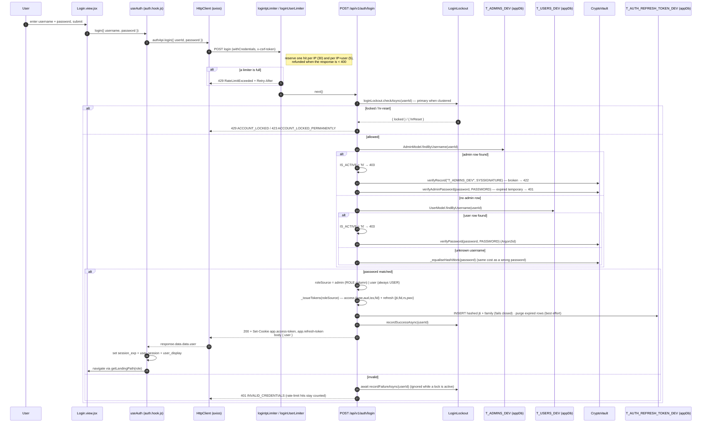
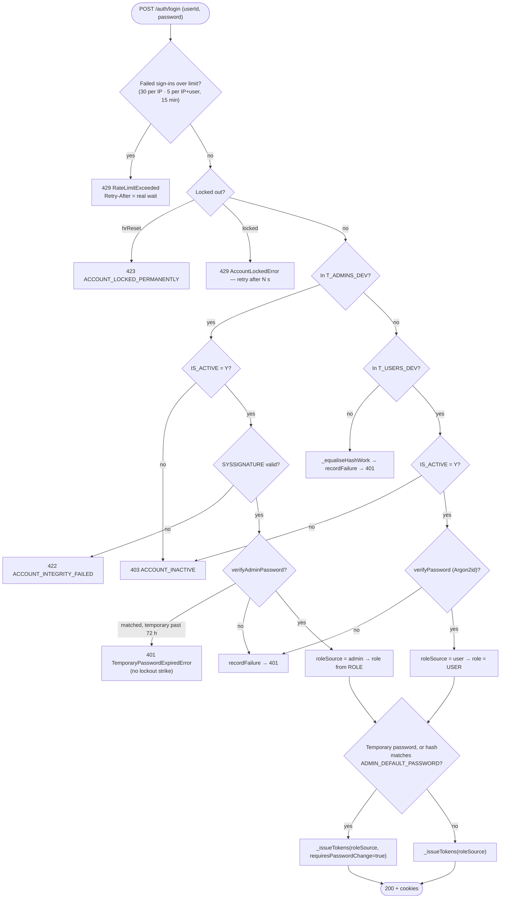
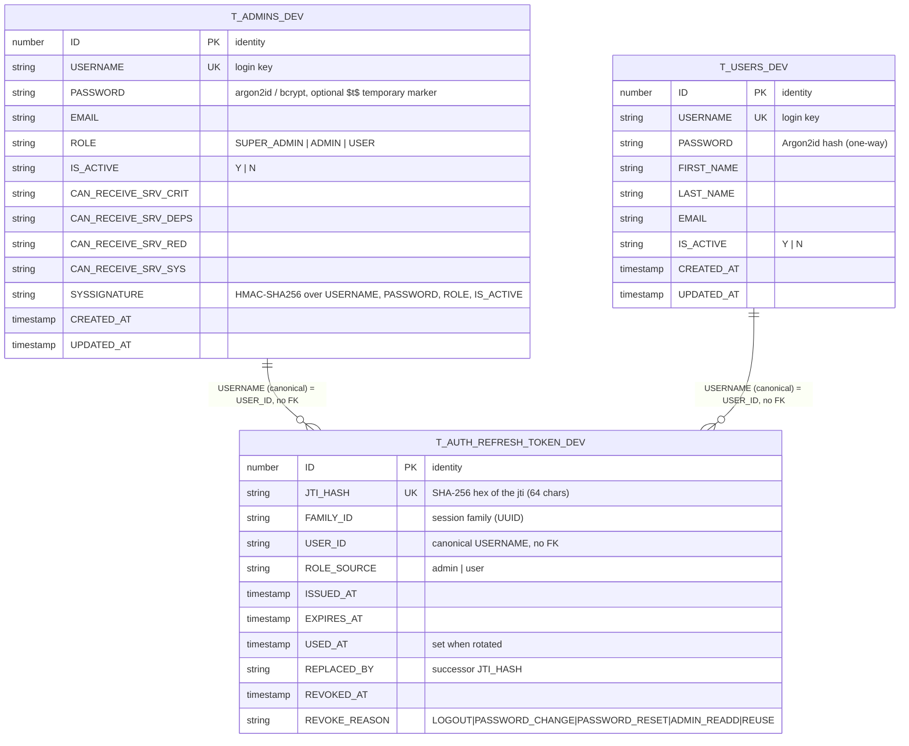
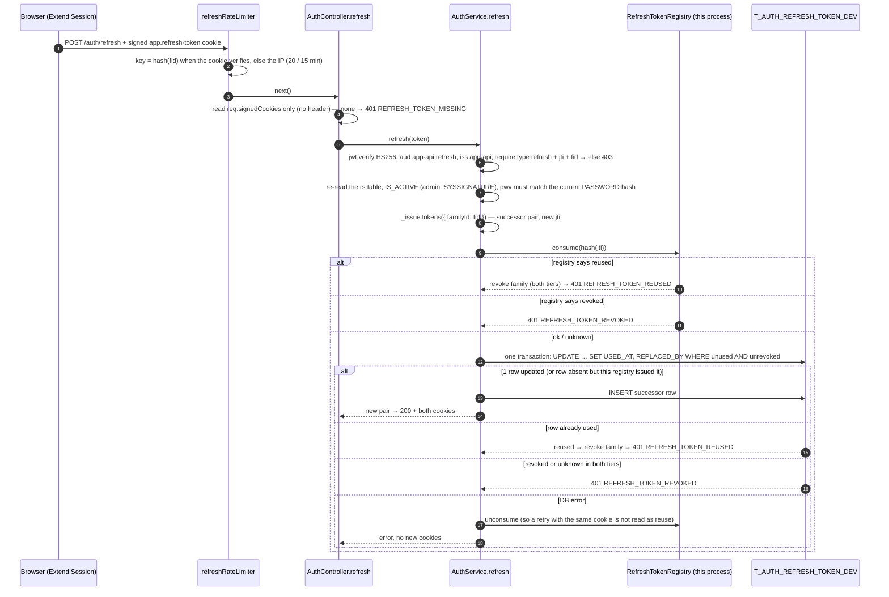

# Authentication — Technical Documentation

> **Scope:** User authentication (login, token refresh, logout, profile, change-password) for the CATHERINE template.
> **Source:** `Frontend/` (frontend) + `Backend/` (backend).
>
> **Verified 2026-10-29 against source.** Re-read `routes/auth.route.js`, `controllers/AuthControllers.js`,
> `services/AuthService.js` (`services/auth.service.js` is a one-line re-export kept for older requires),
> `services/RefreshTokenService.js`, `models/{admin,user,auth.refresh.token}.model.js`,
> `constants/{authTokens,authRateLimits,clusterIpc}.js`, `middleware/authentication/*`,
> `middleware/security/authRateLimiters.js`, `utils/auth/*`, `sql/01_schema.sql` and, on the frontend,
> `features/auth/*`, `middleware/HttpClient.js`, `middleware/authentication/AuthMiddleware.js` and
> `components/forms/Input.jsx`. No test was run for this revision; see §8 for what each answer rests on.
>
> **Key facts.** Two credential tables, checked admin-first: `T_ADMINS_DEV` (`AdminModel`, roles
> `SUPER_ADMIN` / `ADMIN` / `USER`, tamper-evident `SYSSIGNATURE`) and `T_USERS_DEV` (`UserModel`, always
> `USER`). Both read through the `appDb` pool; under `DEMO_MODE=true` every model uses the in-memory demo store
> and no Oracle connection is opened. Tokens: access `type:"access"`, `aud:"app-api:access"`, refresh
> `type:"refresh"`, `aud:"app-api:refresh"`, both `iss:"app-api"`, HS256 with `JWT_SECRET`. Cookies:
> `app.access-token` (30 min default) and `app.refresh-token` (7 days, path `/api/v1/auth/refresh`). Ledger:
> `T_AUTH_REFRESH_TOKEN_DEV` (SHA-256 of each `jti` only).
>
> **Rendering note:** The `mermaid` blocks below render in GitHub, GitLab, Obsidian, and VS Code preview.
> They do **not** render in a plain Markdown→PDF path (e.g. Chrome "print to PDF") — there they print as
> code. If you need a PDF with pictures, pre-render the diagrams with `mermaid-cli`
> (`npx @mermaid-js/mermaid-cli -i diagram.mmd -o diagram.svg`) and embed the SVG/PNG, or view in a
> Mermaid-aware renderer. Ask and I'll generate the images.

---

## 1. Overview

Authentication proves _who_ a caller is and hands them a short-lived session so every later request can be
trusted without re-entering a password. A user submits `userId` + `password`; the backend checks the
credential against **two** tables in priority order — the admin table (`T_ADMINS_DEV`, one-way hash plus a
tamper-evident row signature) first, then the user table (`T_USERS_DEV`, Argon2id hash) — and on success
mints a signed **JWT access token** and a **refresh token**, both delivered as HTTP-only signed cookies so
the browser carries them automatically and JavaScript can never read them. The frontend holds no token; it
only keeps a non-PII "a session may exist" flag and asks `GET /auth/me` to confirm. Protected routes verify
the access-token cookie on every call. Shortly before the access token expires, the session-warning modal
offers **Extend Session**, which spends the 7-day refresh token on a fresh pair so users aren't logged out
mid-task; an access token that has already expired is never refreshed, and the user is signed out (§2.3).

The two tokens cannot stand in for each other: the access token says `type:"access"` with its
own audience and issuer, and the refresh token is one-time. Each refresh consumes the presented token and
issues a successor in the same session family; a server-side ledger (`T_AUTH_REFRESH_TOKEN_DEV`) records every
refresh token by hash, so logging out, changing or resetting a password, or replaying an old token ends the
session for good (§2.5, §6).

**The table that matched decides the privilege.** A `T_ADMINS_DEV` match takes its role from the row's
`ROLE` column (`SUPER_ADMIN`, `ADMIN` or `USER`) with `roleSource = "admin"`. A `T_USERS_DEV` match is always
`USER` with `roleSource = "user"`. The `roleSource` is embedded in the refresh token as the `rs` claim, and a
refresh re-reads only the table named by `rs`, so a user session can never be re-issued with an admin role it
never proved (`AuthService.refresh`).

---

## 2. Flow & Architecture

### 2.1 Login round-trip (happy path + the main rejections)



This is the whole login conversation: the browser never sees a raw token — the server attaches them as
`Set-Cookie`, and the JSON body only carries the decoded `user` profile for the UI. Note the rejection
gates _before_ the password is even checked (the two rate limiters, then the lockout) and the integrity gate
(`SYSSIGNATURE`) that runs _before_ the password comparison on the admin path, so a tampered row is refused
without becoming a timing oracle. A login only succeeds once its refresh token is recorded in
`T_AUTH_REFRESH_TOKEN_DEV`: if that insert fails, no cookie is set (§6).

### 2.2 Credential-source decision logic



This shows the two code paths in `AuthService.login` (`_loginAdmin`, `_loginUser`). The admin table is
checked first, so a username present in both tables always authenticates as the admin row. The admin path is
gated by `IS_ACTIVE`, then by HMAC record integrity (`SYSSIGNATURE`), then by the password verifier; the user
path by `IS_ACTIVE`, then the Argon2id verifier. An unknown username runs one throwaway admin-hash
verification (`_equaliseHashWork`) so it costs the same as a wrong password and answers the same `401`
(CWE-208). Temporary passwords exist only on admin rows (`utils/encryption/adminTempPassword.js`).
### 2.3 Session lifecycle

```mermaid
stateDiagram-v2
    [*] --> Anonymous
    Anonymous --> Authenticated : login success (access + refresh cookies set)
    Authenticated --> NeedsPwChange : requiresPasswordChange = true
    NeedsPwChange --> Authenticated : PATCH /change-password (new tokens)
    NeedsPwChange --> Anonymous : temporary password expires (401 at refresh)
    Authenticated --> Authenticated : Extend Session → POST /auth/refresh (before expiry; old refresh token consumed)
    Authenticated --> Anonymous : access token expired (440) → sign-out + /login-timeout
    Authenticated --> Anonymous : access token without type/aud/iss (440, legacy class)
    Authenticated --> Anonymous : Extend Session refused, refresh token invalid/expired/untyped (403)
    Authenticated --> Anonymous : Extend Session refused, session revoked or token replayed (401)
    Authenticated --> Anonymous : Extend Session refused, IS_ACTIVE='N' on the account (403)
    Authenticated --> Anonymous : POST /auth/logout (cookies cleared, family revoked)
    Authenticated --> Anonymous : session ended elsewhere - sign-out, password change or reset (440 SessionRevokedError on the next request)
```



The access token is short-lived. Before it expires, `useSessionWarning` offers **Extend Session**, which
exchanges the refresh token (7-day, scoped to `/api/v1/auth/refresh`) for a fresh pair. A `440` is never
refreshed or replayed: `HttpClient` signs out, clears the CSRF token and navigates to `/login-timeout` (§5).
Logout and a failed Extend Session both drop the user back to Anonymous. A refresh re-reads the row named by
the `rs` claim; if its `IS_ACTIVE` has been set to `'N'` since login, the refresh is rejected with
`403 ACCOUNT_INACTIVE`, so deactivating an account ends the session on the next token cycle, not just on
re-login.

A refresh can also be refused with `401` because the session was ended elsewhere: the user logged out, their
password was changed or reset (every session of the account), their admin account was re-added, or the
presented refresh token had already been used (reuse revokes the whole family). The access token of an ended
session is refused too, on the very next request, with `440 SessionRevokedError` (the UI ends the session and
shows `/login-timeout` with "Your session has ended"); an open live stream of that session is closed (§6, §7).

**NeedsPwChange is enforced on the server.** A token carrying
`requiresPasswordChange: true` is refused by `AuthMiddleware.authenticate` with 403
`PasswordChangeRequiredError` on every route except the four that use
`authenticatePendingPasswordChange`: `POST /auth/logout`, `GET /auth/me`, `PATCH /auth/change-password`
and `POST /csrf/refresh` (change-password is a CSRF-protected PATCH, so the restricted session must be
able to refresh its CSRF token). Which routes admit it is fixed where each route is defined, never read
from the request path (CWE-807). The frontend redirect to `/auth/change-password` is a convenience on top.

### 2.4 Data model touched by auth



All three tables live behind the `appDb` pool (`APP_DB_*` settings); DDL is in `Backend/sql/01_schema.sql`
(and `04_platform_tables.sql` for the ledger on an existing schema). `USERNAME` is the login key in both
account tables; the numeric `ID` travels in the token as `id` and is what other tables reference (for example
alert acknowledgements). Under `DEMO_MODE=true` all three are replaced by the in-memory demo store
(`models/demo/demoStore.js`).

`T_AUTH_REFRESH_TOKEN_DEV` is the refresh-token ledger. It holds the SHA-256 of each refresh token's `jti`,
never the token or the `jti` itself, and has no foreign key: a row describes a session, not an account.
`CHK_TART_REVOKE_PAIR` lists exactly the application's revoke reasons. It is deliberately left out of
`purgeTables.js`: wiping it would un-revoke every ended session still inside its access-token lifetime.

### 2.5 Refresh rotation and revocation



Two tiers decide whether a refresh token may be used. The per-process `RefreshTokenRegistry` can only veto
(reused or revoked); the database row is the authority across workers, because its conditional `UPDATE`
lets exactly one caller consume a token. The registry may accept on its own only when the database has no
row and this process issued the token — in production the insert is awaited at issue time, so the row
always exists; the rule exists for the database-free test pools and must not be "tightened". A successor is
inserted only on an `ok` outcome. Reuse has no grace window: a double-click racing two tabs ends the
session and forces a fresh sign-in (accepted by the owner).

---

## 3. Frontend implementation

The frontend follows the project's three-layer rule — `*.api.js` (HTTP only) → `*.hook.js` (logic/state) →
`*.view.jsx` (presentation). Tokens live in HTTP-only cookies the browser manages; React state holds only
a non-PII session hint.

| File                                                                                                                                          | Responsibility                                                                                                                                                                                                                                                                                                                                                                                                             |
| --------------------------------------------------------------------------------------------------------------------------------------------- | -------------------------------------------------------------------------------------------------------------------------------------------------------------------------------------------------------------------------------------------------------------------------------------------------------------------------------------------------------------------------------------------------------------------------- |
| [Login.view.jsx](Frontend/src/features/auth/Login.view.jsx)                                                                                   | Login form (Aumovio components), shake-on-error animation, rate-limit countdown, lockout / integrity alerts. Presentation only.                                                                                                                                                                                                                                                                                            |
| [auth.hook.js](Frontend/src/features/auth/auth.hook.js)                                                                                       | `useAuth()` — `login`/`logout`, maps form `username`→`userId`, persists `session_exp` + `user_session` + `user_display`, handles 422/429/423 outcomes, routes to change-password when required. Includes a `submitInFlightRef` re-entrancy guard that prevents double-submission — the ref is only unlocked on failure, not in `finally`, so a successful `navigate()` can't race with a queued second click. |
| [auth.api.js](Frontend/src/features/auth/auth.api.js)                                                                                         | Thin wrappers: `login`, `logout`, `refresh`, `me` — all via `HttpClient`. No state, no React.                                                                                                                                                                                                                                                                                                                              |
| [roleRedirect.js](Frontend/src/features/auth/roleRedirect.js)                                                                                 | `ROLE_LANDING_PATHS` map and `getLandingPath(role)`. Every role (`USER`, `ADMIN`, `SUPER_ADMIN`) lands on `/dashboard`; an unknown role falls back to the `USER` path. A project points each role at its own page here. |
| [signedInDestination.js](Frontend/src/features/auth/signedInDestination.js)                                                                   | `hasSessionHint()` / `resolveSignedInDestination()` — a signed-in user who opens the sign-in page goes back to the last page they used (`utils/lastLocation.js`, per tab and per user) or else to the role landing page. |
| [changePassword.hook.js](Frontend/src/features/auth/changePassword.hook.js)                                                                   | `useChangePassword()` — form state, client validation (match, new≠current, strength), calls `PATCH auth/change-password`, clears auth cache on success.                                                                                                                                                                                                                                                                    |
| [ChangePassword.view.jsx](Frontend/src/features/auth/ChangePassword.view.jsx) / [Logout.view.jsx](Frontend/src/features/auth/Logout.view.jsx) | Presentation for the change-password and logout screens.                                                                                                                                                                                                                                                                                                                                                                   |
| [middleware/HttpClient.js](Frontend/src/middleware/HttpClient.js)                                                                             | The single configured Axios instance: `withCredentials:true`, `timeout: 30_000` (30 s default, per-call overrides for long-running endpoints), injects `x-csrf-token` on mutations, adds `X-Client-Username`, extracts `requestId` from error responses (`data.requestId` or `x-request-id` header), retries once on CSRF 403, hard-redirects on 440/498.                                                                  |
| [middleware/authentication/AuthMiddleware.js](Frontend/src/middleware/authentication/AuthMiddleware.js)                                       | `isAuth()` (session-hint + 5-min in-memory cache + `GET auth/me`), `authenticate()` (post-login state), `signout()` (clears client state), `consumeLastError()` (one-shot read-and-clear of the last failed `isAuth()` error payload — enables dynamic error page rendering in `ProtectedRoute`).                                                                                                                          |
| [middleware/security/CsrfMiddleware.js](Frontend/src/middleware/security/CsrfMiddleware.js)                                                   | CSRF token lifecycle — fetch/refresh/auto-rotate; token kept **in memory only**. Includes `_fetchWithTimeout()` (10 s default) to prevent CSRF initialization from hanging indefinitely if the backend accepts a TCP connection but never responds.                                                                                                                                                                        |

**Where state lives (deliberately):**

- **Access / refresh tokens** — HTTP-only signed cookies. JavaScript cannot read them (XSS-resistant).
- **`user_session`** — `localStorage` flag with the literal value `"1"`. A "a session may exist" hint only;
  no PII. `isAuth()` returns `false` instantly if it's absent, skipping a network call.
- **`session_exp`** — `localStorage` numeric ms timestamp, used to schedule the idle/expiry warning. No PII.
- **`user_display`** — `localStorage` `{ firstName, lastName, userId }`, used only to build the
  `X-Client-Username` traceability header.
- **Full user payload** (role, id, permissions) — module-scoped memory in `AuthMiddleware` (`_authCache`),
  cleared on every page refresh and re-fetched from `GET /auth/me`.
- **CSRF token** — in-memory in `CsrfMiddleware`, never persisted.

**Show/hide password toggle.** Every password field on both screens is the shared
[Input.jsx](Frontend/src/components/forms/Input.jsx) with `type="password"`: the login `password` field, and
the change-password `currentPassword`, `newPassword` and `confirmPassword` fields. None of them passes
`rightElement`, so each draws its own independent toggle at the right edge of the field:

- **Control.** A real `<button type="button">` with a heroicons `EyeIcon` (hidden) or `EyeSlashIcon`
  (revealed), coloured `--accent-icon` so it follows the palette and theme (Personalize doc §3.1). The icons
  are `aria-hidden`.
- **Accessibility.** `aria-label` is `"Show password"` while hidden and `"Hide password"` while revealed;
  `aria-pressed` is `false` / `true` to match. It sits in the Tab order right after its input and toggles with
  Enter or Space. It has a `focus-visible` ring and is `disabled` whenever the input is disabled.
- **What it does, and does not do.** It only switches the input's `type` between `password` and `text`. The
  value is not changed or cleared. `type="button"` means it never submits the form, so it cannot trigger a
  login or a change-password request. The caller's `autoComplete` (`current-password` / `new-password`) stays
  on the input, so password managers keep working. The revealed state is local to that `Input`.
- **Caller override.** If a caller passes `rightElement` to a password `Input`, the caller owns the slot and
  no built-in toggle is drawn.
- **No duplicate native eye.** Edge's own `::-ms-reveal` / `::-ms-clear` are hidden on password inputs in
  `index.css`, so only the app's toggle appears.

**How it's triggered:** `LoginView` collects credentials and calls `login(form)` from `useAuth`. On success
the hook writes the session hints and `navigate()`s (to an explicit deep-link `redirectPath`, else the role
landing route from `getLandingPath`, or the forced `/auth/change-password` when
`user.requiresPasswordChange` is set). `ProtectedRoute`s elsewhere call
`AuthMiddleware.isAuth()`, which validates the session against `GET /auth/me`.

---

## 4. Backend implementation

Route → Controller → Service → Model, with cross-cutting middleware applied globally and per-route. Routes
are mounted under `/api/v1` (`app.use("/api/v1", routes)` in [app.js](Backend/src/app.js)) and the auth
router under `/auth` (`router.use("/auth", authRoutes)` in [routes/index.js](Backend/src/routes/index.js)).

### 4.1 Routes ([auth.route.js](Backend/src/routes/auth.route.js))

| Method & Path                        | Middleware chain                                                                             | Handler                         | Purpose                                                        |
| ------------------------------------ | -------------------------------------------------------------------------------------------- | ------------------------------- | -------------------------------------------------------------- |
| `POST /api/v1/auth/login`            | `loginIpLimiter` → `loginUserLimiter` → `validateRequiredFields([userId,password])` → `validatePasswordFields({verify:[password]})` | `AuthController.login`          | Verify credentials, record the refresh token in the ledger, set token cookies, return `user`. |
| `POST /api/v1/auth/refresh`          | `refreshRateLimiter`                                                                         | `AuthController.refresh`        | Consume the refresh cookie and issue the successor pair in the same session family. |
| `POST /api/v1/auth/logout`           | `authenticatePendingPasswordChange`                                                          | `AuthController.logout`         | Revoke the caller's session family (best effort), clear both token cookies. |
| `GET /api/v1/auth/me`                | `authenticatePendingPasswordChange`                                                          | `AuthController.me`             | Return caller profile with permission flags refreshed from DB. |
| `PATCH /api/v1/auth/change-password` | `authenticatePendingPasswordChange` → `changePasswordRateLimiter` → invalidate `adminList` → `validateRequiredFields([currentPassword,newPassword])` → `validatePasswordFields` | `AuthController.changePassword` | Verify current password, revoke every session of the account, set the new password, issue fresh tokens. Clears the `adminList` cache (it shows each row's temporary-password expiry). |

The four limiters live in [authRateLimiters.js](Backend/src/middleware/security/authRateLimiters.js) (limits in
`constants/authRateLimits.js`; constants, not env overrides):

| Limiter                     | Key                                                          | Limit     | Counts                             |
| --------------------------- | ------------------------------------------------------------ | --------- | ---------------------------------- |
| `loginIpLimiter` (first)    | `rl:login:ip:<ip>`                                           | 30 / 15 min | failed sign-ins (reserve, refund on < 400) |
| `loginUserLimiter`          | `rl:login:u:<ip>:<canonical userId>` (unusable id → `-`)     | 5 / 15 min  | failed sign-ins (reserve, refund on < 400) |
| `refreshRateLimiter`        | `rl:refresh:f:<sha256(fid), 32 hex>` when the signed cookie verifies, else `rl:refresh:ip:<ip>` | 20 / 15 min | every refresh |
| `changePasswordRateLimiter` | `rl:pwchange:<canonical sub>` (after authentication)         | 5 / 15 min  | every attempt |

The IP ceiling runs first so a refused request never creates a per-user key; when the per-user limiter
refuses, the ceiling gives its hit back, so one hammered account cannot lock colleagues on the same PC out.
The change-password limiter runs **after** authentication so it can key on the signed-in account; an
unauthenticated call is always `401` and never reaches the limiter.

### 4.2 Controller ([AuthControllers.js](Backend/src/controllers/AuthControllers.js))

`AuthController` is thin — every method is wrapped in `catchAsync`, calls `AuthService`, sets cookies, and
returns a standardised `sendSuccess(...)` envelope. It owns no business logic. `login`/`refresh`/
`changePassword` write the `app.access-token` and `app.refresh-token` cookies; `logout` awaits
`AuthService.logout(req.user)` and then clears them (the refresh cookie is cleared at its scoped path
`/api/v1/auth/refresh`). **`refresh` reads the refresh token only from
`req.signedCookies["app.refresh-token"]`**; an `Authorization` header fallback would let any script or proxy
holding a captured token replay it. No signed cookie → `401` `REFRESH_TOKEN_MISSING` (hint "No refresh
token provided.").

### 4.3 Service ([AuthService.js](Backend/src/services/AuthService.js))

The brain of the feature:

- `login(userId, password)` — lockout gate (`loginLockout.checkAsync`) → `AdminModel.findByUsername` →
  `_loginAdmin`, else `UserModel.findByUsername` → `_loginUser`, else `_equaliseHashWork` + `401` → token issue → `_persistSession` (ledger insert, fails closed; then a bounded purge of
  rows expired more than a day ago, at most 500, best effort). A credential failure awaits
  `recordFailureAsync` before the `401` is thrown.
- `_loginAdmin(admin, ...)` — `_assertAdminActive` (403) → `_assertAdminSignature` (422 at login) →
  `CryptoVault.verifyAdminPassword` (argon2, bcrypt, legacy TripleDES with rehash-on-match, and the `$t$`
  temporary marker; an expired temporary password → 401) → transparent hash upgrade
  (`_persistAdminHashUpgrade`, re-signs the row) → `_adminPasswordState` → `_issueTokens` with
  `roleSource = "admin"` and the row's `ROLE`.
- `_loginUser(user, ...)` — `_assertUserActive` (403) → `CryptoVault.verifyPassword` (Argon2id) →
  `_issueTokens` with `roleSource = "user"`, role `USER`.
- `refresh(refreshToken)` — verify JWT (HS256, `aud:"app-api:refresh"`, `iss:"app-api"`), assert
  `type==="refresh"` and a non-empty `jti` and `fid` (else `403 TOKEN_INVALID`). If `rs === "admin"` it
  re-reads `T_ADMINS_DEV` only (row gone → 401, `IS_ACTIVE` → 403, broken signature → 403); otherwise it
  re-reads `T_USERS_DEV` only (row gone → 401, `IS_ACTIVE` → 403). Both paths check the credential epoch
  (`_assertCredentialEpoch`), then `_rotateInto`: issue the successor in the same family and
  `RefreshTokenService.rotate` (§2.5). `TOKEN_REFRESHED` is logged only after a successful rotation.
- `logout(user)` — revokes the family named by the access token's `fid` claim (the refresh cookie is
  path-scoped and never reaches `/logout`), reason `LOGOUT`, best effort with one retry on a transient
  database error; a failure is logged and the request still answers `200`.
- `_assertCredentialEpoch(decoded, storedHash)` — every refresh token carries `pwv`, a 16-hex HMAC of the
  stored `PASSWORD` hash under a key HKDF-derived from `JWT_SECRET` (`tokenClaims.credentialEpoch`). A missing
  or different `pwv` means the token was minted from a password that has since changed (a login or rotation
  that raced the revoke): the family is revoked (best effort) and the refresh answers
  `401 REFRESH_TOKEN_REVOKED`. `pwv` is never logged.
- `getProfile(decodedUser)` — `GET /auth/me`; if `role === "USER"`, returns the decoded JWT as-is (no
  admin-table lookup). For other roles, re-reads the permission flags from `T_ADMINS_DEV` through the
  `authProfile` cache (30 s; `false` cached as the "not an admin" sentinel). Best effort: on a lookup failure
  the token payload is returned unchanged.
- `changePassword(...)` — admin row first, else user row (neither → 404) → `IS_ACTIVE` gate (admin: integrity
  check too) → verify current (an expired temporary
  password → 401 `TemporaryPasswordExpiredError`) → reject the legacy default as the new value (inert once
  `ADMIN_DEFAULT_PASSWORD` is unset) → reject a new password equal to the temporary one (400
  `NEW_PASSWORD_SAME_AS_TEMPORARY`) → **`RefreshTokenService.revokeAllForUser(PASSWORD_CHANGE)` (fails
  closed — if the revoke cannot be recorded the password is not changed)** → admin: `hashAdminPassword`
  (stored **unwrapped**, so the temporary password is dead from that moment), re-sign and
  `updateCredentials`; user: `hashPassword` and `updatePassword` → issue fresh tokens with `requiresPasswordChange=false` in a new family and record them in the ledger.
- `_adminPasswordState(...)` / `_refuseExpiredTemporary(...)` — derive `requiresPasswordChange`,
  `isTemporaryPassword` and `temporaryPasswordExpiresAt` from the **stored** row, so login and refresh
  cannot disagree; an expired temporary password is refused with 401 and logged, never counted as a
  lockout strike (the person proved the password — they need a reissue, not a lockout).
- `_issueTokens(...)` — synchronous. Signs the access token (full profile including `roleSource`, plus
  `type:"access"`, `aud:"app-api:access"`, `iss:"app-api"` and `fid`) and the refresh token
  (`{sub, type:"refresh", rs, fid, pwv}` with a fresh `jti`, `aud:"app-api:refresh"`, `iss:"app-api"`),
  registers the refresh token in the per-process registry, and returns `{ user, accessToken, refreshToken,
  refreshRecord }`. `fid` is a new UUID at login/change-password and the presented token's `fid` on refresh.
  The returned `user` body carries none of `type`/`aud`/`iss`/`fid` (`/auth/me` does echo them from the
  decoded token).

[RefreshTokenService.js](Backend/src/services/RefreshTokenService.js) (must not import
`AuthService`) owns the session lifecycle: `persistIssued` (fails closed), `rotate` (§2.5), `revokeFamily`
(`bestEffort` / `retryTransient` options), `revokeAllForUser` (fails closed; used by change-password, admin
Reset Password and admin create/re-add) and `purgeExpired` (best effort). It logs only an 8-character family
prefix — never a token, a `jti` or a full family id. Every revocation also reaches
`AccessRevocationService`, so the family's access tokens end at once (§6).

Also on `AuthService`:

- `_extractPermissionFlags(admin)` — five UI-hint flags: `canReceiveSrvCrit`, `canReceiveSrvDeps`,
  `canReceiveSrvRed`, `canReceiveSrvSys` (from the `CAN_RECEIVE_SRV_*` columns) and `isActive`.
- `_roleToUserLevel(role)` — `SUPER_ADMIN` → 3, `ADMIN` → 2, anything else → 1 (the `userLevel` claim used
  by `requireAccess` predicates).
- Cookie option helpers `accessCookieOptions()` / `refreshCookieOptions()` and the `COOKIE_NAMES` constants.

### 4.4 Middleware

| File                                                                                          | Role                                                                                                                                                                                                                                                                                                    |
| --------------------------------------------------------------------------------------------- | ------------------------------------------------------------------------------------------------------------------------------------------------------------------------------------------------------------------------------------------------------------------------------------------------------- |
| [AuthMiddleware.js](Backend/src/middleware/authentication/AuthMiddleware.js)                  | `authenticate` verifies the access-token cookie/Bearer with `jwt.verify` (HS256) and classifies the payload with `classifyAccessClaims` **before** the password-change gate: `access` passes, `legacy` (no `type`/`aud`/`iss`) → `440 SessionTimeoutError`, `wrong-type` → `401 TOKEN_TYPE_INVALID` (download routes: HTML "Session Expired" / "Access Denied"). An access token whose session family was ended gets `440 SessionRevokedError` (`_rejectRevokedSession`); a restricted (`requiresPasswordChange`) token gets `403 PasswordChangeRequiredError` unless the route uses `authenticatePendingPasswordChange`. Then attaches `req.user`; maps verify errors to 440/403/401. `requireAccess(predicate)` is the authorization factory. `validateRequiredFields([...])` and `validatePasswordFields({verify,hash})` validate inputs. `authenticateForDownload` returns HTML errors for file routes. |
| [LoginLockoutMiddleware.js](Backend/src/middleware/authentication/LoginLockoutMiddleware.js)  | Per-user progressive lockout, keyed by `canonicalUserKey`. Sync `check`/`recordFailure`/`recordSuccess` on a local store (24 h TTL); the cluster-aware `checkAsync`/`recordFailureAsync`/`recordSuccessAsync` ask the primary (`LoginLockoutState`) over IPC when clustered and fall back to the local store if it does not answer. Policy arithmetic in `LoginLockoutPolicy.js`. |
| [security/RateLimiterMiddleware.js](Backend/src/middleware/security/RateLimiterMiddleware.js) | Sliding-window limiter (default limiter at step 12 of the chain, cluster-wide via `rl.hit`). Options: `countMode` (`all` / `failures` = reserve, then refund via `rl.refund` or locally), `maxKeys` (store full → fail open, logged at most once a minute per label), `Retry-After` from the real earliest admit time, and the `RateLimiterGroup` class. |
| [security/authRateLimiters.js](Backend/src/middleware/security/authRateLimiters.js)           | The four route-level auth limiters and their key builders (§4.1).                                                                                                                                                                                                                                       |
| [utils/auth/](Backend/src/utils/auth/)                                                        | `tokenClaims.js` (`classifyAccessClaims`, `hashJti`, `credentialEpoch`), `RefreshTokenRegistry.js` (per-process veto tier, capped at 100 000 entries), `userKey.js` (`canonicalUserKey` — one spelling-collapse rule for lockout, rate limits and revocation), `refreshFamily.js` (`refreshFamilyOf` for the refresh limiter key), `RevokedSessionSet.js` (ended families, bounded at 200 000). |
| [security/CsrfMiddleware.js](Backend/src/middleware/security/CsrfMiddleware.js)               | `csrf-csrf` double-submit protection (step 9, global except `CSRF_EXEMPT_PATHS` in `app.js`).                                                                                                                                                                                                                 |
| [utils/encryption/CryptoVault.js](Backend/src/utils/encryption/CryptoVault.js)                | Hashing/verification (argon2id + pepper, bcrypt, legacy TripleDES) and HMAC record signing/verification.                                                                                                                                                                                                |

### 4.5 Models

- [admin.model.js](Backend/src/models/admin.model.js) (`AdminModel`) — `T_ADMINS_DEV` via the `appDb` pool
  (oracle-mongo-wrapper); `findByUsername`, `updateCredentials`, `updateRole`, `setActive`, `insertAdmin`, and
  `buildSignedFields` / `SIGN_CONTEXT` (`"T_ADMINS_DEV"`; signed fields `USERNAME`, `PASSWORD`, `ROLE`,
  `IS_ACTIVE`). The model only persists; callers compute the signature. `AdminManagementService` invalidates
  the cached `/auth/me` flags (`authProfile`) after each admin write.
- [user.model.js](Backend/src/models/user.model.js) (`UserModel`) — `T_USERS_DEV` via `appDb`;
  `findByUsername`, `updatePassword`, `insertUser`, `deleteUser`.
- [auth.refresh.token.model.js](Backend/src/models/auth.refresh.token.model.js) —
  `T_AUTH_REFRESH_TOKEN_DEV` via `appDb`, raw `execute` with bind variables only: `insert`,
  `rotate` (one transaction: conditional `UPDATE` then `INSERT` of the successor, or a `SELECT` that names
  the outcome `reused` / `revoked` / `absent`; never inserts on a non-`ok` outcome), `revokeFamily`,
  `revokeUser`, `findRevokedSince`, `purgeExpired`. Timestamps are bound application `Date`s, not
  `SYSTIMESTAMP`.

All three models switch to the in-memory demo store when `DEMO_MODE=true` (`config/demoMode.js`); no Oracle
connection is opened.

---

## 5. How frontend and backend connect (the contract)

**Base URL:** `VITE_API_BASE_URL` (`.env.example`: `http://localhost:2108/api/v1/`).
**Transport:** all auth cookies are **HTTP-only, signed** (cookie-parser with `COOKIE_SECRET`),
`SameSite=Strict`, and `Secure` when `USE_HTTPS=true` or `NODE_ENV=production`. The browser sends them automatically because Axios
is configured with `withCredentials:true`. The `authenticate` middleware also accepts an
`Authorization: Bearer <token>` header (header takes precedence) for non-browser clients — for **access**
tokens only. `/auth/refresh` reads only the signed refresh cookie.
**Token kinds:** an access token must carry `type:"access"`, `aud:"app-api:access"` (a string)
and `iss:"app-api"`. A token with none of the three is classed `legacy` → `440 SessionTimeoutError` (the
UI signs out and the user signs in again). Anything else, e.g. a refresh token sent as a Bearer →
`401 AuthenticationError`, message `TOKEN_TYPE_INVALID` ("This token cannot be used to access this
resource.").
**CSRF:** every state-changing call (`POST`/`PUT`/`PATCH`/`DELETE`) carries an `x-csrf-token` header that
`HttpClient` injects from the in-memory `CsrfMiddleware`; the server validates it against an HTTP-only secret
cookie (`csrf-csrf`). `CSRF_EXEMPT_PATHS` in `app.js` exempts `/api/v1/csrf` (bootstrap) and
`/api/v1/metrics/frontend`.
**Traceability:** `HttpClient` adds `X-Client-Username: "<First Last>@<userId>"` (or `anonymous@unknown`).

### `POST /auth/login`

**Request**

```http
POST /api/v1/auth/login
Content-Type: application/json
x-csrf-token: <csrf>
```

```json
{ "userId": "jdoe", "password": "<plaintext>" }
```

> The login form labels the field "Username"; the hook maps `username → userId` to match this contract.

**Response 200** — sets `Set-Cookie: app.access-token=...; HttpOnly; Secure; SameSite=Strict` and
`app.refresh-token=...; Path=/api/v1/auth/refresh; HttpOnly; ...`

```json
{
    "status": "success",
    "code": 200,
    "message": "Welcome back! You're signed in.",
    "data": {
        "user": {
            "sub": "jdoe",
            "userId": "jdoe",
            "id": 7,
            "username": "jdoe",
            "userLevel": 2,
            "firstName": null,
            "lastName": null,
            "email": "jdoe@example.com",
            "role": "ADMIN",
            "loginSource": "admin",
            "roleSource": "admin",
            "isDefaultPassword": false,
            "isTemporaryPassword": false,
            "temporaryPasswordExpiresAt": null,
            "requiresPasswordChange": false,
            "permissions": {
                "canReceiveSrvCrit": "N",
                "canReceiveSrvDeps": "N",
                "canReceiveSrvRed": "N",
                "canReceiveSrvSys": "N",
                "isActive": "Y"
            }
        }
    }
}
```

Admin rows carry no name columns, so `firstName` / `lastName` are `null` for admin sessions. A `T_USERS_DEV`
session has `role:"USER"`, `roleSource:"user"`, `userLevel:1`, its `FIRST_NAME` / `LAST_NAME`, and
`permissions: {}`.

**Error statuses:** `400` missing fields · `401` invalid credentials · `403` account inactive ·
`422` `DataIntegrityError` (tampered admin record) · `423` permanently locked (HR reset) ·
`429` lockout (`AccountLockedError`, `error.details[].field="retryAfter"`) **or** a sign-in limiter refused
(`RateLimitExceeded`, body message "Too many attempts. Please wait before trying again.",
`details[0] = { field: "retryAfter", issue: "<N> seconds" }`; the `Retry-After` header carries the same N,
always ≥ 1). Both 429 shapes carry `retryAfter`, so the UI parses them the same way. The refresh-token
ledger (`T_AUTH_REFRESH_TOKEN_DEV`) must exist before the first login: create it from `sql/01_schema.sql`
(or `sql/04_platform_tables.sql`), or run with `DEMO_MODE=true`.

### `POST /auth/refresh`

Reads **only** the signed `app.refresh-token` cookie (a header, query string or body token is ignored). The
refresh token carries an `rs` claim (`"admin"` or `"user"`) that decides which table is re-read and the
session's `roleSource`. Returns the same `{ user }` shape and a fresh cookie pair; the presented token is consumed and
cannot be used again.

| Status | When |
| ------ | ---- |
| `200` | Rotated: new access + refresh cookies, same session family. |
| `401` `REFRESH_TOKEN_MISSING` | No signed refresh cookie ("Your session has ended. Please sign in again.", hint "No refresh token provided."). |
| `401` `USER_NOT_FOUND` | The admin or user row named by the token no longer exists. |
| `403` `TOKEN_INVALID` | Signature/expiry/algorithm failure, wrong `aud`/`iss`, not `type:"refresh"`, or no `jti`/`fid`. |
| `401` `REFRESH_TOKEN_REVOKED` | "Your session has ended. Please sign in again." The family was revoked (logout, password change/reset, admin re-add, role change, delete, deactivate, revoke access), the token is unknown to both tiers, or its credential epoch (`pwv`) no longer matches the stored password. |
| `401` `REFRESH_TOKEN_REUSED` | The token had already been rotated. The whole family is revoked, including the successor the legitimate holder received. |
| `403` `ACCOUNT_INACTIVE` | The admin or user row's `IS_ACTIVE` is `'N'`. |
| `403` `FORBIDDEN_ACCESS` | The admin row's `SYSSIGNATURE` no longer verifies. |
| `429` `RateLimitExceeded` | More than 20 refreshes in 15 min for one session family (or for one IP when the cookie does not verify). |

### `GET /auth/me`

Requires a valid access cookie. Returns the decoded JWT payload; for admin roles `permissions` is re-read
from `T_ADMINS_DEV` (cached 30 s):

```json
{
    "status": "success",
    "code": 200,
    "message": "Data fetched successfully.",
    "data": {
        /* user + fresh permissions */
    }
}
```

Used by `AuthMiddleware.isAuth()` to confirm the session. `440 SessionRevokedError` when the token's session
was ended by a sign-out, a password change/reset, an admin-management action or refresh-token reuse; the same
answer comes from every authenticated route.

### `POST /auth/logout`

Requires a valid access cookie. Revokes the session family named by the access token's `fid` (best effort
with one retry on a transient database error), then clears both cookies; returns
`{ status:"success", message:"You've been signed out. See you next time!" }`. A database outage still answers `200` with both cookies cleared and an error-level
log line. The frontend treats a server failure as non-critical and clears local state regardless.

### `PATCH /auth/change-password`

```json
{ "currentPassword": "<plaintext>", "newPassword": "<plaintext>" }
```

`200` issues fresh cookies + `{ user }` with `requiresPasswordChange:false`; every other session
of the account (other browsers, other devices, the caller's own previous family) is revoked first. Errors:
`400` default password forbidden, or the new password equals the temporary one · `401` no session (always
`401`; the limiter runs after authentication), wrong current password, or
`TemporaryPasswordExpiredError` · `403` `ACCOUNT_INACTIVE` · `404` user not found · `422` integrity failure ·
`429` `RateLimitExceeded` after 5 attempts in 15 min for the signed-in account.

**Restricted-session fields.** Login and refresh responses carry `requiresPasswordChange`,
`isTemporaryPassword` and `temporaryPasswordExpiresAt` (ISO instant or `null`). A restricted token gets
`403 PasswordChangeRequiredError` from every route except logout, `me`, change-password and
`/csrf/refresh`.

### Frontend-handled status codes (in `HttpClient`)

`HttpClient`'s response interceptor calls `resolveStatusHandling(...)` from `src/constants/httpStatus.js` —
the single source of truth for every status the API can return, mirrored against the backend's own
`HTTP_STATUS_TITLES`. The auth-relevant behaviour:

- **440** (access token expired, or its session ended: `SessionRevokedError`) → session-ending (`AuthMiddleware.signout()` + `CsrfMiddleware.clearToken()`)
  always; additionally a hard navigation to `/login-timeout` **unless** the request URL matches a
  self-handled endpoint.
- **498** (invalid/tampered token) → same session teardown; hard navigation to `/invalid-token` unless
  self-handled.
- **Self-handled exemption:** `auth/login`, `auth/refresh`, and `auth/change-password` are listed in
  `SELF_HANDLED_ENDPOINTS` — a 440/498 on any of these three still clears the local session (a dead cookie is
  a dead cookie) but does **not** hard-navigate, so `Login.view.jsx` can keep showing its own lockout
  countdown instead of being yanked to a full-page takeover mid-attempt. `429` (lockout / rate-limit) on these
  three endpoints is likewise kept inline for the same reason.
- **403 + CSRF error code** (`CSRF_SECRET_MISSING` / `CSRF_TOKEN_MISSING` / `CSRF_TOKEN_INVALID` /
  `CSRF_TOKEN_EXPIRED`) → refresh CSRF token and retry the request once. This check still runs **after** the
  session-ending/takeover check above, so a dead token is never mistaken for a CSRF failure.
- Takeover screens (`/login-timeout`, `/invalid-token`, `/too-many-requests`, etc.) receive the server's
  own `title`/`message`/`requestId` via a `sessionStorage` hand-off (`stashErrorPagePayload` in
  `src/utils/storage.js`), since `window.location.replace` is a full page load that router state does not
  survive.

---

## 6. Technicalities (the details that bite)

**Two credential tables, two verifiers.** Admin passwords in `T_ADMINS_DEV` are **one-way hashed** per
`PASSWORD_HASH_MODE` (argon2id by default, bcrypt supported, legacy TripleDES accepted only for migration)
and verified with `CryptoVault.verifyAdminPassword`, which also understands the `$t$` temporary-password
marker. User passwords in `T_USERS_DEV` are Argon2id hashes verified with `CryptoVault.verifyPassword`.
Never cross them: `verifyAdminPassword` is the only verifier allowed for admin credentials.

**Transparent hash upgrade.** If an admin row still holds a legacy TripleDES password, `verifyAdminPassword`
matches it _and_ returns a fresh strong `newHash`; `_persistAdminHashUpgrade` then re-hashes and re-signs the
row on that successful login. Migration happens silently, one login at a time. Failures are logged as
warnings and never block the login.

**Record integrity (`SYSSIGNATURE`).** Every admin row carries an HMAC-SHA256 signature
(`DATA_SIGNING_SECRET`, ≥32 chars) over a canonical field set (`AdminModel.buildSignedFields`: `USERNAME`,
`PASSWORD`, `ROLE`, `IS_ACTIVE`). Login, refresh, and change-password all verify it with
`crypto.timingSafeEqual` before trusting the row. A broken signature blocks login and change-password with
`422 ACCOUNT_INTEGRITY_FAILED` and refresh with `403 FORBIDDEN_ACCESS`; a tampered `ROLE` is never trusted.
`T_USERS_DEV` rows are not signed. **Any change to the signed field set is a breaking change** requiring a
full-table re-sign.

**Token lifetimes.** The access JWT and the access **cookie** both use `JWT_EXPIRES_IN`, default **30 m**
(`ACCESS_TOKEN_DEFAULT_EXPIRES_IN`), so a copied token never outlives the cookie. Keep the value in the
`s/m/h/d` form: ended sessions are remembered for exactly that long (another form makes
`AccessRevocationService` fall back to the 7-day refresh lifetime and log a warning). The refresh token/cookie is 7 days (`JWT_REFRESH_EXPIRES_IN || "7d"`), and the
refresh cookie is **path-scoped** to `/api/v1/auth/refresh` so it isn't sent on ordinary API calls.

**The table that matched decides the privilege.** Login looks in `T_ADMINS_DEV` first; only when no admin row
exists does it look in `T_USERS_DEV`. An admin match takes the row's signed `ROLE` (`roleSource = "admin"`);
a user match is always `USER` (`roleSource = "user"`). The `roleSource` is embedded in the refresh token as
the `rs` claim, and refresh re-reads only that table, so a user session can never be promoted by a refresh.
`getProfile` skips the admin-table flag lookup for `USER` sessions.

**Permission flags are UI hints, never gates.** JWT claims (including `permissions`) are frozen at
login. `GET /auth/me` re-reads the flags from the DB (30 s cache, request-coalesced, with a `false`
sentinel cached for non-admins) so buttons reflect mid-session permission edits within one page load.
**Authoritative permission checks are always re-read from the DB at action time** — a stale JWT flag can
never bypass a server-side gate. The permission set is five flags: the four `CAN_RECEIVE_SRV_*`
notification opt-ins and `isActive`.

**Throttles: route limiters plus the per-account lockout.** The four limiters in §4.1 each have their own
budget, so successful sign-ins on a shared computer and an open tab's refreshes never spend the login
budget:

- **Only failures count on login.** Both login limiters reserve a hit atomically before the credential check
  (so parallel guesses each need a slot, CWE-307) and give it back when the response is below `400`, or
  when a later limiter on the same request refused. An aborted request is not refunded. Successful sign-ins
  are therefore free.
- **Per person per computer, plus a computer-wide ceiling.** 5 failures per IP + account and 30 failures per
  IP, each per 15 minutes. A user id only becomes part of a key when its canonical form is 1–64 characters of
  `[A-Za-z0-9._@-]`; anything else (objects, arrays, path fragments, oversized ids) shares one `-` bucket per
  IP, so garbage cannot mint keys (CWE-400). Spellings such as `030901`, ` 30901` and `3.0901e4` share one
  budget (`canonicalUserKey`).
- **Refresh is keyed by session family**, using a hash of the `fid` so the raw family id never reaches a log
  line (CWE-532); only a cookie that fully verifies may choose its bucket (CWE-290/CWE-345). A forged or
  expired cookie falls into the IP bucket and cannot spend a real session's budget.
- **Change-password is keyed by the signed-in account** and runs after authentication.
- **`Retry-After` is the real wait** — the earliest time the sliding window would admit the request, never
  less than 1 s; the header and `details[0].issue` always agree.
- **Store full fails open.** At 100 000 keys a local limiter stops counting new keys and logs
  `RATE_LIMIT_STORE_FULL` at most once a minute per label; the lockout remains the brute-force control.
- **Clustered**, every limiter counts on the primary (`rl.hit`); a refund is a fire-and-forget `rl.refund`
  notify (a lost refund only makes the limit stricter). If the primary does not answer, the worker counts
  locally — per worker — and never answers 5xx.

`LoginLockoutMiddleware` is the **per-account** progressive lockout (default 3 attempts → 30 s, doubling
each cycle, 3 cycles → permanent HR-reset state at `423`). The limiters stop one computer from hammering
the endpoint; the lockout stops distributed guessing against one account. **When clustered, the lockout
counters live on the primary** (`LoginLockoutState`, reached with `lockout.check` /
`lockout.fail` / `lockout.clear`, 250 ms timeout), so the threshold is per account across all workers
instead of workers × threshold. If the primary does not answer, rejects the request or returns a result
the IPC schema refuses, the worker falls back to its own local lockout and logs `CLUSTER_LOCKOUT_FALLBACK`
at most once a minute. The primary store holds at most 100 000 keys; a new key first evicts expired
entries, then the oldest entry that is not locked, and only when every slot holds a locked account does the
primary answer "fall back" (the worker then counts locally). A failure that arrives while the account is already
locked is ignored (`LOGIN_FAILURE_IGNORED_LOCKED`), so failures racing an engaged lock cannot burn extra
cycles toward the permanent HR block. State is in memory: a restart (of the primary, when
clustered) clears it.

**`TRUST_PROXY` decides what an "IP" is.** Every limiter keys on `req.ip`. Behind IIS/ARR or a load balancer
set the hop count (e.g. `TRUST_PROXY=1`). `false` behind a proxy puts every user behind one IP — one
30-failure ceiling for the whole site; `true` trusts a client-forged leftmost `X-Forwarded-For` (CWE-290).
See `.env.example`.

**Uniform `jwt.verify` decision.** `authenticate` reads the token from `Authorization` header **or** the
signed cookie and feeds it to `jwt.verify` — the single, server-controlled security decision (no branch on
raw user input; CWE-807). Error mapping: `TokenExpiredError → 440`, `NotBeforeError → 403`, missing → `401`,
invalid-signature/malformed → `403`, unknown → `401`. A verified payload is then classified
(`classifyAccessClaims`): access and refresh tokens share `JWT_SECRET` and HS256, so `type` + `aud` + `iss`
are the only thing that tells them apart (CWE-287, token-type confusion). Without it a refresh token sent
as a Bearer would reach every authenticated route for its whole 7-day life and skip the password-change gate.
`legacy` → `440`, `wrong-type` → `401 TOKEN_TYPE_INVALID`; the classification runs before the
password-change gate. (The frontend additionally has a `498 → /invalid-token` branch; `authenticate`
currently emits `403` for tampered tokens, so that `498` path is defensive/latent unless another layer
returns `498`.)

**Refresh-token rotation, reuse and revocation.** See §2.5 for the flow. Details that bite:

- **Fail closed where a credential changes, best effort where a session ends.** Recording a new session
  (login, change-password), and revoking all sessions before change-password, admin Reset Password and admin
  create/re-add, all fail closed: the database error propagates and the password or row is not written.
  Logout and reuse handling are best effort: a failed revoke is logged and the request answers as usual
  (logout: `200`).
- **A database error during rotation is not reuse.** The registry consume is undone when the database never
  recorded the rotation, so the client's retry with the same cookie succeeds instead of revoking the family.
  A rotation completed by another caller is not undone by this caller's failure.
- **The registry is per process and capped** (100 000 entries; expired first, then oldest). A worker restart
  loses it; tokens live in the database keep working and revoked ones stay revoked, because the database is
  the authority.
- **Credential epoch (`pwv`).** A login or rotation that races a password change can mint a token after the
  revoke ran. Refresh tokens therefore carry `pwv`; on refresh it must match the epoch of the stored
  `PASSWORD`, or the family is revoked and the refresh refused. After a transparent hash upgrade the new token
  carries the epoch of the hash actually stored (if the upgrade write failed, the old hash's).
- **Access tokens end with their session.** Every family revocation (logout, password change/reset, admin
  re-add, role change, delete, deactivate, revoke access, reuse, credential-epoch mismatch) also goes to `AccessRevocationService`, which
  records the `fid` in an in-memory `RevokedSessionSet` BEFORE the DB write. `AuthMiddleware` refuses an
  access token whose `fid` is in the set with **440 `SessionRevokedError`** ("Your session has ended"), after
  the token-class gate and before the password-change gate; downloads get an HTML "Session Ended" page. No
  DB call per request. An entry is kept for the access-token lifetime + 60 s, after which every access token
  of the family has expired on its own (bounded at 200 000; the soonest-expiring entry is dropped and logged).
  Password change/reset revokes every family the DB knows for the user in ONE statement
  (`UPDATE ... RETURNING FAMILY_ID`), so a session issued by another worker is included. Clustered: the
  revoking worker notifies the primary (`auth.revoke`), which broadcasts `auth.revoked` to the other workers
  and replays `auth.sync` to a worker that starts later. Each process reloads the families ended within the
  lifetime after pool init (`loadRecent`), so a restart does not bring a session back. Live SSE streams of the
  family are ended too (`session-ended` event). Known limit: if the IPC notify is lost, the other workers keep
  accepting the token until it expires; that is logged at error level.

**Schema prerequisite.** `T_ADMINS_DEV`, `T_USERS_DEV` and `T_AUTH_REFRESH_TOKEN_DEV` are created by
`sql/01_schema.sql` (the ledger is also in `sql/04_platform_tables.sql`). Without the ledger table, login,
admin create and admin Reset Password fail at the insert. With `DEMO_MODE=true` all three live in the
in-memory demo store instead.

**Concurrency guards on the client.** `AuthMiddleware.isAuth()` de-dupes concurrent verifies via a single
pending promise and a 5-minute in-memory cache; `CsrfMiddleware` guards init/refresh/fetch with promise
locks and auto-refreshes the token ~10 s before expiry. On a 440/498 from `/auth/me`, `isAuth()` returns a
never-resolving promise so `ProtectedRoute` keeps the spinner while `HttpClient` performs the hard redirect.

**Password-change handling is server-authoritative.** `requiresPasswordChange` is computed server-side
from the stored `PASSWORD`: a temporary-password marker (admin rows created or reset through Admin
Management), or a hash that still matches `ADMIN_DEFAULT_PASSWORD` (checked for admin and user rows). The
legacy default-password check does nothing once the variable is unset. The restriction itself is enforced by
`AuthMiddleware.authenticate` (403 `PasswordChangeRequiredError`), not only by the frontend redirect. The
client never embeds any default password.

**A username in both tables resolves to the admin row.** `USERNAME` is unique within each table, but
nothing stops the same name existing in `T_ADMINS_DEV` and `T_USERS_DEV`. Login then only ever checks the
admin password (a wrong one is a failure, never a fall-through to the user row), and the user row cannot
sign in. Keep the two name spaces apart.

**Key env/config dependencies:** `JWT_SECRET`, `JWT_EXPIRES_IN`, `JWT_REFRESH_EXPIRES_IN`, `COOKIE_SECRET`
(signed cookies), `USE_HTTPS` (Secure flag), `PASSWORD_KEY` (legacy TripleDES rows only), `PASSWORD_HASH_MODE` /
`PASSWORD_ENCRYPTION_MODE`, `ARGON2_PEPPER` (≥32), `BCRYPT_SALT_ROUNDS`, `DATA_SIGNING_SECRET` (≥32),
`ADMIN_DEFAULT_PASSWORD` (legacy — retired for new accounts, see above), `LOGIN_MAX_ATTEMPTS` /
`LOGIN_LOCKOUT_*`, `RATE_LIMIT_*` (default limiter only — the auth limiters are constants in
`constants/authRateLimits.js`), `TRUST_PROXY` (what `req.ip` is; see above), `DEMO_MODE`, `APP_DB_*`;
frontend `VITE_API_BASE_URL`, `VITE_SESSION_TIMEOUT_MS`. The post-login landing page is a static map in
`roleRedirect.js` (every role → `/dashboard`), not an environment variable.

---

## 7. Security

**Credential storage.** Admin passwords use Argon2id (OWASP-recommended) with a server-side HMAC-SHA256
pepper and a configurable memory/time cost, or bcrypt with configurable rounds — both one-way, salted. User
passwords are Argon2id. Plain mode is hard-blocked in production. A legacy TripleDES admin row is accepted
once and re-hashed on that login (§6). Hashes are never returned by any list/profile API (`PASSWORD` is
excluded from projections; `/auth/me` returns flags only, never the raw row). _(OWASP A02 Cryptographic Failures.)_

**Token handling & session (A07 Identification & Authentication Failures).** Access/refresh JWTs are
delivered as HTTP-only, signed, `SameSite=Strict` cookies — unreadable by JavaScript (mitigates token theft
via XSS), tamper-evident (cookie signature) and forgery-resistant (`jwt.verify` with `JWT_SECRET`). The
refresh cookie is path-scoped so it isn't exposed to general API routes. Short access-token TTL limits the
blast radius of a leaked token. Brute-force is bounded by the failed-sign-in limiters (per IP + account and
per IP) _and_ per-account progressive lockout escalating to an HR-reset state, counted cluster-wide when
clustered. Typed claims stop a refresh token being used as an access token (CWE-287);
refresh is cookie-only; refresh tokens are one-time with family-wide reuse detection (CWE-294) and are
revoked on logout, password change, admin Reset Password, admin create/re-add and every other
admin-management session end (CWE-613); the credential
epoch closes the race between a password change and an in-flight login or rotation (CWE-367); the ledger
stores only the SHA-256 of each `jti` (CWE-312), and no token, `jti`, `pwv` or full family id is logged
(CWE-532).

**CSRF (A01 Broken Access Control / CSRF).** State-changing requests require a double-submit CSRF token
(`csrf-csrf`): an HTTP-only secret cookie plus an `x-csrf-token` header that only same-origin JS can read and
send. `SameSite=Strict` on the auth cookies is a second layer. The token is held in memory on the client,
never in `localStorage`.

**XSS / data-at-rest in the browser (A03 Injection / CWE-312).** No tokens or PII are written to
`localStorage` — only the non-sensitive `user_session="1"` flag, a numeric `session_exp`, and a minimal
`user_display` for traceability. The full user payload stays in module memory and is re-fetched from the
server. Every credential lookup binds the username (no SQL injection).

**Integrity / tamper detection.** `SYSSIGNATURE` (HMAC-SHA256, timing-safe compare) detects any unauthorized
mutation of an admin row's username, password, role or active flag and blocks the login — defending against
a direct DB write that tries to escalate privileges. A `ROLE` from an unverified row is never used.
`T_USERS_DEV` rows carry no signature; they can only ever yield a `USER` session.

**Broken access control (A01).** Authentication (`authenticate`) is separated from authorization
(`requireAccess(predicate)`), and authoritative permission checks are always re-read from the DB at action
time — JWT permission claims are explicitly UI-only and cannot widen access. `IS_ACTIVE='N'` blocks both
login and refresh, and deactivating an admin also ends their sessions at once (§6).

**Logging & secrets (A09 / CWE-532).** Auth events log the `userId` and outcome via the structured logger
(constants in `auth.messages.js`) — never passwords, hashes, or tokens. All secrets are environment
variables (`JWT_SECRET`, `COOKIE_SECRET`, `DATA_SIGNING_SECRET`, `ARGON2_PEPPER`, `PASSWORD_KEY`); the code
fails fast when the signing/pepper secrets are missing or too short.

**Credential-privilege boundary (OWASP A07).** Only an `T_ADMINS_DEV` password match with a valid signature
yields `ADMIN` or `SUPER_ADMIN`; a `T_USERS_DEV` match is always `USER`. This is enforced at login, refresh
(`rs` picks the table) and profile — a `USER` session's `/auth/me` response never includes admin permission
flags. Deactivated admins are also blocked on refresh (not just login), and Revoke Access, Delete,
Deactivate and a role change end every session of the account at once.

**Residual risks worth tracking (not findings — observations):** (1) lockout/rate-limit state is in-memory,
so it resets on restart; both are held on the primary when clustered, but a worker that cannot reach the
primary falls back to per-worker counting until it can; (2) a lost cluster IPC notify leaves other workers
accepting a revoked access token until it expires (logged at error level); (3) strict reuse detection means
a refresh raced from two tabs ends the session (accepted trade-off); (4) the HTTP auth suites stub
`AuthService`, and no service-level suite exercises the real `login` / `refresh` / `changePassword`
branches (admin vs user table, `rs` routing, credential epoch) — see §8. None expose a credential
directly, but each is a hardening opportunity.

---

## 8. Verification Q&A

> **Q (frontend):** What does a user actually see when the server rejects their credentials?
> **A:** The server's own message, inline — not a generic one. The lockout alert is separate and **hardcoded on
> the client, independent of the server's message**, and it disables submit, counts down to zero, clears exactly
> once and re-enables submit. That countdown is explicitly a UX guard rather than the control: the server
> enforces the lockout regardless.
>
> On success the hook sets the **non-PII session hint** and lands on `/dashboard` (or the remembered
> location) — or on `/auth/change-password` when the server requires a change first.
> **Evidence:** [auth-login-flow.test.jsx](Frontend/test/integration/auth-login-flow.test.jsx) → `"leaves the
> hook in an error state and writes NO session hint when the server answers 401"`, `"carries the bootstrapped
> x-csrf-token and a well-formed X-Client-Username on the login POST, then updates auth state"`.
> _Status: not run for this revision._
> **Evidence (API):** [login.test.js](Backend/test/server/integration/auth/login.test.js) → `"invalid credentials → 401 AuthenticationError"`, `"account locked (lockout window active) → 429 AccountLockedError"`, `"permanent lockout (all cycles exhausted, HR-reset) → 423"`. _Status: not run for this revision._
> **Gap:** no test renders `Login.view.jsx` to assert the inline message, the lockout countdown or the
> change-password redirect.

> **Q (frontend):** Does a failed logout leave the user stuck in a half-signed-in state?
> **A:** No. `useAuth().logout` swallows a failed server call, then runs `AuthMiddleware.signout()` and
> `CsrfMiddleware.clearToken()` and navigates to `/auth` — the client-side teardown does not depend on the
> network round trip succeeding. `Logout.view.jsx` guards its effect with a ref, so it signs out once even
> when the effect is re-invoked.
> **Evidence:** [session-expiry.test.jsx](Frontend/test/reliability/session-expiry.test.jsx) → `"signOut()
> (user-initiated) ends the session down the identical path"`, `"status %i clears the local session AND the
> CSRF token before navigating"`. _Status: not run for this revision._
> **Evidence (API):** [logout.test.js](Backend/test/server/integration/auth/logout.test.js) → `"clears the access-token cookie (Max-Age=0 or past Expires)"` (the HttpOnly cookie only the server can clear). _Status: not run for this revision._
> **Gap:** no test renders `Logout.view.jsx` with a failing logout call.

> **Q (frontend):** Is a password-policy rejection actionable, or just a refusal?
> **A:** Actionable. The hook validates locally first (required fields, match, policy, new ≠ current); a
> server rejection is turned into an `apiError` by `extractApiError` and shown by the view together with the
> server's Request ID. The form stays filled, so the user can correct the current password and resubmit
> without reloading.
> **Evidence (UI):** source only — `ChangePassword.view.jsx`, `changePassword.hook.js`.
> _Status: no test in this repo._
> **Evidence (API):** [change-password.test.js](Backend/test/server/integration/auth/change-password.test.js) → `"returns 401 when current password is wrong"`. The `NEW_PASSWORD_SAME_AS_TEMPORARY` 400 is source only — `AuthService.changePassword`. _Status: not run for this revision._

The questions a reviewer or new teammate would actually ask about auth. Backend tests live under
`Backend/test/server/` (`integration/auth`, `security`, `unit`); frontend tests under `Frontend/test/`.
The HTTP suites stub `AuthService` with Vitest’s `vi.spyOn()` / `vi.fn()`, so they exercise
the real route → middleware → controller chain without an Oracle connection; the unit suites are fully
isolated.

> **Evidence mode:** test files and titles were checked against the repository on 2026-10-29; none of the
> suites was run for this revision, so no pass counts are claimed. To run them:
> `cd Backend; npx vitest run test/server/integration/auth test/server/security/auth-bypass.test.js
> test/server/unit/middleware/loginLockout.test.js test/server/unit/utils/cryptoVault.adminMode.test.js
> test/server/unit/models/authRefreshTokenDemo.test.js` and
> `cd Frontend; npx vitest run test/integration/auth-login-flow.test.jsx test/reliability/session-expiry.test.jsx
> test/unit/middleware/httpClientStatusHandling.test.js test/reliability/csrf-retry.test.jsx`.

> **Q:** Do login tokens travel only in HttpOnly cookies, and never leak into the JSON body?
> **A:** Yes. On success the server sets `app.access-token` and `app.refresh-token` as `HttpOnly` cookies,
> and the response body carries only the decoded `user` profile — the raw token strings are absent.
> **Evidence:** [login.test.js](Backend/test/server/integration/auth/login.test.js) → `"sets HttpOnly
> access-token and refresh-token cookies (CWE-287)"` and `"does not expose the raw token values in the
> response body"`. _Status: not run for this revision._
> **Evidence (UI):** source only — `HttpClient` (`withCredentials: true`), `AuthMiddleware` (only the
> `user_session` / `session_exp` / `user_display` hints reach `localStorage`). _Status: no test in this repo._

> **Q:** Are bad credentials and adversarial inputs rejected cleanly (401, never a 500)?
> **A:** Yes. Invalid credentials map to `401 AuthenticationError`, and SQLi/XSS/path-traversal payloads in
> `userId`/`password` never produce a 500 — they still return a structured error envelope.
> **Evidence:** [login.test.js](Backend/test/server/integration/auth/login.test.js) → `"invalid credentials
> → 401 AuthenticationError"` and the `"adversarial input handling (CWE-20)"` block, which loops SQLi, XSS
> and path-traversal payloads asserting `status ≠ 500` and `body.status === "error"`.
> _Status: not run for this revision._
> **Evidence (UI):** [auth-login-flow.test.jsx](Frontend/test/integration/auth-login-flow.test.jsx) →
> `"leaves the hook in an error state and writes NO session hint when the server answers 401"`.
> _Status: not run for this revision._

> **Q:** Does the per-account lockout actually escalate and end in a permanent HR-reset state?
> **A:** Yes. `LoginLockoutMiddleware` runs a progressive sequence — 3 fails → lock, then 2 → lock, then
> 1 → lock — and once all cycles are exhausted `check()` returns `{ locked: false, hrReset: true }`. At the
> HTTP edge that surfaces as `429` during an active window and `423` once permanently locked.
> **Evidence:** [loginLockout.test.js](Backend/test/server/unit/middleware/loginLockout.test.js) → `"3 fails
> → lock → 2 fails → lock → 1 fail → lock → HR-reset"` and `"HR-reset state (all cycles exhausted) →
> { locked: false, hrReset: true }"`; the edge mapping is in
> [login.test.js](Backend/test/server/integration/auth/login.test.js) → `"account locked (lockout window
> active) → 429 AccountLockedError"` and `"permanent lockout (all cycles exhausted, HR-reset) → 423"`.
> _Status: not run for this revision._
> **Evidence (UI):** [httpClientStatusHandling.test.js](Frontend/test/unit/middleware/httpClientStatusHandling.test.js)
> → `"never hijacks a 429 on %s — the form owns its own countdown"`, `"never hijacks a locked account on
> auth/login (423)"`. _Status: not run for this revision._ The countdown itself is source only —
> `auth.hook.js`.

> **Q:** Is `check()` read-only — i.e. can a flood of login _checks_ itself trip the lockout?
> **A:** No. `check()` never increments `failCount`; only `recordFailure()` does. Lockout state is also
> per-user isolated and fully cleared by `recordSuccess()`.
> **Evidence:** [loginLockout.test.js](Backend/test/server/unit/middleware/loginLockout.test.js) → `"check()
> is read-only — calling it does not increment failCount"`, `"locking user-A does not lock user-B"`, and
> `"deletes userId state — _readState returns factory defaults"`. _Status: not run for this revision._
> **Evidence (UI):** none — backend-only; no screen shows this.

> **Q:** Is a forged/tampered access token rejected, and is an expired one distinguished from an invalid one?
> **A:** Yes. A token signed with the wrong secret or with a tampered payload → `403`; an expired token →
> `440` (session-timeout); a structurally malformed token → `401`. Authorization (level) failures → `403
AuthorizationError`.
> **Evidence:** [auth-bypass.test.js](Backend/test/server/security/auth-bypass.test.js) → `"returns 403 for a
> token signed with the wrong secret (M-11: tampered → 403)"`, `"returns 403 for a token with a tampered
> payload (M-11: tampered → 403)"`, `"returns 440 for an expired token"`, `"returns 401 for a structurally
> invalid JWT"`, and `"returns 403 when user level is below route requirement"`. The 440 is re-asserted on
> real routes in [logout.test.js](Backend/test/server/integration/auth/logout.test.js) → `"expired token →
> 440 (session timeout — AuthMiddleware code path)"`. _Status: not run for this revision._
> **Evidence (UI):** [httpClientStatusHandling.test.js](Frontend/test/unit/middleware/httpClientStatusHandling.test.js)
> → `"status %i clears the session before navigating"` (440 and 498);
> [session-expiry.test.jsx](Frontend/test/reliability/session-expiry.test.jsx) → `"maps 440 → /login-timeout
> and 498 → /invalid-token (the concrete route values)"`. _Status: not run for this revision._

> **Q:** Can an _access_ token be replayed at `/auth/refresh` as if it were a refresh token?
> **A:** No. `refresh` verifies `aud:"app-api:refresh"` + `iss:"app-api"` and asserts `type === "refresh"`
> with a `jti` and `fid`; an access token (`type:"access"`, access audience), a wrong issuer, `alg=none`, or a
> token missing `jti` / `fid` all yield `403`, and a refresh whose account is gone or whose session was
> revoked → `401`.
> **Evidence:** [refresh.test.js](Backend/test/server/integration/auth/refresh.test.js) → `"access token
> presented as refresh → 403 (token-type confusion, CWE-287)"`, `"refresh token without a family id → 403"`,
> `"refresh token without a jti → 403"`, `"wrong issuer → 403"`, `"alg=none token → 403"`, `"account gone /
> session revoked during refresh → 401"`, plus `"rotates both cookies — new access-token and refresh-token
> set"` for the happy path. _Status: not run for this revision._
> **Evidence (UI):** none — backend-only; no screen shows this.

> **Q:** Does cookie auth only trust a _properly signed_ cookie, and does the header win over the cookie?
> **A:** Yes. A valid `cookie-signature`-signed `app.access-token` authenticates; an unsigned plain cookie
> or one signed with the wrong secret → `401`; and when both are present the `Authorization` header takes
> precedence. `/auth/refresh` accepts only the signed refresh cookie.
> **Evidence:** [auth-bypass.test.js](Backend/test/server/security/auth-bypass.test.js) → `"returns 200 when
> a valid signed cookie token is provided"`, `"returns 401 when an unsigned (plain) cookie token is
> provided"`, `"returns 401 when cookie is signed with the wrong secret"`, `"prefers Authorization header over
> signed cookie"`; [refresh.test.js](Backend/test/server/integration/auth/refresh.test.js) → `"valid refresh
> token in Authorization header only → 401 (header source removed)"`, `"unsigned plain cookie → 401 (lands in
> req.cookies not req.signedCookies)"`. _Status: not run for this revision._
> **Evidence (UI):** none — backend-only; no screen shows this.

> **Q:** Does change-password enforce the server-side rules (reject the default as the new value, reject a
> wrong current password, block a tampered record) and re-issue fresh tokens?
> **A:** Yes. Setting the system default as the new password → `400`; wrong current password → `401`; a
> broken `SYSSIGNATURE` → `422 DataIntegrityError`; on success it sets new HttpOnly access/refresh cookies.
> **Evidence:** [change-password.test.js](Backend/test/server/integration/auth/change-password.test.js) →
> `"returns 400 when new password equals the system default password"`, `"returns 401 when current password
> is wrong"`, `"returns 422 DataIntegrityError when SYSSIGNATURE is broken"`, `"returns 404 when admin record
> does not exist"`, `"returns 429 after exceeding auth rate limit from a single IP"`, and `"sets new HttpOnly
> access-token and refresh-token cookies on success (CWE-287)"`. _Status: not run for this revision._
> **Evidence (UI):** source only — `ChangePassword.view.jsx`. _Status: no test in this repo._

> **Q:** Is every state-changing auth route CSRF-protected?
> **A:** Yes. The global `doubleCsrfProtection` (step 9) covers every `POST`/`PUT`/`PATCH`/`DELETE` outside
> `CSRF_EXEMPT_PATHS`, so `login`, `refresh`, `logout` and `change-password` reject a missing or forged
> `x-csrf-token` with `403`, even when the JWT is otherwise valid.
> **Evidence:** [login.test.js](Backend/test/server/integration/auth/login.test.js) → `"POST without CSRF
> token → 403"`, `"POST with a forged CSRF token → 403"`;
> [refresh.test.js](Backend/test/server/integration/auth/refresh.test.js) → `"POST with forged CSRF token →
> 403"`; [logout.test.js](Backend/test/server/integration/auth/logout.test.js) → `"POST without CSRF token →
> 403 even with valid JWT"`. Change-password is covered by the global middleware only — source only,
> `app.js`. _Status: not run for this revision._
> **Evidence (UI):** [auth-login-flow.test.jsx](Frontend/test/integration/auth-login-flow.test.jsx) →
> `"carries the bootstrapped x-csrf-token and a well-formed X-Client-Username on the login POST, then updates
> auth state"`; [csrf-retry.test.jsx](Frontend/test/reliability/csrf-retry.test.jsx) (the one-shot CSRF
> retry). _Status: not run for this revision._

> **Q:** Are admin passwords always stored as strong hashes, with weak modes hard-blocked, and do legacy
> TripleDES hashes self-upgrade on login?
> **A:** Yes. `hashAdminPassword` produces argon2id or bcrypt; a weak `PASSWORD_HASH_MODE` with no
> `PASSWORD_ENCRYPTION_MODE` is rejected; and verifying a legacy TripleDES hash matches the password _and_
> returns a fresh `newHash` for transparent migration.
> **Evidence:** [cryptoVault.adminMode.test.js](Backend/test/server/unit/utils/cryptoVault.adminMode.test.js)
> → `"produces an argon2id hash when PASSWORD_HASH_MODE=argon2"`, `"produces a bcrypt hash when
> PASSWORD_HASH_MODE=bcrypt"`, `"rejects when PASSWORD_HASH_MODE is weak and PASSWORD_ENCRYPTION_MODE is
> absent"`, and `"performs legacy TripleDES match + returns newHash for migration when
> PASSWORD_HASH_MODE=tripledes and PASSWORD_ENCRYPTION_MODE=argon2"`. _Status: not run for this revision._
> **Evidence (UI):** none — backend-only; no screen shows this.

> **Q:** Does the HMAC record-integrity primitive actually detect a tampered value, and reject a null/forged
> signature?
> **A:** Partly tested. `CryptoVault.verifyRecord` (the primitive behind the admin `SYSSIGNATURE`) is HMAC-SHA256
> with a constant-time compare — source only, `utils/encryption/CryptoVault.js`. The SHA-256 row-hash sibling
> `verifyRowHash` rejects a mismatched, null, empty or wrong-length hash.
> **Evidence:** [cryptoVaultRowHash.test.js](Backend/test/server/unit/utils/cryptoVaultRowHash.test.js) →
> `"returns false when hash does not match"`, `"returns false when storedHash is null"`, `"returns false when
> storedHash is wrong length"`. The HTTP-level `422` is in
> [login.test.js](Backend/test/server/integration/auth/login.test.js) → `"account integrity failure (tampered
> record) → 422"` (service stubbed). _Status: not run for this revision._
> **Gap:** no unit test calls `verifyRecord` / `_assertAdminSignature` on a tampered `T_ADMINS_DEV` row.
> **Evidence (UI):** none — backend-only; no screen shows this.

> **Q:** Do file-download (export) routes return a human-readable HTML error instead of JSON on auth failure?
> **A:** Yes. `authenticateForDownload` returns `401`/`440`/`403` with `text/html` bodies ("Authentication
> Required", "Session Expired", "Access Denied") so a broken download link doesn't dump JSON at the user.
> **Evidence:** [auth-bypass.test.js](Backend/test/server/security/auth-bypass.test.js) → the
> `"authenticateForDownload (HTML error responses)"` block. _Status: not run for this revision._
> **Evidence (UI):** none — backend-only; no screen shows this.

> **Q:** Is the refresh-token ledger one-time, with reuse and revocation detected?
> **A:** Yes. `rotate` lets the first caller win; a replay of a consumed token is reported as `reused`, an
> unknown one as `absent`, and a rotate after `revokeFamily` / `revokeUser` fails. `purgeExpired` deletes at
> most `limit` rows, and a duplicate `JTI_HASH` is rejected like `UQ_TART_JTI_HASH`. These run against the
> demo store; the Oracle SQL path is source only (`auth.refresh.token.model.js`).
> **Evidence:** [authRefreshTokenDemo.test.js](Backend/test/server/unit/models/authRefreshTokenDemo.test.js) →
> `"rotate: first wins, replay is 'reused', unknown is 'absent'"`, `"revokeFamily / revokeUser /
> findRevokedSince / rotate-after-revoke"`, `"purgeExpired deletes at most \`limit\` expired rows"`, `"insert
> rejects a duplicate JTI_HASH like UQ_TART_JTI_HASH"`. _Status: not run for this revision._
> **Evidence (UI):** none — backend-only; no screen shows this.

> **Q:** Is there a self-registration endpoint?
> **A:** No. Accounts are created only through Admin Management (admins) or directly in `T_USERS_DEV`.
> **Evidence:** [register.test.js](Backend/test/server/integration/auth/register.test.js) → `"GET
> /api/v1/auth/register returns 404 — the route is intentionally absent"`. _Status: not run for this
> revision._
> **Evidence (UI):** none — no register screen exists.

> **Q:** Can a locked user keep guessing by retyping a numeric username as `030901`, ` 30901` or `3.0901e4`?
> **A:** No. Lockout, the login limiters and revocation all key on `canonicalUserKey(userId)`: a decimal
> numeral collapses to its numeric value, anything else is trimmed, so every spelling shares one budget.
> **Evidence:** source only — `utils/auth/userKey.js`, `LoginLockoutMiddleware`. _Status: no test in this
> repo._
> **Gap:** no unit test pins `canonicalUserKey` or the rate-limiter key builders.

> **Q:** Does an unknown username answer faster than a real admin with a wrong password?
> **A:** Not measurably (CWE-208). When neither table has the username, `AuthService._equaliseHashWork` runs
> one verify against a throwaway hash (computed once per process) before answering the same `401`.
> **Evidence:** source only — `AuthService.login`, `_equaliseHashWork`. _Status: no test in this repo._

> **Q:** What happens when someone sends a password longer than the hash library accepts?
> **A:** `400 ValidationError` naming the field, never a `500`. `AuthMiddleware.validatePasswordFields` runs
> after `validateRequiredFields` on `/login` (`verify: ["password"]`) and `/change-password`
> (`verify: ["currentPassword"], hash: ["newPassword"]`). It counts UTF-8 **bytes** and reads its cap from
> `CryptoVault.maxPasswordBytes()` (`ARGON2_MAX_PASSWORD_BYTES`, default 1 024; a new password in bcrypt admin
> mode is capped at 72).
> **Evidence:** source only — `AuthMiddleware.validatePasswordFields`, `CryptoVault.maxPasswordBytes`.
> _Status: no test in this repo._

> **Q:** Can a session opened with a temporary password call anything besides changing the password?
> **A:** No. Its token carries `requiresPasswordChange: true`, and `AuthMiddleware.authenticate` refuses it
> with `403 PasswordChangeRequiredError`. Only routes using `authenticatePendingPasswordChange` (logout, `me`,
> change-password, CSRF refresh) admit it. Refresh re-derives the flag from the stored row, so a refresh never
> lifts it. After 72 hours a temporary password answers `401 TemporaryPasswordExpiredError` at login, refresh
> and change-password — only after the right password was typed, and without a lockout strike.
> **Evidence:** source only — `AuthMiddleware.authenticate`, `AuthService._adminPasswordState`,
> `CryptoVault.verifyAdminPassword`, `routes/auth.route.js`, `routes/csrf.route.js`. _Status: no test in this
> repo._

> **Q:** Does the eye button on a password field change the value, submit the form, or drop `autocomplete`?
> **A:** No. `Input.jsx` flips the input `type` between `password` and `text`, with `aria-label`
> ("Show password" / "Hide password") and `aria-pressed`. The button is `type="button"`, the value and
> `autocomplete` are untouched, and a caller-supplied `rightElement` replaces the toggle.
> **Evidence:** source only — `Frontend/src/components/forms/Input.jsx`. _Status: no test in this repo._
> **Gap:** [input.test.jsx](Frontend/test/unit/components/input.test.jsx) has no toggle cases.

> **Q:** Does an access token stop working as soon as its session is ended?
> **A:** Yes. Every family revocation also goes to `AccessRevocationService`, which records the `fid` in
> `RevokedSessionSet`; `AuthMiddleware` then answers `440 SessionRevokedError` for that token on every route.
> **Evidence:** source only — `AuthMiddleware._rejectRevokedSession`, `services/AccessRevocationService.js`,
> `utils/auth/RevokedSessionSet.js`. _Status: no test in this repo._
> **Evidence (UI):** [httpClientStatusHandling.test.js](Frontend/test/unit/middleware/httpClientStatusHandling.test.js)
> → `"STILL ends the session on a 440 from auth/refresh — a dead cookie is dead everywhere"`.
> _Status: not run for this revision._

> **Q:** When clustered, is the lockout threshold per account across all workers?
> **A:** Yes. The counters live on the primary (`LoginLockoutState`, IPC `lockout.check` / `lockout.fail` /
> `lockout.clear`, 250 ms timeout); a worker that cannot reach it falls back to local counting and logs
> `CLUSTER_LOCKOUT_FALLBACK`.
> **Evidence:** source only — `LoginLockoutMiddleware`, `LoginLockoutState`. _Status: no test in this repo._

**Coverage summary.**

- **Tested (cited above, not run for this revision):** HttpOnly cookie delivery on login, refresh and
  change-password; the `401/403/440` token-error mapping on header and signed-cookie paths; lockout
  progression and the `429`/`423` edge mapping (service stubbed); refresh-token type, issuer, `alg`,
  `jti`/`fid` checks and cookie-only transport; CSRF on login, refresh and logout; change-password status
  mapping (service stubbed); admin hashing modes and legacy migration; the row-hash primitive; the refresh
  ledger on the demo store; download-route HTML errors; the frontend 440/498 teardown, 429/423 pass-through
  and login wire format.
- **Not tested:** the real `AuthService` login / refresh / changePassword branches (admin vs user table,
  `rs` routing, credential epoch, temporary-password expiry) — the HTTP suites stub the service; access-token
  revocation (`RevokedSessionSet`, `AccessRevocationService`); cluster lockout; rate-limiter key builders and
  `canonicalUserKey`; `validatePasswordFields`; `verifyRecord` on a tampered admin row; the Oracle path of the
  refresh ledger; the `Input` password toggle; the login, logout and change-password views.

> **Q:** Does changing a password sign the account out everywhere, including sessions that raced it?
> **A:** Yes. `changePassword` calls `RefreshTokenService.revokeAllForUser(PASSWORD_CHANGE)` before it writes
> the new hash, and fails closed if the revoke cannot be recorded. A login or rotation that raced the change
> carries a stale credential epoch (`pwv`) and is refused at its first refresh with
> `401 REFRESH_TOKEN_REVOKED`.
> **Evidence:** source only — `AuthService.changePassword`, `_assertCredentialEpoch`,
> `utils/auth/tokenClaims.js`. _Status: no test in this repo._

> **Q:** Does logout really end the session, even when the database is down?
> **A:** Logout revokes the family named by the access token's `fid` (best effort, one retry on a transient
> error). With the database down it still answers `200`, clears both cookies and logs at error level.
> **Evidence:** [logout.test.js](Backend/test/server/integration/auth/logout.test.js) → `"clears the
> access-token cookie (Max-Age=0 or past Expires)"`. The revoke and the DB-down path are source only —
> `AuthService.logout`, `RefreshTokenService.revokeFamily`. _Status: not run for this revision._

> **Q: Is a database error during rotation mistaken for token reuse?**
> **A:** No. The registry consume is undone, so a retry with the same cookie succeeds and the family stays
> alive; while the ledger is down a valid token never yields a new pair.
> **Evidence:** source only — `RefreshTokenService.rotate`, `utils/auth/RefreshTokenRegistry.js`.
> _Status: no test in this repo._
> **Evidence (UI):** none — backend-only.

> **Q: What if the ledger table is missing or the revoke cannot be recorded?**
> **A:** Login fails closed (no cookies, never `2xx`). Change-password, admin Reset Password and admin create
> abort before writing the credential or row, and send no email.
> **Evidence:** source only — `AuthService._persistSession`, `AuthService.changePassword`,
> `AdminManagementService` (`revokeAllForUser` before each write). _Status: no test in this repo._
> **Evidence (UI):** none — backend-only.

> **Q: Is any token material stored or logged?**
> **A:** No. The ledger holds only the 64-hex SHA-256 of each `jti` and a UUID family; a full login → refresh →
> reuse → logout flow logs no token, `jti` or full family id. `CHK_TART_REVOKE_PAIR` in `sql/01_schema.sql`
> pairs `REVOKED_AT` with `REVOKE_REASON`.
> **Evidence:** source only — `utils/auth/tokenClaims.js` (`hashJti`), `RefreshTokenService`,
> `sql/01_schema.sql`. The demo-store duplicate check is in
> [authRefreshTokenDemo.test.js](Backend/test/server/unit/models/authRefreshTokenDemo.test.js) → `"insert
> rejects a duplicate JTI_HASH like UQ_TART_JTI_HASH"`. _Status: not run for this revision._
> **Evidence (UI):** none — backend-only.

> **Q: On a shared computer, can colleagues use up each other's sign-in attempts?**
> **A:** No. Successful sign-ins are free; each person has 5 failures per 15 min on that computer; a
> computer-wide ceiling of 30 failures applies to everyone; when the per-person limiter refuses, the ceiling
> hit is refunded. Garbage ids share one `-` bucket per IP.
> **Evidence:** source only — `constants/authRateLimits.js`, `middleware/security/authRateLimiters.js`,
> `RateLimiterMiddleware` (`countMode`, refund). _Status: no test in this repo._
> **Evidence (UI):** none — backend-only.

> **Q: Can sign-in failures block Extend Session, or one tab's refreshes block another's?**
> **A:** No. Refresh has its own limiter keyed by session family (20 per 15 min); a forged cookie only spends
> its IP bucket.
> **Evidence:** source only — `authRateLimiters.js` (`rl:refresh:f:` / `rl:refresh:ip:` keys),
> `utils/auth/refreshFamily.js`. _Status: no test in this repo._
> **Evidence (UI):** none — backend-only.

> **Q: Does `Retry-After` tell the truth?**
> **A:** Yes: the real earliest admit time, at least 1 s, identical in the header and the body detail.
> **Evidence:** source only — `RateLimiterMiddleware` (earliest-admit computation, `Retry-After` header and
> `details[0].issue`). _Status: no test in this repo._
> **Evidence (UI):** none — backend-only.

> **Q: Is change-password throttled per account, and only after authentication?**
> **A:** Yes. 5 per account per 15 min, keyed `rl:pwchange:<canonical sub>`; the limiter runs after
> `authenticatePendingPasswordChange`, so an unauthenticated flood is `401` and never reaches it.
> **Evidence:** [change-password.test.js](Backend/test/server/integration/auth/change-password.test.js) →
> `"returns 429 after exceeding auth rate limit from a single IP"`. The per-account key is source only —
> `authRateLimiters.js`. _Status: not run for this revision._
> **Evidence (UI):** none — backend-only.

> **Q: What does `TRUST_PROXY` do to these limits?**
> **A:** It decides the IP every limiter keys on. Off, `X-Forwarded-For` is ignored — behind a proxy every user
> then shares one ceiling. With a hop count such as `1`, client IPs get separate buckets.
> **Evidence:** source only — `app.js` (`trust proxy`), `.env.example` (`TRUST_PROXY`). _Status: no test in
> this repo._
> **Evidence (UI):** none — backend-only.

> **Q: If the cluster primary stops answering, does sign-in break?**
> **A:** No. Every limiter counts locally and sign-in answers `401`/`200`, never `5xx`.
> **Evidence:** source only — `RateLimiterMiddleware` (`rl.hit` fallback). _Status: no test in this repo._
> **Evidence (UI):** none — backend-only.

> **Q: Does a restart bring a signed-out session back?**
> **A:** No. After pool init every process reloads the families ended within the access-token lifetime
> (`AccessRevocationService.loadRecent`, backed by `AuthRefreshTokenModel.findRevokedSince`); a reload
> failure is logged and the process keeps starting. When clustered, the primary broadcasts `auth.revoked` to
> the other workers and replays `auth.sync` to a worker that starts later.
> **Evidence:** source only — `AccessRevocationService`, `utils/auth/RevokedSessionSet.js`. The demo-store
> `findRevokedSince` is in [authRefreshTokenDemo.test.js](Backend/test/server/unit/models/authRefreshTokenDemo.test.js)
> → `"revokeFamily / revokeUser / findRevokedSince / rotate-after-revoke"`. _Status: not run for this
> revision._
> **Evidence (UI):** none — backend-only.

> **Q: Does Access Control end an administrator's sessions at once when it takes access away?**
> **A:** Yes. Revoke Access, Delete, switching an active account to inactive and a role change call
> `revokeAllForUser` before their write (stored reason `LOGOUT`, the specific cause from
> `SESSION_END_CAUSES` in the log), so the access token the admin holds is refused `440` on its next request.
> Fail closed: if the sessions cannot be ended, nothing is written.
> **Evidence:** source only — `AdminManagementService._endSessions`, `constants/authTokens.js`. _Status: no
> test in this repo._
> **Evidence (UI):** none — backend-only.

> **Q: Does the session-ended gate change the order of the existing ones?**
> **A:** No. Expiry still answers `440 SessionTimeoutError`, a refresh token used as access is still `401`,
> and an ended restricted session gets `440`, not the password-change `403`.
> **Evidence:** source only — `AuthMiddleware.authenticate` (`_rejectTokenClass` → `_rejectRevokedSession`
> → password-change gate). _Status: no test in this repo._
> **Evidence (UI):** none — backend-only.

---

_End of document. Updated 2026-10-29._

