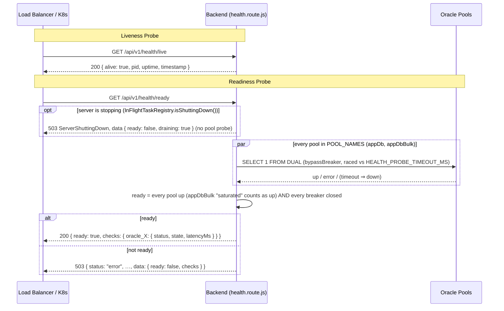
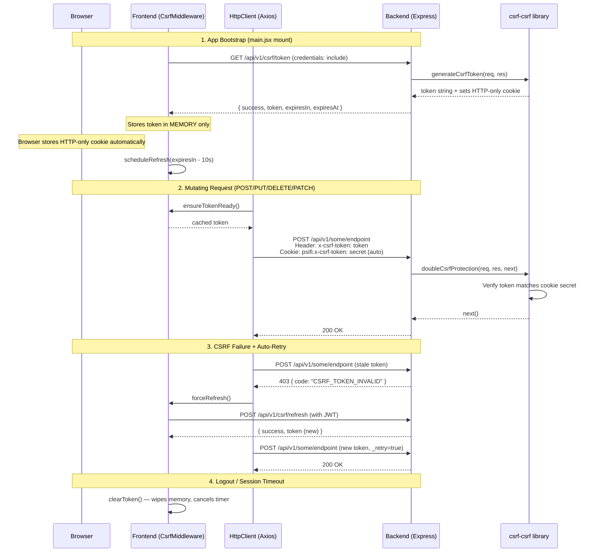
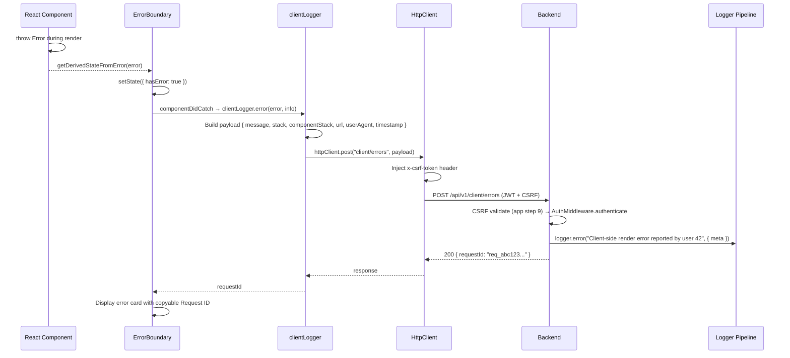

# Infrastructure: Health, CSRF & Client Error Reporting — Technical Documentation

> **Scope:** Health probes (liveness/readiness), CSRF double-submit cookie protection, and client-side error reporting pipeline.
> **Source:** `Frontend/src/` (frontend) + `Backend/src/` (backend).
>
> **Structure — this document is split into Part A / B / C, one per feature, plus Part D for two short
> cross-cutting contracts (cache consistency and shared-component accessible names) and Part E for
> database connection settings, demo mode and test-environment safety.** It is the only doc in the
> corpus that departs from the flat `1.`–`8.` section numbering, because it covers three independent
> features rather than one. Each Part carries its own numbering (`A.1` Overview, `A.2` Flow &
> Architecture, and so on), so **there is no single §5 "contract" or §6 "technicalities" section** —
> per-Part request/response shapes live under each Part's "Response Shapes" heading, and each Part ends
> with its own Security and Verification Q&A. Splitting this into three documents was considered and
> rejected: health, CSRF and client error reporting are each too small to carry a document, and all
> three are cross-cutting infrastructure a reader generally arrives at together.
>
> **Verified 2026-10-29 against source** (`routes/health.route.js`, `services/ReadinessService.js`, `services/HealthStreamHub.js`, `config/database.js`, `config/adapters/oracle.js`, `routes/csrf.route.js`, `middleware/security/CsrfMiddleware.js` on both sides, `routes/client.route.js`, `services/ClientService.js`, `middleware/cache/`, `config/demoMode.js`, `config/bootGuard.js`, `app.js`, `server.js`). Test files cited below exist in the repo; **none were run for this revision**, so no pass counts are quoted.

> **Key facts.** (1) `/ready` (`src/services/ReadinessService.js`) is 200 only when **every** pool in `POOL_NAMES` (`appDb`, `appDbBulk`) answers — a saturated `appDbBulk` still counts as up, a saturated `appDb` does not — **and** every `PoolHealthMonitor` circuit breaker is closed. A successful probe closes that pool's breaker at once (`recordProbeSuccess`), so the UI never says "Back online" while `withConnection` still fails fast. Concurrent evaluations share one probe round. (2) **`GET /api/v1/health/stream`** (`src/services/HealthStreamHub.js`, unauthenticated SSE): sends `retry: 3000`, the current `status {ready, cause}` (`cause` is `"database"` or null; no ORA-/NJS- text, CWE-209), then a `status` frame only when the verdict changes, a `heartbeat` every `HEALTH_STREAM_HEARTBEAT_MS` (default 15 s) and `shutdown` on drain; it re-evaluates on every breaker flip and every `HEALTH_STREAM_EVAL_MS` (default 30 s). 429 `TOO_MANY_HEALTH_STREAMS` above `HEALTH_STREAM_MAX_PER_IP` (50) / `HEALTH_STREAM_MAX_TOTAL` (2000); 503 `ServerShuttingDown` while draining. State is per worker. (3) **Detection cadence** (`config/adapters/oracle.js` → `PoolHealthMonitor`): every 30 s, every 5 s while any pool is failing or a stream client is watching; a connectivity error inside `withConnection` (ORA-12541/12514/12170/…, NJS-500/501/503/510/521, DPI-1080, acquire timeout) nudges an immediate check (debounced 250 ms). The UI (`ServerStatusWatch`) keeps the stream open and falls back to polling `/ready` when it is refused. (4) **Demo mode:** with `DEMO_MODE=true` no Oracle pool is opened (`server.js`); see §E.
>
> **Server vs database.** The UI's reachability probe (`Frontend/src/components/shared/serverStatus/serverStatus.api.js`) reads only `GET /api/v1/health/ready`: 200 = healthy; 503 `ServerShuttingDown` = restarting; a 503 API envelope with `ServiceUnavailableError` or `data.ready === false` = **the database is down** (the server answers; `/health/live` stays 200); no API envelope or a network error = **the server is down**.
>
> **Request intake.** A `Content-Encoding: br` body is refused 415 (`middleware/parsing/BodyParserMiddleware.js`); a multipart field name with an array index above 100 is refused (`src/constants/multipart.js` → `MULTIPART_FIELD_LIMITS.fieldArrayIndexLimit`); the JSON body limit is `BODY_LIMIT` (default `10mb`).
>
> **Draining.** While draining, the legacy `GET /api/v1/health` answers **200** `{ uptime, timestamp, database: "draining" }` from memory with no Oracle borrow, and `/ready` answers 503 `ServerShuttingDown` with `Retry-After` from `SHUTDOWN_RETRY_AFTER_SEC` (`src/constants/shutdownGate.js`, 5 s) — §A.2, §A.3, §A.5.
>
> **Out of scope.** `/api/v1/dev-docs/*` and the other admin route families have their own documents.


---

# Part A — Health Probes

## A.1. Overview

The Health system exposes four unauthenticated endpoints for infrastructure tooling (Kubernetes, load balancers) and the UI's server-status banner. The **liveness** probe confirms the Node.js process is alive (never contacts the database). The **readiness** probe tests all named Oracle connection pools in parallel with `SELECT 1 FROM DUAL`. The **stream** endpoint pushes the readiness verdict over SSE. A **legacy** endpoint provides backward compatibility with a simplified response.

## A.2. Flow & Architecture



The liveness probe is a pure process check — it never contacts the database, ensuring it remains responsive even during pool exhaustion.

The readiness probe probes every named pool from `POOL_NAMES` (`src/config/database.js` — `appDb` and the bulk/export pool `appDbBulk`) concurrently via `db.withConnection()` (`ReadinessService.evaluate`). Every pool must answer **and** every pool's breaker must be closed. **`READINESS_GATING_POOLS`** (`["appDb"]`) only decides which pools may **not** be saturated: `appDbBulk` is a load-shedding bulkhead with a bounded `queueMax`, so an `NJS-076` saturation there is the bulkhead working as designed and counts as up. Gating on it would let an export or purge burst 503 `/ready` and make the load balancer drop the **whole** service while interactive `appDb` is healthy. `database.js` throws at module load if a gating pool name is not a registered pool (fail-closed on a typo).

**Draining.** Once a stop has begun (`InFlightTaskRegistry.isShuttingDown()` is true), `/ready` answers **503** with `error.type: "ServerShuttingDown"` and `data: { ready: false, draining: true }` straight away. It does **not** probe any pool: a load balancer and the UI's "server is restarting" banner only need the 503, and the pools are about to close. The shutdown gate (`ShutdownGateMiddleware`, app.js step 3b) refuses every other route with 503 `ServerShuttingDown` + `Retry-After: 5`, but lets `/api/v1/health*` and OPTIONS through, so `/live` and `/ready` still answer during the drain. The `/ready` draining 503 sends `Retry-After: 5` (the same `SHUTDOWN_RETRY_AFTER_SEC` as the gate's own 503), and the legacy `GET /api/v1/health` answers 200 with `database: "draining"` instead of borrowing a pool connection for every monitor poll.

Three further properties of each probe (`probePool`):

- **It bypasses the circuit breaker** (`{ bypassBreaker: true }`). `/ready` is the signal that reports pool health; it must actually probe rather than fail fast on the breaker's own opinion.
- **It is bounded.** Each probe races a timer of `HEALTH_PROBE_TIMEOUT_MS` (env, default **2500 ms**). A probe that loses the race reports `{ status: "down", state: "down", error: "probe timeout", latencyMs: HEALTH_PROBE_TIMEOUT_MS }`. The losing promise's rejection is swallowed so it cannot surface as an unhandled rejection later.
- **It classifies, additively.** Alongside the gating `status` (`"up"` / `"down"`), each check carries a `state`: `"up"`, `"down"`, or **`"saturated"`** when the failure is `NJS-076` (pool queue full). `state` matters only for `appDbBulk`, where `"saturated"` counts as up. The raw driver error is logged (`logger.warn`) but the response carries only the fixed string `"probe failed"`, never the driver message.

## A.3. Backend Implementation

| Method & Path              | Auth | Purpose                                         |
| -------------------------- | ---- | ----------------------------------------------- |
| `GET /api/v1/health`       | None | Legacy combined check — always 200, first pool in `POOL_NAMES` only |
| `GET /api/v1/health/live`  | None | Liveness probe — process info only              |
| `GET /api/v1/health/stream` | None | SSE readiness push: `status {ready, cause}` on change, `heartbeat` 15 s, `shutdown` on drain; 429 over the per-IP/total cap |
| `GET /api/v1/health/ready` | None | Readiness probe — 200 only when every pool answers and every breaker is closed (saturated `appDbBulk` tolerated). While draining: 503 `ServerShuttingDown`, `{ ready: false, draining: true }`, no pool probe, `Retry-After: 5` |

**Implementation note:** Health routes are defined **inline** in the route file — no dedicated controller class; the probing rule lives in `ReadinessService`, the push in `HealthStreamHub`.

### Response Shapes

**Liveness (always 200):**

```json
{
    "status": "success",
    "code": 200,
    "message": "OK",
    "requestId": null,
    "data": {
        "alive": true,
        "pid": 12345,
        "uptime": 3600.5,
        "timestamp": "2026-08-05T12:00:00.000Z"
    }
}
```

**Readiness — 200** (note `appDbBulk` saturated and it is still ready):

```json
{
    "status": "success",
    "code": 200,
    "message": "Ready",
    "requestId": null,
    "data": {
        "ready": true,
        "checks": {
            "oracle_appDb": { "status": "up", "state": "up", "latencyMs": 12 },
            "oracle_appDbBulk": { "status": "down", "state": "saturated", "error": "probe failed" }
        }
    }
}
```

**Readiness — 503** (a pool is not up, or a breaker is open). The body is `sendError(...)` with `data` attached:

```json
{
    "status": "error",
    "code": 503,
    "title": "Service Unavailable",
    "message": "Service Unavailable",
    "requestId": null,
    "error": { "type": "ServiceUnavailableError" },
    "data": {
        "ready": false,
        "checks": {
            "oracle_appDb": { "status": "down", "state": "down", "error": "probe timeout", "latencyMs": 2500 },
            "oracle_appDbBulk": { "status": "up", "state": "up", "latencyMs": 9 }
        }
    }
}
```

`error` on a check is always one of two fixed strings — `"probe failed"` or `"probe timeout"` — never the driver's message.

**Readiness — 503 while draining** (the server is stopping). No `checks`, because no pool is probed:

```json
{
    "status": "error",
    "code": 503,
    "title": "Service Unavailable",
    "message": "Service Unavailable",
    "requestId": null,
    "error": { "type": "ServerShuttingDown" },
    "data": { "ready": false, "draining": true }
}
```

**Legacy (always 200):**

```json
{
    "status": "success",
    "code": 200,
    "message": "OK",
    "data": {
        "uptime": 3600.5,
        "timestamp": "2026-08-05T...",
        "database": "connected"
    }
}
```

`database` is `"connected"` or `"disconnected"` (initialised `"unknown"`, overwritten either way). The legacy check probes only `POOL_NAMES[0]` and — unlike `/ready` — goes through the circuit breaker and has no timeout race.

**L3 hardening:** The legacy endpoint does NOT expose `host`, `pid`, or `environment` (unlike `/live`).

### Frontend Integration

The React frontend uses the health endpoints in two places:

- **Server status banner.** `ServerStatusWatch` keeps `GET health/stream` open (`useServerStatusStream`) and falls back to polling `/ready` (`useReadinessWatch`) when the stream is refused or `EventSource` is missing. While the banner shows "restarting" or "can't reach the server", `Frontend/src/components/shared/serverStatus/serverStatus.api.js` probes `GET health/ready` (flagged `_serverStatusProbe`, so `HttpClient` does not retry it or treat it as a takeover). 200 clears the banner ("Back online."); 503 `ServerShuttingDown` keeps it in "restarting"; a 503 with any other error envelope counts as reachable; no answer counts as unreachable. Probes run only while the banner is up and the tab is visible.
- **Metrics → Health tab** (`Frontend/src/features/systemadmin/metrics/metrics.api.js` → `healthLive()`, `healthReady()`; `healthReady` accepts 200 and 503) for admin visibility.

## A.4. Security

| Vector                     | Protection                                                                    |
| -------------------------- | ----------------------------------------------------------------------------- |
| **Authentication**         | None — intentionally unauthenticated for infrastructure probes                |
| **Information disclosure** | Legacy endpoint strips `host`/`pid`/`environment` (L3 hardening)              |
| **Availability**           | Liveness never contacts DB — survives pool exhaustion                         |
| **Error handling**         | Readiness returns 503 with per-pool error details, never exposes stack traces |

## A.5. Verification Q&A

> **Q:** Does the liveness probe always return 200 regardless of DB state?
> **A:** Yes. It returns process info only — `alive`, `pid`, `uptime`, `timestamp`.
> **Evidence:** `Backend/test/server/integration/health/health-probes.test.js` → `"always returns 200 (no DB dependency)"`, `"body.data contains pid (number), uptime (number), timestamp (ISO string)"`, `"does not require auth token"`, `"responds in under 100ms (no DB call — pure process info)"`. _Status: not run for this revision._
> **Evidence (UI):** none — backend-only.

> **Q:** Does the readiness probe correctly detect a down Oracle pool?
> **A:** Yes. It returns 503 with `ready: false` and per-pool `checks`, each carrying a fixed `error` string.
> **Evidence:** `Backend/test/server/integration/health/health-probes.test.js` (stubs `db.withConnection` to reject with ORA-12541) → `"when ready:false the HTTP status is 503 and data.ready is false"`, `"data.checks contains the oracle_appDb key"`, `"failed pools report an error string in the checks object"`. _Status: not run for this revision._
> **Gap:** no test covers the breaker-open rule, the `appDbBulk` saturation tolerance, the probe timeout, or the Health tab rendering a 503.

> **Q:** What does `/ready` answer while the server is stopping?
> **A:** 503 `ServerShuttingDown` with `data: { ready: false, draining: true }` and `Retry-After: 5`, at once, with no pool probe. The shutdown gate lets `/health*` through, so the probe still answers. The UI's server status banner reads this as "restarting" and keeps probing until `/ready` answers 200.
> **Evidence:** source only — `Backend/src/routes/health.route.js` (`InFlightTaskRegistry.isShuttingDown()` branch), `Backend/src/middleware/security/ShutdownGateMiddleware.js`.
> _Status: no test in this repo._ (`Backend/test/server/reliability/graceful-shutdown.test.js` covers SIGTERM and in-flight draining, not the `/ready` body.)

> **Q:** What does the legacy `GET /api/v1/health` answer while the server is stopping?
> **A:** 200 `{ uptime, timestamp, database: "draining" }`, from memory. It does not borrow an Oracle connection, so a monitor polling it during the drain adds no pool load.
> **Evidence:** source only — `Backend/src/routes/health.route.js` (`GET /`).
> _Status: no test in this repo._

> **Q:** Does the legacy endpoint leak sensitive info?
> **A:** No. It strips `host`, `pid`, and `environment` from the response.
> **Evidence:** `Backend/test/server/integration/health.test.js` → `"response body includes uptime and timestamp but NOT environment or host (L3)"`. _Status: not run for this revision._
> **Evidence (UI):** none — the legacy endpoint has no UI caller.

> **Q:** Does `/health/stream` cap concurrent connections?
> **A:** Yes, per source. `HealthStreamHub.canAccept(ip)` refuses with 429 `TOO_MANY_HEALTH_STREAMS` above `HEALTH_STREAM_MAX_PER_IP` (50) or `HEALTH_STREAM_MAX_TOTAL` (2000); while draining it answers 503 `ServerShuttingDown`.
> **Evidence:** source only — `Backend/src/routes/health.route.js`, `Backend/src/services/HealthStreamHub.js`.
> _Status: no test in this repo._

---

# Part B — CSRF Protection

## B.1. Overview

CSRF protection uses the **double-submit cookie** pattern via the `csrf-csrf` library. The backend generates a cryptographic token and sets an HTTP-only secret cookie. The frontend stores the token in **memory only** (never localStorage) and attaches it as an `x-csrf-token` header on every mutating request (POST/PUT/DELETE/PATCH). The backend validates that the header token matches the cookie secret. Tokens expire every 5 minutes with automatic pre-expiry refresh.

## B.2. Flow & Architecture



The double-submit cookie pattern ensures that an attacker on a different origin cannot forge requests — they can't read the HTTP-only cookie to construct a matching header, and they can't read the in-memory token from another origin.

## B.3. Frontend Implementation

| File                                        | Responsibility                                                                                                       |
| ------------------------------------------- | -------------------------------------------------------------------------------------------------------------------- |
| `src/middleware/security/CsrfMiddleware.js` | Singleton — token lifecycle (init, refresh, clear), auto-refresh scheduling, retry logic, observable pattern         |
| `src/middleware/HttpClient.js`              | Request interceptor (inject `x-csrf-token`), response interceptor (403 → force-refresh → retry once)                 |
| `src/contexts/security/CsrfContext.jsx`     | React provider — wraps singleton, exposes `{ csrfToken, loading, error, isInitialized, refreshToken, clearToken }`   |
| `src/main.jsx`                              | CsrfGate — blocks rendering until CSRF initialized; hard redirects to `/service-is-currently-unavailable` on failure |

### CsrfMiddleware Configuration

| Setting         | Value                                                                    |
| --------------- | ------------------------------------------------------------------------ |
| Token storage   | **Memory only** — never localStorage, sessionStorage, or readable cookie |
| Max retries     | 3 (exponential backoff: 1s, 2s, 4s)                                      |
| Request timeout | 10s                                                                      |
| Refresh buffer  | 10s before expiry                                                        |
| Token max age   | 300,000ms (5 min, matching backend)                                      |

### HttpClient CSRF Integration

- **Request interceptor:** For mutating methods not in `CSRF_EXEMPT` list, calls `CsrfMiddleware.ensureTokenReady()` and sets `x-csrf-token` header
- **Response interceptor:** Detects CSRF errors (403 + code in `CSRF_SECRET_MISSING`, `CSRF_TOKEN_MISSING`, `CSRF_TOKEN_INVALID`, `CSRF_TOKEN_EXPIRED`), retries exactly once with force-refreshed token (`_retry` guard prevents infinite loops)
- **CSRF_EXEMPT endpoints:** `csrf/token`, `csrf/refresh`, `csrf/status`

### Session Lifecycle Integration

- On 440 (session timeout): `CsrfMiddleware.clearToken()` + redirect to `/login-timeout`
- On 498 (invalid token): `CsrfMiddleware.clearToken()` + redirect to `/invalid-token`
- On logout: `CsrfMiddleware.clearToken()` via `auth.hook.js`

## B.4. Backend Implementation

| Method & Path               | Auth          | CSRF   | Purpose                                       |
| --------------------------- | ------------- | ------ | --------------------------------------------- |
| `GET /api/v1/csrf/token`    | None          | Exempt | Bootstrap — generate initial token            |
| `POST /api/v1/csrf/refresh` | Authenticated | Exempt | Rotate token (requires existing CSRF session) |
| `GET /api/v1/csrf/status`   | None          | Exempt | Introspect CSRF configuration                 |

**All `/api/v1/csrf` paths are CSRF-exempt** (`app.js` `CSRF_EXEMPT_PATHS`, step 9) to avoid the bootstrap catch-22. `POST /csrf/refresh` uses `AuthMiddleware.authenticatePendingPasswordChange`, so a session restricted to a forced password change can still rotate its token (see the auth doc §2.3).

### CsrfMiddleware (Backend)

**File:** `src/middleware/security/CsrfMiddleware.js`

| Setting                  | Value                                                                                          |
| ------------------------ | ---------------------------------------------------------------------------------------------- |
| Library                  | `csrf-csrf` (`doubleCsrf`)                                                                     |
| Secret source            | `CSRF_SECRET` env var (fail-fast in ALL environments)                                          |
| Cookie name (secure)     | `__Host-psifi.x-csrf-token`                                                                    |
| Cookie name (non-secure) | `psifi.x-csrf-token`                                                                           |
| Cookie options           | `httpOnly: true`, `secure: <env>`, `sameSite: "strict"`, `path: "/"`, `maxAge: 300000` (5 min) |
| Token size               | 64 bytes                                                                                       |
| Session identifier       | `req.ip` (ties token to IP)                                                                    |
| Token sources            | `x-csrf-token` header → `body._csrf` → `body.csrfToken`                                        |
| Protected methods        | POST, PUT, DELETE, PATCH                                                                       |

### Global Mounting (app.js Step 9)

```js
const CSRF_EXEMPT_PATHS = ["/api/v1/csrf", "/api/v1/metrics/frontend"];
app.use((req, res, next) => {
    if (CSRF_EXEMPT_PATHS.some((p) => req.path.startsWith(p))) return next();
    defaultCsrf.handle.bind(defaultCsrf)(req, res, next);
});
```

### Response Shapes

> **Note.** These bodies are **not** wrapped in the `{ status: "success", data: { … } }` envelope:
> `CsrfMiddleware` writes **flat** objects with `res.json(...)` directly, bypassing `sendSuccess`. The
> error bodies are flat too, but carry `status` / `title` / `requestId` fields that line them up with the
> global error envelope. A client reading `body.data.token` gets `undefined`.

**Token — `GET /csrf/token` (200):**

```json
{
    "success": true,
    "token": "a1b2c3d4...",
    "cookieName": "__Host-psifi.x-csrf-token",
    "headerName": "x-csrf-token",
    "expiresIn": 300000,
    "expiresAt": "2026-08-05T12:05:00.000Z"
}
```

**Refresh — `POST /csrf/refresh` (200):** same fields as Token, plus `"message": "CSRF token refreshed successfully"`.

**Refresh without an existing CSRF cookie (400):**

```json
{
    "success": false,
    "status": "error",
    "title": "Bad Request",
    "message": "Cannot refresh without an existing CSRF session. Obtain a token via GET /csrf/token first.",
    "code": "NO_CSRF_SESSION",
    "requestId": "…"
}
```

**Status — `GET /csrf/status` (200):**

```json
{
    "success": true,
    "status": {
        "enabled": true,
        "hasSecret": true,
        "cookieName": "__Host-psifi.x-csrf-token",
        "headerName": "x-csrf-token",
        "methods": {
            "protected": ["POST", "PUT", "DELETE", "PATCH"],
            "safe": ["GET", "HEAD", "OPTIONS"]
        },
        "tokenSources": ["header:x-csrf-token", "body:_csrf", "body:csrfToken"],
        "cookieOptions": {
            "httpOnly": true,
            "secure": true,
            "sameSite": "strict",
            "maxAge": 300000
        }
    },
    "message": "CSRF protection is active with a valid secret cookie"
}
```

⚠ **`hasSecret` reports whether the CSRF cookie is present on *this request*, not whether the server has a
`CSRF_SECRET`** (the server fails fast at boot without one, so that could never be `false` here). The
`message` switches to `"CSRF protection is active (no secret cookie found on this request)"` when it is
absent. Here `status` is an **object**, not the string `"success"` used by the global envelope.

**Validation failure on a protected method (403):**

```json
{
    "success": false,
    "status": "error",
    "title": "Forbidden Access",
    "message": "CSRF validation failed",
    "code": "CSRF_TOKEN_INVALID",
    "requestId": "…",
    "error": "Invalid or missing CSRF token"
}
```

`error` carries the library's own message only when `NODE_ENV === "development"`. Handler failures
(500) go through `_sendError` and return `{ success: false, message, error }`, with `error` likewise
populated only in development.

## B.5. Security

| Vector                   | Protection                                                        |
| ------------------------ | ----------------------------------------------------------------- |
| **Double-submit cookie** | Token in header must match secret in HTTP-only cookie             |
| **Token storage**        | Memory only — never localStorage/sessionStorage (CWE-384)         |
| **Cookie flags**         | `httpOnly`, `secure`, `sameSite: strict`, `__Host-` prefix        |
| **IP binding**           | Token tied to `req.ip` via session identifier                     |
| **Token rotation**       | 5-minute TTL with auto-refresh 10s before expiry                  |
| **Fail-fast**            | Missing `CSRF_SECRET` env var → process crash in ALL environments |
| **Retry safety**         | Single retry on 403 with `_retry` guard — no infinite loops       |
| **CORS integration**     | `X-CSRF-Token` in both `allowedHeaders` and `exposedHeaders`      |

## B.6. Verification Q&A

> **Q:** Is the CSRF token stored only in memory (never localStorage)?
> **A:** Yes. The CsrfMiddleware singleton stores the token in a private instance variable. It is never written to localStorage, sessionStorage, or a readable cookie.
> **Evidence:** source only — `Frontend/src/middleware/security/CsrfMiddleware.js` (header comment and `_token` field).
> **Gap:** no unit test asserts the token is absent from `localStorage` / `sessionStorage` / `document.cookie`.
> _Status: no test in this repo._

> **Q:** Does the auto-retry on 403 prevent infinite loops?
> **A:** Yes. The HttpClient response interceptor uses a `_retry` flag on the original request. A second consecutive 403 surfaces the error to the user.
> **Evidence:** `Frontend/test/reliability/csrf-retry.test.jsx` → `"surfaces a SECOND consecutive CSRF 403 to the caller instead of retrying again"`, `"refreshes the token at most once per failed request — no refresh storm on the retry"`, `"retries a POST exactly once after a CSRF 403, sending the refreshed token, and succeeds"`. _Status: not run for this revision._
> **Evidence (API):** `Backend/test/server/security/csrf.test.js` → `"POST with a forged CSRF token returns 403"`. _Status: not run for this revision._

> **Q:** Does the backend fail-fast on missing CSRF*SECRET?
> **A:** Yes. The CsrfMiddleware constructor throws in ALL environments (not just production) when `CSRF_SECRET` is missing.
> **Evidence:** `Backend/test/server/unit/middleware/csrf.test.js` → `"throws in ALL environments when no secret is provided (CWE-352 fail-fast fix)"`, `"throws in development too when no CSRF_SECRET is configured (fail-fast — no dev fallback)"`. _Status: not run for this revision._
> **Evidence (UI):** none — backend-only. Separately, `config/bootGuard.js` requires `CSRF_SECRET` ≥ 32 characters and exits in production on a violation.

> **Q:** Does a POST without a CSRF token get rejected?
> **A:** Yes. Returns 403 with code `CSRF_TOKEN_INVALID`.
> **Evidence:** `Backend/test/server/security/csrf.test.js` → `"POST without CSRF token returns 403"`, `"POST with valid CSRF token is accepted (not blocked by CSRF)"`, `"POST with a forged CSRF token returns 403"`; `Backend/test/server/integration/csrf.test.js` covers `/token`, `/status` and `/refresh` (401 without a JWT). _Status: not run for this revision._
> **Evidence (UI):** `Frontend/test/security/csrf-injection-invariants.test.jsx` → `"sends NO x-csrf-token on a GET"`, `"the mirrored exempt list is exactly the three bootstrap endpoints — no more, no less"`. _Status: not run for this revision._

---

# Part C — Client Error Reporting

## C.1. Overview

The Client Error Reporting pipeline captures React `ErrorBoundary` crashes and forwards them to the backend for structured logging. When a component throws during render, the `ErrorBoundary` catches it, sends the error details (message, stack, component stack, URL, user agent) to `POST /api/v1/client/errors`, and displays a user-friendly error card with a copyable Request ID for support tracing. The pipeline is designed to **never throw** — all failures are silently swallowed to avoid cascading errors.

## C.2. Flow & Architecture



The pipeline is intentionally auth-gated — anonymous visitors' pre-auth render errors are surfaced via dev-only `console.error` in `clientLogger.js` but not forwarded to the server. This prevents unauthenticated traffic from polluting the log stream.

## C.3. Frontend Implementation

| File                                        | Responsibility                                                                                                                |
| ------------------------------------------- | ----------------------------------------------------------------------------------------------------------------------------- |
| `src/components/feedback/ErrorBoundary.jsx` | React class component — catches render errors, displays fallback UI with Request ID, "Try again" button, dev-only stack trace |
| `src/utils/clientLogger.js`                 | `clientLogger.error(message, info)` — builds payload, posts to backend, returns `requestId` or `null`, **never throws**       |

### ErrorBoundary Fallback UI

- Danger icon
- "Something went wrong" heading
- `RequestIdTag` component (copyable, for support tracing)
- "Try again" button (resets error state)
- Dev-only stack trace (`import.meta.env.DEV`)

### Request ID Sources

1. `error.requestId` from HttpClient interceptor (if the error originated from an API call)
2. `clientLogger.error()` return value (server-assigned Request ID from the error report response)

## C.4. Backend Implementation

| Method & Path                   | Auth                     | CSRF              | Rate limit          | Purpose                                        |
| ------------------------------- | ------------------------ | ----------------- | ------------------- | ---------------------------------------------- |
| `POST /api/v1/client/errors`    | Authenticated (any role) | Required (global) | Global default      | Ingest frontend ErrorBoundary reports          |
| `POST /api/v1/client/help-miss` | Authenticated (any role) | Required (global) | 20 / 60 s (per-route) | Record a Help-search zero-result event (telemetry) |

**Controller** (`src/controllers/ClientController.js`) — thin `catchAsync`-wrapped layer. `logError` delegates to `ClientService.logError(req.body, req.user)`; `logHelpMiss` delegates to `ClientService.logHelpMiss(req.body, req.user)` and returns `HELP_SEARCH_MISS_LOGGED`.

**Service** (`src/services/ClientService.js`):
- **`logError`** — destructures `message`, `stack`, `componentStack`, `url`, `userAgent`, `timestamp` from payload. Logs via `logger.error()` with structured meta. Falls back to `"unknown"` for userId. **Never throws.**
- **`logHelpMiss`** — records a zero-result Help search so the misses can be mined to grow the frontend synonym table. The `query` is **truncated to 120 chars** and stripped of newlines/control chars (`[\u0000-\u001f\u007f]`) before logging — a log-injection defense (CWE-117) so a crafted query cannot forge fake log lines or bloat the log. A **blank query is dropped** (nothing actionable); `surface` is kept only when it is `"assistant"` or `"center"`, else `"unknown"`. Logged at warning level via `clientMessages.HELP_SEARCH_MISS`. Rate-limited to **20 requests / 60 s** via a dedicated `helpMissLimiter` (`RateLimiterMiddleware`, label `RateLimit:help-miss`) so one user hammering search cannot flood the log.

### Request/Response Shapes

**Request:**

```json
{
    "message": "Cannot read properties of undefined (reading 'map')",
    "stack": "TypeError: Cannot read properties...\n  at Component (Component.jsx:42)",
    "componentStack": "\n    at Component\n    at App",
    "url": "/dashboard",
    "userAgent": "Mozilla/5.0 (Windows NT 10.0)",
    "timestamp": "2026-08-05T12:00:00.000Z"
}
```

**Response (200):**

```json
{
    "status": "success",
    "code": 200,
    "message": "Error logged successfully.",
    "data": null,
    "requestId": "req_abc123..."
}
```

## C.5. Security

| Vector                     | Protection                                                                     |
| -------------------------- | ------------------------------------------------------------------------------ |
| **Authentication**         | JWT required — prevents anonymous log pollution                                |
| **CSRF**                   | Required (global enforcement)                                                  |
| **XSS reflection**         | Payloads are logged server-side only — never reflected in responses (CWE-79)   |
| **SQL injection**          | Payloads go to logger, not database — no SQL execution path (CWE-89)           |
| **Error handling**         | `clientLogger` never throws — `.catch(() => {})` swallows all errors (CWE-209) |
| **Information disclosure** | No stack traces in production responses; dev-only `console.error` echo         |
| **Body limits**            | 413 on oversized payloads (`BODY_LIMIT`, default `10mb`)                       |

## C.6. Verification Q&A

> **Q:** Does the client logger never throw, even on server failure?
> **A:** Yes. All errors are silently swallowed via `.catch(() => {})`. Returns `null` on failure.
> **Evidence (UI):** `Frontend/test/reliability/error-boundary.test.jsx` → `"never crashes a second time when clientLogger's own POST fails — the fallback UI still works, just without a Request ID"`. _Status: not run for this revision._
> **Gap:** no direct unit test for `Frontend/src/utils/clientLogger.js`.

> **Q:** Are XSS payloads in the error message reflected in the response?
> **A:** No. The payload is logged server-side only and never included in the response body.
> **Evidence:** source only — `Backend/src/controllers/ClientController.js` (fixed success message), `Backend/src/services/ClientService.js`. `Backend/test/server/integration/client/client-errors.test.js` → `"response shape matches { status, code, message, data } contract"` pins the shape but sends no XSS payload.
> **Gap:** no test sends an XSS string and asserts it is absent from the body.
> _Status: not run for this revision._

> **Q:** Does the endpoint reject unauthenticated requests?
> **A:** Yes. Returns 401 without JWT.
> **Evidence:** `Backend/test/server/integration/client/client-errors.test.js` → `"returns 401 when no Authorization header is provided"`, `"returns 401 when token is structurally invalid"`, `"returns 440 when token is expired (AuthMiddleware maps TokenExpiredError → 440)"`, `"returns 403 when token is signed with wrong secret (M-11: tampered → 403)"`, `"returns 403 when CSRF token is absent"`, `"returns 413 when body exceeds size limit"`. _Status: not run for this revision._
> **Note:** one title in that file still says `"returns 200 for APPROVER role"`; `APPROVER` is not a role in this template (owner: test engineer).
> **Evidence (UI):** `Frontend/test/reliability/error-boundary.test.jsx` (same title as above). _Status: not run for this revision._

> **Q:** Does the service handle null/undefined payloads gracefully?
> **A:** Yes. Destructuring with defaults handles missing fields. Falls back to `"unknown"` for userId.
> **Evidence:** source only — `Backend/src/services/ClientService.js` (`payload ?? {}`, `user?.userId ?? "unknown"`).
> **Gap:** no `ClientService` unit test; `logHelpMiss` truncation/control-char stripping is also untested.
> _Status: no test in this repo._

### Coverage Summary (All Three Features)

Test files that exist (none run for this revision, so no counts are quoted):

| Feature      | Backend test files | Frontend test files |
| ------------ | ------------------ | ------------------- |
| Health       | `integration/health.test.js`, `integration/health/health-probes.test.js`, `reliability/graceful-shutdown.test.js` (under `Backend/test/server/`) | none |
| CSRF         | `unit/middleware/csrf.test.js`, `integration/csrf.test.js`, `security/csrf.test.js` | `reliability/csrf-retry.test.jsx`, `security/csrf-injection-invariants.test.jsx`, `performance/csrf-token-coalescing.test.jsx`, `performance/csrf-retry-bounded.test.jsx`, `chaos/csrf-refresh-failure.test.jsx` (under `Frontend/test/`) |
| Client Error | `integration/client/client-errors.test.js` | `reliability/error-boundary.test.jsx` |

**⚠ No test covers:** health probe behaviour under partial pool failure, breaker-open, `appDbBulk` saturation or probe timeout; `/health/stream`; the draining bodies of `/ready` and `/health`; a health security suite (no info-leak / header checks); the frontend `CsrfMiddleware` memory-only storage; `ClientService` and `clientLogger` units; `/client/help-miss`; XSS non-reflection. For Part D's gaps, see §D.3.

---

# Part D — Cross-cutting: cache consistency and accessible names

Two small contracts that every feature relies on and that have no feature document of their own.

## D.1. Cache consistency (backend — `src/middleware/cache/`)

**The defect class (CWE-362).** A read-through cache can be re-filled with old data after it has been invalidated:
a read starts loading from the database, a write commits and flushes the store, and then the read finishes and
stores what it loaded before the write. Flushing later does not help, because the stale value arrives after the
flush. The mechanism is generic to any read-through cache.

**The guard, in `CacheStore`:**

- Each store keeps a monotonic `generation` counter, exposed as a read-only getter.
- `flush()`, `del()`, `delByPattern()` and `delWhere()` all call `_invalidateInFlight()`, which bumps the generation
  and swaps in a fresh `SingleFlight`. Invalidations relayed from sibling cluster workers by `ClusterCacheSync` go
  through the same methods, so they bump it too.
- `getOrSet(key, loader, ttl)` records the generation when its load starts. If the generation has changed by the
  time `loader()` resolves, the value is still **returned** to the waiting callers but is **not stored**, and
  `cacheMessages.CACHE_SET_SKIPPED_STALE` is logged at debug.
- Because the `SingleFlight` is replaced, a reader that arrives after an invalidation starts a new load instead of
  joining the pre-invalidation one. The old `SingleFlight` still resolves its own callers and cleans up its own map.

**The same guard, in `CacheMiddleware.read`:** the store's generation is captured at the MISS. When the controller
calls `res.json`, a 2xx response is stored only if the generation is unchanged; otherwise it is sent but not
cached, and `CACHE_SET_SKIPPED_STALE` is logged.

**What this does not change.** HIT/MISS/COALESCED behaviour, TTLs, key shapes and the invalidation API are the
same. A store that is never invalidated behaves exactly as before. The guard never blocks a response; it only
declines to cache one.

## D.2. Accessible names for shared form controls and dialogs (frontend — `Frontend/src/components/`)

A control or dialog without a programmatic name is announced by screen readers as just "button" or "dialog"
(WCAG 1.3.1 / 4.1.2). The shared components now carry the name themselves, so feature code only has to pass a
`label` or `title`.

| Component | Contract |
| --- | --- |
| `forms/Select.jsx` | Trigger id is `id ?? name ?? useId()`; the `<label>` has an id and `htmlFor` that id. The trigger is named by `aria-labelledby="<label id> <value id>"`, so its name is the label followed by the current value (for example "Status All Statuses"). This names every labelled `Select` in the app. |
| `forms/Timepicker.jsx` | Same label + value naming (for example "Start Time 09:00"); `aria-haspopup="dialog"`, `aria-controls` pointing at the popup while it is open, and the popup is `role="dialog"` named by the label. Errors are wired through `aria-describedby` and `aria-invalid`; every option button is `type="button"`. |
| `ui/Modal.jsx` | `role="dialog"`, `aria-modal="true"`, named by its title through `aria-labelledby` pointing at the title `<h2 id>`. A modal without a `title` can pass the optional `ariaLabel` prop instead; it is ignored when a title is set. |
| `ui/Drawer.jsx` | `role="dialog"`, `aria-modal="true"`, named by its title `<h2 id>` through `aria-labelledby`. |

Titled `Modal`s and `Drawer`s are named by their titles. The title-less modals pass `ariaLabel`: `ProfileModal`
("Your profile"), `EmailFailureModal` ("Email delivery failed") and `PersonalizeModal` ("Personalize appearance").
**Rule for new code:** give every `Modal` a `title`, or an `ariaLabel` if it has no visible title; give every `Select` and
`Timepicker` a `label`.

## D.3. Verification Q&A

> **Q:** Can a read that started before a cache invalidation put its old result back into the cache?
> **A:** No. `getOrSet` stores a loaded value only if the store's generation is the same as when the load started;
> `flush`/`del`/`delByPattern`/`delWhere` bump it, and swap in a fresh `SingleFlight` so later readers do not join
> the old load. The old value is still returned to the callers that were already waiting, so no request fails
> because of the guard.
> **Evidence:** source only — `Backend/src/middleware/cache/CacheStore.js` (`_generation`, `_invalidateInFlight`,
> `getOrSet`), `Backend/src/middleware/cache/CacheMiddleware.js` (`read`, generation captured at MISS).
> **Regression controls** (normal caching still works): `Backend/test/server/unit/middleware/cache/cacheStore.chaos.test.js`
> → `"50 simultaneous getOrSet() calls on a missing key: all callers get a valid (non-undefined) result"`, `"second call
> with same key after a successful load hits the cache — loader called only once"`, `"set() and get() continue to work
> normally after flush()"`; `Backend/test/server/unit/middleware/cache/cacheMiddleware.chaos.test.js` → `"stores the
> response in cache after controller calls res.json() with 200"`, `"second request after MISS is a HIT (cache was
> populated)"`. _Status: not run for this revision._
> **Gap:** no test drives an invalidation **while** a loader is in flight (store guard, `SingleFlight` swap, cluster
> relay, or the middleware MISS→`res.json` window).
> **Evidence (UI):** none — server-side cache state; the UI cannot observe which copy the server cached.

> **Q (frontend):** Are labelled selects and dialogs announced with a name?
> **A:** Per source, yes. A labelled `Select` is named "label + current value" via `aria-labelledby`, with the trigger id
> falling back to `useId()` when it has neither `id` nor `name`. A titled `Modal` or `Drawer` is named by its title
> `<h2 id>`; a title-less `Modal` uses `ariaLabel`.
> **Evidence:** `Frontend/test/unit/components/select.test.jsx` → ``"associates the label with the trigger button via
> htmlFor/id (falls back to `name`)"``; `Frontend/test/unit/components/modal.test.jsx` → `"marks the dialog aria-modal so
> assistive tech treats the page behind it as inert"`. _Status: not run for this revision._ Source:
> `Frontend/src/components/forms/Select.jsx`, `forms/Timepicker.jsx`, `ui/Modal.jsx`, `ui/Drawer.jsx`.
> **Gap:** no test asserts the label + value name, the `useId()` fallback, the Modal/Drawer name-by-title, the
> `ariaLabel` path, the Timepicker popup role, or that `ProfileModal` / `EmailFailureModal` / `PersonalizeModal` are
> findable by name. There are no `drawer` or `timepicker` test files.
> **Evidence (API):** none — UI-only.

---

# Part E — Database connection, demo mode and test-environment safety

Which Oracle schema a process connects to is decided by configuration. Backend only; no route, no UI.

## E.1. Connection settings — `APP_DB_*` (`src/config/database.js`)

There is **one** credential set and **two** pools built from it (`appDbCredentials`):

| Pool | Purpose | Env (defaults) |
| --- | --- | --- |
| `appDb` | Interactive traffic (`T_USERS_DEV`, `T_ADMINS_DEV`, `T_AUDIT_LOGS_DEV`, …); the only readiness-gating pool | `APP_POOL_MIN` (5), `APP_POOL_MAX` (20), `APP_QUEUE_MAX` (40), `APP_POOL_TIMEOUT` (30 s, `0` kept) |
| `appDbBulk` | Long-hold work (export, backup, purge, restore) so it cannot starve `appDb` | `APP_BULK_POOL_MIN` (1), `APP_BULK_POOL_MAX` (6), `APP_BULK_QUEUE_MAX` (24), `APP_BULK_QUEUE_TIMEOUT` (30000 ms), `APP_BULK_CONNECT_TIMEOUT` (20000 ms) |

- **Credentials:** `APP_DB_USERNAME`, `APP_DB_PASSWORD`; connect string built by `buildTNSConnectString(DB_HOST, DB_PORT, DB_APP_SERVICE_NAME)`.
- ⚠ Despite its name, `DB_APP_SERVICE_NAME` is used as the Oracle **SID** (`CONNECT_DATA=(SID=…)`); `.env.example` documents this.
- **Adding a connection:** add env vars, add one entry to `connections`, call `withConnection("yourKey", …)`. `POOL_NAMES` is derived from the keys, so `/ready` picks it up automatically.
- **Fail closed:** `getConnectionConfig` throws on an unknown name; a `READINESS_GATING_POOLS` entry that is not a registered pool throws at module load.
- Config files never call `dotenv` themselves; `server.js` (and each standalone script) loads `.env` once.

## E.2. Demo mode — `DEMO_MODE` (`src/config/demoMode.js`)

`isDemoMode()` is the single source of truth: `String(process.env.DEMO_MODE).toLowerCase() === "true"`, read as a
function (not a cached constant) so it reflects `process.env` after `dotenv` loads and tests can toggle it.

- **`DEMO_MODE=true`** — zero database setup. Authentication, audit logs, admin management and changelog are served
  from in-memory fixtures (`src/models/demo/demoStore.js`); the refresh-token store is in memory too. `server.js`
  skips `db.initializePools()`, logs `serverMessages.DEMO_MODE_POOLS_SKIPPED` and still announces boot. No Oracle
  pool is opened at boot; what `/ready` reports in demo mode is not verified (see §E.5).
- **`DEMO_MODE=false` / unset** — the normal path: `appDb` / `appDbBulk` against the SQL schema in `Backend/sql/`.
- **Production guard:** `config/bootGuard.js` records a violation when `NODE_ENV=production` and `DEMO_MODE=true`;
  production violations exit the process.
- Documented in `.env.example` (`DEMO_MODE=false`, "Demo mode" block).

## E.3. Tests never reach a real database

`Backend/test/server/setup.js` (Vitest setup, runs before any `src/` module) sets `NODE_ENV=test`, dummy
`DB_HOST=127.0.0.1` / `DB_PORT=1521` / `DB_APP_SERVICE_NAME=testdb` / `APP_DB_USERNAME=test_app`, test-only
secrets, `ENABLE_CLUSTERING=false`, and stubs the audit-log insert so no background Oracle borrow happens.
Integration suites that touch a pool stub `db.withConnection` (for example `health-probes.test.js`). There is no
live-database test gate and no write-capable seed-script guard in this repo.

## E.4. Security

| Vector | Protection |
| --- | --- |
| Unknown pool name / gating typo | `getConnectionConfig` throws; `READINESS_GATING_POOLS` checked at module load (fail closed) |
| Demo fixtures in production | `bootGuard` refuses `DEMO_MODE=true` with `NODE_ENV=production` |
| Weak or placeholder secrets | `bootGuard` `SECRET_RULES` (≥ 32 chars, no template placeholder); production violation exits |
| Driver error text leaking to callers (CWE-209) | Health checks return fixed `"probe failed"` / `"probe timeout"`; raw error logged server-side only |
| Tests touching a real DB | `setup.js` dummy connection values; pool calls stubbed per suite |

## E.5. Verification Q&A

> **Q:** What are the `appDb` pool defaults, and does an explicit env value win?
> **A:** `poolMin` 5 / `poolMax` 20 when unset; `APP_POOL_MIN` / `APP_POOL_MAX` win when set; `APP_POOL_MIN=0` falls back to 5 (`parseInt || default`).
> **Evidence:** `Backend/test/unit/config/database.poolConfig.test.js` → `"DB-P-02: poolMin defaults to 5 when APP_POOL_MIN is not set"`, `"DB-P-03: poolMax defaults to 20 when APP_POOL_MAX is not set"`, `"DB-P-04: poolMin reads APP_POOL_MIN env var when set"`, `"DB-P-07: APP_POOL_MIN=0 falls back to default 5 (falsy branch: 0 || 5 === 5)"`. _Status: not run for this revision._
> **Evidence (UI):** none — backend-only.

> **Q:** Does `DEMO_MODE=true` open any Oracle pool, and is it refused in production?
> **A:** Per source, no pool is opened (`server.js` skips `db.initializePools()`), and `bootGuard` records a violation for `DEMO_MODE=true` with `NODE_ENV=production`. The in-memory refresh-token store behaves like the table (rotation, reuse detection, revoke, purge, unique `JTI_HASH`).
> **Evidence:** source only — `Backend/server.js`, `Backend/src/config/demoMode.js`, `Backend/src/config/bootGuard.js`. `Backend/test/server/unit/models/authRefreshTokenDemo.test.js` → `"rotate: first wins, replay is 'reused', unknown is 'absent'"`, `"insert rejects a duplicate JTI_HASH like UQ_TART_JTI_HASH"`. _Status: not run for this revision._
> **Gap:** no test for the `bootGuard` DEMO_MODE rule or for what `/ready` answers in demo mode (`ReadinessService` still probes `POOL_NAMES`, so it is expected to report not-ready — unverified).
> **Evidence (UI):** none — backend-only.

> **Q:** Can a test run reach a real database?
> **A:** Not through the shared setup: `setup.js` points the connection at dummy values (`127.0.0.1`, `testdb`, `test_app`) and stubs the audit-log insert; suites that hit a pool stub `db.withConnection`. Nothing enforces this beyond convention — a suite that drops the stub would try `127.0.0.1:1521`.
> **Evidence:** source only — `Backend/test/server/setup.js`.
> _Status: no test in this repo._
> **Evidence (UI):** none — backend-only.

Command to run the suites cited in this document (Backend, from `Backend/`):
`npx vitest run test/server/integration/health test/server/integration/health.test.js test/server/integration/csrf.test.js test/server/security/csrf.test.js test/server/unit/middleware/csrf.test.js test/server/integration/client test/server/reliability/graceful-shutdown.test.js test/server/unit/middleware/cache test/unit/config/database.poolConfig.test.js test/server/unit/models/authRefreshTokenDemo.test.js`

Frontend (from `Frontend/`):
`npx vitest run test/reliability/csrf-retry.test.jsx test/security/csrf-injection-invariants.test.jsx test/reliability/error-boundary.test.jsx test/unit/components/select.test.jsx test/unit/components/modal.test.jsx`

---

_End of document. Updated 2026-10-29._
