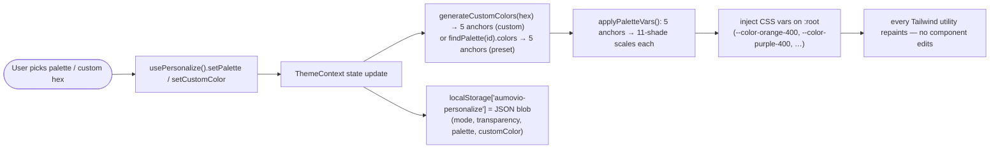

# Personalize — Technical Documentation

> **Scope:** The **Personalize** modal — appearance mode (System/Light/Dark), surface transparency, a 5-colour accent **palette** (incl. a custom colour picker), and the app **layout** (Sidebar vs Top Bar). Client-only preferences.
> **Source:** `Frontend/src/features/personalize/` (`PersonalizeModal.jsx`, `personalize.hook.js`, `personalize.palettes.js`) + the `ThemeContext` (`Frontend/src/contexts/theme/ThemeContext.jsx`) / `LayoutContext` (`Frontend/src/contexts/layout/LayoutContext.jsx`) it composes. **No backend.**
>
> **Verified 2026-10-29.** Re-checked against the CATHERINE source: the three files in `Frontend/src/features/personalize/`; the storage keys in `ThemeContext.jsx` (`aumovio-personalize`, legacy `aumovio-theme`) and `LayoutContext.jsx` (`aumovio-layout`); `ariaLabel="Personalize appearance"` in `PersonalizeModal.jsx`; the `EyeIcon` / `EyeSlashIcon` toggle and number-spinner rules in `Frontend/src/components/forms/Input.jsx`; and the "Native date/time picker icon" and "Native control safety net" blocks plus the `::-ms-reveal` rule in `Frontend/src/assets/styles/index.css`. A search of `Frontend/test/` found **no** test that covers Personalize, its storage keys, its contrast maths or the native-control CSS; §8 says so per question instead of citing suites. No test counts are quoted because none were run for this document.
>
> **Rendering note:** ` ```mermaid ` blocks render in GitHub, GitLab, Obsidian, and VS Code preview. For PDF via Chrome print, pre-render with `mermaid-cli` first.

---

## 1. Overview

Personalize lets any user tune the app's look: light/dark/system mode, surface transparency, one of several 5-colour accent palettes (or a custom colour that derives a full 5-colour scheme), and whether navigation is a sidebar or a top bar. Every choice is applied live by injecting CSS custom properties on `:root` and is persisted to `localStorage` — no server round-trip.

The one-line story: `PersonalizeModal` reads/writes through `usePersonalize()`, which is a thin composition of `useTheme()` + `useLayout()`; changing a setting updates context, which (a) regenerates the 11-shade CSS variable scales from the chosen anchors and (b) persists it — the theme settings as one JSON blob under `aumovio-personalize` (`ThemeContext`), the layout as a plain string under `aumovio-layout` (`LayoutContext`).

---

## 2. Flow & Architecture

### 2.1 Applying a palette



The key idea: components never hard-code accent colours — they use design tokens (`bg-orange-400`, `text-purple-400`, …) that resolve to CSS variables. Personalize overrides those variables, so a single write repaints the whole app without touching a single component.

---

## 3. Frontend implementation

| File | Responsibility |
| --- | --- |
| `src/features/personalize/PersonalizeModal.jsx` | Two-column modal — appearance settings (mode/transparency/layout) + accent palette grid with live 5-segment swatches and a Custom picker |
| `src/features/personalize/personalize.hook.js` | `usePersonalize()` — thin composition of `useTheme()` + `useLayout()`, exposing exactly the state/setters the modal needs |
| `src/features/personalize/personalize.palettes.js` | `PALETTES` registry, `generateCustomColors(hex)` (HSL-rotation, deterministic), `applyPaletteVars()` (anchor → 11-shade scale → `:root`), plus contrast helpers (`pickOnColor`, `getContrastRatio`, `darkenToContrast`, …) |

**Composition, not new state:** `usePersonalize()` holds no state of its own — all state lives in `ThemeContext`/`LayoutContext`. This keeps a single source of truth and means the same preferences apply outside the modal too.
**Custom colour is deterministic:** `generateCustomColors(hex)` derives 5 complementary anchors via HSL rotation, so the same hex always yields the same scheme.

### 3.1 Native form controls follow the palette and theme

Browser-drawn parts of form fields would otherwise ignore Personalize: Chromium paints the date/time picker icon as a fixed black glyph (invisible on dark surfaces), and Edge draws its own black password-reveal eye. The rules below make the palette and theme reach these controls too. Everything keys off one token, `--accent-icon`, which `applyPaletteVars()` solves per palette and per theme to at least 3:1 against the current surface (`personalize.palettes.js`: `lightenToContrast` in dark mode, `darkenToContrast` in light, target `3.0`, the WCAG non-text minimum).

| Control | Where | What it does |
| --- | --- | --- |
| Date / time picker icon (Chromium) | `src/assets/styles/index.css`, "Native date/time picker icon" block | `::-webkit-calendar-picker-indicator` on `date`, `time`, `datetime-local`, `month` and `week` inputs is repainted as a CSS mask filled with `background: var(--accent-icon)`. The mask is a calendar glyph (`--picker-icon-calendar`); `type="time"` swaps in a clock glyph (`--picker-icon-clock`). No hard-coded colour and no `filter: invert` on the indicator. Disabled inputs get `cursor: not-allowed`. |
| Password show/hide eye | `src/components/forms/Input.jsx` | `Input type="password"` (without a caller-supplied `rightElement`) renders its own toggle (heroicons `EyeIcon` / `EyeSlashIcon`) coloured `text-(--accent-icon)`, with `aria-label` "Show password" / "Hide password" and `aria-pressed`. Behaviour is in the auth doc §3. |
| Edge's native reveal and clear | `index.css` | `input[type="password"]::-ms-reveal` and `::-ms-clear` are `display: none`, so the black native eye cannot appear next to the app's toggle. |
| Every other native control | `index.css`, "Native control safety net" block | `:root { color-scheme: light; accent-color: var(--accent-icon); }` and `[data-theme="dark"] { color-scheme: dark; }`. `color-scheme` is inherited, so scrollbars, autofill, date popups and spinners follow the theme. `accent-color` paints native checkboxes, radios, range sliders and progress bars from the palette. The scheme is set once at the root and no longer per date input. |
| Number spinners | `Input.jsx` | `Input type="number"` hides the native spin buttons (`[appearance:textfield]` plus the `-webkit-inner/outer-spin-button` rules), the same as `NumberInput`. There is no spinner left to theme. |

**Firefox limit.** Firefox has no `::-webkit-calendar-picker-indicator`, so its date/time icon is not palette-coloured. It follows the theme only, through the root `color-scheme` (dark icon in light mode, light icon in dark mode).

---

## 4. Backend implementation

**None.** Personalize is entirely client-side. There is no route, controller, service, or table; preferences never leave the browser. This section is intentionally empty and documented so the absence is explicit.

---

## 5. How frontend and backend connect (the contract)

**No network contract.** The only persistence surface is the browser's `localStorage`. No API request/response, no status codes, no headers.

| Key | Owner | Value |
| --- | --- | --- |
| `aumovio-personalize` | `src/contexts/theme/ThemeContext.jsx` | JSON `{ mode, transparency, palette, customColor }`, rewritten on every theme change |
| `aumovio-theme` | `ThemeContext` (legacy) | the bare `mode` string, still written alongside the blob and read as a fallback when the blob is absent |
| `aumovio-layout` | `src/contexts/layout/LayoutContext.jsx` | `"sidebar"` or `"top"`; when absent or invalid, `VITE_LAYOUT_MODE`, then `"sidebar"` |

Corrupt/malformed storage is tolerated: a bad JSON value under the key falls back to defaults rather than crashing the app, and a write that throws (quota, private mode) is swallowed — the preference just does not persist.

---

## 6. Technicalities

- **CSS-variable override strategy.** `applyPaletteVars` turns 5 anchor colours into five 11-shade scales and injects them as `:root` custom properties. Because the design system's Tailwind utilities read those variables, no component needs re-rendering logic for theming.
- **Deterministic custom palette.** HSL rotation from one hex → 5 anchors; identical input ⇒ identical output (testable, cache-friendly).
- **Contrast safety (WCAG).** The palette module includes contrast machinery (`getContrastRatio`, `pickOnColor`, `darkenToContrast`, `lightenToContrast`, `computeSurfaceForContrast`) to prevent the classic "white text on a pale pastel" invisibility bug — pale palettes are darkened until text meets a contrast threshold.
- **Malformed-storage resilience.** A non-JSON or partial blob under `aumovio-personalize` must not brick the app; it falls back to defaults.
- **Preference key, not identity key.** `aumovio-personalize` is a *preference* blob — it holds no tokens or PII (see §7 storage-hygiene).

---

## 7. Security

- **CWE-312 / CWE-522 (sensitive data in client storage) — none stored.** `aumovio-personalize`, `aumovio-theme` and `aumovio-layout` hold only display preferences (mode, transparency, palette, custom colour, layout). No JWT, no credentials, no PII — auth tokens live in HTTP-only cookies, never here. No automated storage-hygiene suite exists in this repo; the claim rests on reading `ThemeContext.jsx` and `LayoutContext.jsx`.
- **XSS surface.** The custom colour is a hex string, parsed by `hexToRgb`/HSL math — never interpolated into HTML or a `style` injection beyond well-formed CSS variable values.
- **CWE-20 (input validation).** Custom hex is bounded/clamped in the colour math (`Math.max(0, Math.min(255, …))`); malformed storage falls back to defaults.
- **No transport, no server trust** — nothing to intercept or forge.

---

## 8. Verification Q&A

> **Q:** Does a malformed `aumovio-personalize` blob crash the app?
> **A:** No. It falls back to defaults.
> **Evidence:** source only — `loadPrefs()` in `Frontend/src/contexts/theme/ThemeContext.jsx` wraps `JSON.parse` in `try/catch` and falls through to the legacy key / system default. _Status: no test in this repo._
> **Evidence (API):** none — UI-only; the server is not involved. (§4: Personalize has no route, controller, service, or table — the blob never leaves the browser.)

> **Q:** Are preferences persisted under the expected key and mechanism?
> **A:** Yes — the theme settings as one JSON blob under `aumovio-personalize`, with the bare mode mirrored to the legacy `aumovio-theme` key; a fresh mount restores them with no interaction. (Layout lives under `aumovio-layout`, §5.)
> **Evidence:** source only — `PERSONALIZE_KEY = "aumovio-personalize"` and `LEGACY_KEY = "aumovio-theme"` in `ThemeContext.jsx`; `LAYOUT_KEY = "aumovio-layout"` in `LayoutContext.jsx`. _Status: no test in this repo._
> **Evidence (API):** none — UI-only; the server is not involved. Persistence here is `localStorage`, not a network contract (§5).

> **Q:** Does a custom colour produce a WCAG-legible palette (no white-on-pale invisibility)?
> **A:** Yes. The palette math darkens/adjusts anchors to meet a contrast ratio.
> **Evidence:** source only — `getContrastRatio`, `darkenToContrast`, `lightenToContrast`, `computeSurfaceForContrast` and `pickOnColor` exported from `personalize.palettes.js`. _Status: no test in this repo — a contrast regression suite over `PALETTES` + `generateCustomColors` is a gap._
> **Evidence (API):** none — UI-only; the server is not involved. Palette generation and contrast math run entirely in `personalize.palettes.js`, with no server round-trip.

> **Q:** Does client storage stay free of identity/secret data?
> **A:** Yes. Only preference keys (`aumovio-layout`, `aumovio-personalize`, …) are permitted; tokens are cookie-only.
> **Evidence:** source only — the three keys above are the only ones Personalize writes. The auth hints (`user_session`, `user_display`, `session_exp`) are written by `Frontend/src/middleware/authentication/AuthMiddleware.js` / `auth.hook.js`, not by this feature. _Status: no test in this repo._
> **Evidence (API):** none — UI-only; the server is not involved. Tokens live in HTTP-only cookies the server sets (§7) — the server has no `localStorage` write path to test.

> **Q:** Is the modal announced with a name by screen readers?
> **A:** Yes. `PersonalizeModal` has no visible title, so it passes `ariaLabel="Personalize appearance"` to the shared `Modal` (see the infrastructure doc §D.2).
> **Evidence:** source only — `<Modal … ariaLabel="Personalize appearance">` in `PersonalizeModal.jsx`. _Status: no test in this repo (`Frontend/test/unit/components/modal.test.jsx` does not cover `ariaLabel`)._
> **Evidence (API):** none — UI-only.

> **Q:** Does the native date/time picker icon follow the palette and the theme instead of staying black?
> **A:** Yes, in Chromium. The indicator is a mask filled with `--accent-icon`: a calendar glyph for date-style inputs and a clock glyph for time inputs, with no hard-coded colour. In Firefox the icon follows the theme only (§3.1).
> **Evidence:** source only — the "Native date/time picker icon" block in `Frontend/src/assets/styles/index.css` (`--picker-icon-calendar`, `--picker-icon-clock`, `::-webkit-calendar-picker-indicator` masks). _Status: no test in this repo._
> **Evidence (API):** none — UI-only; global CSS, no server involved.

> **Q:** Do the other native controls (scrollbars, autofill, checkboxes, the password eye) follow the theme and palette?
> **A:** Yes. The root sets `color-scheme: light` and `accent-color: var(--accent-icon)`, and `[data-theme="dark"]` switches to `color-scheme: dark`. Edge's native `::-ms-reveal` / `::-ms-clear` are hidden on password inputs, because `Input` draws its own accent-coloured toggle. `color-scheme` is no longer set per date input.
> **Evidence:** source only — the "Native control safety net" block and the `input[type="password"]::-ms-reveal` rule in `index.css`. `Frontend/test/unit/components/input.test.jsx` → `"forwards \`type\` to the native input so a password field is genuinely masked"` covers masking only; it has no case for the show/hide toggle. _Status: CSS rules have no test in this repo; test not run for this document._
> **Evidence (API):** none — UI-only.

### Coverage summary

**Test-backed:** nothing — `Frontend/test/` has no Personalize, contrast, storage-hygiene or native-control CSS suite. Every answer above is from reading source on 2026-10-29.
**Gap:** all of it. Suggested suites: malformed-storage and persistence for `ThemeContext` / `LayoutContext`, a WCAG contrast sweep over `PALETTES` + `generateCustomColors`, the modal's accessible name, and CSS-text assertions over the two `index.css` blocks.

---

_End of document. Updated 2026-10-29._
