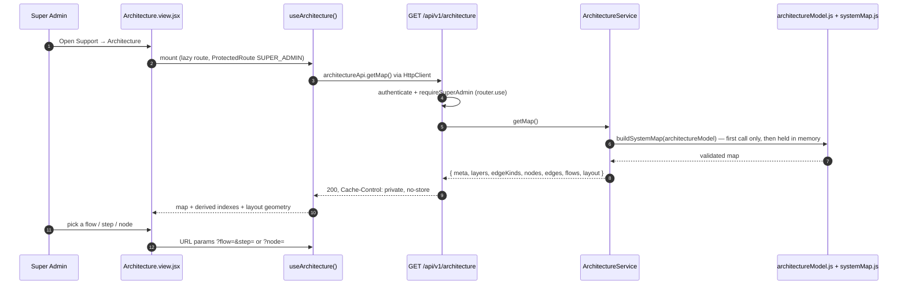

# Architecture — Technical Documentation

> **Scope:** The **Architecture page** — Support → **Architecture** (`/support/architecture`), **SUPER_ADMIN only**. An interactive map of the whole system (actors, frontend, Express edge, every API module, shared services, the runtime band, Oracle pools and table groups, external systems) with step-through request flows and a JSON export for AI agents.
> **Source (FE):** `Frontend/src/features/support/architecture/` — `Architecture.view.jsx`, `architecture.hook.js`, `architecture.api.js` — a thin feature over the shared engine in `Frontend/src/components/shared/systemMap/` (`index.js` — the barrel the features import from — `SystemMapView.jsx`, `useSystemMap.js`, `systemMapLayout.js`, `systemMapTones.js`, `SystemMapCanvas.jsx`, `FlowPanel.jsx`, `NodeDetails.jsx`, `systemMap.css`), which Support → Runtime also uses. Route registered in `Frontend/src/App.jsx`; nav item (SUPER_ADMIN block only) in `Frontend/src/components/layout/config/nav.config.jsx`.
> **Source (BE):** `Backend/src/routes/architecture.route.js`, `src/controllers/ArchitectureController.js`, `src/services/ArchitectureService.js`, `src/constants/architectureModel.js` (the hand-authored map, its `LAYOUT` and `META`), `src/utils/systemMap.js` (shared validator/assembler), `src/constants/messages/architecture.messages.js`, `ARCHITECTURE_ERRORS` in `src/constants/errors/index.js`, `ARCHITECTURE_MAP_FETCHED` in `src/constants/responses/index.js`.
> **Verified 2026-10-29.** Re-checked against the CATHERINE source: `Backend/src/constants/architectureModel.js` (`MAP_VERIFIED_AT = "2026-10-26"`, `META.system` "CATHERINE — project-agnostic Express + React template"), `Backend/src/utils/systemMap.js`, `architecture.route.js` (`requireSuperAdmin` = `requireAccess(user.role === "SUPER_ADMIN")` on `router.use`), `ArchitectureController.js` (`private, no-store, max-age=0`, `MAP_SERVED`), `ArchitectureService.js`, `architecture.messages.js`, and on the frontend `architecture.hook.js` (`cacheKey "architecture/map"`, `downloadName "architecture.json"`), `useSystemMap.js` (`staleTime 300_000`, `PLAY_INTERVAL_MS 1600`), `SystemMapCanvas.jsx` (`HOVER_LOCK_MS 250`), `App.jsx` and `nav.config.jsx`. Node, edge and flow counts in §1 were counted by hand from the model on that date. A search of `Backend/test/` and `Frontend/test/` found **no** system-map, architecture or runtime test of any kind; §6 and §8 say so instead of citing suites. No test counts are quoted.
>
> **Related docs:**
> - `Support/runtime-documentation.md` — the sibling map of how the server runs (same engine, same route, same gate).
> - `Support/dev-docs-viewer-documentation.md` — the Support page this one is modelled on (server-served, never bundled, `private, no-store`).
> - `Others/auth-documentation.md` — `AuthMiddleware.authenticate` and the role predicates.
>
> **Rendering note:** ` ```mermaid ` blocks render in GitHub/GitLab/Obsidian/VS Code — **and in the Dev Docs viewer**, via `MermaidBlock`. For PDF via Chrome print, pre-render with `mermaid-cli`.

---

## 1. Overview

The Architecture page draws the system as 50 nodes and 97 edges in eight layers, plus 12 request flows (anatomy of an API request, login & session refresh, integrity tamper sweep, data purge with mandatory backup, scheduled DB backup, metrics/alerts/logs, opening the Architecture page, admin provisioning, restore from a signed archive, health probes, version history and Dev Docs, restart detection & boot emails). Counts are by hand from `architectureModel.js` on 2026-10-29; the page header shows the live numbers. Selecting a flow highlights its path and numbers each step on the diagram; the steps can be walked with Prev/Next/Play or the arrow keys. Selecting a node shows its files, endpoints, connections and the flows it appears in. **Download JSON** exports `{ meta, layers, edgeKinds, nodes, edges, flows }` for AI agents and tooling.

The map is **hand-authored**, not inferred at runtime: `src/constants/architectureModel.js` is the source of truth. Its file header names a drift test (`test/server/unit/architecture/systemMap.test.js`) that does **not** exist in this repo yet (§6) — today only `buildSystemMap` guards it, at request time.

It is SUPER_ADMIN-only — narrower than Dev Docs, which also admits ADMIN — because it lists every endpoint, table, signing step and permission predicate in one place.

## 2. Flow & Architecture



The page appears on its own map as the flow **"Open the Architecture page"**.

## 3. Frontend implementation

| File | Role |
| --- | --- |
| `features/support/architecture/architecture.api.js` | `getMap()` → `GET architecture` through `HttpClient`. |
| `features/support/architecture/architecture.hook.js` | `useArchitecture()` = `useSystemMap({ cacheKey, fetchMap, downloadName, forbiddenMessage, loadErrorMessage })`. |
| `features/support/architecture/Architecture.view.jsx` | `<SystemMapView hook={hook} title="Architecture" … />`. |
| `components/shared/systemMap/useSystemMap.js` | Fetch via `useRequest` (5-min stale), derived indexes, URL-held selection, search, layer toggles, autoplay, camera requests, JSON download. |
| `components/shared/systemMap/systemMapLayout.js` | Pure geometry and highlight rules: `computeLayout`, `edgeGeometry`, `pointAt`, `computeHighlight`, `stepBadges`, `searchNodes`, `agentJson`, `validateMap`, `bboxOf`, `buildAdjacency`. No React, no DOM. |
| `components/shared/systemMap/systemMapTones.js` | Palette- and theme-aware layer / edge-kind tones (`tonesById`); the API's hex colours are never painted. |
| `components/shared/systemMap/SystemMapView.jsx` | Header, counts, Download JSON, diagram + Flows/Details rail (`Tabs`), keyboard shortcuts. |
| `components/shared/systemMap/SystemMapCanvas.jsx` | The SVG: pan/zoom, nodes, edges, step badges, edge tooltips, legend, layer toggles. |
| `components/shared/systemMap/{FlowPanel,NodeDetails}.jsx` | The two rail tabs. A flow's optional `ref` shows as a badge. |
| `components/shared/systemMap/systemMap.css` | SVG state styling; every surface/text colour is a theme variable, so light and dark both work. |

- **Selection lives in the URL** (`?flow=<id>&step=<n>` or `?node=<id>`), like Dev Docs' `?doc=`, so a link to "step 7 of the data purge" can be shared. `step` is 1-based and clamped to the flow's length.
- **The camera lives in refs.** Pan and zoom write the viewport `<g>` transform directly, so dragging never re-renders the diagram (about 150 nodes and edges, several hundred SVG elements). The hook only *requests* moves through a `focus` value (`{ ids, mode: "fit" | "ensure" | "all", key }`).
- **Hover is ignored until 250 ms (`HOVER_LOCK_MS`) after an animated camera move (fit/ensure/all) ends; drag and wheel do not lock it**, so a node sliding under a still cursor cannot steal the highlight from the one just clicked.
- **Edge midpoints are computed from the bezier**, not `getPointAtLength`, so badge placement is unit-testable in jsdom.
- **A click on empty canvas clears a node focus but not a flow** — panning around a flow must not drop it. `Esc` or **Clear** leaves a flow.
- Keyboard: `←` / `→` step, `Space` play/pause, `Esc` clear. Autoplay advances every 1.6 s (`PLAY_INTERVAL_MS`); the animated current-step edge stops under `prefers-reduced-motion`.

## 4. Backend implementation

| File | Role |
| --- | --- |
| `src/routes/architecture.route.js` | `router.use(authenticate)`, `router.use(requireSuperAdmin)`, `GET /` (this map) and `GET /runtime` (Support → Runtime). No cache middleware, no extra limiter. |
| `src/controllers/ArchitectureController.js` | One handler per map name (fixed per route, never from the request); projects the seven keys explicitly; `Cache-Control: private, no-store, max-age=0`; logs `MAP_SERVED`. |
| `src/services/ArchitectureService.js` | `getMap(name)` builds each map once per process and holds it; a failed build is logged (`MAP_BUILD_FAILED`) and **not** cached, and does not affect the other map. |
| `src/constants/architectureModel.js` | Hand-authored nodes, edges, flows, diagram `LAYOUT` and `META`. Bump `MAP_VERIFIED_AT` when re-checking it against the code — the page shows it as "Verified <date>". |
| `src/utils/systemMap.js` | `buildSystemMap(model)` — the shared validator/assembler. Throws on an unknown node, a duplicate, a flow step with no edge, or an unplaced node. |

Both data files sit under `src/` deliberately: PKG bundles `src/**/*.js`, so the `.exe` can serve the map without a build step or generated artefact (`src/generated/` is gitignored and would be missing from a fresh clone).

## 5. How frontend and backend connect (the contract)

### `GET /api/v1/architecture`

- **Auth:** access-token cookie; `SUPER_ADMIN` only. Every other role → `403`; no session → `401`.
- **200 body:** `sendSuccess("Architecture map fetched successfully.", { meta, layers, edgeKinds, nodes, edges, flows, layout })`.
  - `nodes[]`: `{ id, layer, label, subtitle, description, files?, endpoints? }`
  - `edges[]`: `{ id: "<source>-><target>", source, target, kind, label }`
  - `flows[]`: `{ id, name, category, summary, nodes[], edges[], steps[] }`; each step `{ step, from, to, edge, reverse, action, detail }`. `reverse: true` means the step travels its edge backwards (a response).
  - `layout`: diagram placement for the UI only. The downloaded JSON omits it.
- **500:** `"This system map is unavailable on this server."` — the model failed validation. The validator's detail goes to the server log only.

## 6. Technicalities

**Completeness.** The template's map covers the modules mounted in `Backend/src/routes/index.js` (health, csrf, client, auth, admin-management, audit-logs, metrics, changelog, dev-docs, architecture, integrity, data-purge), the two pools `appDb` / `appDbBulk`, and the table groups `T_USERS_DEV` / `T_ADMINS_DEV` / refresh-token ledger, audit and alert tables, and backup governance tables. The changelog is the encrypted file `data/changelog.enc`, not a database table. No automated completeness check exists in this repo; whether every `src/**/*.js` file is on a node was **not** re-verified for this document.

**Keeping the map honest.** The model's file header describes `test/server/unit/architecture/systemMap.test.js`, which would fail when:

1. the shipped model does not build (unknown node, flow step with no edge, unplaced node);
2. any `Backend/...` path on a node no longer exists;
3. the endpoints the model lists differ from the endpoints the route files declare.

**That test is not in this repo.** Until it is added, only rule 1 is enforced — by `buildSystemMap` when the first request arrives (a broken model is a 500, §5). Rules 2 and 3 are on whoever changes a route or moves a file: **adding a route means adding it to `architectureModel.js`** (to the module node's `endpoints`, via `eps(...)`), and **adding a file means adding it to some node's `files`**.

**Test coverage by category** (both maps share it):

| Category | API (`Backend/test/server/…`) | UI (`Frontend/test/…`) |
| --- | --- | --- |
| Unit | none in this repo | none in this repo |
| Integration | none in this repo | none in this repo |
| Security | none in this repo | none in this repo |
| Performance | none in this repo | none in this repo |
| Reliability | none in this repo | none in this repo |
| Chaos | none in this repo | none in this repo |

**Bad payloads never draw half a map.** `validateMap` (`systemMapLayout.js`) checks a payload before anything is drawn; an empty body, a missing layout, or an edge/step pointing at something that does not exist becomes one "map data is incomplete" alert instead of a blank page or a geometry crash. `validateMap` never throws: it returns a list of problems, and a null step, a null flow, a null layer, a layout column without a node list, a flow without `nodes` or `steps`, and node `files` / `endpoints` that are not lists of text are each reported as a problem rather than raised. The server side is just as strict: `buildSystemMap` (`src/utils/systemMap.js`) walks every flow's steps with an indexed loop, so a sparse hole (a `,,` typo), an `undefined` step or a `steps` value that is not an array is rejected with the validator's "model is invalid" error instead of being served as a null step or crashing with a raw `TypeError`.

What the test cannot catch: a wrong *description*, a missing *edge*, or a flow that no longer reflects the code path. Those are on whoever changes the behaviour; bump `MAP_VERIFIED_AT` after re-checking.

**Adding a node** also means placing it in `LAYOUT` in `architectureModel.js` (a column or the runtime band) — the builder refuses an unplaced node.

**Scope choices.** Project services are folded into their API module node; only cross-cutting services are separate (`META.caveats`). Related tables are grouped into one node. A project built on this template adds its own API module nodes, table groups and flows.

**Edge kinds.** `http`, `sse`, `call`, `sql`, `device`, `ipc`, `schedule`, `smtp`, `fs` (`edgeKinds` in the model). `device` is declared but no template edge uses it.

## 7. Security

- **The route is the control.** `requireSuperAdmin` on the router (`router.use`, so a later route cannot skip it). The nav entry existing only in the SUPER_ADMIN block, and the `ProtectedRoute` guard, are conveniences.
- **No static copy.** The map is never bundled into the frontend or `public/` — a static asset has no auth check.
- **No caching outside the session.** `private, no-store`; no cache middleware (a shared entry is the easiest way to leak a role-gated body).
- **CWE-209.** A failed build returns a generic message; the validator's detail (node ids, file names) is logged server-side only.
- **Audit.** Each read logs `System map "architecture" served — admin EMP_ID: …, nodes: …, flows: ….` (`MAP_SERVED`, called with `req.user?.userId`; the "EMP_ID" label is legacy wording in the message template) — never the contents.

## 8. Verification Q&A

> **Evidence convention.** No system-map test exists in `Backend/test/` or `Frontend/test/`. Every answer below is from reading the named source on 2026-10-29 and is marked _no test in this repo_. Writing the suites is an open gap.

**Q: Can an ADMIN or USER read the map?**
No — 403 from the server.
**Evidence (API):** source only — `architecture.route.js`: `router.use(authenticate)`, then `router.use(requireSuperAdmin)` where `requireSuperAdmin = AuthMiddleware.requireAccess((user) => user.role === "SUPER_ADMIN", …)`.
**Evidence (UI):** source only — `useSystemMap.js` shows `forbiddenMessage` ("The architecture map is available to Super Admins only.") on a 403. _Status: no test in this repo._

**Q: Does a refused caller still receive part of the map in the error body?**
No.
**Evidence (API):** source only — the route-level gate runs before the controller, so `ArchitectureService.getMap` is never called for a refused caller.
**Evidence (UI):** none — backend-only. The view renders only the alert on a refusal and never draws the diagram. _Status: no test in this repo._

**Q: Who sees the Architecture nav item?**
SUPER_ADMIN only; ADMIN sees Dev Docs but not Architecture.
**Evidence (API):** none — UI-only; the nav item is client configuration (the server-side gate is covered above).
**Evidence (UI):** source only — `nav.config.jsx` lists "Architecture" (`/support/architecture`) in the SUPER_ADMIN-only group and `DEV_DOCS_ITEM` for ADMIN + SUPER_ADMIN; `App.jsx` wraps the route in `ProtectedRoute role={[ROLES.SADMIN]}`. _Status: no test in this repo._

**Q: Is the response cacheable by a browser or proxy?**
No — `private, no-store`.
**Evidence (API):** source only — `ArchitectureController.js` sets `Cache-Control: private, no-store, max-age=0`; the route has no cache middleware.
**Evidence (UI):** none — backend-only. `Cache-Control` has no on-screen representation. _Status: no test in this repo._

**Q: What happens if the model fails validation?**
500 with a generic message that names no node, edge or path; the next request builds again; the Runtime map is unaffected.
**Evidence (API):** source only — `ArchitectureService.getMap(name)` catches the builder error, logs `MAP_BUILD_FAILED`, throws `AppError(ARCHITECTURE_ERRORS.MAP_UNAVAILABLE, 500)` and does not cache the failure; each map name is built separately.
**Evidence (UI):** none — backend-only. The view shows its generic load-failure alert for any non-403 error. _Status: no test in this repo._

**Q: What stops the map drifting from the code?**
Today, only `buildSystemMap` (unknown node / layer / edge kind, duplicate node / edge / flow, a flow step with no edge, an unplaced or doubly placed node). The path and endpoint-parity checks described in the model's header are not implemented in this repo.
**Evidence (API):** source only — `Backend/src/utils/systemMap.js`. `test/server/unit/architecture/systemMap.test.js` does not exist.
**Evidence (UI):** none — backend-only. _Status: no test in this repo._

**Q: Can a flow step be linked to directly?**
Yes — `?flow=<id>&step=<n>`; an out-of-range step is clamped.
**Evidence (API):** none — UI-only; selection is held in the browser URL.
**Evidence (UI):** source only — URL-held selection in `useSystemMap.js`. _Status: no test in this repo._

**Q: How does the diagram show a step that is a response rather than a request?**
The step's `reverse` flag: the edge animates backwards and the step list shows `⇠`.
**Evidence (API):** source only — `buildSystemMap` looks up `${from}->${to}`, then `${to}->${from}` and sets `reverse = true` when only the latter exists.
**Evidence (UI):** source only — `FlowPanel.jsx` / `SystemMapCanvas.jsx`. _Status: no test in this repo._

**Q: Does the downloaded JSON include the diagram layout?**
No — it carries `meta, layers, edgeKinds, nodes, edges, flows` only.
**Evidence (API):** none — UI-only; the API serves `layout` because the page needs it, and the page strips it from the download.
**Evidence (UI):** source only — `agentJson(map)` in `systemMapLayout.js`, used by the Download JSON handler in `useSystemMap.js`. _Status: no test in this repo._

**Q: Is everything in the codebase actually on a map?**
Not guaranteed. No completeness check exists in this repo; a new source file, feature folder or table can be left off the map without anything failing.
**Evidence (API):** none — no test in this repo.
**Evidence (UI):** none. _Status: no test in this repo._

**Q: What does the page do with a payload it cannot draw?**
Shows one alert; never a blank page, never a crash.
**Evidence (API):** none — UI-only; the API validates its own models (see the build check above).
**Evidence (UI):** source only — `useSystemMap.js` runs `validateMap(data)` and, when problems are found, shows `${loadErrorMessage} The map data is incomplete.` _Status: no test in this repo._

**Q: What happens when the map is malformed in a way that used to crash the page (a null step, a null flow or layer, a column with no node list, a flow with no nodes or steps)?**
One "Could not load the … map" alert ending "The map data is incomplete."; never a crash and never half a diagram. `validateMap` reports each defect instead of throwing, and the server's builder refuses to serve the same defects in the first place.
**Evidence (API):** source only — the indexed loop in `buildSystemMap` (`"flow … step N: not a [from, to, action, detail] step"`, `"flow …: steps is not an array"`).
**Evidence (UI):** source only — `validateMap` in `systemMapLayout.js`. _Status: no test in this repo._

**Q: Can a map string inject script?**
No — every field renders as text.
**Evidence (API):** none — UI-only; the API serves plain data.
**Evidence (UI):** source only — the components render map strings as React text children (no `dangerouslySetInnerHTML` was found in `Frontend/src/components/shared/systemMap/` on 2026-10-29). _Status: no test in this repo._

**Q: Does it hold up under faults and load?**
By design: a failed build is not cached and only that map fails; a successful build is held for the life of the process. Not load-, chaos- or concurrency-tested.
**Evidence (API):** none — no test in this repo.
**Evidence (UI):** none — no test in this repo.

---

_End of document. Updated 2026-10-29._
