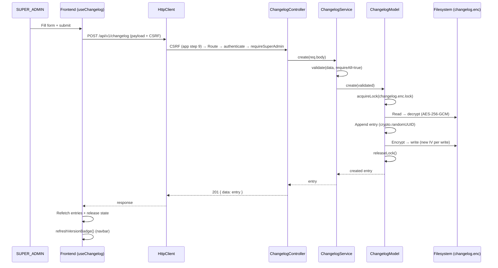
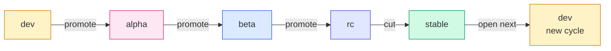
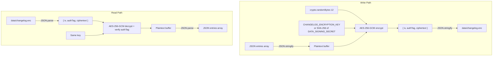

# Changelog & Release Train — Technical Documentation

> **Scope:** Version history management, AES-256-GCM encrypted file-based storage, SemVer release train lifecycle, and the "Version History" UI.
> **Source (FE):** `Frontend/src/features/support/changelog/` (`changelog.api.js`, `changelog.hook.js`, `Changelog.view.jsx`, `components/*`), `Frontend/src/contexts/version/VersionContext.jsx`, `Frontend/src/components/layout/config/nav.config.jsx` (`canSeeVersion`). Route `about/changelog` (public) in `Frontend/src/App.jsx`.
> **Source (BE):** `Backend/src/routes/changelog.route.js`, `src/controllers/{ChangelogController,ReleaseController}.js`, `src/services/{ChangelogService,ReleaseService}.js`, `src/models/changelog.model.js`, `src/config/bootGuard.js`, `CHANGELOG_ERRORS` in `src/constants/errors/index.js`, `CHANGELOG_*` / `RELEASE_STATE_FETCHED` in `src/constants/responses/index.js`; store `Backend/data/changelog.enc`; scripts `Backend/scripts/{dump-changelog,seed-changelog}.js`.
> Diagrams render in GitHub/GitLab/Obsidian/VS Code preview.
>
> **Verified 2026-10-29** against the source files above. The only test touching this feature in this repo is `Frontend/test/integration/changelog-httpclient.test.jsx` (CSRF injection over the real `HttpClient`); there is no backend changelog/release test. No tests were run for this revision. The sibling **Dev Docs** item has its own document, `Support/dev-docs-viewer-documentation.md`.

## 1. Overview

The Changelog (branded as **"Version History"** in the UI) is a file-based, AES-256-GCM encrypted feature that tracks platform releases. It does **not** use Oracle or any database — data lives in a single encrypted JSON file (`Backend/data/changelog.enc`). A built-in **Release Train** sub-feature manages a SemVer stage ladder (`dev → alpha → beta → rc → stable`), generating draft entries for promotions and new cycles. Anonymous visitors can read a privacy-stripped version; only SUPER_ADMINs can create, edit, or delete entries.

## 2. Flow & Architecture

### 2.1 Changelog CRUD Flow



This diagram shows the full create flow. Every write acquires an exclusive cross-process lockfile, reads and decrypts the store, appends the new entry, re-encrypts with a fresh IV, writes back, and releases the lock. The frontend refetches both the entry list and the release-train state after any mutation.

### 2.2 Release Train Stage Ladder



The release train derives its state from the highest-precedence version in the changelog store. Each stage has exactly one forward action: `promote` advances one stage (dev→alpha→beta→rc), `cut` finalizes rc→stable, and `open` starts a new cycle at dev. The backend generates pre-filled draft entries for each valid action.

### 2.3 Encryption at Rest



Every write generates a fresh 12-byte IV. The GCM auth tag provides both confidentiality and integrity verification — a tampered file will fail decryption. Key resolution: `CHANGELOG_ENCRYPTION_KEY` (64-char hex → 32-byte key) takes priority; fallback is `DATA_SIGNING_SECRET` (≥32 chars) hashed through SHA-256.

## 3. Frontend Implementation

| File                                                                   | Responsibility                                                                                                                 |
| ---------------------------------------------------------------------- | ------------------------------------------------------------------------------------------------------------------------------ |
| `src/features/support/changelog/changelog.api.js`                      | HTTP calls — `list()`, `listPublic()`, `latestPublic()`, `create()`, `update()`, `delete()`, `release.current()`               |
| `src/features/support/changelog/changelog.hook.js`                     | `useChangelog()` — entries, modals, form state, date journey navigation, release train actions, `whatChanged` serialization    |
| `src/features/support/changelog/Changelog.view.jsx`                    | Page view — date journey layout, `ErrorBoundary` + `ANIMATE_PAGE_ENTER`                                                        |
| `src/features/support/changelog/components/ChangelogForm.jsx`          | Shared create/edit form (type, date, version, title, message, whatChanged, authors, coAuthors)                                 |
| `src/features/support/changelog/components/DateJourneyNav.jsx`         | Sticky right rail — year-grouped date list, search, vertical journey line connector                                            |
| `src/features/support/changelog/components/DateJourneyPanel.jsx`       | Selected-date content panel — timeline, entry cards, collapsible "What Changed", older/newer steppers                          |
| `src/features/support/changelog/components/ReleaseControl.jsx`         | SUPER_ADMIN card — current version, visual ladder progress strip, promote/cut/open buttons                                     |
| `src/features/support/changelog/components/shared/changelogMeta.js`    | `TYPE_META` (11 types with badge variant, icon, label, dot colour), date formatting, `buildDateGroups()`, `filterDateGroups()` |
| `src/features/support/changelog/components/shared/ChangelogBadges.jsx` | `VersionBadge` (orange mono pill) + `StageBadge` (inferred from version pre-release tag)                                       |
| `src/contexts/version/VersionContext.jsx`                              | Fetches `latestPublic()` (falls back to `listPublic()` on a 404) → resolves real app version for navbar/sidebar badge, caches in `sessionStorage` |

### Key UI Behaviours

**Auth-first fetch with public fallback:** The hook tries `changelogApi.list()` first; on 401/403, it falls back to `changelogApi.listPublic()` — so anonymous visitors can still read the Version History without author names.

**Date journey:** Entries are grouped by `displayDate` via `buildDateGroups()`. Only one date's entries render at a time. Selection is mirrored to `?date=YYYY-MM-DD` query param for deep linking. The right rail shows year-grouped dates with type-coloured dots, and supports free-text search across date/version/title/message/type.

**Release train integration:** Both content builds and release markers go through the same create form. The form is seeded from `releaseState.drafts` (promote/cut/open) or from the next in-cycle build (`drafts.content`). After any release action, the hook calls `refreshVersionBadge()` to update the navbar badge.

**`whatChanged` serialization:** Textarea ↔ structured array conversion via `serializeWhatChanged()` / `parseWhatChanged()`. Two-space indent in the textarea maps to nested `items` in the structured array.

### Entry Types

| Type       | Badge (`TYPE_META.badge`) | Label       |
| ---------- | ------------------------- | ----------- |
| `breaking` | red                       | Breaking    |
| `feat`     | blue                      | Feature     |
| `fix`      | red                       | Bug Fix     |
| `patch`    | amber                     | Patch       |
| `perf`     | purple                    | Performance |
| `refactor` | grey                      | Refactor    |
| `security` | orange                    | Security    |
| `test`     | cyan                      | Test        |
| `docs`     | cyan                      | Docs        |
| `chore`    | grey                      | Chore       |
| `release`  | green                     | Release     |

An unknown type falls back to `TYPE_META.feat` for display. The backend allow-list (`VALID_TYPES` in `ChangelogService.js`) is the same 11 values.

## 4. Backend Implementation

| Method & Path                           | Handler / File                   | Purpose                                                              |
| --------------------------------------- | -------------------------------- | -------------------------------------------------------------------- |
| `GET /api/v1/changelog/public`          | `ChangelogController.listPublic` | Author-stripped entries for anonymous visitors — rate-limited 30/min |
| `GET /api/v1/changelog/public/latest`   | `ChangelogController.latestPublic` | Newest author-stripped entry only (or `null`) — the version badge's read; same 30/min limiter |
| `GET /api/v1/changelog`                 | `ChangelogController.list`       | Full entries with authors — any authenticated user                   |
| `GET /api/v1/changelog/release/current` | `ReleaseController.current`      | Release-train state + drafts — SUPER_ADMIN                           |
| `POST /api/v1/changelog`                | `ChangelogController.create`     | Create entry — SUPER_ADMIN + CSRF                                    |
| `PUT /api/v1/changelog/:id`             | `ChangelogController.update`     | Partial update — SUPER_ADMIN + CSRF                                  |
| `DELETE /api/v1/changelog/:id`          | `ChangelogController.delete`     | Permanent delete — SUPER_ADMIN + CSRF                                |

**Route ordering note:** `/public` and `/release/current` are declared before `/:id` to prevent the parameterised matcher from shadowing literal paths.

### Validation Rules

| Field                                                | Rule                                                                                 |
| ---------------------------------------------------- | ------------------------------------------------------------------------------------ |
| `displayDate`                                        | Must match `YYYY-MM-DD` regex                                                        |
| `version`                                            | Must match SemVer regex: `MAJOR.MINOR.PATCH` with optional `-dev\|alpha\|beta\|rc.N` |
| `type`                                               | Must be one of 11 allowed types                                                      |
| `whatChanged`                                        | Must be array if present                                                             |
| `displayDate`, `version`, `title`, `message`, `type` | All required on create; partial on update                                            |
| `authors` / `coAuthors`                              | Accept array or comma-separated string → normalised to trimmed string array          |

### Encryption & Storage

- **Algorithm:** AES-256-GCM
- **IV:** 12 random bytes per write (`crypto.randomBytes(12)`)
- **Key resolution:** `CHANGELOG_ENCRYPTION_KEY` (64-char hex) → `DATA_SIGNING_SECRET` (≥32 chars, SHA-256 hashed)
- **Auth tag:** GCM authentication tag (integrity verification)
- **File location:** `Backend/data/changelog.enc` (resolved beside the executable under pkg: `PROJECT_ROOT = process.pkg ? path.dirname(process.execPath) : path.resolve(__dirname, "../..")`)
- **File format:** `{ iv: "<hex>", authTag: "<hex>", ciphertext: "<hex>" }`

### Cross-Process File Lock

- **Mechanism:** Exclusive-create lockfile (`fs.openSync(path, "wx")`) at `data/changelog.enc.lock`
- **Stale lock timeout:** 10,000ms — a lock older than this is stolen
- **Retry interval:** 25ms (blocking sleep via `Atomics.wait`)
- **Acquisition timeout:** 5,000ms → throws `STORE_UNAVAILABLE` (503)
- **Purpose:** Serialises read-modify-write cycles across processes (`ENABLE_CLUSTERING` workers, or two instances behind a load balancer)
- **Errors:** `CHANGELOG_ERRORS` — `ENTRY_NOT_FOUND`, `STORE_UNAVAILABLE`, `INVALID_ENTRY`

### Release Train — `ReleaseService`

Read-only service that derives the release-train state from the highest-precedence version in the changelog store.

**Stage ladder:** `dev → alpha → beta → rc → stable`

**SemVer helpers:** `parseVersion(v)`, `compareVersion(a, b)` (SemVer 2.0.0 precedence), `bumpCore(p, bump)`, `composeVersion(p)`.

**`getState()` return shape:**

```js
{
  hasTarget: boolean,        // false when store is empty or last version is stable
  version: "1.19.0-beta.2", // current highest version
  core: "1.19.0",           // MAJOR.MINOR.PATCH
  stage: "beta",            // dev | alpha | beta | rc | stable
  iter: 2,                  // iteration within stage
  label: "Beta",            // human-readable stage label
  nextActions: ["promote"], // valid next actions
  drafts: {
    content: { version, stage, type, title, message, whatChanged },  // next in-cycle build
    promote: { ... },  // advance one stage
    cut: null,         // rc → stable (null when not in rc)
    open: { patch, minor, major }  // open next cycle (null when not stable)
  }
}
```

### Boot Guard

`CHANGELOG_ENCRYPTION_KEY` is one of the `SECRET_RULES` in `src/config/bootGuard.js` (minimum 32 characters, must not be a `.env.example` placeholder). In production (`NODE_ENV=production`) any violation causes `process.exit(1)` (fail closed); in development it is logged as a warning.

> Note the two checks differ: the boot guard accepts ≥32 characters, while `changelog.model.js` `resolveKey()` uses the key only when it is **exactly 64 characters** (hex → 32 bytes) and otherwise falls back to SHA-256 of `DATA_SIGNING_SECRET`. A 32–63-character key passes the boot guard but is silently ignored by the model. Flagged for the backend owner; not changed here.

## 5. How Frontend and Backend Connect (the Contract)

### `GET /api/v1/changelog` — Full List (Authenticated)

**Auth:** JWT cookie, any role. **CSRF:** Not required (GET).

```json
// Response 200
{
    "status": "success",
    "code": 200,
    "message": "Changelog entries fetched successfully.",
    "data": [
        {
            "id": "a1b2c3d4-...",
            "displayDate": "2026-07-10",
            "version": "1.20.0",
            "title": "Report Export Overhaul",
            "message": "Redesigned the report export pipeline.",
            "whatChanged": [
                {
                    "text": "Added streaming Excel generation",
                    "items": ["Lower memory use on large exports"]
                },
                { "text": "Fixed a filter edge case" }
            ],
            "type": "feat",
            "authors": ["John Doe"],
            "coAuthors": ["Jane Doe"],
            "createdAt": "2026-07-10T08:00:00.000Z",
            "updatedAt": "2026-07-10T08:00:00.000Z"
        }
    ]
}
```

### `GET /api/v1/changelog/public` — Public List (Unauthenticated)

**Auth:** None. **Rate limit:** 30 req/min. Same shape as above but **without** `authors` and `coAuthors` fields (privacy: staff names not exposed to anonymous visitors).

### `GET /api/v1/changelog/public/latest` — Newest Public Entry (Unauthenticated)

**Auth:** None. **Rate limit:** the SAME 30 req/min limiter instance as `/public` — one per-IP budget across both. `data` is exactly `/public`'s `data[0]` (`ChangelogService.latestPublic()` is `listPublic()[0] ?? null`, never a second sort), or `null` for an empty store.

A performance-only route: `VersionContext` needs one field, and reading the whole public list for it on every landing-page visit grows with the store; this answers one entry. The badge falls back to `/public` on a 404, so a UI deployed ahead of the API shows the same version. No test in this repo covers this route (source only — `ChangelogService.latestPublic`, `VersionContext.jsx`).

### `POST /api/v1/changelog` — Create Entry

**Auth:** JWT cookie, SUPER_ADMIN. **CSRF:** Required.

```json
// Request
{
  "displayDate": "2026-07-10",
  "version": "1.20.0",
  "title": "Report Export Overhaul",
  "message": "Redesigned the report export pipeline.",
  "whatChanged": [{ "text": "Added streaming Excel generation" }],
  "type": "feat",
  "authors": "John Doe, Jane Doe",
  "coAuthors": "Bob Smith"
}

// Response 201
{
  "status": "success",
  "code": 201,
  "message": "Changelog entry created successfully.",
  "data": { /* full entry with id, createdAt, updatedAt */ }
}
```

### `PUT /api/v1/changelog/:id` — Partial Update

**Auth:** JWT cookie, SUPER_ADMIN. **CSRF:** Required. Only provided fields are validated and merged. Allowed fields: `displayDate`, `version`, `title`, `message`, `whatChanged`, `type`, `authors`, `coAuthors`.

### `DELETE /api/v1/changelog/:id` — Delete

**Auth:** JWT cookie, SUPER_ADMIN. **CSRF:** Required.

```json
// Response 200
{
    "status": "success",
    "code": 200,
    "message": "Changelog entry deleted successfully.",
    "data": null
}
```

### `GET /api/v1/changelog/release/current` — Release Train State

**Auth:** JWT cookie, SUPER_ADMIN.

```json
// Response 200
{
    "status": "success",
    "code": 200,
    "message": "Release state retrieved successfully.",
    "data": {
        "hasTarget": true,
        "version": "1.20.0-beta.2",
        "core": "1.20.0",
        "stage": "beta",
        "iter": 2,
        "label": "Beta",
        "nextActions": ["promote"],
        "drafts": {
            "content": {
                "version": "1.20.0-beta.3",
                "stage": "beta",
                "type": "feat",
                "title": "",
                "message": "",
                "whatChanged": []
            },
            "promote": {
                "version": "1.20.0-rc.1",
                "stage": "rc",
                "type": "release",
                "title": "1.20.0 promoted to Release Candidate",
                "message": "..."
            },
            "cut": null,
            "open": null
        }
    }
}
```

### Version Badge Integration

The `VersionContext` provider calls `changelogApi.latestPublic()` (`GET /changelog/public/latest`) to resolve the real app version for the navbar/sidebar badge; only a **404** (an API that predates the route) falls back to `listPublic()`, and any other failure leaves the badge unresolved rather than downloading the full list. The resolved version is cached in `sessionStorage` (key `app_ver`). After any release-train action, the hook calls `refreshVersionBadge()` to update the badge immediately.

**Who sees the version.** The badge and the **Version History** nav entry are shown to **ADMIN and SUPER_ADMIN only**. `canSeeVersion(role)` in `Frontend/src/components/layout/config/nav.config.jsx` (backed by `VERSION_VISIBLE_ROLES = new Set(["ADMIN", "SUPER_ADMIN"])`) is the single source of truth; `Navbar.jsx`, `Sidebar.jsx` and `SidebarHeader.jsx` all call it. The reason is CWE-200 — a visible version string helps an attacker match known CVEs, and a USER has no need for it. ⚠ This is **surfaced visibility only**: `/about/changelog` stays link-reachable and `GET /changelog/public` stays unauthenticated, by design — anyone who knows the URL can still read the version.

## 6. Technicalities

### Why File-Based (Not Oracle)?

The changelog is a low-write, high-read dataset with a small cardinality (hundreds of entries, not millions). File-based storage with encryption avoids Oracle schema management, migration scripts, and the operational overhead of a new table for what is essentially a configuration artifact. The cross-process lockfile handles the rare concurrent-write case.

### Fresh IV Per Write

Every write generates a new 12-byte IV via `crypto.randomBytes(12)`. This ensures that even identical plaintext produces different ciphertext, preventing pattern analysis. The GCM auth tag provides authenticated encryption — a tampered ciphertext or auth tag will fail decryption with an error, not silent corruption.

### Cross-Process Lock Mechanics

With `ENABLE_CLUSTERING=true` (or several instances) more than one process can write. The lockfile mechanism uses `fs.openSync(path, "wx")` (exclusive create) — only one process can create the file. Other processes retry every 25ms (via `Atomics.wait` to avoid busy-spinning) for up to 5 seconds. Stale locks from crashed workers are detected by checking the lock file's mtime against a 10-second threshold and stolen if expired.

### Migration Compatibility

Old entries with a `summary` field (pre-structured format) are auto-migrated to `message` + `whatChanged: []` on read. This is a non-destructive migration — the original data is preserved and the new fields are populated on the next write.

### SemVer Precedence

Version comparison follows SemVer 2.0.0: pre-release versions (`-dev.1`, `-alpha.1`, etc.) have lower precedence than the bare release (`1.20.0-rc.1 < 1.20.0`). Within pre-release, stages are ordered by the ladder (`dev < alpha < beta < rc`), then by iteration number.

### Maintenance scripts — dump → seed

The app writes the store only through `ChangelogService` → `ChangelogModel` (the CRUD routes above). Two offline scripts in `Backend/scripts/` exist for capturing and re-seeding it, wired as `npm run changelog:dump` and `npm run changelog:seed`. Each reads the same key `ChangelogModel` uses (`CHANGELOG_ENCRYPTION_KEY`, else `DATA_SIGNING_SECRET`) from `.env`. (`scripts/seed-template.js` is unrelated — it seeds the demo accounts.)

| Step | Script | Reads | Writes |
|---|---|---|---|
| 1. Dump | `dump-changelog.js` (`npm run changelog:dump`) | `data/changelog.enc` via `ChangelogModel.listAll()` (`.env` loaded by absolute path, so any cwd works) | `scripts/changelog-dump.json` — **decrypted plaintext**, oldest → newest |
| 2. Seed | `seed-changelog.js` (`npm run changelog:seed`) | the in-file `SEED_ENTRIES` array (oldest → newest; `.env` loaded relative to the **current directory**, so run it from `Backend/`) | `data/changelog.enc` via `ChangelogModel.resetStore(SEED_ENTRIES)` — **wipes and rewrites the whole store** under the same lockfile |

The seed does not read the dump file; to carry UI-written entries into a re-seed, copy them from the dump into `SEED_ENTRIES` by hand. Run `dump-changelog.js` immediately before any seed, because the seed overwrites everything written through the UI.

> ⚠ **`scripts/changelog-dump.json` is a plaintext copy of the encrypted store** — including the `authors`/`coAuthors` the public route strips. It is **present in this repo** and `Backend/.gitignore` does **not** list it (checked for this revision). Whether it should be tracked is a security decision for the backend/security owner; until then, regenerate it locally only when needed and treat its contents as non-public.

## 7. Security

| Vector                 | Protection                                                                                              |
| ---------------------- | ------------------------------------------------------------------------------------------------------- |
| **Authentication**     | JWT required on all routes except `GET /public` and `GET /public/latest`                                |
| **Authorization**      | `requireSuperAdmin` (`user.role === "SUPER_ADMIN"`) on all mutating routes + release state              |
| **CSRF**               | App-level step 9 (`src/app.js`), enforced on POST/PUT/DELETE via the `x-csrf-token` header               |
| **Rate limiting**      | `GET /public` and `GET /public/latest` share one limiter: 30 req/60s (`RateLimit:changelog-public`)     |
| **Encryption at rest** | AES-256-GCM with authenticated encryption (confidentiality + integrity)                                 |
| **Key management**     | Boot guard validates presence, length ≥32 and non-placeholder; `process.exit(1)` in production (see §4 note on the 64-char model rule) |
| **Input validation**   | SemVer regex (anchored, no unbounded wildcard — CWE-20), type allow-list, date format regex             |
| **Injection**          | No SQL (file-based store); SecurityFilterMiddleware blocks SQL/XSS/traversal patterns in request bodies |
| **Concurrency**        | Cross-process advisory lockfile prevents lost updates                                                   |
| **Privacy**            | `listPublic()` strips `authors`/`coAuthors` from anonymous responses                                    |
| **Error handling**     | No stack traces in production; no encryption keys or file paths leaked in responses                     |
| **Path traversal**     | `:id` is matched against entry ids (`crypto.randomUUID`) inside the decrypted array — never used as a path |
| **Plaintext copies**   | `scripts/changelog-dump.json` (decrypted dump) is present and **not** gitignored in this repo — flagged in §6 "Maintenance scripts" |

## 8. Verification Q&A

> **No backend test for the changelog or release train exists in this repo**, and the only frontend test is `Frontend/test/integration/changelog-httpclient.test.jsx`. Answers below are read from source unless a test is named; none was run for this revision.

> **Q:** Are mutating endpoints properly restricted to SUPER_ADMIN?
> **A:** Yes, per source. POST/PUT/DELETE and `GET /release/current` all run `AuthMiddleware.authenticate` then `requireSuperAdmin` (`user.role === "SUPER_ADMIN"`), so USER and ADMIN are refused with 403.
> **Evidence:** source only — `Backend/src/routes/changelog.route.js`.
> **Gap:** a security suite covering JWT bypass, role escalation (ADMIN/USER denied on mutations), CSRF and no stack-trace leakage.
> _Status: no test in this repo._

> **Q:** Do mutations carry the CSRF token and GET requests not?
> **A:** Yes. `list()` (GET) reaches the endpoint with no `x-csrf-token`; `create`/`update`/`delete` carry the bootstrapped token through the real `HttpClient`, and a 500 on create still proves the token was sent.
> **Evidence (UI):** `Frontend/test/integration/changelog-httpclient.test.jsx` → `"rejects create() on a 500 but proves the CSRF token WAS sent — a server failure is not an injection failure"`, `"list() (GET) reaches the real endpoint carrying NO x-csrf-token and unwraps the success envelope"`.
> _Status: not run for this revision._

> **Q:** Does the cross-process lock prevent concurrent write corruption?
> **A:** By design, yes. `withLock()` wraps every create/update/delete/resetStore: exclusive `wx` lockfile, 25 ms retry, 5 s acquisition timeout → `STORE_UNAVAILABLE` (503), stale lock (>10 s) stolen.
> **Evidence:** source only — `Backend/src/models/changelog.model.js` (`_acquireLock`, `withLock`).
> **Gap:** a chaos test for concurrent creates, a live lock → 503, and stale-lock recovery.
> _Status: no test in this repo._

> **Q:** Does the public endpoint strip author information?
> **A:** Yes, per source. `listPublic()` destructures out `authors` and `coAuthors`; `latestPublic()` is `listPublic()[0] ?? null`, so the badge read is stripped the same way.
> **Evidence:** source only — `Backend/src/services/ChangelogService.js`.
> **Gap:** a security test that stubs `ChangelogModel.listAll` with fixtures carrying authors and asserts no name in either public body. A frontend MSW handler cannot cover this — it replaces the server with a fixture.
> _Status: no test in this repo._
> **Evidence (UI):** none — backend-only; no screen shows this. The Version History view never renders `authors`/`coAuthors` for any role (only date/version/stage/type/message/whatChanged) — there is no screen where a stripping regression could even become visible.

> **Q:** Does validation correctly reject invalid SemVer versions?
> **A:** Yes, per source. `SEMVER_RE = /^\d+\.\d+\.\d+(?:-(?:dev|alpha|beta|rc)(?:\.\d+)+)?$/` is anchored; `DATE_RE` requires `YYYY-MM-DD`; `type` must be in `VALID_TYPES` (11 values). A failure is a 400 with a `details` array. The Create/Edit form has no client-side format gate — it surfaces whatever the backend returns.
> **Evidence:** source only — `Backend/src/services/ChangelogService.js`.
> **Gap:** a unit test for the SemVer accept/reject matrix, the 11 types and partial-update acceptance.
> _Status: no test in this repo._

> **Q:** Does the frontend date journey support deep linking?
> **A:** Yes. The selected date is mirrored to `?date=YYYY-MM-DD` query param. On mount, the hook reads the query param and selects the corresponding date group.
> **Evidence:** source only — `Frontend/src/features/support/changelog/changelog.hook.js` (`useSearchParams`, `urlDate`). UI-only; the backend serves the same list regardless of which date the URL names.
> _Status: no test in this repo._

> **Q:** Does the VersionContext correctly resolve the app version from the changelog?
> **A:** Per source, yes. It reads `latestPublic()` (`GET /changelog/public/latest`), caches the result in `sessionStorage` under `app_ver`, falls back to `listPublic()` only on a 404 (any other error is rethrown), and keeps the build-time fallback (`APP_VERSION` / `APP_STAGE` from `src/config/appVersion.js`) for an empty store or a failure.
> **Evidence:** source only — `Frontend/src/contexts/version/VersionContext.jsx`, `Backend/src/services/ChangelogService.js` → `latestPublic`.
> _Status: no test in this repo._

### Coverage Summary

> **Q: Does a server fault get masked by the public-endpoint fallback?**
> **A:** No, per source. The hook falls back to `changelog/public` only when `list()` fails with 401 or 403; any other status is rethrown and reported.
> **Evidence:** source only — `Frontend/src/features/support/changelog/changelog.hook.js` (`status !== 401 && status !== 403`).
> _Status: no test in this repo._

**Tested:** frontend CSRF injection for the changelog api over the real `HttpClient` (`Frontend/test/integration/changelog-httpclient.test.jsx`, with MSW handlers in `Frontend/test/helpers/msw/handlers/changelog.handlers.js`).

**Not tested in this repo:** every backend path — CRUD, the SUPER_ADMIN gate, author stripping on `/public` and `/public/latest`, validation, the file lock, encryption round-trip, `ReleaseService.getState()` drafts — and on the frontend the date journey, deep linking, `VersionContext` and the public fallback. The offline scripts in §6 have no tests. Recommended suites are owned by the test engineer.

---

_End of document. Updated 2026-10-29._
