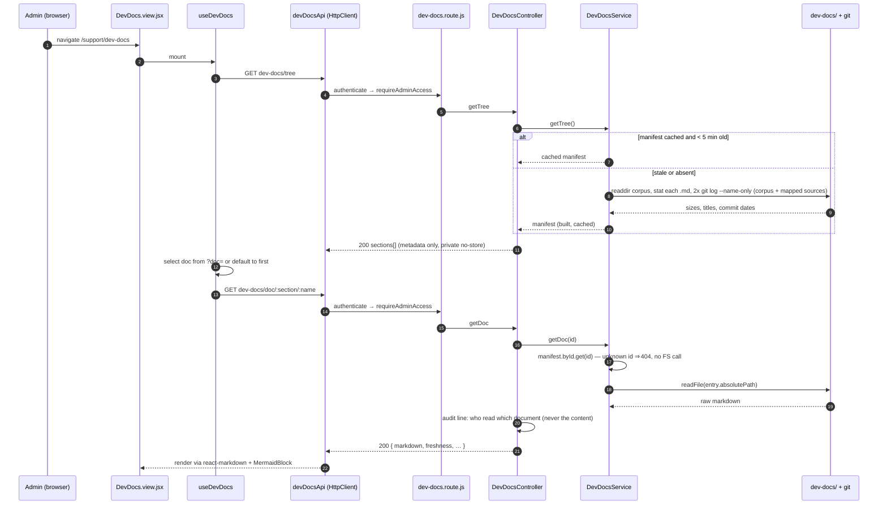
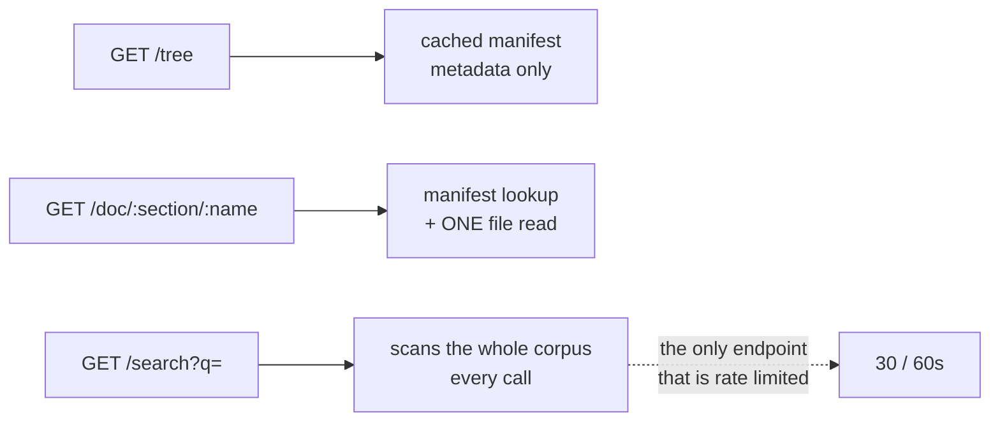

# Dev Docs Viewer — Technical Documentation

> **Scope:** The **in-app developer documentation viewer** — Support → **Dev Docs** (`/support/dev-docs`). It serves *this corpus* (the `dev-docs/` directory you are reading) to ADMIN and SUPER_ADMIN over an authenticated API: a section tree, one document's raw markdown, and a literal substring search, plus a per-document **freshness** signal derived from git.
> **Source (FE):** `Frontend/src/features/support/devdocs/` — `DevDocs.view.jsx`, `devdocs.hook.js`, `devdocs.api.js`, `devdocsToc.js`, `devdocs-syntax.css`, and `components/{DocIndexNav,MarkdownDoc,MermaidBlock}.jsx`; the "On this page" rail uses `Frontend/src/components/shared/DocsPage/useScrollSpy.js`. Route registered in `Frontend/src/App.jsx`; nav item in `Frontend/src/components/layout/config/nav.config.jsx`.
> **Source (BE):** `Backend/src/routes/dev-docs.route.js`, `src/controllers/DevDocsController.js`, `src/services/DevDocsService.js`, `src/constants/messages/devdocs.messages.js`, `scripts/build-devdocs-freshness.js` (build-time freshness snapshot), `DEV_DOCS_ERRORS` in `src/constants/errors/index.js`, `DEV_DOCS_*` in `src/constants/responses/index.js`.
> **Verified 2026-10-29** against the source files above. Corpus today: 13 documents in 3 section folders (`Others`, `Support`, `System Admin`) plus `README.md` under the synthetic `Overview` section. No dedicated test suite for this feature exists in this repo (backend or frontend) — §8 cites source only. No tests were run for this revision.
>
> **Related docs:**
> - `Support/changelog-release-train-documentation.md` — the other Support nav item.
> - `Others/infrastructure-health-csrf-client-documentation.md` — the shared middleware chain, rate limiting, and `HttpClient` these endpoints sit behind.
> - `Others/auth-documentation.md` — `AuthMiddleware.authenticate` and the role predicates this router composes.
>
> **Rendering note:** ` ```mermaid ` blocks render in GitHub/GitLab/Obsidian/VS Code — **and in this viewer**, via `MermaidBlock`. For PDF via Chrome print, pre-render with `mermaid-cli`.

---

## 1. Overview

The corpus documents HMAC record signing, integrity-gate failure conditions, the backup/restore design, the cluster shared-state design and the auth predicates. It is an internal architecture map of the system. The viewer exists so an engineer or admin can read it inside the app instead of needing a repo checkout — without that convenience widening who can read it.

One design decision determines everything else in this document:

> **The corpus is SERVED, never COPIED.** It is read at request time from `Backend/dev-docs/` by `DevDocsService`. It is not bundled into the frontend, not placed in `public/`, and not pulled in with `import.meta.glob`.

The reason is that a React route guard hides a **page**, not **files**. Anything bundled or in `public/` is a static asset served with no auth check, and `import.meta.glob` would ship the whole corpus to every client that loads the app — including a plain USER. Serving it from the backend is what makes "admin only" a control rather than a cosmetic. It also removes the second copy that would have drifted from the first.

The second decision worth stating up front: **path traversal is designed out, not filtered.** A caller never supplies a path. They supply an **id**, which is a key into a manifest the service builds by walking the corpus itself. An unknown id is a 404 *before any filesystem call*, so there is no `..` to sanitise and no encoding trick to miss.

---

## 2. Flow & Architecture

### 2.1 Opening a document



### 2.2 The three endpoints and what each costs



The asymmetry is the reason search is the only rate-limited route: the tree is served from a cached manifest and a document is a single file read, but search reads every document on every call. An authenticated admin looping it is a cheap self-inflicted DoS.

---

## 3. Frontend implementation

Three-layer feature under `Frontend/src/features/support/devdocs/`.

### 3.1 `devdocs.api.js` — the HTTP layer

Three calls through `httpClient`, which carries the session:

| Function | Request |
|---|---|
| `getTree()` | `GET dev-docs/tree` |
| `getDoc(id)` | splits `id` on `/` and issues `GET dev-docs/doc/{section}/{name}`, both segments `encodeURIComponent`-ed |
| `search(q)` | `GET dev-docs/search` with `params: { q }` |

The file header states the rule this layer must not break: there is **no static copy of these documents anywhere in the bundle**, and adding one would defeat the gate.

### 3.2 `devdocs.hook.js` — `useDevDocs`

Three reads, each independently gated so none fires before it can return anything useful:

- **tree** — `useRequest("devdocs/tree", …, { staleTime: 300_000 })`.
- **document** — keyed `devdocs/doc/${selectedId}`, `enabled: !!selectedId`, `staleTime: 300_000`.
- **search** — keyed `devdocs/search/${debouncedSearch}`, `enabled: searchActive`, `staleTime: 60_000`. `searchActive` requires the debounced query (400 ms, via `useDebounce`) to reach `MIN_QUERY_LENGTH = 2`, which mirrors the server's minimum so the UI does not spend a 400 to learn it.

**Selection lives in the URL, not in state.** `selectedId` is `searchParams.get("doc")`, written back with `setSearchParams(…, { replace: true })`. These are reference documents an admin will link a colleague to; a selection held only in memory could not be shared or reloaded onto. An effect lands on the first document of the first section only when the tree has arrived *and* the URL did not already name one.

**Everything derivable is derived.** `docsById` (flat `id → metadata`, memoised over `sections`), `toc` (`useMemo(() => buildToc(doc?.markdown), …)`), and `apiError` are `useMemo`, not `useState` written from effects. `apiError` special-cases 403 to *"Developer documentation is available to administrators only."* rather than a generic failure message — the server refusing a non-admin is the feature working, not the page being broken.

### 3.3 Rendering — `MarkdownDoc.jsx`

`react-markdown` + `remark-gfm` + `rehype-highlight`.

> **`rehype-raw` is not installed and must not be added.** Without it, react-markdown renders to React elements — there is no HTML string to inject into. The corpus is first-party and version-controlled, so this is not the usual untrusted-markdown case, but enabling raw HTML buys nothing these documents need and would turn any future doc into an XSS vector.

Headings get their `id` from `slugify`; `buildToc` (in `devdocsToc.js`) calls the **same** function, which is what stops the nav pointing at anchors the document does not contain. Every heading is anchored, including the h4+ that `buildToc` leaves out of the nav — a deep heading is still a link target someone may have been sent.

Syntax colours come from `devdocs-syntax.css`, token-based so they follow `[data-theme]`, rather than one of highlight.js's prebuilt themes (which are fixed-palette and would break dark-mode parity).

### 3.4 Diagrams — `MermaidBlock.jsx`

Renders ` ```mermaid ` fences with `mermaid` (`^12.0.0` in `Frontend/package.json`, loaded lazily via `import("mermaid")`) at `securityLevel: "strict"` — no click handlers and no raw HTML out of a diagram.

Theme handling is the subtle part: `mermaid.initialize` sets the theme for **subsequent** renders, so SVGs already in the DOM do not re-theme. The component therefore reads `useTheme()` itself and keys its render result on `(code, theme)`, re-rendering on a flip, with a guard against a late render landing after the theme changed again or after unmount. It uses the **built-in** `dark` / `default` themes rather than `"base"` plus selected `themeVariables`, because the latter leaves ER, class and state diagrams on their own defaults — a half-themed diagram reads as broken.

#### Failure containment — `suppressErrorRendering` is not optional

A malformed fence must cost one `<pre>` fallback and nothing else. Catching the throw is **only half** of that; without the second half an invalid diagram reaches a reader as mermaid's bomb glyph — *"Syntax error in text"* — stacked in the page.

The bombs are not rendered by `MermaidBlock` at all. On a **parse** error mermaid's default path does not simply throw: it swaps in its built-in `error` diagram, **draws that into a temporary `<div>` it appended to `document.body`**, and only then rethrows the parse error — reaching the rethrow *before* its own `removeTempElements()` call. So the throw arrives in the component's `.catch`, the `<pre>` fallback appears as designed, and the bomb stays parented to `<body>`: one orphan per bad fence, outside the component's React tree where unmounting cannot reach it.

`suppressErrorRendering: true` makes the parse-error branch clean up and throw **without drawing** the error diagram. Note what this means for any future test: *"a fallback is shown"* passes with or without the flag, so the only assertion that distinguishes fixed from broken is **`document.body` gains nothing**.

> Mermaid has two failure branches with separate cleanup paths — parse and draw — and only the parse branch leaks. No test in this repo asserts either branch yet (§8).

### 3.5 Shell — `DevDocs.view.jsx` and `DocIndexNav.jsx`

`DocIndexNav` is the section index and search-results pane; `DevDocs.view.jsx` is the document pane, header, TOC and freshness surface.

The **freshness chip** (`FreshnessBadge`) maps the server's three states:

| `freshness` | Badge | Tooltip |
|---|---|---|
| `CURRENT` | green, "Current" | `Updated <docCommittedAt>, at or after the code it describes.` |
| `SUSPECT` | amber, **"Check against code"** | `Last updated <docCommittedAt>, but the code it describes changed on <sourceCommittedAt>. It may still be accurate — verify before relying on it.` |
| `UNKNOWN` | grey, "Age unknown" | `No commit history available for this document or the code it describes.` |

`SUSPECT` additionally renders a warning `Alert` ("This document may be behind the code" / "Verify against the source before relying on it.") above the document body, and `DocIndexNav` marks the entry with a "may be behind the code" hint. The wording is load-bearing and is called out in both the service and the view: a reader told flatly *"this is out of date"* who then finds the document accurate stops reading the banner, and the next genuinely stale document goes unchecked. **"May still be accurate" must survive any copy edit.**

The loading state is a document-shaped skeleton (title, paragraph, heading, body, diagram-sized block) rather than a generic stack of equal bars, which would visibly resettle when prose-plus-Mermaid content lands.

---

## 4. Backend implementation

### 4.1 `dev-docs.route.js`

```
router.use(AuthMiddleware.authenticate);
router.use(requireAdminAccess);

GET /tree                     → DevDocsController.getTree
GET /search                   → searchLimiter.handle → DevDocsController.search
GET /doc/:section/:name       → DevDocsController.getDoc
```

Mounted at `/dev-docs` in `src/routes/index.js`.

Four things about this file are deliberate:

1. **Guards via `router.use`, not per-route.** A route added later cannot be published unprotected by forgetting to repeat the predicate.
2. **`requireAdminAccess` is `AuthMiddleware.requireAccess((user) => user.role === "ADMIN" || user.role === "SUPER_ADMIN", { message: "Access denied: ADMIN or SUPER_ADMIN role required." })`** — declared locally in this route file. USER is excluded. The system maps (`/architecture`) use a stricter SUPER_ADMIN-only gate; do not widen either to the other for convenience.
3. **Literal paths before the param route.** Express v5 matches in declaration order, so `/tree` and `/search` are declared first and can never be captured as a document id.
4. **Two segments, not one free-form `:id`.** Express v5's path-to-regexp no longer accepts an inline pattern on a param, and a single `:id` would not match a value containing `/` anyway. The id's own shape (`section/name`) becomes the route's shape and the controller rejoins them. This is a cheap second gate, *not* the traversal defence.

**No cache middleware on this router, deliberately.** The manifest is already cached inside the service with its own TTL, which is where the expensive work is. The simplest mistake available here would be a shared cache entry holding an admin-only body.

**Rate limiting: search only.** `new RateLimiterMiddleware({ max: 30, windowMs: 60_000, label: "RateLimit:dev-docs-search" })` — far above what a person typing into a debounced box produces, far below what a loop would.

### 4.2 `DevDocsController.js`

A thin HTTP layer with no business logic, enforcing two rules about what leaves the process:

1. **Every response is projected field by field, never spread from a service object.** Manifest entries carry an `absolutePath` that must not reach a client: it is a filesystem layout detail, and this corpus is exactly the map an attacker would want (CWE-209). A field added to the manifest later is then opt-in to the response rather than leaked by default.
2. **Every response is `private, no-store`.** `_noStore(res)` sets `Cache-Control: private, no-store, max-age=0` and `Pragma: no-cache` on all three. An admin-only body in a shared or intermediary cache is the same disclosure by a different route.

Nothing in the controller re-checks a role — one gate, in one place, that a reader can find.

Logging, via `devdocs.messages.js`:

| Message | Fired by | Carries |
|---|---|---|
| `TREE_SERVED(empId, sectionCount, docCount)` | `getTree` | counts |
| `DOC_READ(empId, docId)` | `getDoc` | **who read which document** — never its content |
| `SEARCH_COMPLETED(empId, total, returned)` | `search` | counts, **never `q`** |

> The parameter is named `empId` and the rendered line says `admin EMP_ID:` — a legacy label in `devdocs.messages.js`. The value logged is the authenticated admin's id. Renaming the label is a code change for the backend owner, not done here.

`DOC_READ` is the audit trail: these are internal architecture documents, so who opened which one is worth the same record any export gets. `q` is deliberately absent — it is caller-supplied text that would land unescaped in a log file, and the counts answer the operational question.

### 4.3 `DevDocsService.js`

`CORPUS_ROOT = path.join(REPO_ROOT, "dev-docs")`, where `REPO_ROOT = process.pkg ? path.dirname(process.execPath) : path.resolve(__dirname, "..", "..")`. Everything served is inside it.

> **Why not `__dirname`.** In the pkg-compiled exe `__dirname` is the read-only `C:\snapshot\…` bundle. `dev-docs` is deliberately **not** a pkg asset (§7 — never a static asset), so a corpus resolved there would not exist and every request would return `CORPUS_UNAVAILABLE`, even with `dev-docs\` deployed beside `backend.exe`. It resolves next to the executable — the same rule `changelog.model.js` and the logger follow. **Deploy `dev-docs\` as a sibling of `backend.exe`.**

**The manifest.** `_buildManifest()` walks the corpus one directory level deep plus root-level files — the shape the corpus actually has. Each `.md` file yields an entry:

```js
{ id, title, sizeBytes, docCommittedAt, sourceCommittedAt, freshness, absolutePath }
```

- `id` — `_buildId(section, fileName)`: lower-cased, extension dropped, separators collapsed to `-`, joined as `section/name`. Stable across runs so a shared link keeps working, and **looked up in a `Map`** — never re-joined onto a filesystem path.
- `title` — `_readTitle()` reads only the **first 2048 bytes** and takes the first markdown H1, falling back to a humanised filename. Slurping every document to build a tree would make the list endpoint pay the read cost of the whole corpus. A failed title read must not make a document unlistable.
- `sizeBytes` — from `stat`. A file that vanishes between `readdir` and `stat` is skipped rather than failing the whole tree.
- Root-level `.md` files (currently `README.md`) are collected under the synthetic section name **`Overview`**.

Building the manifest costs one `stat` per document plus **two** `git log` spawns, so it is cached for `MANIFEST_TTL_MS = 5 * 60_000` and rebuilt lazily. `invalidateManifest()` drops it, for tests and for an explicit refresh.

**Freshness.** `_commitDateIndex(pathspecs)` runs `git log --format=%x1e%cd --date=short --name-only -- <pathspecs>` via `execFile` **with an argument array, never a shell string**, so a path can never be interpreted as a command (CWE-78) — paths come from the corpus walk and from `SECTION_SOURCE_MAP` rather than from a caller, but the safe form costs nothing. It returns a `Map` of repo-relative path → `YYYY-MM-DD`, and a path absent from that map means *unknown* (a non-git checkout, an untracked file, or a shallow clone).

`--name-only` lists the files each commit touched and `git log` is newest-first, so the **first** appearance of a path is its last commit — what `git log -1 -- <path>` returns, for every path, in one spawn. `_buildManifest()` therefore runs exactly two: one over `dev-docs`, one over the deduplicated `SECTION_SOURCE_MAP` values.

> **Why not one spawn per path.** One `git log -1` per document plus one per mapped source would cost a child process per path on every TTL expiry, and process spawn is expensive on Windows. The batched form builds the same dates in two spawns. The batched call runs with a **15 s** timeout and a **32 MB** `maxBuffer` — a 1 MB default would truncate long corpus history and silently drop dates.

A `git` failure (no git, not a repo, a shallow clone) yields an **empty index**. Freshness is advisory: it must never fail a documentation read.

**Build-time snapshot.** A deployed exe has no git checkout, so the live index is always empty there — without a fallback every document would read `UNKNOWN` ("Age unknown") in production, exactly where readers are. `npm run build` / `build:debug` run `scripts/build-devdocs-freshness.js` **before** `pkg`. It calls the same `_commitDateIndex` over the same two pathspecs and writes `src/generated/devDocsFreshness.json` (`{ generatedAt, docs, sources }`, repo-relative path → `YYYY-MM-DD`, sorted keys), which pkg bundles via the `src/**/*.json` asset glob. It is gitignored (`src/generated/` in `Backend/.gitignore`), and it **fails the build** (exit 1) when either index is empty — shipping an exe without dates is the defect it exists to stop.

`_resolveDateIndexes()` prefers live git and falls back **per index** to `_loadFreshnessSnapshot()` only when git returns nothing, so a dev checkout never reads a stale snapshot. The snapshot path resolves off `__dirname` on purpose — it lives inside the exe, not beside it. A missing or malformed snapshot degrades to `UNKNOWN` and logs `FRESHNESS_SNAPSHOT_UNAVAILABLE` at warning; it never fails the tree.

> ⚠ **Dates are as of the build.** Source dates are exact for the running exe (those sources are what it runs). Document dates are the corpus as of the build commit — deploy `dev-docs\` from the **same commit** as `backend.exe`, or a doc edited after the build shows its older date.

`SECTION_SOURCE_MAP` maps each section to the source paths it describes:

| Section | Source paths compared against |
|---|---|
| `System Admin` | `src/services/DataPurgeService.js`, `src/services/BackupStoreService.js`, `src/services/AdminManagementService.js`, `src/services/IntegrityService.js`, `src/services/AuditLogService.js`, `src/services/MetricsService.js` |
| `Support` | `src/services/ChangelogService.js`, `src/services/ArchitectureService.js`, `src/constants/architectureModel.js`, `src/constants/runtimeModel.js`, `src/utils/systemMap.js`, `src/services/DevDocsService.js` |
| `Others` | `src/services/AuthService.js`, `src/routes/health.route.js`, `src/middleware/security/CsrfMiddleware.js`, `src/services/ClientService.js` |
| `Overview` | `src/services/DevDocsService.js` _(synthetic section for root-level files such as `README.md`)_ |

Paths are repo-relative to `Backend/`, must be **files** (not directories), and are **case-exact** — git pathspecs are case-sensitive, while Windows and macOS disks are not, so a wrong-case path passes `fs.existsSync` yet never ages its documents. The map has one key per section folder the corpus has today; a project that adds a dev-docs folder adds its key here.

`_sectionSourceDate()` takes the newest of those dates; `_freshness(docDate, sourceDate)` returns `UNKNOWN` if either is missing, else `CURRENT` when `docDate >= sourceDate`, else `SUSPECT`.

The mapping is **deliberately coarse**. The question it answers is "has the code under this doc moved since the doc was written", and a section-level mapping answers it without pretending to a precision that would need maintaining per file. A section **absent** from the map yields `UNKNOWN` rather than a guess — an unmapped doc is not evidence of currency.

> **Why every section must be mapped.** **`UNKNOWN` is indistinguishable from "never checked"**, so an unmapped section reads "Age unknown" permanently, however recently its documents were verified — and re-verifying one changes nothing on screen. A coarse `SUSPECT` carries strictly more information than `UNKNOWN`. This cannot be fixed by writing documentation: the verdict comes from a **map key**, not from the document.
>
> **Why nothing would fail.** `_sectionSourceDate` returns `null` for an unmapped section, and `_freshness` turns a null into `UNKNOWN` — which is also the legitimate answer when git history is unavailable (no git, a shallow clone). A real gap and a designed fallback produce the identical value. Likewise `git log` on a deleted path still returns its last commit, so a renamed service leaves the badge working and quietly frozen. No test in this repo guards the map against either drift (§8); a coverage test that drives off the corpus **directory** and checks each mapped path exists in exact case would close it.
>
> ⚠ **Known limit.** `Others/personalize-documentation.md` documents `Frontend/src/features/personalize/` and has **no backend**, while freshness compares against `Backend/` paths only. It inherits the `Others` date, which cannot speak to it. A per-document map is the fix if that ever matters. The `Verified …` line in each document's header remains the authoritative record of what was re-checked.

**`getDoc(id)`** looks the lower-cased, trimmed id up in `manifest.byId`. A miss throws `DEV_DOCS_ERRORS.DOC_NOT_FOUND` at 404 *before any filesystem call*, with the id echoed (the caller sent it) but no corpus layout (they did not — CWE-209). A hit reads the file and returns markdown plus metadata. The server **never converts markdown to HTML**, so there is no HTML-injection surface on this path.

**`search(rawQuery)`** requires `MIN_QUERY_LENGTH = 2` or throws `INVALID_QUERY` at 400. It lower-cases the needle and walks every document line by line with `indexOf` — **literal, not regex**: the query is caller-supplied and compiling it is a ReDoS vector (CWE-1333) over the whole corpus; `indexOf` on a lower-cased line cannot backtrack. It tracks the nearest preceding `#{1,6}` heading so each hit carries a `heading`, and builds a snippet with `SNIPPET_RADIUS = 80` characters either side, ellipsis-marked when truncated. It collects at most `SEARCH_RESULT_CAP = 50` hits but **keeps counting past the cap**, so `total` is exact and `truncated` is `total > results.length`. One unreadable document is skipped rather than failing the whole search.

**`_assertInsideCorpus(absolutePath)`** re-checks every resolved path against the corpus root, including manifest-sourced ones. It is reached only for paths the service produced itself, so a throw means the *manifest* is wrong rather than the caller — hence `DOC_READ_FAILED` at **500**, not a 404 that would hide a real defect behind a routine-looking response.

### 4.4 Errors and responses

`DEV_DOCS_ERRORS` (`src/constants/errors/index.js`) — every message deliberately incurious about the filesystem:

| Key | Status | Message |
|---|---|---|
| `DOC_NOT_FOUND` | 404 | `That document could not be found.` |
| `DOC_READ_FAILED` | 500 | `That document could not be read. Try again, or contact a Super Admin.` |
| `CORPUS_UNAVAILABLE` | 500 | `Developer documentation is unavailable on this server.` |
| `INVALID_QUERY` | 400 | `Enter at least 2 characters to search.` |

`RESPONSE_MESSAGES` (`src/constants/responses/index.js`): `DEV_DOCS_TREE_FETCHED`, `DEV_DOCS_DOC_FETCHED`, `DEV_DOCS_SEARCH_COMPLETED`.

---

## 5. How frontend and backend connect (the contract)the whole corpus

All three are `GET`, authenticated, ADMIN/SUPER_ADMIN, `private, no-store`.

### `GET /api/v1/dev-docs/tree`

```jsonc
{
  "data": {
    "sections": [
      { "name": "Support",
        "docs": [
          { "id": "support/dev-docs-viewer-documentation",
            "title": "Dev Docs Viewer — Technical Documentation",
            "sizeBytes": 0,
            "docCommittedAt": "YYYY-MM-DD",
            "sourceCommittedAt": "YYYY-MM-DD",
            "freshness": "CURRENT|SUSPECT|UNKNOWN" }
        ] }
    ],
    "generatedAt": "…Z"   // when the manifest was built, not "now"
  }
}
```

**Section order:** `Overview` (the root `README.md` index) comes first, then the folder sections alphabetically (`_buildManifest` collects root files before the sorted directory list). The viewer renders sections in this order and opens the first document by default, so the index is both the top of the sidebar and the landing page. Evidence: source only — `DevDocsService._buildManifest`. _Status: no test in this repo._

**No `markdown` and no `absolutePath`** — the index is metadata. Shipping bodies here would move the whole corpus per page load and defeat the per-document audit line.

### `GET /api/v1/dev-docs/doc/:section/:name`

```jsonc
{ "data": { "id": "…", "title": "…", "markdown": "# …",
            "sizeBytes": 0, "docCommittedAt": "…",
            "sourceCommittedAt": "…", "freshness": "CURRENT|SUSPECT|UNKNOWN" } }
```

### `GET /api/v1/dev-docs/search?q=<term>`

```jsonc
{ "data": { "results": [ { "id": "…", "title": "…", "heading": "…",
                           "snippet": "…matched line…", "line": 412 } ],
            "total": 137, "truncated": true } }
```

**`generatedAt` is manifest build time, not request time.** A caller comparing it against the wall clock to decide whether data is fresh will be wrong by up to the 5-minute TTL.

---

## 6. Technicalities

| Constant | Value | Where | Why |
|---|---|---|---|
| `MANIFEST_TTL_MS` | `5 * 60_000` | `DevDocsService` | one stat per document + 2 git spawns per build; docs change at edit time, not request time |
| `SEARCH_RESULT_CAP` | `50` | `DevDocsService` | collection stops, counting does not — `total` stays exact |
| `SNIPPET_RADIUS` | `80` | `DevDocsService` | characters either side of a match |
| `MIN_QUERY_LENGTH` | `2` | `DevDocsService`, mirrored in `devdocs.hook.js` | a 1-character scan over the corpus returns noise |
| git timeout / buffer | `15_000 ms` / `32 MB` | `DevDocsService._commitDateIndex` | long history must not be truncated |
| search rate limit | `30 / 60_000 ms` | `dev-docs.route.js` | the only endpoint that scans the corpus |
| debounce | `400 ms` | `devdocs.hook.js` | via `useDebounce` |
| `staleTime` | `300_000` tree/doc, `60_000` search | `devdocs.hook.js` | in-memory `useRequest` entry only; server still sends `no-store` |

`DevDocsService` exports `CORPUS_ROOT`, `SEARCH_RESULT_CAP`, `MIN_QUERY_LENGTH` and `SECTION_SOURCE_MAP` alongside the class, for tests, plus `FRESHNESS_SNAPSHOT_PATH` for the build script (its only writer).

**Adding a document** requires no code change: drop a `.md` file into a section directory and it appears after the manifest TTL expires (or immediately, after `invalidateManifest()`). **Adding a section directory** also needs no code change to be *listed* — but it will report `UNKNOWN` freshness until it is added to `SECTION_SOURCE_MAP`.

---

## 7. Security

| Concern | CWE | Control |
|---|---|---|
| Unauthorised read of an internal architecture map | CWE-284 / CWE-863 | `AuthMiddleware.authenticate` + `requireAdminAccess` applied with `router.use` on **every** route. USER is refused (403); unauthenticated callers get 401 |
| Bypassing the gate via a static copy | CWE-284 | The corpus is served from the backend and **never** bundled, placed in `public/`, or `import.meta.glob`-ed |
| Path traversal | CWE-22 | Callers supply a **manifest key**, not a path; an unknown key 404s before any filesystem call. `_assertInsideCorpus` re-checks resolved paths and throws 500 on disagreement |
| Command injection through the git call | CWE-78 | `execFile` with an argument array, never a shell string; `windowsHide`, 15 s timeout and 32 MB `maxBuffer` on the batched `_commitDateIndex` |
| Filesystem layout disclosure in responses and errors | CWE-209 | Responses projected field by field (never spread, so `absolutePath` cannot ride along); error messages name no directory |
| Admin-only body cached by a shared/intermediary cache | CWE-524 | `Cache-Control: private, no-store, max-age=0` + `Pragma: no-cache` on all three responses; no cache middleware on the router |
| ReDoS via the search query | CWE-1333 | Literal `indexOf`, never a compiled pattern |
| Search as a cheap DoS | CWE-770 | 30/min limiter on `/search` only |
| XSS through rendered markdown | CWE-79 | `rehype-raw` not installed; react-markdown renders to React elements. Mermaid runs at `securityLevel: "strict"`, which is what keeps its SVG output DOMPurify-sanitized — see the assessment below |
| Sensitive data in logs | CWE-532 | Document **content** never logged; search query `q` never logged. `DOC_READ` records reader + document id as the audit trail |

#### `dangerouslySetInnerHTML` in `MermaidBlock` — CWE-79 assessment

`MermaidBlock` uses `dangerouslySetInnerHTML` (once, on the rendered SVG). The prop is unavoidable: `mermaid.render()` returns an SVG **string**, not a node.

**Verdict: allowed, because the platform rule is "not without DOMPurify" — and DOMPurify is applied inside mermaid.** In mermaid's `renderDiagram`, `serializeSvg()` passes the whole returned string through DOMPurify before returning it:

```js
} else if (!isLooseSecurityLevel) {
  code2 = DOMPurify.sanitize(code2, {
    ADD_TAGS: ["foreignobject"],
    ADD_ATTR: ["dominant-baseline"],
    HTML_INTEGRATION_POINTS: { foreignobject: true },
  });
}
```

with `isLooseSecurityLevel = config.securityLevel === "loose"`. So the string reaching `__html` **is** DOMPurify output, and the only two additions to DOMPurify's default allow-list are an SVG container element and a presentational attribute — no `script`, no `on*` handler. `dompurify` is a transitive dependency of `mermaid` (not listed in `Frontend/package.json`); the resolved versions of both were not re-checked for this revision — run `npm ls mermaid dompurify` in `Frontend/` and `npm audit` before relying on a specific version.

No security test in this repo pins this exemption. If one is added, it should be a conditional allow-list — one entry, with the exemption tied to the mitigation:

| Assertion (recommended) | What it stops |
|---|---|
| No file outside the allow-list uses the prop | A new unreviewed usage anywhere under `src/` |
| Each allow-list entry still exists and still uses the prop | A stale exemption that reads as reviewed but guards nothing |
| Exactly **one** occurrence per exempt file | A second, unreviewed usage inside an already-exempt file |
| `securityLevel: "strict"`, and **not** `"loose"` | The single-word edit that skips `DOMPurify.sanitize` entirely |
| `rehype-raw` absent from `package.json` | Caller-authored HTML reaching react-markdown's output |

(The only test mentioning the prop, `Frontend/test/unit/components/helpConsistency.test.jsx`, bans the *word* from help-article prose; it does not scan source files and does not cover `MermaidBlock`.)

**Residual risk, stated plainly.** `foreignObject` is allowed through, which is how mermaid renders HTML labels; `HTML_INTEGRATION_POINTS` is the setting that makes DOMPurify sanitize inside it correctly, so it is a hardening flag rather than a hole. The trust boundary does the rest: diagram source is first-party Markdown read off disk, the route is ADMIN/SUPER_ADMIN-gated server-side, and the server never converts Markdown to HTML. A malicious diagram would have to be committed to this repository first.

> The hidden tab and the client route guard are **not** controls. `nav.config.jsx` omits Dev Docs from every role's block other than ADMIN and SUPER_ADMIN, and `App.jsx` guards the route — both are client-side and neither survives someone calling the endpoint directly. Any review that accepts "the tab is hidden" as the access control has accepted nothing. The comments in both frontend files say so explicitly; keep them there.

---

## 8. Verification Q&A

> **No dedicated test suite exists for this feature in this repo** — neither a backend security/route suite for `/dev-docs` nor frontend tests for `Frontend/src/features/support/devdocs/` (a file search for `*devdocs*`, `*dev-docs*`, `*mermaid*`, `*xss*` and `*useScrollSpy*` under `test/` returns nothing). Every answer below is therefore read from source; none was run. The "Gap" lines name the test that would pin each answer.

**Q: Can a USER read a document?**
No. `requireAdminAccess` (`AuthMiddleware.requireAccess` with `user.role === "ADMIN" || user.role === "SUPER_ADMIN"`) is applied with `router.use` after `AuthMiddleware.authenticate`, so every route refuses USER with 403 before the controller runs; the controller never reads the corpus for a refused caller. On screen the hook maps a 403 to "Developer documentation is available to administrators only."
**Evidence:** source only — `Backend/src/routes/dev-docs.route.js` (`requireAdminAccess`, `router.use`), `Frontend/src/features/support/devdocs/devdocs.hook.js` (`apiError`).
**Gap:** a security suite asserting 403 for USER and 401 unauthenticated on all three endpoints, plus a body check that a 403 carries no markdown.
_Status: no test in this repo._

**Q: Who *is* admitted?**
`ADMIN` and `SUPER_ADMIN` — the only two roles the predicate accepts.
**Evidence:** source only — `dev-docs.route.js` → `requireAdminAccess`.
_Status: no test in this repo._

**Q: Can traversal get a file out?**
No, by construction. A caller supplies `:section/:name`; the controller rejoins them and `DevDocsService.getDoc` looks the lower-cased id up in `manifest.byId`. A miss is `DOC_NOT_FOUND` (404) before any filesystem call, and a hit's path is re-checked by `_assertInsideCorpus` (500 on disagreement). The viewer only ever requests ids the `/tree` response supplied.
**Evidence:** source only — `DevDocsService.getDoc`, `DevDocsService._assertInsideCorpus`.
**Gap:** a table-driven traversal test (parent, encoded, double-encoded, absolute POSIX/Windows, null byte, backslash) asserting no 200 and no file content.
_Status: no test in this repo._

**Q: Does a 404 leak the corpus layout?**
No. `DEV_DOCS_ERRORS` messages name no directory (§4.4), and controller responses are projected field by field so `absolutePath` cannot ride along.
**Evidence:** source only — `Backend/src/constants/errors/index.js` → `DEV_DOCS_ERRORS`; `Backend/src/controllers/DevDocsController.js`.
_Status: no test in this repo._

**Q: Could an admin-only body end up in a cache?**
No. `_noStore(res)` sets `Cache-Control: private, no-store, max-age=0` and `Pragma: no-cache` on all three responses, and the router mounts no cache middleware.
**Evidence:** source only — module-level `_noStore()` in `Backend/src/controllers/DevDocsController.js`; `dev-docs.route.js` header comment.
_Status: no test in this repo._

**Q: Can `absolutePath` escape?**
No. The tree response is built field by field (`id`, `title`, `sizeBytes`, `docCommittedAt`, `sourceCommittedAt`, `freshness`); `absolutePath` and `markdown` are never projected into it.
**Evidence:** source only — `DevDocsController.getTree`.
_Status: no test in this repo._

**Q: Is the search query compiled as a regex?**
No. `DevDocsService.search` lower-cases the needle and uses `indexOf` per line — literal, so a pattern like `(a+)+$` cannot backtrack.
**Evidence:** source only — `DevDocsService.search`.
_Status: no test in this repo._

**Q: Is a too-short query rejected?**
Yes. The service throws `INVALID_QUERY` (400) below `MIN_QUERY_LENGTH = 2`; the hook mirrors the rule on the trimmed, debounced value (400 ms), so the UI never spends a request to learn it.
**Evidence:** source only — `DevDocsService.search`, `devdocs.hook.js` (`MIN_QUERY_LENGTH`, `searchActive`).
_Status: no test in this repo._

**Q: Is a hostile query reflected back?**
The response carries matched corpus lines, never the query itself, and `SEARCH_COMPLETED` logs counts only — `q` is never logged.
**Evidence:** source only — `DevDocsService.search`, `Backend/src/constants/messages/devdocs.messages.js` → `SEARCH_COMPLETED`.
_Status: no test in this repo._

**Q: Does freshness work on a deployed exe with no git?**
By design, yes. `_resolveDateIndexes()` prefers live git and falls back per index to `_loadFreshnessSnapshot()` (the build-time `src/generated/devDocsFreshness.json`); when both are missing every document reads `UNKNOWN` and `FRESHNESS_SNAPSHOT_UNAVAILABLE` ("… no git history and no build snapshot …") is logged at warning — never a failed tree. `scripts/build-devdocs-freshness.js` exits 1 if either index is empty, so a normal `npm run build` cannot ship without dates.
**Evidence:** source only — `DevDocsService._resolveDateIndexes`, `DevDocsService._loadFreshnessSnapshot`, `Backend/scripts/build-devdocs-freshness.js`.
**Gap:** a unit test stubbing `_commitDateIndex` to return nothing and asserting zero `UNKNOWN` documents from a fixture snapshot.
_Status: no test in this repo._

**Q: Does a Support document go SUSPECT when the code it describes changes, not only when the changelog service changes?**
Yes, by the map. `Support` maps to `ChangelogService`, `ArchitectureService`, `architectureModel`, `runtimeModel`, `utils/systemMap` and `DevDocsService`; `_sectionSourceDate` takes the newest of them, so a change to any one after the document's date makes it SUSPECT.
**Evidence:** source only — `DevDocsService.js` → `SECTION_SOURCE_MAP`, `_sectionSourceDate`, `_freshness`.
**Gap:** a coverage test that drives off the corpus directory (every folder mapped), checks every mapped path exists in exact case, and asserts SUSPECT/CURRENT against a synthetic index.
_Status: no test in this repo._

**Q: Does the compiled exe find `dev-docs\` beside it?**
By design, yes — `REPO_ROOT` is `path.dirname(process.execPath)` under pkg (§4.3). Not verified for this revision on a deployed exe. There is no automated test: `process.pkg` is undefined under vitest, so that arm is `c8 ignore`d.
**Evidence:** source only — `DevDocsService.js` → `REPO_ROOT`.
_Status: no test in this repo._

**Q: Is there a frontend test suite for this feature?**
**No.** There are no tests under `Frontend/test/` for `devdocs.hook.js`, `DevDocs.view.jsx`, `DocIndexNav.jsx`, `MarkdownDoc.jsx`, `MermaidBlock.jsx` or `useScrollSpy.js`. The behaviours below are read from source; each names the test that would pin it.

> **Q: Is the selection really held in the URL rather than in state?**
> Yes. `selectedId` is `searchParams.get("doc")`, written back with `setSearchParams(…, { replace: true })`. The auto-land effect early-returns on `selectedId || !sections.length`, so a `?doc=` already in the URL is honoured, and with none it lands on the first document of the first section. Clearing the selection is transient — the same effect re-lands on the first document.
> **Evidence:** source only — `Frontend/src/features/support/devdocs/devdocs.hook.js`.
> **Gap:** hook tests asserting on the real query string (auto-land writes `?doc=`; an existing `?doc=` is not overridden).
> _Status: no test in this repo._

> **Q: Does a 403 read as "you are not an admin" or as "the page is broken"?**
> As the former, and that distinction is the reason the hook special-cases the status at all: the server refusing a non-admin **is the server working correctly**. A 403 yields "Developer documentation is available to administrators only."; any other failure yields "Failed to load developer documentation."
> **Evidence:** source only — `devdocs.hook.js` → `apiError`. A future test should return the failure **bodyless**, since `extractApiError(err, fallback)` prefers a server-supplied message.
> _Status: no test in this repo._

> **Q: Can a short search query spend a request?**
> No. `MIN_QUERY_LENGTH = 2` is measured against the **trimmed, debounced** (400 ms) value, and the search request is `enabled: searchActive`, so a single character or whitespace-only fires nothing. A truncated result set carries the exact server-side `total` (counted past the 50-hit cap) alongside at most 50 rows.
> **Evidence:** source only — `devdocs.hook.js` (`searchActive`), `DevDocsService.search`.
> _Status: no test in this repo._

> **Q: Is the freshness badge mapped correctly — including its wording?**
> Per source: `CURRENT` → "Current", `SUSPECT` → "Check against code", `UNKNOWN` → "Age unknown", and an unrecognised value renders **no badge** (`if (!config) return null`). "May still be accurate" lives in the SUSPECT badge's **tooltip**; the warning `Alert` carries "This document may be behind the code" / "Verify against the source before relying on it." and names both dates. Neither says "out of date". The §3.5 rule that this wording must survive copy edits is enforced only by code comments today.
> **Evidence:** source only — `Frontend/src/features/support/devdocs/DevDocs.view.jsx` → `FreshnessBadge`.
> **Gap:** a view test per badge arm plus a banner-wording assertion.
> _Status: no test in this repo._

> **Q: Do the table-of-contents links actually land on the headings they name?**
> By construction. `MarkdownDoc` stamps `id={slugify(text)}` on each heading; `buildToc` (in `devdocsToc.js`) derives nav entries from the same pure function and strips fenced code first, so a `#` inside a code block produces no TOC entry. Nothing asserts that every TOC anchor exists in the rendered document — the half a refactor could break silently.
> **Evidence:** source only — `Frontend/src/features/support/devdocs/devdocsToc.js`, `components/MarkdownDoc.jsx`.
> **Gap:** a render test resolving every `a[href^="#"]` with `document.getElementById`.
> _Status: no test in this repo._

> **Q: What happens to raw HTML inside a document's markdown?**
> It renders as literal text. `rehype-raw` is deliberately not a dependency and react-markdown renders to React elements, so a `<script>` or an `` in a document arrives as a text node rather than as parsed markup. `rehype-raw` is absent from `Frontend/package.json` today (checked for this revision). The corpus is first-party and admin-gated, so this is defence in depth rather than a live threat.
> **Evidence:** source only — `components/MarkdownDoc.jsx`, `Frontend/package.json`.
> **Gap:** a render test that a `<script>` / `img onerror` payload arrives as text, and a package guard that `rehype-raw` stays absent.
> _Status: no test in this repo._

> **Q: How does the diagram pan/zoom viewport behave?**
> Per source (`MermaidBlock.jsx`): `ZOOM_STEP = 0.25`, clamped between `ZOOM_MIN = 0.5` and `ZOOM_MAX = 4` (the zoom buttons disable at the bounds); `Number(…toFixed(2))` keeps the scale free of floating-point noise; pan is **OFF by default** (a diagram that captures the pointer on touch fights a reader who was only scrolling); a drag is ignored while pan is off; and **leaving pan mode drops the offset but keeps the zoom**. The controls render only on the successful-render path.
> **Evidence:** source only — `Frontend/src/features/support/devdocs/components/MermaidBlock.jsx`.
> **Gap:** a viewport test with mermaid mocked (the real mermaid cannot draw under jsdom for want of text metrics, so the controls are unreachable without a mock), plus a separate test driving the **real** mermaid that asserts a malformed fence adds nothing to `document.body` (§3.4).
> _Status: no test in this repo._

> **Q: Are the corpus's Mermaid fences valid?**
> Not verified by any test. Diagrams are data read off disk at runtime, so a malformed one is invisible to ESLint, the type checker and `npm run build`; it degrades to a `<pre>` fallback in the viewer. Common silent breakers: an unquoted `{` inside `[ ]` (opens the hexagon shape), and `;` inside a `sequenceDiagram` message or `stateDiagram-v2` label (terminates the statement).
> **Gap:** a corpus test that runs `mermaid.parse` (not `render`) over every fence under `CORPUS_ROOT`, failing with `file:line`, guarded by file/fence counts so it cannot pass vacuously.
> _Status: no test in this repo._

> **Q: Can the "On this page" rail highlight a section that no longer exists, or throw without IntersectionObserver?**
> No, per source. `useScrollSpy` returns the first intersecting section in `sections` order, keeps the last known id when nothing intersects, falls back to the first section, and returns early (no observer) when `IntersectionObserver` is undefined.
> **Evidence:** source only — `Frontend/src/components/shared/DocsPage/useScrollSpy.js`.
> _Status: no test in this repo._

**Coverage summary.** Backend: no `/dev-docs` route, security or service test exists. Frontend: no test covers the `devdocs` feature or `useScrollSpy`. Every behaviour in this document is source-only; the "Gap" lines above are the recommended suite, owned by the test engineer.

---

_End of document. Updated 2026-10-29._
