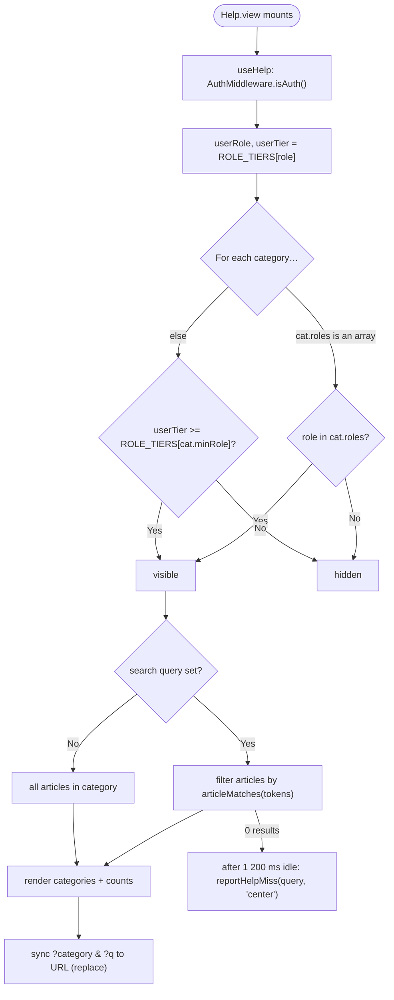

# Help Center — Technical Documentation

> **Scope:** The **Help** page (`/about/help`) — a searchable, role-filtered FAQ / help-article center — and the global Help Assistant launcher that searches the same corpus. Static content, no content API.
> **Source:** `Frontend/src/features/support/help/` and `Frontend/src/components/shared/HelpAssistant/` (frontend). **No content backend** — content is a static module and role visibility resolves from the already-authenticated user; the only server call is the zero-result telemetry `POST /api/v1/client/help-miss` (`helpTelemetry.js`; backend `Backend/src/routes/client.route.js` → `ClientController.logHelpMiss` → `ClientService.logHelpMiss`, infra doc §C.4).
>
> **Rendering note:** ` ```mermaid ` blocks render in GitHub, GitLab, Obsidian, and VS Code preview. For PDF via Chrome print, pre-render with `mermaid-cli` first.
>
> **Verified 2026-10-29.** Re-read against `Frontend/src/features/support/help/help.data.jsx`, `help.hook.js`, `helpSearch.js`, `helpTelemetry.js`, `components/shared/HelpAssistant/useHelpAssistant.js`, `Frontend/src/App.jsx` (route `about/help`, public) and `Backend/src/routes/client.route.js` / `ClientService.logHelpMiss`. The corpus holds **52 articles in 16 categories** (counted by `question:` key and category `label:` on 2026-10-29). All earlier dated update notes, which described a different application's articles and tests, were removed. Test files cited below exist in `Frontend/test/`; they were **not run** for this revision.
>
> **Telemetry caveat.** `helpTelemetry.js`'s header still says the backend `client/help-miss` route "is intentionally not shipped with this template". That comment is stale: `Backend/src/routes/client.route.js` mounts `POST /help-miss`. Flagged for the frontend owner; not changed here.

---

## 1. Overview

The Help Center is a self-service FAQ: help articles grouped into categories, searchable by question/answer/tag, and filtered so each role sees only the articles relevant to it (a USER never sees the database, caching or logging internals written for administrators). Category and search state sync to the URL so a help link is shareable.

The one-line story: `Help.view.jsx`'s `useHelp()` hook reads the current user (via `AuthMiddleware.isAuth()`), filters the static `HELP_CATEGORIES` by role, applies the search query and category filter, and renders. There is **no network call** for content — it's all in `help.data.jsx`. The route `about/help` is public (no `ProtectedRoute`), so a signed-out visitor sees the tier-0 categories.

---

## 2. Flow & Architecture

### 2.1 Role-filtered, searchable render



Visibility uses **two models in priority order**: an exact `roles` allow-list wins when present and requires a signed-in user whose role is in the list (a tier is a ladder, so it cannot express "SUPER_ADMIN only, and never a signed-out visitor"); otherwise the `minRole` tier ladder applies (`ROLE_TIERS`: signed-out / `USER` 0, `ADMIN` 1, `SUPER_ADMIN` 2).

---

## 3. Frontend implementation

| File | Responsibility |
| --- | --- |
| `src/features/support/help/Help.view.jsx` | Presentation — category rail + article panel + search |
| `src/features/support/help/help.hook.js` | `useHelp()` — auth resolve, role filter, search filter, category filter, URL sync, match counts |
| `src/features/support/help/help.data.jsx` | Static `HELP_CATEGORIES`, `ROLE_TIERS`, articles (question/answer/tags) |
| `src/features/support/help/components/HelpCategoryNav.jsx` | Right-rail category navigation with per-category match counts |
| `src/features/support/help/components/HelpArticlePanel.jsx` / `HelpArticleCard.jsx` | Article list + expandable card |
| `src/features/support/help/components/HelpFormula.jsx` | `Callout`, `DefList`, `Formula`, `Mark`, `WorkedExample` — rich `detail` blocks and highlight chips |
| `src/features/support/help/helpSearch.js` | Shared search engine (tokenize, synonyms, stem, fuzzy match, scoring, suggestion) |
| `src/features/support/help/helpTelemetry.js` | `reportHelpMiss(query, surface)` — fire-and-forget, deduped per page load, query bounded to 120 chars |
| `src/components/shared/HelpAssistant/` | Global launcher over the same corpus |

**Search:** both surfaces use the shared engine in `helpSearch.js` — `tokenize` (stop words dropped, tokens under 3 chars ignored), `expandSynonyms` (curated `SYNONYMS` table + `stem`), `articleMatches` / `scoreArticle` (substring match on tokens of 3+ chars, bounded-Levenshtein typo tolerance on words of 4+ chars, field weighting), and `findSuggestion` over `buildVocabulary` for the "Did you mean …?" empty state. The Help Center filters with `articleMatches`; the launcher ranks with `scoreArticle`. A linear pass over **52 articles in 16 categories** needs no index.

### Corpus (as shipped in `help.data.jsx`)

| Tier / rule | Categories (`label`) |
| --- | --- |
| Tier 0 — `minRole: null` (everyone, incl. signed-out visitors) | Account & Login · Getting Started · Appearance & Personalization · Version History · Money & Currency · Dashboard & Home · Errors & Troubleshooting |
| Tier 1 — `minRole: "ADMIN"` (ADMIN and SUPER_ADMIN) | Database & Connections · Mira ORM · Caching · CORS Setup · Request Lifecycle |
| Tier 2 — `minRole: "SUPER_ADMIN"` | Boot, Config & Build |
| Allow-list — `roles: ["SUPER_ADMIN"]`, `roleGroup: "System"` | Logging & Audit · Metrics & Observability · Admin Management & RBAC |

Every article is plain reader language: the corpus-wide plain-language guard in `helpConsistency.test.jsx` bans CWE ids, `ORA-` codes, `dangerouslySetInnerHTML`, `npm run`, `process.env`, `httpClient` and `AuthMiddleware` from any question or answer.

### Help Assistant launcher

`components/shared/HelpAssistant/` (`HelpAssistant.jsx`, `useHelpAssistant.js`) is mounted unconditionally in `App.jsx`, so a floating launcher is available on every route except `/about/help` itself (`HIDDEN_PATHS`, matched boundary-aware by `isHiddenPath`, so `/about/helpdesk` would still get it). It reads the same `HELP_CATEGORIES` / `ROLE_TIERS`, applies the same two-model visibility filter, ranks with `scoreArticle`, offers the same "Did you mean …?" recovery, and reports zero-result queries with surface `"assistant"`. "Go to Help Center" hands off to `/about/help`.

### Highlight philosophy: answer-skeleton model

`HelpFormula.jsx`'s `Mark` JSDoc sets the house style ("HIGHLIGHT THE ANSWER SKELETON, NOT JUST ONE PHRASE"): highlight *every* phrase that directly answers the article's question, so that reading only the highlighted chips yields the complete answer. Filler prose stays unhighlighted. Tones: `key` for neutral answer points, `good` for reassurances, `bad` for loss/warning outcomes, `plain` only inside colour-matched `Callout`s.

All 52 articles carry an `answerRender` block (`chunk`, `highlight: [{ phrase, tone }]`); two (`display-vs-stored`, `golden-signals`) also carry a rich `detail` panel. **No test checks that a highlight phrase is a verbatim substring of its answer** — a phrase that does not match simply renders no chip, so check new highlights by hand.

### Changelog

```
docs(help): re-verify help-center doc against CATHERINE source

- docs(help): corpus is 52 articles / 16 categories; tier table added
- docs(help): document the shared helpSearch engine and HelpAssistant launcher
- docs(help): drop history notes and article sets that are not in help.data.jsx
- docs(help): Q&A evidence limited to test files that exist in Frontend/test
```

**URL sync:** `?category=<id>` ↔ `selectedCategoryId`, `?q=<term>` ↔ `searchQuery`, written with `{ replace: true }` so back-button history isn't polluted.

---

## 4. Backend implementation

**No content backend.** The Help Center has no content routes, controllers, services, or DB tables. Content is a static frontend module (`help.data.jsx`); role visibility uses the JWT already present from login, read client-side via `AuthMiddleware.isAuth()` to determine the viewer's role. The only server call is the zero-result telemetry `POST /api/v1/client/help-miss` (`helpTelemetry.js` → `Backend/src/routes/client.route.js`: `AuthMiddleware.authenticate`, a 20-per-minute per-user `RateLimiterMiddleware` labelled `RateLimit:help-miss`, then `ClientController.logHelpMiss` → `ClientService.logHelpMiss`). The service strips control characters, truncates the query to 120 chars, drops a blank query, coerces `surface` to `assistant` / `center` / `unknown`, and writes one WARNING log line (`clientMessages.HELP_SEARCH_MISS`) with `userId` and `role`. Nothing is stored in the database. Documented in `Others/infrastructure-health-csrf-client-documentation.md` §C.4.

---

## 5. How frontend and backend connect (the contract)

There is **no content API contract**. No content backend — content is a static module; the only server call is the zero-result telemetry `POST /client/help-miss` (infra doc §C.4), which sends `{ query, surface }` and whose failure is swallowed (the dedupe key is rolled back so a later identical miss retries). A signed-out visitor's miss reaches `authenticate` and is refused; the client swallows that too. For visibility, `useHelp()` calls `AuthMiddleware.isAuth()` (client helper) to obtain `{ role }`, which drives the categories shown. No request body, no response payload, no status codes for content — everything renders from the static module.

If Help were ever backed by a CMS, the natural contract would be `GET /api/v1/help/articles?role=` returning role-scoped categories; today that does not exist and must not be implied.

---

## 6. Technicalities

- **Two-model visibility (allow-list beats tier).** `Array.isArray(cat.roles)` → `userRole != null && roles.includes(userRole)`; otherwise `userTier >= ROLE_TIERS[cat.minRole]`. The allow-list keeps the three System categories exact (SUPER_ADMIN only), and their shared `roleGroup: "System"` drives one nav divider in `HelpCategoryNav.jsx`.
- **Client-side role gate is UX, not security.** Hiding a category is a convenience filter — the articles are static content already shipped in the bundle. Nothing sensitive should ever be an "article" gated only by this filter (see §7).
- **Match counts are derived, not accumulated in render.** The total is `filtered.reduce(...)` over kept categories rather than mutated inside the map callback — avoids a render-phase reassignment (react-hooks immutability).
- **Loading state.** `isLoading` covers the async `isAuth()` resolve; a `cancelled` flag guards the effect against setting state after unmount (CWE-362).
- **No staleness.** Content is static, so there's no cache/TTL story — a deploy is the only way content changes.
- **Miss reporting is debounced.** Both surfaces wait 1 200 ms (`MISS_REPORT_DEBOUNCE_MS`) after the query settles and report only when the match count is zero.

---

## 7. Security

- **CWE-200 / broken access control — content is not secret.** Role filtering is **cosmetic**: every help article is in the static bundle regardless of role. This is safe *by design* because help articles are non-sensitive guidance. **Rule:** never place credentials, tokens, internal IDs, or data that must be authorized behind this filter — it is not an access-control boundary.
- **CWE-362 (async race).** The `isAuth()` effect uses a `cancelled` flag so an unmount mid-resolve doesn't write state.
- **XSS.** Article content is static JSX from `help.data.jsx` (developer-authored), not user input, and is not injected via `dangerouslySetInnerHTML`. Search input is used only for substring matching, never rendered as HTML.
- **No secrets, no transport concerns** — nothing leaves the browser for content.
- **Telemetry hardening (CWE-117 / CWE-400 / CWE-20).** The miss endpoint is auth-gated, rate-limited to 20/min per user, and the service strips control characters (log-injection guard) and bounds the query before logging.

---

## 8. Verification Q&A

> **Evidence convention.** Test names are quoted from files that exist in `Frontend/test/`. None of them was run for this revision, so no pass status or count is claimed. Run them with `cd Frontend; npx vitest run test/integration/support-help test/unit/components/help` to confirm.

> **Q:** Does a user only see categories permitted for their role?
> **A:** Yes. `visibleCategories` applies the `roles` allow-list first, then the `minRole` tier ladder.
> **Evidence (UI):** `Frontend/test/integration/support-help/help-center.test.jsx` → `"shows the System category to a SUPER_ADMIN"`, `"hides the System category from an ADMIN (allow-list is exact, not a ladder)"`, `"hides the System category from an ordinary USER"`, `"hides the System category from an unauthenticated visitor"`; `Frontend/test/unit/components/helpRoleGating.test.jsx` → `"shows every tier-0 (minRole:null) category to an unauthenticated visitor"`, `"hides tier-1 (minRole:ADMIN) categories from tier-0 roles but shows them to ADMIN+"`, `"restricts System (roles allow-list) categories to the exact allow-list — NOT even ADMIN"`, `"never grants a lower role more than a higher role for any category (monotonic)"`. _Status: not run for this revision._
> **Evidence (API):** none — UI-only; the server is not involved. Help Center content is a static frontend module; category visibility is resolved entirely client-side.

> **Q:** Does search match across question, answer, and tags, with typo tolerance?
> **A:** Yes. `articleMatches` runs the shared `helpSearch.js` engine (tokenize → synonyms/stem → substring or bounded-Levenshtein match) over the article fields.
> **Evidence (UI):** `help-center.test.jsx` → `"finds real content and shows a result summary when searching"`, `"shows the no-results copy for a genuinely off-topic query"`; `Frontend/test/unit/components/helpSearch.test.js` (describes `boundedLevenshtein`, `tokenize`, `expandSynonyms`, `articleMatches`, `findSuggestion`, `stem`, …); `helpCenterSearch.test.jsx` → `"Help Center search — parity with the launcher"`. _Status: not run for this revision._
> **Evidence (API):** none — UI-only; there is no server-side search endpoint.

> **Q:** Is the corpus structurally sound and free of internal identifiers?
> **A:** Yes, as far as the guards reach: every category has id/label/description/icon/≥1 article; every article has an id, a question ending in `?`, an answer over 40 chars and ≥1 tag; ids are unique; `roleGroup` blocks are contiguous; banned tokens (CWE ids, `ORA-`, `dangerouslySetInnerHTML`, `npm run`, `process.env`, `httpClient`, `AuthMiddleware`) never appear in user-facing text.
> **Evidence (UI):** `Frontend/test/unit/components/helpConsistency.test.jsx` → `"gives every article an id, a question, a substantial answer, and tags"`, `"has globally unique article ids (launcher keys on them)"`, `"never repeats a roleGroup divider label in non-adjacent blocks"`, `"keeps banned internal tokens out of every question and answer"`. _Status: not run for this revision._
> **Evidence (API):** none — UI-only.

> **Q:** Is a zero-result search reported once, and can telemetry ever break the page?
> **A:** One report per distinct `(surface, query)` per page load; failures are swallowed and the dedupe key rolled back.
> **Evidence (UI):** `Frontend/test/unit/components/helpTelemetry.test.js` → `"sends { query, surface } to POST client/help-miss"`, `"dedupes the same (surface, query) — sent at most once per session"`, `"bounds an over-long query to 120 chars before sending"`, `"never rejects to the caller when the server errors (fire-and-forget)"`, `"rolls back the dedupe key on failure so a later identical miss retries"`. _Status: not run for this revision._
> **Evidence (API):** source only — `client.route.js` (`authenticate`, 20/min limiter) and `ClientService.logHelpMiss` (control-char strip, 120-char bound, surface coercion). _Status: no test in this repo for `POST /client/help-miss`._

> **Q:** Is the launcher hidden on the Help Center page itself, and does it render for every role?
> **A:** Yes — `HIDDEN_PATHS = ["/about/help"]`, matched boundary-aware; elsewhere the launcher renders for USER, ADMIN and SUPER_ADMIN sessions.
> **Evidence (UI):** `Frontend/test/unit/components/helpAssistantRouteGating.test.jsx` (describes `"isHiddenPath — boundary-aware suppression matcher"`, `"<HelpAssistant /> — route-based FAB suppression"`); `helpRoleGating.test.jsx` → `"renders the FAB for a %s session on an ordinary route"`, `"maps exactly the template roles onto the tier ladder"`. _Status: not run for this revision._
> **Evidence (API):** none — UI-only.

> **Q:** Is the role gate a security boundary?
> **A:** No — it's cosmetic. All articles ship in the bundle; the filter only tidies the UI. Sensitive data must never rely on it.
> **Evidence:** architectural (static content module); no test asserts secrecy because there is no secret to protect. Documented as a **design constraint** in §7. _Status: N/A (by design)._
> **Evidence (API):** none — UI-only; the server is not involved. Every article ships to every client regardless of role, so there is no server-side gate to test.

### Coverage summary

**Test files that cover this feature (not run for this revision):** `Frontend/test/integration/support-help/help-center.test.jsx`; `Frontend/test/unit/components/helpRoleGating.test.jsx`, `helpConsistency.test.jsx`, `helpSearch.test.js`, `helpCenterSearch.test.jsx`, `helpAssistantSearch.test.jsx`, `helpAssistantRouteGating.test.jsx`, `helpTelemetry.test.js`, `helpFormulaSplitSentences.test.jsx`.
**Gaps:** no backend test for `POST /api/v1/client/help-miss` (auth gate, 20/min limiter, sanitising); no test that `answerRender.highlight` phrases are verbatim substrings of their answers. "Content secrecy" is deliberately untested — the role filter is not a security boundary.

---

_End of document. Updated 2026-10-29._
