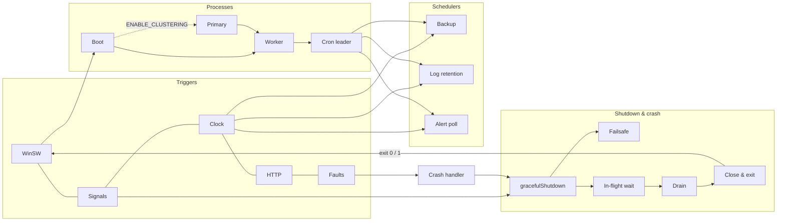

# Runtime — Technical Documentation

> **Scope:** The **Runtime page** — Support → **Runtime** (`/support/runtime`), **SUPER_ADMIN only**. An interactive map of how the backend *runs*: boot and its guards, cluster roles, the cron-leader schedulers, scheduled backups, the request and backup watchdogs, rate limiting and the security filter, the pool breaker, alerting, crash handling and graceful shutdown. Each flow carries a `ref` badge naming the code site (or test) that exercises it.
> **Source (FE):** `Frontend/src/features/support/runtime/` — `Runtime.view.jsx`, `runtime.hook.js`, `runtime.api.js` — a thin feature over the shared engine in `Frontend/src/components/shared/systemMap/` (see `Support/architecture-documentation.md` §3). Route registered in `Frontend/src/App.jsx`; nav item (SUPER_ADMIN block only) in `Frontend/src/components/layout/config/nav.config.jsx`.
> **Source (BE):** `Backend/src/constants/runtimeModel.js` (the hand-authored map), served by `GET /api/v1/architecture/runtime` through `src/routes/architecture.route.js`, `src/controllers/ArchitectureController.js` (`getRuntimeMap`), `src/services/ArchitectureService.js` (`getMap("runtime")`) and `src/utils/systemMap.js`. `RUNTIME_MAP_FETCHED` in `src/constants/responses/index.js`.
> **Verified 2026-10-29.** Re-checked against the CATHERINE source: `Backend/src/constants/runtimeModel.js` (`MAP_VERIFIED_AT = "2026-10-26"`, `META.system` "CATHERINE — backend runtime: scheduling, backup, resilience, shutdown", 44 nodes, 95 edges, 21 flows counted by hand), the shared route/controller/service/builder (see the Architecture doc), `runtime.hook.js` (`cacheKey "architecture/runtime"`, `downloadName "runtime.json"`), `FlowPanel.jsx` (`ref` badge), `SystemMapView.jsx` (endpoint count hidden when 0), `Backend/src/constants/clusterIpc.js`, `PrimaryStateServices.js`, `LoginLockoutState.js`, `RevokedSessionSet.js`, `AccessRevocationService.js`, `HealthStreamHub.js`, `LogRetentionService.js` and `Backend/deploy/winsw/`. There is **no** `scripts/sim-server/` and no `sim:server` npm script in this repo, so flow `ref`s name code sites (mostly `server.js`), not simulation stages. No system-map test exists in `Backend/test/` or `Frontend/test/`; §8 says so. No test counts are quoted.
>
> **Related docs:**
> - `Support/architecture-documentation.md` — the sibling whole-system map; same engine, route and gate.
> - `Backend/CLAUDE.md` → "Resilience & Graceful Shutdown" — the prose the model header names as its reference (not served by this viewer; section title not re-verified for this document).
> - `Backend/deploy/winsw/README.md` — the Windows service wrapper (`catherine-backend-service.xml`) the `trg.winsw` node describes.
>
> **Rendering note:** ` ```mermaid ` blocks render in GitHub/GitLab/Obsidian/VS Code — **and in the Dev Docs viewer**, via `MermaidBlock`. For PDF via Chrome print, pre-render with `mermaid-cli`.

---

## 1. Overview

The Runtime page draws the server as 44 nodes and 95 edges in seven layers — **Triggers** (WinSW, OS signals, the clock, HTTP clients, faults) → **Processes** (boot, cluster primary, HTTP worker, cron leader, shared state) → **Schedulers & jobs** (DB-backup scheduler, log retention, alert poll) → **Guards & limits** → **Shutdown & crash** → **Observability** → **Resources** — and 21 step-through flows (counts by hand from `runtimeModel.js` on 2026-10-29):

| Flow | `ref` badge (as served) |
| --- | --- |
| Boot and readiness | `server.js` |
| Leader arms the schedulers | `server.js` |
| Scheduled backup with watchdog | `server.js` |
| Database outage (breaker, load-shed, alerts) | `server.js` |
| Critical alert storm (digest, hourly ceiling) | `server.js` |
| Crash and restart | `server.js` |
| Graceful stop | `server.js` |
| Shutdown failsafe | `server.js` |
| Request watchdog | `server.js` |
| Rate limit and security filter | `server.js` |
| Logging under pressure | `server.js` |
| Cluster lifecycle | `server.js` |
| Cluster shared state | `server.js` |
| Ended session across the cluster | `server.js` |
| Compressed request bodies (Brotli refused) | `server.js` |
| Multipart field-name index (index > 100 refused) | `server.js` |
| Readiness: server vs database | `server.js` |
| Readiness push stream | `server.js` |
| Sign-in lockout | `server.js` |
| Restart detection and boot emails | `serverProcess.restartMarker.reliability.test.js · bootAlertHistoryLiveOracle.test.js` |
| Restore verifies before it re-signs | `restore.verifyBeforeResign VBR-01–08` |

The badge is free text from the model. The last two name test files that do **not** exist in this repo's `Backend/test/`; treat them as stale labels (flagged for the owner of `runtimeModel.js`, not changed here). There is no server-simulation harness in this repo.

## 2. Flow & Architecture



The page reaches the browser exactly like Architecture's (`Support/architecture-documentation.md` §2), at `GET /api/v1/architecture/runtime`.

## 3. Frontend implementation

| File | Role |
| --- | --- |
| `features/support/runtime/runtime.api.js` | `getMap()` → `GET architecture/runtime` through `HttpClient`. |
| `features/support/runtime/runtime.hook.js` | `useRuntime()` = `useSystemMap({ cacheKey: "architecture/runtime", downloadName: "runtime.json", … })`. |
| `features/support/runtime/Runtime.view.jsx` | `<SystemMapView hook={hook} title="Runtime" … />`. |

Everything else — diagram, flow player, node details, URL-held selection (`?flow=&step=` / `?node=`), keyboard shortcuts, Download JSON — is the shared engine described in `Support/architecture-documentation.md` §3. Two behaviours matter more here than on Architecture:

- **Flow `ref` badge.** Every Runtime flow carries a `ref` (the code site or test that exercises it); `FlowPanel` shows it on the list card and under the open flow's title.
- **No endpoints count.** The runtime map lists no HTTP endpoints, so the header omits the count rather than showing "0 endpoints".

## 4. Backend implementation

`src/constants/runtimeModel.js` is plain data — `{ MAP_VERIFIED_AT, META, LAYOUT, layers, edgeKinds, nodes, E, flows }` — in the same shape as `architectureModel.js`, validated by the same `buildSystemMap`. `ArchitectureService.getMap("runtime")` builds it once per process; a failed build is logged and not cached, and does not affect the Architecture map. The route, controller, `private, no-store` headers and audit log line are shared with Architecture (`Support/architecture-documentation.md` §4).

Edge kinds specific to this map: `signal` (signals and exit codes), `schedule`, `call`, `ipc`, `http`, `sse`, `log`, `sql`, `fs`, `smtp`.

## 5. How frontend and backend connect (the contract)

### `GET /api/v1/architecture/runtime`

- **Auth:** access-token cookie; `SUPER_ADMIN` only. Every other role → `403`; no session → `401`.
- **200 body:** `sendSuccess("Runtime map fetched successfully.", { meta, layers, edgeKinds, nodes, edges, flows, layout })` — the same shape as `GET /api/v1/architecture`, with `meta.title = "Runtime"`, `meta.repos = ["Backend"]`, `meta.conventions.ref` ("flow.ref names the code site or test that exercises the flow"), and a `ref` string on every flow.
- **500:** `"This system map is unavailable on this server."` — the model failed validation.

## 6. Technicalities

**Keeping the map honest.** The model's header names `test/server/unit/architecture/systemMap.test.js` as the guard against stale `Backend/...` paths and flow steps without an edge. **That test does not exist in this repo**; only `buildSystemMap` runs, at the first request (see `Support/architecture-documentation.md` §6). There is no server-simulation harness either, so nothing ties a flow to a runnable stage.

What nothing catches: a threshold that changed in code but not here. Every number on the page (120 s idle, 30 min wait cap, 1 834 s failsafe, 30 s digest window, 10 emails/hour, 90-day log-file retention (`LOG_RETENTION_DAYS`, `DEFAULT_RETENTION_DAYS = 90` in `LogRetentionService.js`), `HEALTH_STREAM_MAX_PER_IP` default 50 …) is a **code default**; production can override several through `.env`. Only the log-retention and health-stream defaults were re-read for this document; the others are as the model states them. Re-check against `server.js` and bump `MAP_VERIFIED_AT` after changing any of them.

**Single-process vs clustered.** Flows that mention the primary, shared state or the critical relay apply only with `ENABLE_CLUSTERING=true`. In single-process mode the one process is always the cron leader and registers no IPC listener.

**Cluster shared state (auth).** Two auth counters live in the primary-held state (`src/utils/cluster/PrimaryStateServices.js`, methods in `src/constants/clusterIpc.js`, argument and result validators in `ipcSchemas.js`):

| IPC method | Kind | What the primary does | When the primary does not answer |
| --- | --- | --- | --- |
| `rl.refund` | notify (fire-and-forget) | Gives one counted hit back to `<label>|<windowMs>` for the key and window bucket the worker names. Sent by the two login limiters, which count failed sign-ins only (reserve a hit before the credential check, refund it when the response is below 400). | Nothing to wait for; a lost refund only makes the limit stricter. A hit that was counted locally (fallback) is refunded locally. |
| `lockout.check` / `lockout.fail` / `lockout.clear` | request (250 ms timeout, `CLUSTER_RPC_TIMEOUTS.LOCKOUT_MS`) | `LoginLockoutState` keeps the per-account lockout counters (24 h TTL, at most 100 000 keys; a new key evicts expired entries first, then the oldest entry that is not locked; when every slot holds a locked account it answers `{ fallback: true }` and logs `CLUSTER_LOCKOUT_FALLBACK("store-full")` at error level, throttled). A failure that arrives while the account is locked is ignored. | The worker falls back to its own local lockout (per-worker threshold) and logs `CLUSTER_LOCKOUT_FALLBACK` at most once a minute. The worker, not the primary, writes the lockout log lines, so they keep the serving worker's PID. |
| `auth.revoke` -> `auth.revoked` / `auth.sync` | notify, then broadcast | Keeps a copy of the ended session families (`RevokedSessionSet`, entry lives for the access-token lifetime + 60 s clock skew) and broadcasts them to every OTHER worker; replays live entries to a worker on `listening` (`auth.sync`, at most `ACCESS_REVOCATION_LIMITS.MAX_SYNC_ENTRIES` = 50 000). Every worker refuses a token of an ended family with `440 SessionRevokedError` and closes its live SSE streams. | The revoking worker still refuses the token; the others accept it until it expires. The lost notify is logged at error level (`ACCESS_REVOCATION_BROADCAST_FAILED`). After a restart each process reloads recent revocations from `T_AUTH_REFRESH_TOKEN_DEV` (`AccessRevocationService.loadRecent`). |

The refresh-token ledger has **no** IPC for rotation (the `auth.*` row above is the access-token side): `T_AUTH_REFRESH_TOKEN_DEV`'s conditional update is atomic across workers on its own, and each worker keeps only a local veto registry. See `Others/auth-documentation.md` §2.5 and §6.

**Adding a node** means placing it in this model's `LAYOUT` — the builder refuses an unplaced node.

## 7. Security

Identical controls to Architecture (`Support/architecture-documentation.md` §7): `requireSuperAdmin` on the router is the control; the nav entry and `ProtectedRoute` are conveniences; no static copy in the frontend; `private, no-store`; a failed build returns a generic message; each read is audit-logged without contents. This map is arguably the more sensitive of the two — it states every watchdog limit, failsafe deadline and alert ceiling an attacker would want to time a stall or a storm against.

## 8. Verification Q&A

> **Evidence convention.** No system-map test exists in `Backend/test/` or `Frontend/test/`. Every answer below is from reading the named source on 2026-10-29 and is marked _no test in this repo_.

**Q: Can an ADMIN or USER read the runtime map?**
No — 403 from the server.
**Evidence (API):** source only — `GET /runtime` sits behind the same `router.use(authenticate)` + `router.use(requireSuperAdmin)` in `architecture.route.js`.
**Evidence (UI):** source only — `runtime.hook.js` `forbiddenMessage`: "The runtime map is available to Super Admins only." _Status: no test in this repo._

**Q: Who sees the Runtime nav item?**
SUPER_ADMIN only.
**Evidence (API):** none — UI-only; the nav item is client configuration (the server-side gate is covered above).
**Evidence (UI):** source only — `nav.config.jsx` lists "Runtime" (`/support/runtime`) in the SUPER_ADMIN-only group; `App.jsx` wraps it in `ProtectedRoute role={[ROLES.SADMIN]}`. _Status: no test in this repo._

**Q: Is every flow tied to something that proves it?**
Every flow has a `ref`, but it is a label, not a link. 19 of 21 say `server.js`; the other two name test files that do not exist in this repo.
**Evidence (API):** source only — `ref:` on each flow in `runtimeModel.js`.
**Evidence (UI):** source only — `FlowPanel.jsx` renders `f.ref` / `flow.ref`. _Status: no test in this repo._

**Q: What stops the runtime map pointing at files that no longer exist?**
Nothing automated in this repo. `buildSystemMap` checks ids, edges and placement, not file paths.
**Evidence (API):** source only — `Backend/src/utils/systemMap.js`.
**Evidence (UI):** none — backend-only. _Status: no test in this repo._

**Q: If the runtime model is broken, does the Architecture page still work?**
Yes — each map is built and cached independently.
**Evidence (API):** source only — `ArchitectureService.getMap(name)` caches per name and does not cache a failure.
**Evidence (UI):** none — backend-only. _Status: no test in this repo._

**Q: Does the page call its own endpoint, not the Architecture one?**
Yes — `GET architecture/runtime`, cached client-side for 5 minutes (`useRequest` `staleTime 300_000`).
**Evidence (API):** source only — `GET /runtime` in `architecture.route.js`, `private, no-store` set by the shared controller.
**Evidence (UI):** source only — `runtime.api.js` and `runtime.hook.js`; `SystemMapView.jsx` renders the endpoint count only when `hook.endpointCount > 0`. _Status: no test in this repo._

---

_End of document. Updated 2026-10-29._
