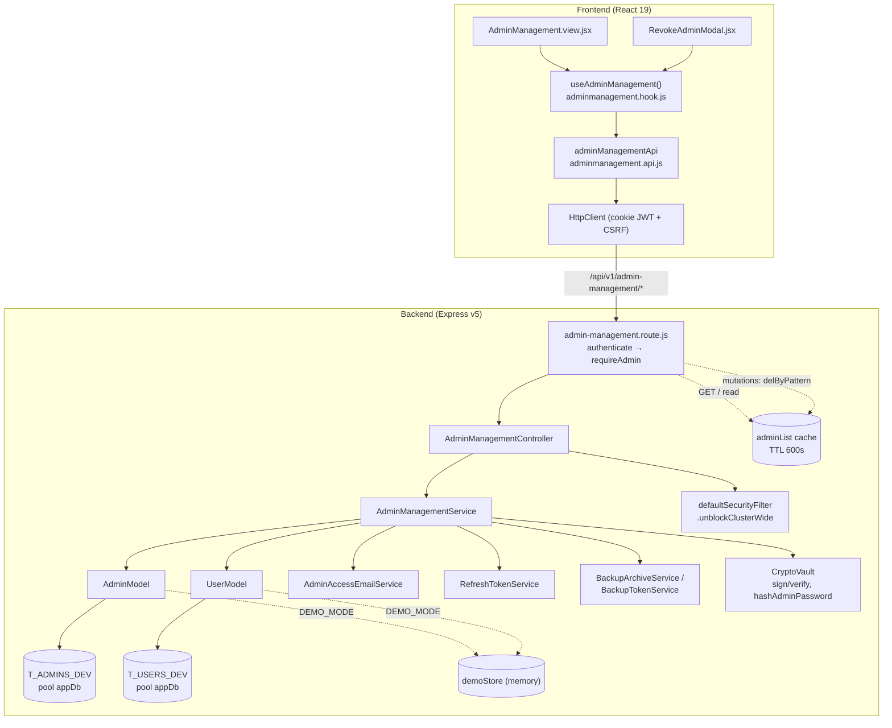
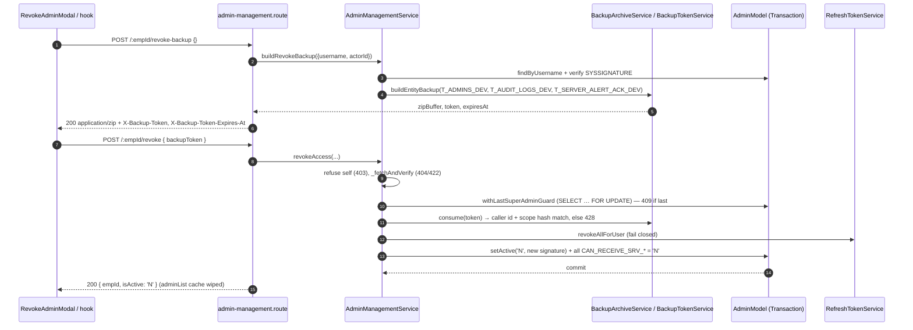
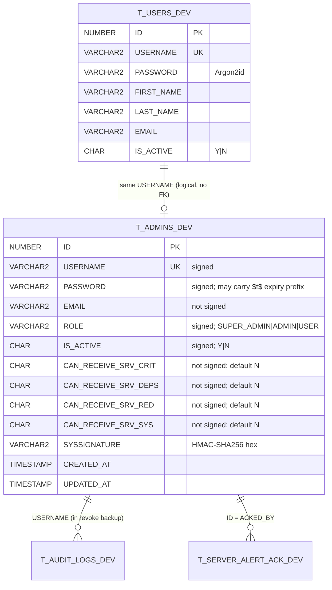

# Admin Management — Technical Documentation

> **Scope:** Access Control: who holds a privileged account (`SUPER_ADMIN`, `ADMIN`, `USER`) in `T_ADMINS_DEV`, what each role may do to other accounts, how temporary passwords are issued and emailed, how per-admin server-notification opt-ins (`CAN_RECEIVE_SRV_*`) are set, how access is revoked or deleted behind a mandatory backup, and the tamper-evident `SYSSIGNATURE` on every row. Also covers the Super Admin escape hatch for a SecurityFilter IP block (`POST /security/unblock-ip`).
>
> **Primary source files:**
> Backend: `Backend/src/routes/admin-management.route.js`, `Backend/src/controllers/AdminManagementController.js`, `Backend/src/services/AdminManagementService.js`, `Backend/src/services/AdminAccessEmailService.js`, `Backend/src/models/admin.model.js`, `Backend/src/models/user.model.js`, `Backend/src/utils/encryption/adminTempPassword.js`, `Backend/sql/01_schema.sql`.
> Frontend: `Frontend/src/features/systemadmin/adminmanagement/` (`adminmanagement.api.js`, `adminmanagement.hook.js`, `AdminManagement.view.jsx`, `components/*`), `Frontend/src/App.jsx`.
>
> **Verified 2026-10-29 against source.** Tests were not run for this revision.

---

## 1. Overview

Access Control is the page where a Super Admin decides which accounts are privileged and what they can receive. In plain terms:

- **Add** — pick an existing account from `T_USERS_DEV` and give it a role. The server makes up a temporary password and emails it to the account holder. Nobody sees the password, including the operator.
- **Edit** — change the role. Edit never touches the password.
- **Reset Password** — email a new temporary password. The old password stops working and every session of the account ends.
- **Reset Signature** — re-sign a row whose `SYSSIGNATURE` no longer verifies (for example after a manual DB fix or a key rotation).
- **Permissions** — switch the four server-notification channels and `IS_ACTIVE` on or off.
- **Revoke / Delete** — download a backup archive of that admin first. The archive returns a one-use **backup token**. Revoke (the default) deactivates the account. Delete removes the row.
- **Unblock IP** — clear an in-memory SecurityFilter block without a restart. The API exists. The frontend does not call it yet.

### Roles

| Role          | Level (schema comment) | What it may do here                                                                                     |
| ------------- | ---------------------- | ------------------------------------------------------------------------------------------------------- |
| `SUPER_ADMIN` | 3                      | Everything, on any row.                                                                                 |
| `ADMIN`       | 2                      | API only: search, list, **add a `USER`**, **Reset Password on a `USER` row that is not its own**. Nothing else. |
| `USER`        | 1                      | No access (403 at the router).                                                                          |

The role values come from `CK_T_ADMINS_DEV_ROLE` in `Backend/sql/01_schema.sql` and `VALID_ROLES` in `AdminManagementService`. The frontend route `system/admin-management` is **SUPER_ADMIN-only** (`Frontend/src/App.jsx`). The ADMIN branch of the role policy can therefore only be reached through the API, not through the UI (see §6).

### Invariants

1. Every write and delete verifies `SYSSIGNATURE` first (`_fetchAndVerify` → 422). Reset Signature is the one exception, because repairing the signature is its purpose.
2. At least one active `SUPER_ADMIN` always remains (`AdminModel.withLastSuperAdminGuard` → 409).
3. Revoke and Delete are refused without a backup token that is bound to the caller and scoped to the target (428).
4. Passwords are only issued by the server, only emailed, and expire after 72 h.
5. Any action that removes access or changes the role ends the account's sessions **before** the write. If ending them fails, nothing is written.

---

## 2. Flow & Architecture

### 2.1 Component flow

### 2.2 Revoke sequence (backup → token → revoke)

### 2.3 Data model

`T_ADMINS_DEV` holds no name columns. Names come from the `T_USERS_DEV` row with the same `USERNAME`, when one exists.

---

## 3. Frontend implementation

### 3.1 Files

| File | Layer | Responsibility |
| ---- | ----- | -------------- |
| `Frontend/src/features/systemadmin/adminmanagement/adminmanagement.api.js` | API | `adminManagementApi` — 10 Axios calls. No state. |
| `Frontend/src/features/systemadmin/adminmanagement/adminmanagement.hook.js` | Hook | `useAdminManagement()`, `accessPolicy()`, `needsOverrideEmail()`; all modal, form, search and revoke-stepper state. |
| `Frontend/src/features/systemadmin/adminmanagement/AdminManagement.view.jsx` | View | "Access Control" page: table, paginated list, Add/Edit/Reset/Permissions modals. Wrapped in `ErrorBoundary`. |
| `Frontend/src/features/systemadmin/adminmanagement/components/RevokeAdminModal.jsx` | Component | 3-step stepper: Backup → Choose Action → Processing. |
| `Frontend/src/features/systemadmin/adminmanagement/components/PermissionFlagsFieldset.jsx` | Component | Flag toggles (Add and Permissions modals). |
| `Frontend/src/features/systemadmin/adminmanagement/components/PermissionCluster.jsx` | Component | Compact flag display in the table row. |
| `Frontend/src/features/systemadmin/adminmanagement/components/TempPasswordBadge.jsx` | Component | Shows an outstanding temporary-password expiry. |
| `Frontend/src/features/systemadmin/adminmanagement/components/TemporaryPasswordRecipient.jsx` | Component | Masked recipient hint, plus the override-email input when it is needed. |

### 3.2 Routing

`Frontend/src/App.jsx` lazy-loads `AdminManagementView` and mounts it at `system/admin-management` inside `<ProtectedRoute role={[ROLES.SADMIN]} />`. `ROLES` is `{ SADMIN: "SUPER_ADMIN", ADMIN: "ADMIN", USER: "USER" }`. The guard is a convenience only. The control is server-side.

### 3.3 Hook state and behaviour

- **List:** `useRequest("admin-management/list", …, { staleTime: 30_000 })`. Every successful mutation calls `invalidateCache(CACHE_KEY)` and then `refetchAdmins()`.
- **Current user:** `AuthMiddleware.isAuth()` feeds `accessPolicy(currentUser)`. The policy mirrors `_assertCanManage`:
  - `addableRoles`: SUPER_ADMIN → all three roles; ADMIN → `["USER"]`.
  - `canEdit`, `canResetSignature`, `canRevoke`: SUPER_ADMIN only.
  - `canResetPassword(row)`: SUPER_ADMIN, or ADMIN on a `USER` row whose `empId` is not its own.
- **Search (Add modal):** `useDebounce(searchQuery, 600)`. The view calls `executeSearch(debouncedQuery)` while the Add modal is open. `searchFetchRef` holds a per-request token, so a slower, older response can never overwrite a newer one. The hook comments explain why: picking a stale top row would grant rights to the wrong account.
- **Add / Reset Password:** no password field. `needsOverrideEmail(account, form)` is true when `emailOnFile === false` or when the server already answered 422 with `details[].field === "overrideEmail"`. In that case `overrideRequired` flips on. `announceTemporaryPassword` shows a **warning** toast when `emailDelivered === false`, because the account was saved but the email failed, and a success toast with `recipientHint` otherwise.
- **Defaults:** `EMPTY_ADD_FLAGS` sets all four `canReceiveSrv*` to `'N'` and `isActive` to `'Y'`, matching the backend's deny-by-default.
- **Revoke stepper:** `revokeStep` 1→2→3. `handleDownloadRevokeBackup` reads `x-backup-token`, `x-backup-token-expires-at` and `content-disposition` from the blob response, starts the download, and stores the token. **Revoke and Delete share the same token.** `extractRevokeBlobErrorMessage` decodes a JSON error that arrived as a `Blob`. `closeRevokeModal` will not close while an action is in flight.
- **Delete 409 with `details`:** `isDependentsConflict` collects per-table counts into `dependentCounts` and steers the operator to "Revoke Access Instead". The current backend never emits this shape (see §6).

### 3.4 Revoke stepper states

| `revokeStep` | Shows | Leaves when |
| ------------ | ----- | ----------- |
| 1 — Backup | Credential-material warning, download button, `revokeBackupError` | Backup downloaded and token captured (`revokeBackupDownloaded`) |
| 2 — Choose Action | Revoke Access (primary), Delete Permanently (secondary), `revokeActionError`, `dependentCounts` panel | `confirmRevokeAccess` / `confirmDeletePermanently` set step 3 |
| 3 — Processing | Spinner, then `revokeActionResult` | On failure the hook returns to step 2 |

Both confirm handlers return early if `revokeBackupToken` is null. The UI gate repeats the server rule; it does not replace it.

### 3.5 View

The table columns are Username, Name, Role badge (grey when inactive), Status plus `TempPasswordBadge`, Permissions (`PermissionCluster`), Integrity (`signatureValid` green/red badge) and Actions. `RowActions` hides any action the policy would refuse. **Reset Signature only appears when `!row.signatureValid`.** Inactive rows render at `opacity-50`. The page-level `ApiErrorAlert` is hidden while a modal is open, because each modal renders its own.

---

## 4. Backend implementation

### 4.1 Layering

| Layer | File | Notes |
| ----- | ---- | ----- |
| Mount | `Backend/src/routes/index.js` | `router.use("/admin-management", adminManagementRoutes)` |
| Route | `Backend/src/routes/admin-management.route.js` | Auth, role predicates, validation, cache read/invalidate, rate limit. |
| Controller | `Backend/src/controllers/AdminManagementController.js` | Thin. `catchAsync`, `sendSuccess`. Helpers `_flag`, `_caller`, `_actorId`. |
| Service | `Backend/src/services/AdminManagementService.js` | Role policy, signatures, temp passwords, guards, token verification, session ending, cache busting. |
| Email | `Backend/src/services/AdminAccessEmailService.js` | `resolveRecipient` (before any write) and `sendTemporaryPassword` (never throws). |
| Model | `Backend/src/models/admin.model.js` | `T_ADMINS_DEV` via the oracle-mongo-wrapper `OracleCollection` / `Transaction` on `appDb`. DEMO_MODE branches use `demoStore`. |
| Model | `Backend/src/models/user.model.js` | `T_USERS_DEV` reads (`findByUsername`, `findAll`), `appDb`. |
| Util | `Backend/src/utils/encryption/adminTempPassword.js` | Generates temp passwords and owns the `$t$` expiry marker. |

### 4.2 Route-level guards

- `router.use(AuthMiddleware.authenticate, requireAdmin)`, where `requireAdmin` passes `role === "ADMIN" || role === "SUPER_ADMIN"`.
- `requireSuperAdmin` (`role === "SUPER_ADMIN"`, message "Only a Super Admin can do this.") is added to: `PUT /:empId`, `PATCH /:empId/reset-signature`, `PATCH /:empId/permissions`, `DELETE /:empId`, `POST /:empId/revoke-backup`, `POST /:empId/revoke`, `POST /security/unblock-ip`.
- `credentialEmailRateLimiter` (5 per 60 s, `keyBy: "user"`, `Backend/src/middleware/security/RateLimiterMiddleware.js`) only applies to `PATCH /:empId/reset-password`.
- `AuthMiddleware.validateRequiredFields` rejects missing fields with 400. Its default `stringOnly` mode refuses objects and turns primitives into strings. `/permissions` passes `{ stringOnly: false }` so that `flags` can be an object.

### 4.3 Service operations

| Method | Key steps |
| ------ | --------- |
| `searchEmployees(q)` | Empty → 400. Needle = trimmed, ≤100 chars, lower-cased. Runs `UserModel.findAll()` and `AdminModel.search(needle, 50)` in parallel. Filters users on USERNAME/FIRST_NAME/LAST_NAME and keeps the first **20** (`SEARCH_LIMIT`). Unmatched admin rows are resolved with one `findByUsernames` `$in` query. Returns `USERID, FIRSTNAME, LASTNAME, isAdmin, emailOnFile, emailConflict, emailHint`. |
| `listAdmins()` | `AdminModel.findAll()` + `UserModel.findAll()`. Each row is checked with `CryptoVault.verifyRecord(SIGN_CONTEXT, buildSignedFields(row), SYSSIGNATURE)`. Returns `empId, empRole, firstName, lastName, signatureValid, emailOnFile, emailConflict, emailHint, tempPasswordExpiresAt, canReceiveSrv*, isActive, createdAt, updatedAt`. |
| `addAdmin` | Validate role → refuse `retainPassword`/`newPassword` (400 `PASSWORD_FIELDS_NOT_ACCEPTED`) → `USERNAME_PATTERN` → `_assertCanManage('create')` → validate flags → exists? 409 → `resolveRecipient` → issue temp password → sign → `RefreshTokenService.revokeAllForUser(ADMIN_READD)` → `insertAdmin` (all `CAN_RECEIVE_SRV_*` = 'N') → `setNotifyFlags` only if a flag is 'Y' → email. |
| `updateAdmin` | Validate role → refuse `changePassword: true` / `newPassword` (400 `EDIT_PASSWORD_NOT_ACCEPTED`) → `_assertCanManage('changeRole')` → `_fetchAndVerify` → re-sign → end sessions if the role changed → `updateRole`. A demotion from SUPER_ADMIN runs inside the last-SUPER_ADMIN guard. |
| `resetPassword` | `_fetchAndVerify` → `_assertCanManage('resetPassword')` → `resolveRecipient` → issue → re-sign → `revokeAllForUser(PASSWORD_RESET)` → `updateCredentials` → store an OVERRIDE address as `EMAIL` → email. |
| `resetSignature` | `_assertCanManage('resetSignature')` → `findByUsername` (404) → `signRecord(buildSignedFields(existing))` → `updateCredentials(same password, new sig)`. Does **not** verify the old signature. |
| `deleteAdmin` | Self → 403 `CANNOT_DELETE_SELF` → `_fetchAndVerify` → guard { verify token → end sessions → `deleteAdmin(session)` }. |
| `buildRevokeBackup` | `_fetchAndVerify` → `BackupArchiveService.buildEntityBackup` over `ADMIN_REVOKE_BACKUP_TABLES` (`T_ADMINS_DEV`, `T_AUDIT_LOGS_DEV` by USERNAME, `T_SERVER_ALERT_ACK_DEV` by `ACKED_BY = ID`). |
| `revokeAccess` | Self → 403 `CANNOT_REVOKE_SELF` → `_fetchAndVerify` → sign with `IS_ACTIVE='N'` → guard { verify token → end sessions → `setActive('N')` → all channels 'N' }. |
| `updatePermissions` | `_validateFlags` (allow-list `ALLOWED_FLAG_KEYS`, values 'Y'/'N') → `_fetchAndVerify` → re-sign only if `IS_ACTIVE` changes → deactivation runs under the guard and ends sessions → `setNotifyFlags`. |

Every action that changes access calls `_invalidateProfileFlags` (the `authProfile` cache). Recipient-affecting changes also call `_invalidateRecipientCache`, which lazy-requires `ServerNotificationService`.

### 4.4 Role policy — `AdminManagementService._assertCanManage`

| action           | SUPER_ADMIN | ADMIN                               | ADMIN denial constant                |
| ---------------- | ----------- | ----------------------------------- | ------------------------------------ |
| `create`         | any role    | `newRole === "USER"`                | `ADMIN_CREATE_USER_ONLY`             |
| `resetPassword`  | any row     | target role `USER` and not self     | `ADMIN_RESET_USER_ONLY`              |
| `changeRole`     | any row     | never                               | `ROLE_CHANGE_SUPER_ADMIN_ONLY`       |
| `resetSignature` | any row     | never                               | `RESET_SIGNATURE_SUPER_ADMIN_ONLY`   |
| (unknown caller) | —           | —                                   | `ROLE_ACTION_FORBIDDEN`              |

A denial throws 403 `AuthorizationError` and logs both `adminMessages.ROLE_POLICY_DENIED` and `logger.security("ADMIN_ROLE_POLICY_DENIED")`.

### 4.5 AdminModel highlights

- `TABLE = SIGN_CONTEXT = "T_ADMINS_DEV"`. `buildSignedFields(row)` returns `{ USERNAME, PASSWORD, ROLE, IS_ACTIVE ?? "Y" }`. This is the canonical signed set, and changing it means re-signing every row.
- `search(q, limit)`: raw `SEARCH_SQL` with `UPPER(USERNAME) LIKE :q ESCAPE '\' OR UPPER(EMAIL) LIKE :q ESCAPE '\'` and `FETCH FIRST :lim ROWS ONLY`. `escapeLike` escapes `\ % _`. `clampLimit` keeps `limit` within 1..50 (default 20). The needle is capped at 100 chars. The result never includes PASSWORD or SYSSIGNATURE.
- `withLastSuperAdminGuard(excludeId, fn)`: one `Transaction(db()).withTransaction`, which locks every active SUPER_ADMIN row with `.forUpdate(true)` (no `.limit()`, because `FETCH FIRST` cannot be combined with `FOR UPDATE`) and throws 409 `ADMIN_ERRORS.LAST_ACTIVE_SUPER_ADMIN` when the target is the only one. `fn(session)` must route its writes through `writeCol(session)`.
- `SERVER_NOTIFY_FLAG_COLUMNS` maps channel → column. It is also the allow-list: an unknown channel resolves to zero recipients.
- `findServerNotifyRecipients(channel)`: active admins with the flag set to 'Y' and a non-blank EMAIL, de-duplicated.

### 4.6 Temporary passwords — `Backend/src/utils/encryption/adminTempPassword.js`

- `TEMP_PASSWORD_TTL_MS = 72 h`. Format `XXXX-XXXX-XXXX-XXXX` over a 56-char unambiguous alphabet, drawn with `crypto.randomInt`. The generator retries until the password contains an upper-case letter, a lower-case letter and a digit.
- Stored as `$t$<expiry seconds base36><argon2|bcrypt hash>`. Because the expiry sits inside `PASSWORD`, `SYSSIGNATURE` covers it.
- `wrapTemporaryHash` throws `RangeError` above 128 bytes. The service turns that into 500 `TEMP_PASSWORD_STORAGE_MISCONFIGURED`.
- `temporaryExpiryIso` is for display only (`tempPasswordExpiresAt`).

### 4.7 Recipient resolution — `AdminAccessEmailService.resolveRecipient`

| Address on file (admin EMAIL, else user EMAIL) | override | Result |
| ---------------------------------------------- | -------- | ------ |
| usable | absent | `PROFILE` |
| usable | present | 400 `EMAIL_OVERRIDE_NOT_ALLOWED` |
| none | valid (`singleAddress`) | `OVERRIDE` |
| none | invalid / non-string | 400 `INVALID_EMAIL` |
| none | absent | 422 `EMAIL_REQUIRED` |
| lookup throws | any | 503 `RECIPIENT_LOOKUP_UNAVAILABLE` (`type: "RecipientLookupError"`) |

`sendTemporaryPassword` renders `utils/email-templates/admin-access/temporary-password.html`, HTML-escaping every value, and never throws. The plaintext password appears only in the email body. It is never logged, never returned, and never put in the subject.

### 4.8 Constants

- Errors: `ADMIN_ERRORS`, `VALIDATION_ERRORS` in `Backend/src/constants/errors/index.js`.
- Responses: `RESPONSE_MESSAGES.FETCHED`, `ADMIN_CREATED`, `ADMIN_UPDATED`, `ADMIN_DELETED`, `PASSWORD_RESET`, `SIGNATURE_RESET`, `ADMIN_PERMISSIONS_UPDATED`, `ADMIN_REVOKED`, `UPDATED` in `Backend/src/constants/responses/index.js`.
- Log templates: `adminMessages` in `Backend/src/constants/messages/admin.messages.js`.
- Cache store: `adminList: { ttl: 600, checkPeriod: 120, maxKeys: 50 }` in `Backend/src/app.js`.

### 4.9 Error catalogue (raised by this feature)

| `ADMIN_ERRORS` key | HTTP | `type` | Raised by |
| ------------------ | ---- | ------ | --------- |
| `ADMIN_NOT_FOUND` | 404 | `NotFoundError` | `_fetchAndVerify`, `resetSignature` |
| `ADMIN_ALREADY_EXISTS` | 409 | `ConflictError` | `addAdmin` |
| `SIGNATURE_RESET_REQUIRED` | 422 | `DataIntegrityError` | `_fetchAndVerify` |
| `LAST_ACTIVE_SUPER_ADMIN` | 409 | `BusinessRuleError` | `AdminModel.withLastSuperAdminGuard` |
| `CANNOT_REVOKE_SELF` / `CANNOT_DELETE_SELF` | 403 | `AuthorizationError` | `revokeAccess` / `deleteAdmin` |
| `BACKUP_TOKEN_REQUIRED` / `BACKUP_TOKEN_INVALID` | 428 | `AuthenticationError` | `_verifyRevokeBackupToken` |
| `PASSWORD_FIELDS_NOT_ACCEPTED` / `EDIT_PASSWORD_NOT_ACCEPTED` | 400 | `ValidationError` | `addAdmin` / `updateAdmin` |
| `ADMIN_CREATE_USER_ONLY`, `ADMIN_RESET_USER_ONLY`, `ROLE_CHANGE_SUPER_ADMIN_ONLY`, `RESET_SIGNATURE_SUPER_ADMIN_ONLY`, `ROLE_ACTION_FORBIDDEN` | 403 | `AuthorizationError` | `_assertCanManage` |
| `EMAIL_OVERRIDE_NOT_ALLOWED`, `INVALID_EMAIL` | 400 | `ValidationError` | `resolveRecipient` |
| `EMAIL_REQUIRED` | 422 | `ValidationError` | `resolveRecipient` |
| `RECIPIENT_LOOKUP_UNAVAILABLE` | 503 | `RecipientLookupError` | `resolveRecipient` |
| `TEMP_PASSWORD_STORAGE_MISCONFIGURED` | 500 | `ConfigurationError` | `_issueTemporaryPassword` |

Invalid role, username or flags raise `VALIDATION_ERRORS.INVALID_INPUT` (400). A few `ADMIN_ERRORS` / `RESPONSE_MESSAGES` keys are defined but never raised by this feature. `EMAIL_AMBIGUOUS` is unreachable, because `profileContactFor` always returns `conflict: false`. `ADMIN_HAS_DEPENDENTS`, the `SUCCESSOR_*` keys, `ADMIN_DELETED_WITH_TAKEOVER` and `ADMIN_TAKEOVERS_FETCHED` have no producer in `Backend/src`.

---

## 5. How frontend and backend connect (the contract)

Base path: `/api/v1/admin-management`. All routes need the JWT cookie (`authenticate`) and ADMIN or SUPER_ADMIN (`requireAdmin`). Mutations also need the CSRF header (global middleware). Success bodies follow `sendSuccess`: `{ status: "success", code, message, requestId, data }`.

| # | Method | Path | Auth beyond router | Body / query | Success | Errors |
| - | ------ | ---- | ------------------ | ------------ | ------- | ------ |
| 1 | GET | `/search` | — | `?q=` (required) | 200 `data: [{ USERID, FIRSTNAME, LASTNAME, isAdmin, emailOnFile, emailConflict, emailHint }]` (≤20) | 400 missing/empty `q`; 401; 403 |
| 2 | GET | `/` | — (cached `adminList`) | — | 200 `data: [enrichedAdmin]` | 401; 403 |
| 3 | POST | `/` | service role policy | `{ empId, role, flags?, overrideEmail? }` | 201 `{ empId, empRole, emailDelivered, recipientSource, recipientHint, tempPasswordExpiresAt }` | 400 (missing fields, bad role/username/flags, password fields, override rules); 403 policy; 409 exists; 422 `EMAIL_REQUIRED`; 503; 500 storage misconfig |
| 4 | PUT | `/:empId` | `requireSuperAdmin` | `{ role }` | 200 `{ empId, empRole }` | 400; 403; 404; 409 last SUPER_ADMIN; 422 signature |
| 5 | PATCH | `/:empId/reset-password` | rate limit 5/min/user; service policy | `{ overrideEmail? }` | 200 `{ empId, emailDelivered, recipientSource, recipientHint, tempPasswordExpiresAt }` | 400; 403; 404; 422; 429; 503 |
| 6 | PATCH | `/:empId/reset-signature` | `requireSuperAdmin` | — | 200 `{ empId }` | 403; 404 |
| 7 | DELETE | `/:empId` | re-`authenticate` + `requireSuperAdmin` | `{ backupToken }` | 200 `{ empId }` | 400 missing token; 403 self/role; 404; 409 last SUPER_ADMIN; 422; 428 token |
| 8 | POST | `/:empId/revoke-backup` | re-`authenticate` + `requireSuperAdmin` | `{}` | 200 `application/zip`; headers `X-Backup-Token`, `X-Backup-Token-Expires-At`, `Content-Disposition` | 403; 404; 422 |
| 9 | POST | `/:empId/revoke` | re-`authenticate` + `requireSuperAdmin` | `{ backupToken }` | 200 `{ empId, isActive: "N" }` | 400; 403 self/role; 404; 409; 422; 428 |
| 10 | POST | `/security/unblock-ip` | re-`authenticate` + `requireSuperAdmin` | `{ ip }` | 200 `{ ip, cleared }` | 400 missing `ip`; 403 |
| 11 | PATCH | `/:empId/permissions` | re-`authenticate` + `requireSuperAdmin` | `{ flags: { canReceiveSrvCrit?, canReceiveSrvDeps?, canReceiveSrvRed?, canReceiveSrvSys?, isActive? } }` | 200 `{ empId, flags }` | 400 unknown key / non-Y/N; 403; 404; 409; 422 |

Every mutation except #8 and #10 installs `CacheMiddleware.invalidate(adminStore, () => "adminList", { usePattern: true })`.

**Frontend mapping** (`adminManagementApi`): `search`→#1, `list`→#2, `create`→#3, `update`→#4, `resetPassword`→#5, `resetSignature`→#6, `remove`→#7 (`{ data: { backupToken } }`), `revokeBackup`→#8 (`responseType: "blob"`, `timeout: 120_000`, body `{}`), `revoke`→#9, `updatePermissions`→#11. **#10 has no frontend caller.**

The `:empId` parameter is the account **USERNAME**, not a numeric id. Search results use upper-case keys (`USERID`, `FIRSTNAME`, `LASTNAME`). List rows use camelCase (`empId`, `empRole`).

---

## 6. Technicalities (the details that bite)

1. **Booleans arrive as strings.** `validateRequiredFields` turns primitives into strings, so JSON `false` becomes `"false"`. The controller's `_flag()` reads only `true`, `1`, `"true"` or `"1"` as true. `changePassword: false` is accepted as absent.
2. **Guard before token.** In `deleteAdmin` and `revokeAccess` the token is consumed **inside** the guard callback. A 409 refusal therefore does not burn the token. A token that verifies is burned at once (`BackupTokenService.consume`), so a later failure (e.g. a session revoke error) needs a fresh backup.
3. **Token binding.** The token's `payload.empId` must equal `_actorId(req)` (`req.user.id ?? req.user.userId`). Its `scopeHash` must equal `computeEntityScopeHash(_revokeEntity(target), ADMIN_REVOKE_BACKUP_TABLES)`. Changing `ADMIN_REVOKE_BACKUP_TABLES` invalidates every outstanding token.
4. **All token failures return the same response:** 428 `BACKUP_TOKEN_INVALID`, while the real reason goes to the log only.
5. **Writes inside the guard must pass `session`.** If they don't, they block on the `FOR UPDATE` locks held by the guard's own transaction. `setNotifyFlags` in `updatePermissions` and `addAdmin` runs with no session, outside any transaction.
6. **Flags are outside the signature.** `EMAIL` and `CAN_RECEIVE_SRV_*` changes do not re-sign. `IS_ACTIVE`, `ROLE` and `PASSWORD` changes always re-sign.
7. **Cache layers.** Backend `adminList` lives 600 s and is wiped on every mutation. The frontend `useRequest` uses `staleTime` 30 s. `tempPasswordExpiresAt` is display-only, and the UI compares it with its own clock because the response may come from cache.
8. **Email failure is not rollback.** After the row is written, a failed send returns `emailDelivered: false`. The UI shows a warning, and Reset Password is the recovery path.
9. **Recipient is decided before the write.** `resolveRecipient` runs before `insertAdmin` / `updateCredentials`, so a refused recipient leaves nothing behind.
10. **Re-`authenticate` on SUPER_ADMIN routes.** `router.use` already authenticates. The per-route `AuthMiddleware.authenticate` simply runs a second time. The route comment calls this "overrides".
11. **Unblock is cluster-wide.** `defaultSecurityFilter.unblockClusterWide(ip, actor)` asks the cluster primary to clear and broadcast. If the RPC fails it clears only the local worker and logs `CLUSTER_SF_UNBLOCK_DEGRADED`. No cache or table is touched.
12. **DEMO_MODE.** Every `AdminModel` / `UserModel` method branches on `isDemoMode()` and uses `demoStore`. `withLastSuperAdminGuard` runs the same check and passes `fn(null)`.
13. **Search is two-sourced.** Users are filtered in JS after `UserModel.findAll()`. Admins come from the bounded SQL search (≤50) plus one `$in` batch for name-only matches.

---

## 7. Security

| Control | Where | CWE |
| ------- | ----- | --- |
| Authentication before any cache read | `router.use(authenticate, requireAdmin)` before `CacheMiddleware.read` | CWE-306, CWE-639 |
| Per-action, per-target role policy (ADMIN cannot escalate or act on peers) | `_assertCanManage`, `requireSuperAdmin` | CWE-269, CWE-285, CWE-862 |
| Deny-by-default notification flags | `insertAdmin` defaults 'N'; `EMPTY_ADD_FLAGS` | CWE-276 |
| Tamper-evident rows; refuse writes on a bad signature | `CryptoVault.signRecord/verifyRecord`, `_fetchAndVerify` (422) | CWE-345, CWE-353 |
| Last-SUPER_ADMIN lockout prevented without a check-then-act race | `withLastSuperAdminGuard` (`FOR UPDATE`) | CWE-367 |
| Backup before destroy, server-enforced (UI gate is UX only) | `_verifyRevokeBackupToken` | CWE-602 |
| Replay-safe single-use token bound to caller and target | `BackupTokenService.consume`, scope hash | CWE-294 |
| Uniform token error, reason logged server-side | 428 `BACKUP_TOKEN_INVALID` | CWE-209 |
| CSPRNG temporary passwords, 72 h expiry, signed expiry | `generateTemporaryPassword`, `$t$` marker | CWE-338, CWE-521 |
| Sessions end before role change / revoke / delete / reset (fail closed) | `_endSessions`, `revokeAllForUser` | CWE-613 |
| Credential never logged/returned; email values HTML-escaped | `AdminAccessEmailService` | CWE-532, CWE-79 |
| Override address cannot redirect a credential when one is on file; one address only | `resolveRecipient`, `singleAddress` | CWE-640, CWE-843 |
| Bound LIKE with `ESCAPE`, bound `FETCH FIRST`, `$in` bind list | `AdminModel.search`, `findByUsernames` | CWE-89 |
| Body flag allow-list, Y/N values only; channel map as column allow-list | `_validateFlags`, `SERVER_NOTIFY_FLAG_COLUMNS` | CWE-20, CWE-915 |
| Credential-email rate limit, keyed by user | `credentialEmailRateLimiter` | CWE-770, CWE-799 |
| CSRF on mutations | global CSRF middleware (tested by the security suite) | CWE-352 |
| Revoke archive is credential material (hash + signature) | warnings in controller, API and modal | CWE-312 (residual: operator handling) |

**Residual risks:** a SUPER_ADMIN may deactivate or demote **itself** through `/permissions` or `PUT`, as long as another active SUPER_ADMIN exists (only revoke and delete refuse self). `/security/unblock-ip` does not validate `ip` beyond presence; `unblockClusterWide` falls back to local `unblock` for non-IP strings.

---

## 8. Verification Q&A

Test files referenced below exist in the repository. **The tests were not run for this revision.** No pass counts are claimed.

**Q1. Can an ADMIN only manage USER accounts?**
Yes. `AdminManagementService._assertCanManage` allows an ADMIN `create` only when `newRole === "USER"` and `resetPassword` only on a `USER` target that is not itself. `changeRole` and `resetSignature` are always refused. The route adds `requireSuperAdmin` on PUT, reset-signature, permissions, revoke-backup, revoke, delete and unblock-ip (`Backend/src/routes/admin-management.route.js`). Evidence: `Backend/test/server/integration/admin-management/admin-management.test.js` — "returns 403 for ADMIN role (role change is SUPER_ADMIN only)", "returns 403 for ADMIN role" in the reset-signature and DELETE suites, "returns 201 for ADMIN role" on POST (service stubbed). No test exercises `_assertCanManage` directly.

**Q2. What stops the last SUPER_ADMIN from being removed?**
`AdminModel.withLastSuperAdminGuard` locks the active SUPER_ADMIN rows `FOR UPDATE` in one transaction and throws 409 `ADMIN_ERRORS.LAST_ACTIVE_SUPER_ADMIN`. It is invoked via `AdminManagementService._withSuperAdminGuard` from `updateAdmin` (demotion), `updatePermissions` (deactivation), `revokeAccess` and `deleteAdmin`. Evidence: `Backend/test/server/unit/models/adminModel.test.js` — "throws 409 LAST_ACTIVE_SUPER_ADMIN and never runs fn for the last one".

**Q3. Is the admin search injection-safe and bounded?**
Yes. `AdminModel.search` binds `:q` (upper-cased, `%`-wrapped, `escapeLike`-escaped) with `ESCAPE '\'` and binds `:lim`, clamped to 1..50 by `clampLimit`. Evidence: `Backend/test/server/unit/models/adminModel.test.js` — "binds an upper-cased, %-wrapped needle and uses ESCAPE", "escapes LIKE wildcards and the escape character". The service returns at most 20 rows (`SEARCH_LIMIT`). No test file references the `/search` route.

**Q4. Can a password be supplied by the operator?**
No. `addAdmin` refuses `retainPassword` / `newPassword` (400 `PASSWORD_FIELDS_NOT_ACCEPTED`). `updateAdmin` refuses `changePassword: true` / `newPassword` (400 `EDIT_PASSWORD_NOT_ACCEPTED`). Evidence: integration suite — "returns 400 ValidationError when retainPassword is sent", "…when newPassword is sent", "…when changePassword is true", "treats changePassword: false as absent and succeeds", "returns the delivery summary and never a password field".

**Q5. How long is a temporary password valid, and is the expiry tamper-proof?**
72 h (`TEMP_PASSWORD_TTL_MS` in `Backend/src/utils/encryption/adminTempPassword.js`). The expiry is part of `PASSWORD` (the `$t$` marker), which is in `AdminModel.buildSignedFields`, so editing it breaks `SYSSIGNATURE`. Related evidence: `Backend/test/server/unit/utils/cryptoVault.adminMode.test.js` exists for admin hash mode. No dedicated test file for `adminTempPassword.js` was found.

**Q6. Are Revoke and Delete impossible without a backup?**
Yes. The route requires `backupToken` (400 when missing). `_verifyRevokeBackupToken` returns 428 when the token is missing, invalid, bound to another caller, or scoped to another target. Evidence: integration DELETE suite — "returns 400 with details when backupToken is missing", "returns 400 when the body is absent". No test file references `/revoke` or `/revoke-backup`.

**Q7. Is Reset Password rate-limited?**
Yes. `credentialEmailRateLimiter` allows 5 per 60 s, keyed by user. Evidence: integration suite — "returns 429 on the 6th reset within the window and stops calling the service", "a different caller still gets 200 after another caller is limited".

**Q8. Does a broken signature block writes?**
Yes. `_fetchAndVerify` returns 422 `SIGNATURE_RESET_REQUIRED`, and `resetSignature` is the repair path (SUPER_ADMIN only). Evidence: integration suite — "returns 422 DataIntegrityError when SYSSIGNATURE is broken" (PUT), "returns 422 when SYSSIGNATURE is broken" (reset-password, DELETE), "allows SUPER_ADMIN to reset any admin's signature".

**Q9. Are mutations CSRF-protected, and are stack traces hidden?**
Evidence: `Backend/test/server/security/admin-management-auth.test.js` — "CSRF protection on mutating routes" (missing or forged token → 403 for POST, PUT, both PATCH resets and DELETE) and "no stack trace leakage". The permissions, revoke and unblock-ip routes are not in its `ADMIN_MUTATING_ROUTES` list.

**Q10. Who can call `/security/unblock-ip`, and is it cluster-wide?**
SUPER_ADMIN only (route). The controller calls `defaultSecurityFilter.unblockClusterWide` (`Backend/src/middleware/security/SecurityFilterMiddleware.js`). No test file references the route or `unblock`. `Backend/test/server/unit/middleware/securityFilter.test.js` exists but contains no `unblock` match.

**Q11. Who can open the page in the UI?**
SUPER_ADMIN only: `ProtectedRoute role={[ROLES.SADMIN]}` in `Frontend/src/App.jsx`. Frontend tests only touch the path indirectly (`Frontend/test/helpers/auth.js` usage comment; `Frontend/test/unit/constants/httpStatus.test.js` uses the `admin-management` URL for status-handling plans). No frontend test covers `accessPolicy`, `useAdminManagement` or `RevokeAdminModal`.

**Q12. Do new admins receive server notifications by default?**
No. `AdminModel.insertAdmin` writes all four `CAN_RECEIVE_SRV_*` as 'N'. The service calls `setNotifyFlags` only when a requested flag is 'Y'. This is backed by the source alone. No test covers it.

---

_End of document. Updated 2026-10-29._
