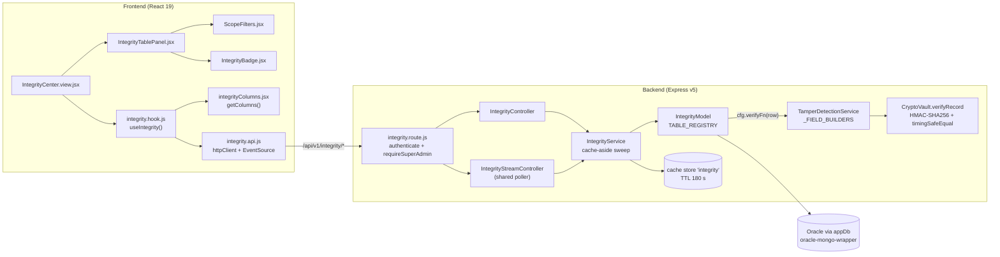
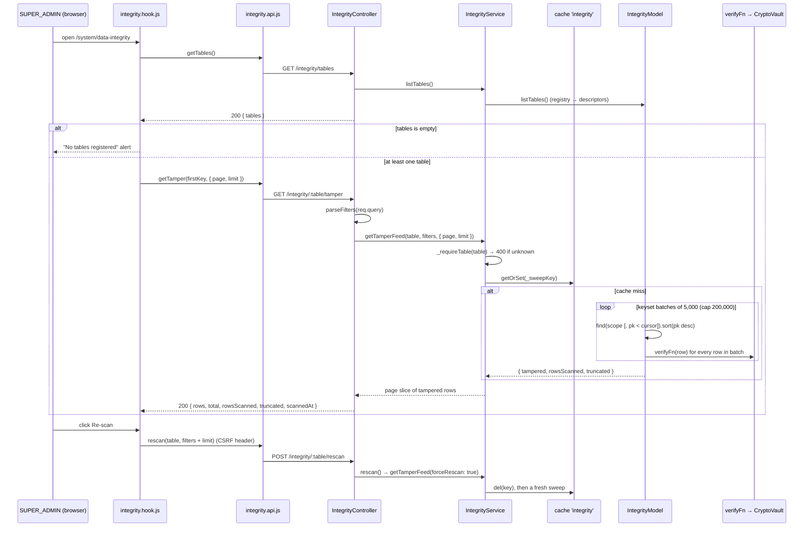
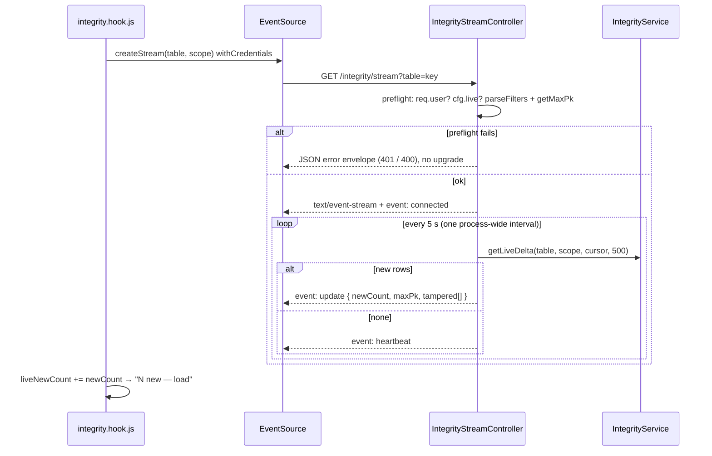

# Data Integrity — Technical Documentation

> **Scope:** The **Data Integrity** page (Integrity Center) — System → **Data Integrity** (`/system/data-integrity`), **SUPER_ADMIN only**. A generic, registry-driven HMAC tamper monitor: for every table a project registers, it re-computes each row's `ROW_HASH`, lists the rows that no longer match, offers a browse-all mode with a per-row verdict, an Excel/CSV export, a cache-busting re-scan and (for tables flagged `live`) an SSE live-tail.
> **Source (BE):** `Backend/src/routes/integrity.route.js`, `Backend/src/controllers/IntegrityController.js`, `Backend/src/controllers/IntegrityStreamController.js`, `Backend/src/services/IntegrityService.js`, `Backend/src/models/integrity.model.js`, `Backend/src/services/TamperDetectionService.js`, `Backend/src/utils/encryption/CryptoVault.js` (data-signing section), `Backend/src/utils/integrity/signedFields.js`, `Backend/src/constants/messages/integrity.messages.js`, `INTEGRITY_ERRORS` / `STREAM_ERRORS` in `Backend/src/constants/errors/index.js`, `INTEGRITY_*` in `Backend/src/constants/responses/index.js`, the `integrity` cache store in `Backend/src/app.js`.
> **Source (FE):** `Frontend/src/features/systemadmin/integrity/` — `IntegrityCenter.view.jsx`, `integrity.hook.js`, `integrity.api.js`, `components/IntegrityTablePanel.jsx`, `components/ScopeFilters.jsx`, `components/shared/integrityColumns.jsx`, `components/shared/IntegrityBadge.jsx`. Route in `Frontend/src/App.jsx`; nav item in `Frontend/src/components/layout/config/nav.config.jsx`.
> **Verified 2026-10-29 against source.** `TABLE_REGISTRY` is `Object.freeze({})` with a commented `orders` example; `_FIELD_BUILDERS` holds exactly one domain, `T_SYSTEM_CONFIG`. The template therefore ships with **zero** tables in the Integrity Center. No test was run for this revision; §8 cites only test files confirmed to exist.
>
> **Related docs:** `Others/auth-documentation.md` (`AuthMiddleware.authenticate`, `requireAccess`), `Others/infrastructure-health-csrf-client-documentation.md` (CSRF and the HTTP client).
>
> **Rendering note:** ` ```mermaid ` blocks render in GitHub/GitLab/VS Code and in the Dev Docs viewer.

---

## 1. Overview

A **signed table** stores, on every row, `ROW_HASH = HMAC-SHA256(DATA_SIGNING_SECRET, buildPayload(domain, fields))`. The fields come from one builder per domain, kept in `TamperDetectionService`. If someone edits a signed column directly in the database without the secret, the stored hash no longer matches the recomputed one, and the row reads **TAMPERED**.

The Integrity Center is the operator's view of that check. It is **generic**: it has no table-specific code. Everything it shows (tabs, filters, live indicator, columns) comes from the backend `TABLE_REGISTRY` in `Backend/src/models/integrity.model.js`.

**What ships in the template:**

| Piece | State in the template |
| ----- | --------------------- |
| `TABLE_REGISTRY` (`integrity.model.js`) | Empty frozen object; one commented example (`orders` / `T_ORDERS`) |
| `_FIELD_BUILDERS` (`TamperDetectionService.js`) | One domain: `T_SYSTEM_CONFIG` (`CONFIG_KEY`, `CONFIG_VALUE`) |
| Signed table in use | `T_SYSTEM_CONFIG_DEV` (via `SystemConfigService`), **not** registered in the Integrity Center |
| FE column registry (`integrityColumns.jsx` `COLUMNS`) | Empty; columns are derived from the first row |

**What the screen shows with zero registered tables:** `GET /integrity/tables` returns `tables: []`, so the view renders an info `Alert` titled **"No tables registered"**, telling the operator to register a table in `Backend/src/models/integrity.model.js` (`IntegrityCenter.view.jsx`). No tabs and no table panel are shown, and no tamper, browse or stream request is made, because `activeTab` stays `null` and every data `useRequest` key is `null`.

The signed config store still protects itself without the Integrity Center: `SystemConfigService.getRaw` verifies each row before trusting it, and falls back to the key's safe default if the row is unsigned or fails verification.

---

## 2. Flow & Architecture

### 2.1 Component map



### 2.2 Tamper feed and re-scan



### 2.3 SSE live-tail (tables registered `live: true`)



---

## 3. Frontend Implementation

### 3.1 Files

| File | Role |
| ---- | ---- |
| `Frontend/src/features/systemadmin/integrity/IntegrityCenter.view.jsx` | Page shell: header, `ApiErrorAlert`, empty-registry `Alert` or pill `Tabs`; wrapped in `ErrorBoundary` |
| `Frontend/src/features/systemadmin/integrity/integrity.hook.js` | `useIntegrity()`: catalog, active tab, filters, mode, paging, fetch, re-scan, export, SSE |
| `Frontend/src/features/systemadmin/integrity/integrity.api.js` | `integrityApi`: `httpClient` calls and `createStream` (native `EventSource`) |
| `Frontend/src/features/systemadmin/integrity/components/IntegrityTablePanel.jsx` | Filters, "Show all rows" toggle, live dot, scan summary, Export, Re-scan, alerts, `Table`, `Pagination` |
| `Frontend/src/features/systemadmin/integrity/components/ScopeFilters.jsx` | Inputs driven by the catalog: date range, enum `Select`s, free-text inputs |
| `Frontend/src/features/systemadmin/integrity/components/shared/integrityColumns.jsx` | `getColumns(tableKey, sampleRow)`: registered columns, or columns derived from the first row |
| `Frontend/src/features/systemadmin/integrity/components/shared/IntegrityBadge.jsx` | Verdict pill: VERIFIED green, TAMPERED red, otherwise grey dash |

### 3.2 Routing and access

`App.jsx` lazy-loads `DataIntegrityView` from `./features/systemadmin/integrity/IntegrityCenter.view` and mounts it at `system/data-integrity`, inside `<ProtectedRoute role={[ROLES.SADMIN]} />` (`ROLES.SADMIN = "SUPER_ADMIN"`). The nav item **Data Integrity** (`/system/data-integrity`) is in the SUPER_ADMIN-only `SYSTEM_GROUP` of `nav.config.jsx`. Both are convenience guards only. The real control is the router-level `requireSuperAdmin` on the backend (§4.1).

### 3.3 Hook behaviour (`useIntegrity`)

- **Catalog:** `useRequest("integrity/tables", …, { staleTime: 600_000 })`. Tabs are `{ id: key, label }`. Until the operator picks a tab, the first catalog entry is active.
- **Filter classification:** from the active descriptor, `date` gives the From/To inputs, keys in `enums` become dropdowns (options from `/filter-options`, `staleTime 300_000`), and every other key becomes a free-text input.
- **Mode:** `"tamper"` (default) calls `getTamper`; `"all"` ("Show all rows") calls `browse`. Changing tab resets filters, mode and page.
- **Data key:** `buildKey(table, mode, filters, page, limit)` with `staleTime: 0`. A fetch error sets `dataError`, so a failure never falls through to the "all verified" empty text.
- **Re-scan:** `integrityApi.rescan`, then `invalidateCache(cacheKey)` + `refetch()`, then a success toast. A failure goes to `apiError`.
- **Export:** `integrityApi.exportRows(table, { ...filters, mode })` → `exportRowsToFile` (`Frontend/src/utils/excelUtils.js`). The file name is `integrity_<table>_<mode>`, the header is the displayed columns plus `integrity`. A warning toast is shown when the result is `truncated` or `sweepTruncated`.
- **Live-tail:** opened only when `activeConfig.live` is true. The stream is closed while the tab is hidden (`visibilitychange`) and re-opened when it is visible again. Its scope is the text and enum filters only; the date range is not sent. `update` events add to `liveNewCount`; **"N new — load"** clears the counter and refetches. The `tampered[]` array in the event is not displayed.
- **Page sizes:** `[25, 50, 100, 200]`, default 50.

### 3.4 Panel states

| Condition | Rendered |
| --------- | -------- |
| Catalog empty | Info alert "No tables registered" (view level) |
| `truncated` in tamper mode | Warning "Partial scan": the scan hit its row cap |
| `dataError` | Danger "Failed to load integrity data" |
| Tampered count > 0 | Danger "N tampered row(s) detected", scope-wide (tamper mode `total`, browse mode `tamperedInScope`) |
| No rows, tamper mode | Table empty text "No tampered rows — all verified ✓" |
| No rows, browse mode | "No rows in scope." |

Only the verdict column is added generically (`INTEGRITY_COLUMN` in `IntegrityTablePanel.jsx`). `getColumns` hides `integrity`, `ROW_HASH`, `SYSSIGNATURE` and `contentDigest`.

---

## 4. Backend Implementation

### 4.1 Route and guard

`Backend/src/routes/index.js` mounts the router at `/integrity` under `app.use("/api/v1", routes)` (`Backend/src/app.js`). The router does:

```js
router.use(AuthMiddleware.authenticate, requireSuperAdmin);
// requireSuperAdmin = AuthMiddleware.requireAccess((user) => user.role === "SUPER_ADMIN", { message })
```

`requireAccess` returns 401 if there is no `req.user` and 403 `AuthorizationError` if the predicate fails. The static paths `/tables` and `/stream` are declared before the `/:table/*` routes, so Express never matches `tables` as a `:table` value.

### 4.2 Controller (`IntegrityController`)

A thin layer: every method is `catchAsync` and calls `IntegrityService`.

- `parseFilters(src)` parses `from`/`to` as dates (400 `INVALID_DATE_RANGE` if unparseable or `from > to`). It keeps every other key that is not in `NON_FILTER_KEYS` (`from, to, page, limit, mode, table`), matches `/^[A-Za-z][A-Za-z0-9]{0,39}$/`, and has a non-empty string value. Keys the table does not declare are dropped later by `IntegrityModel._buildMatch`.
- `page` defaults to 1 and `limit` to 50; the service clamps `limit` to 1–200.
- `exportRows` sets `mode` to `"all"` only when it is exactly `all`, otherwise `"tamper"`, and ignores `page`/`limit`.
- `rescan` merges `req.query` and `req.body` and passes `actor = req.user.userId ?? req.user.sub ?? "SYSTEM"` for the log line.

### 4.3 Service (`IntegrityService`)

| Method | Behaviour |
| ------ | --------- |
| `listTables()` | Calls `IntegrityModel.listTables()` |
| `_requireTable(key)` | Looks up the frozen registry; throws 400 `UNKNOWN_TABLE` if not found |
| `_sweepKey(key, cfg, filters)` | `CacheKeyBuilder.build("integrity", { table, mode:"tamper", <filter>: value or "none", from, to })` |
| `_sweptTampered(...)` | `_store.getOrSet(key, sweep)`; adds `id` and `integrity:"TAMPERED"`; logs `INTEGRITY_TAMPER_FOUND` (security) and `SWEEP_TRUNCATED` |
| `getTamperFeed` | Pages through the cached tampered list in memory |
| `rescan` | Logs `RESCAN_REQUESTED`, then `getTamperFeed(..., forceRescan: true)` (deletes the cache key first) |
| `browsePage` | `listPage` + `_annotate` (verify only the page's rows) + the cached sweep for `tamperedInScope` |
| `exportRows` | `tamper`: slice of the cached set (≤ `maxRows`, default 10,000, max 50,000). `all`: `listPage(page 1, limit maxRows)` + `_annotate` |
| `getMaxPk` / `getLiveDelta` | SSE cursor and the delta rows, with their verdicts |

### 4.4 Model (`IntegrityModel`)

- `_db = createDb("appDb")`. `OracleCollection` instances are cached per physical table.
- **`TABLE_REGISTRY = Object.freeze({})`**, also exposed as `IntegrityModel.REGISTRY` and `module.exports.TABLE_REGISTRY`. `getTableConfig` uses `hasOwnProperty`, so prototype keys such as `__proto__` and `constructor` never resolve.
- `listTables()` returns `{ key, label, pk, filters: Object.keys(filters), enums: Object.keys(enums), live }`. No table name and no column names are sent.
- `_buildMatch(cfg, filters)` maps each declared filter key to its column (a number for `numericFilters`, otherwise a string). `from`/`to` become `$gte`/`$lte` on `filters.date`.
- `sweepTampered` does a descending keyset scan: batch `5_000`, cap `200_000`, verifying each batch concurrently. It returns only failing rows.
- `listPage` is an offset page (`limit` clamped to 200) plus `count()`. `getMaxPk` reads the top PK. `listSince` reads ascending PK `> afterPk`, up to `cap`.
- `getFilterOptions`: an enum with a `label` reads `def.source` (up to 1,000 rows, sorted); otherwise it groups by `$<column>` and reads the result by the source column name (a comment records an earlier `ORA-00904` from sorting on `_id`).
- There is **no `DEMO_MODE` branch** in this file. With the empty registry nothing reaches Oracle.

### 4.5 Signing primitives

**`TamperDetectionService`** (`Backend/src/services/TamperDetectionService.js`):

- `_FIELD_BUILDERS = Object.freeze({ T_SYSTEM_CONFIG: _fieldsSystemConfig })`. The builder returns `{ CONFIG_KEY, CONFIG_VALUE }` as strings (`null` becomes `""`).
- `buildSignedFields(domain, row)` throws if the domain is unknown. `listDomains()`. `verifyRow(domain, row)` calls `CryptoVault.verifyRecord(domain, fields, row.ROW_HASH)`. `verifySystemConfigRow(row)`.
- `scanTable(tableName, domain, projection)` is a full-table audit helper and is not used by the Integrity Center.
- The same builder is used by the writer (`SystemConfigService.set`), the reader (`SystemConfigService.getRaw`) and `DataRestoreService._verifyThenSign`.

**`CryptoVault`** data-signing section (`Backend/src/utils/encryption/CryptoVault.js`):

- `buildPayload(context, fields)` returns `"<context>:" + sorted "k=v"` joined with `|`, with any `|` inside a value doubled (CWE-347).
- `signData` is HMAC-SHA256 hex using `DATA_SIGNING_SECRET`. `resolveSigningSecret` throws if the secret is missing or shorter than 32 characters.
- `verifySignature` rejects anything that is not exact hex of the right length, then uses `crypto.timingSafeEqual`. `verifyRecord` returns `false` for a missing signature.
- `verifyRowHash(canonical, stored)` is plain **unkeyed** SHA-256, for Oracle `STANDARD_HASH` columns. No `Backend/src` caller uses it.

**`makeSignedFields`** (`Backend/src/utils/integrity/signedFields.js`) is an optional factory. It produces one `project`/`sign`/`verify` set per domain, and passes money fields through `Money.from(..).toStorage()` (scale 4) so `1500`, `"1500.00"` and an Oracle number all sign the same way. No `_FIELD_BUILDERS` entry uses it yet.

### 4.6 How a project registers a signed table

To make a table show up as a tab, follow these steps in order. The example names (`orders`, `T_ORDERS`, `ORDER_ID`) come from the comment in `integrity.model.js`.

1. **Schema.** Give the table a numeric PK (used for keyset paging and the live cursor) and a `ROW_HASH VARCHAR2(64)` column, like `T_SYSTEM_CONFIG_DEV` in `Backend/sql/01_schema.sql`. Index the column you will use as the `date` filter, so a scoped sweep stays bounded.
2. **Field builder.** In `TamperDetectionService.js`, add a function that returns exactly the signed fields as stable strings, and register it in `_FIELD_BUILDERS` under a permanent domain string (for example `T_ORDERS`). Include the PK only if its value is known when you sign (the `CONFIG_KEY` rationale). For money columns, build the projection with `makeSignedFields({ domain, fields, moneyFields })`. **Never copy a field list anywhere else.**
3. **Sign on every write.** In the service that writes the table: `ROW_HASH = await CryptoVault.signRecord(domain, TamperDetectionService.buildSignedFields(domain, row))`, on every insert **and** every update that changes a signed column. A write that skips this step will read as TAMPERED.
4. **Verifier.** Add a verify function, for example `static verifyOrderRow(row) { return TamperDetectionService.verifyRow("T_ORDERS", row); }`. The registry example refers to `verifyOrderRow`, which does not exist until you add it.
5. **Registry entry.** Add the entry inside the `Object.freeze({ ... })` literal in `integrity.model.js`:
   - `key`, `label`, `table`, `pk`
   - `project`: every signed column + `ROW_HASH` + the PK, plus any display-only columns. **Never project secrets**, because tampered rows are sent to the client as they are.
   - `verifyFn`
   - `filters`: client key → column; `date` is the range column
   - `numericFilters`, optional `enums` (`{ column, source?, label? }`)
   - `live: true` only for append-only tables
6. **Unkeyed alternative (not recommended).** If the database computes the hash with `STANDARD_HASH`, a `verifyFn` can wrap `CryptoVault.verifyRowHash(canonical, row.ROW_HASH)`. Anyone with write access to the database can recompute an unkeyed hash, so this detects accidental drift, not deliberate tampering (§7).
7. **Columns (optional).** Register `<key>: [col("COLUMN", "Label", text), ...]` in `COLUMNS` of `integrityColumns.jsx`. Without it, columns are derived from the first row: the first column is shown as an id cell, `*_AT`/`*DATE*` columns as dates, and the rest as text.
8. **Restore coverage (optional).** If the table is in `Backend/src/constants/purgeTables.js`, set its `rowHashDomain`. `DataRestoreService._verifyThenSign` then checks each archived hash before re-signing (all four template entries are currently `null`).

**What the UI then shows:** a pill tab with `label`. It opens in tampered-only mode with the filters you declared (From/To if you declared `date`, a dropdown per enum, a text box per other key). A **Live / Offline** dot appears for `live` tables. The scan summary reads "Scanned <time> · N rows". Export and Re-scan are available, and every row carries a Verified/Tampered badge in "Show all rows" mode. Rows written before signing was in place have `ROW_HASH = NULL`; `verifyRecord` returns `false` for them, so they show as **Tampered** until they are re-signed.

---

## 5. How Frontend and Backend Connect (the Contract)

Base path: `/api/v1/integrity`. Every route: `authenticate` + `requireSuperAdmin`. All JSON responses use the `sendSuccess(message, data)` envelope; the FE reads `r.data.data`.

| Method | Path | Query / body | `data` on success | Message constant |
| ------ | ---- | ------------ | ----------------- | ---------------- |
| GET | `/tables` | — | `{ tables: [{ key, label, pk, filters[], enums[], live }] }` | `INTEGRITY_TABLES_FETCHED` |
| GET | `/stream` | `table`, scope filters | SSE: `connected`, `update`, `heartbeat`, `error` | — |
| GET | `/:table/tamper` | filters, `from`, `to`, `page`, `limit` | `{ rows, total, page, limit, rowsScanned, truncated, scannedAt }` | `INTEGRITY_TAMPER_FETCHED` |
| GET | `/:table/filter-options` | — | `{ options: { <enumKey>: [{ value, label }] } }` | `INTEGRITY_FILTER_OPTIONS_FETCHED` |
| GET | `/:table/browse` | same as tamper | `{ rows, total, page, limit, tamperedInScope, sweepTruncated }` | `INTEGRITY_BROWSE_FETCHED` |
| GET | `/:table/export` | filters, `mode=tamper\|all` | `{ rows, total, mode, truncated, sweepTruncated, rowsScanned, scannedAt }` | `INTEGRITY_BROWSE_FETCHED` |
| POST | `/:table/rescan` | filters + `limit` (body or query); CSRF header | same as tamper (page 1) | `INTEGRITY_RESCAN_COMPLETE` |

Each row carries its projected columns plus `id` (`Number(row[pk])`) and `integrity` (`"VERIFIED"` or `"TAMPERED"`).

**Error responses:**

| Status | When | Source |
| ------ | ---- | ------ |
| 401 | No or invalid session; SSE preflight with no `req.user` | `AuthMiddleware`, `sendSsePreflightError` |
| 403 | Role is not `SUPER_ADMIN` | `requireSuperAdmin` message |
| 400 `UNKNOWN_TABLE` | `:table` not in the registry (with zero tables registered, every `:table` route) | `IntegrityService._requireTable` |
| 400 `INVALID_DATE_RANGE` | Unparseable date or `from > to` | `IntegrityController.parseFilters` |
| 400 `STREAM_ERRORS.TABLE_NOT_STREAMABLE` | `/stream` for an unknown or non-`live` table | `IntegrityStreamController.stream` |
| 403 (CSRF) | POST `/rescan` without a valid CSRF token | `defaultCsrf` in `app.js` |

SSE pre-upgrade refusals use the standard error envelope, including `requestId` (`Backend/src/utils/sse/ssePreflight.js`). After the upgrade, failures are sent as `event: error` frames.

---

## 6. Technicalities

- **Cache.** Store `integrity` (`ttl: 180, checkPeriod: 60, maxKeys: 500`, `app.js`). Only the **sweep result** and the filter options are cached, at the service layer. HTTP responses are not cached, and export always reads a fresh `listPage` in `all` mode (the tampered set may still come from the cached sweep).
- **Sweep cost.** Time grows with the number of scanned rows, in batches; memory holds one batch plus the tampered rows. A sweep stops at 200,000 rows with `truncated: true`, and the FE asks the operator to narrow the date range.
- **Browse triggers a sweep.** `browsePage` also calls `_sweptTampered` for `tamperedInScope`, so the first browse on a cold cache pays for a full scoped sweep.
- **Pagination.** Tamper mode pages an in-memory list; browse uses `skip`/`limit` with `count()` (offset paging gets slower on deep pages).
- **SSE poller.** One `setInterval(5_000)` per process (`unref`'d), started when the first stream connects and stopped when none remain. Subscriptions are keyed by `table|sorted scope JSON`, so each distinct scope runs one delta query per tick. The delta is capped at 500 rows per tick. A tick that is still running blocks the next one (`_pollBusy`). After 5 failed ticks in a row, every client gets `error { code: "POLL_FAILED" }` and the poller stops. Each stream registers with `SseConnectionRegistry` so a graceful shutdown can end it. This controller has its own poller and does not use `ScopedSsePoller`.
- **Cursor.** Baseline = `MAX(pk)` within the scope when the first connection for that scope arrives. `listSince` returns rows with PK greater than the cursor, so the live-tail assumes PKs only ever increase.
- **Pool.** The model reads through `appDb`, not `appDbBulk`.
- **DEMO_MODE.** With the empty registry, the feature makes no Oracle calls. A table registered while `DEMO_MODE=true` would reach `appDb` and fail, because no pool is opened in demo mode and the model has no demo store.
- **Logging.** All log strings are templates in `integrity.messages.js`. Security events: `INTEGRITY_TAMPER_FOUND` (sweep) and `INTEGRITY_TAMPER_LIVE` (stream).

---

## 7. Security

| Control | Mechanism | CWE |
| ------- | --------- | --- |
| Authentication | `AuthMiddleware.authenticate` on the whole router; the SSE stream uses the HTTP-only cookie (`withCredentials`) | CWE-287 |
| Authorisation | `requireSuperAdmin` on the whole router; FE `ProtectedRoute` is cosmetic | CWE-285, CWE-639 |
| SQL injection | `:table` only looks up a frozen registry via `hasOwnProperty`; filter keys go through each table's `filters` allow-list; values are bind variables in the oracle-mongo-wrapper | CWE-89 |
| Prototype keys | `getTableConfig` uses `hasOwnProperty`, so `__proto__`/`constructor` never resolve | CWE-1321 |
| Tamper detection | Keyed HMAC-SHA256 with a separate `DATA_SIGNING_SECRET` (≥ 32 chars, one purpose) | CWE-345, CWE-353 |
| Signature checks | `timingSafeEqual`; exact-hex/length check; `|` escaping in `buildPayload`; domain prefix blocks reuse of a hash across tables | CWE-208, CWE-347 |
| Signer/verifier drift | One builder per domain in `_FIELD_BUILDERS`; `makeSignedFields` canonicalises money values | CWE-345 |
| Data exposure | Projection rule: never project secrets, because tampered rows are returned verbatim; catalog exposes no table or column names | CWE-200 |
| CSRF | POST `/rescan` covered by the app-level `defaultCsrf`; FE goes only through `httpClient` | CWE-352 |
| Resource bounds | Sweep cap 200,000, batch 5,000, `limit ≤ 200`, export ≤ 50,000, SSE delta ≤ 500, one shared poller | CWE-400, CWE-770 |
| XSS | Cells rendered as React text children; no `dangerouslySetInnerHTML` in the feature | CWE-79 |

**Caveats:**

- **Unkeyed hashes.** `verifyRowHash` is plain SHA-256. Anyone with write access to the database can recompute it (CWE-328 / CWE-345). Use `signRecord`/`verifyRecord` for real tamper evidence.
- **A leaked `DATA_SIGNING_SECRET` defeats every check.** Keep it out of logs and backups, and do not reuse `JWT_SECRET` or `ARGON2_PEPPER`.
- **Unsigned rows.** A `NULL` `ROW_HASH` reads as TAMPERED in the Integrity Center. `SystemConfigService` treats an unsigned row as "fall back to the default", with a warning-level log instead of critical.

---

## 8. Verification Q&A

Evidence is cited as `file:symbol`. **Tests: not run for this revision.** The only test files that exercise this area are `Backend/test/server/unit/utils/cryptoVaultRowHash.test.js` (`CryptoVault.verifyRowHash`) and `Backend/test/unit/signedFields.test.js` (`makeSignedFields`, `canonicalMoney`, `canonicalPlain`). A search of `Backend/test/` and `Frontend/test/` found **no** test for `IntegrityController`, `IntegrityStreamController`, `IntegrityService`, `IntegrityModel`, `TamperDetectionService`, or any `features/systemadmin/integrity` component. `CryptoVault.js` also has an inline self-test (`require.main === module`, "TEST GROUP 8: HMAC-SHA256 Data Signing") that runs only when the file is executed directly.

**Q1. Does the template register any table in the Integrity Center?**
No. Evidence: `Backend/src/models/integrity.model.js:TABLE_REGISTRY` is `Object.freeze({})`; the `orders` entry is a comment.

**Q2. What does the screen show then?**
An info alert "No tables registered", with no tabs or panel. Evidence: `Frontend/src/features/systemadmin/integrity/IntegrityCenter.view.jsx:IntegrityCenterView` (the `tabs.length === 0` branch); `integrity.hook.js:useIntegrity` (`activeTab` stays `null`, so no data key).

**Q3. Which tables does the template actually sign?**
Only the `T_SYSTEM_CONFIG` domain (physical table `T_SYSTEM_CONFIG_DEV`). Evidence: `Backend/src/services/TamperDetectionService.js:_FIELD_BUILDERS`; `Backend/src/models/system.config.model.js:TABLE`; `Backend/src/services/SystemConfigService.js:set` / `getRaw`.

**Q4. Who can call the API?**
Only `SUPER_ADMIN`. Evidence: `Backend/src/routes/integrity.route.js:requireSuperAdmin` with `router.use(AuthMiddleware.authenticate, requireSuperAdmin)`; `Backend/src/middleware/authentication/AuthMiddleware.js:requireAccess` (401/403).

**Q5. Can `:table` or a filter key inject SQL?**
No. `:table` only looks up the frozen registry, and filter keys are mapped through `cfg.filters`. Evidence: `integrity.model.js:getTableConfig`, `_buildMatch`; `IntegrityController.js:parseFilters` (`FILTER_KEY_PATTERN`, `NON_FILTER_KEYS`).

**Q6. How is a row judged TAMPERED?**
`verifyFn(row)` returns `false`. The shipped path is `verifyRecord`: HMAC over `buildPayload`, compared with `timingSafeEqual`. Evidence: `TamperDetectionService.js:verifyRow`; `CryptoVault.js:verifyRecord`, `verifySignature`, `buildPayload`.

**Q7. Is a sweep bounded?**
Yes: batch 5,000, cap 200,000, `truncated` flag. Evidence: `integrity.model.js:DEFAULT_SWEEP_BATCH`, `DEFAULT_SWEEP_CAP`, `sweepTampered`; FE alert in `IntegrityTablePanel.jsx` ("Partial scan").

**Q8. Is a stale "clean" result possible?**
Yes, within the 180 s TTL. Re-scan deletes the exact key first. Evidence: `Backend/src/app.js` (`integrity` store); `IntegrityService.js:_sweptTampered`, `rescan`.

**Q9. Which tables can stream?**
Only entries with `live: true`; others get 400 before the upgrade. Evidence: `IntegrityStreamController.js:stream` (`!cfg || !cfg.live`); `Backend/src/utils/sse/ssePreflight.js:sendSsePreflightError`.

**Q10. Does the money canonicaliser make the signer and verifier agree?**
Yes, if a domain uses it. Evidence: `Backend/src/utils/integrity/signedFields.js:canonicalMoney`; test file `Backend/test/unit/signedFields.test.js` (not run for this revision).

**Q11. Is `verifyRowHash` safe against length and case quirks?**
It compares byte lengths and upper-cases both sides. Evidence: `CryptoVault.js:verifyRowHash`; test file `Backend/test/server/unit/utils/cryptoVaultRowHash.test.js` (not run for this revision). No source caller uses it.

**Q12. Does a restored row keep a bad hash's verdict?**
Yes, for tables with a `rowHashDomain`: the original hash is verified before re-signing, and an invalid row is restored with `ROW_HASH = NULL`. Evidence: `Backend/src/services/DataRestoreService.js:_verifyThenSign`; `Backend/src/constants/purgeTables.js` (`rowHashDomain: null` on every template entry, so this does not apply yet).

---

_End of document. Updated 2026-10-29._
