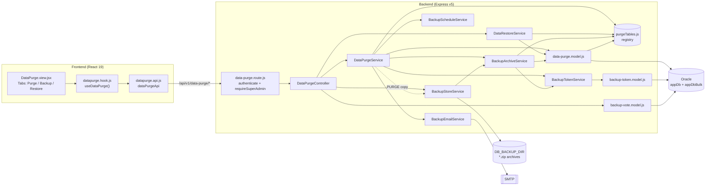
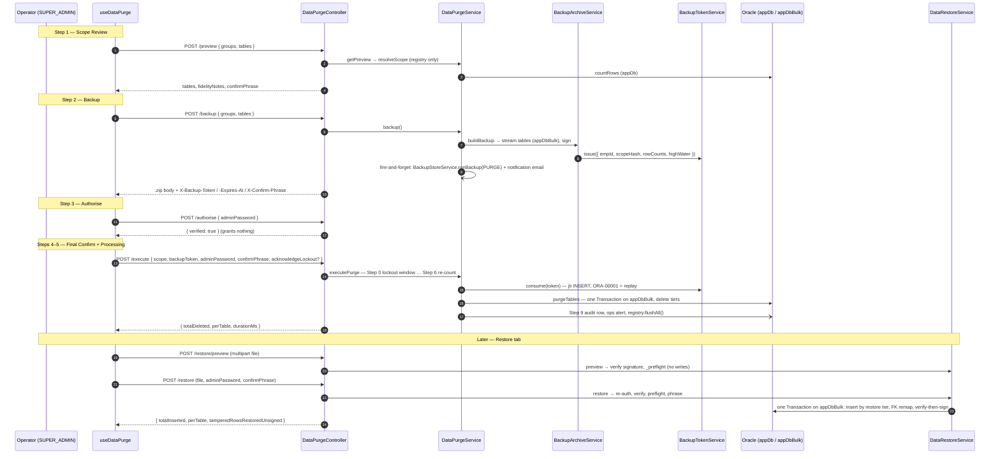
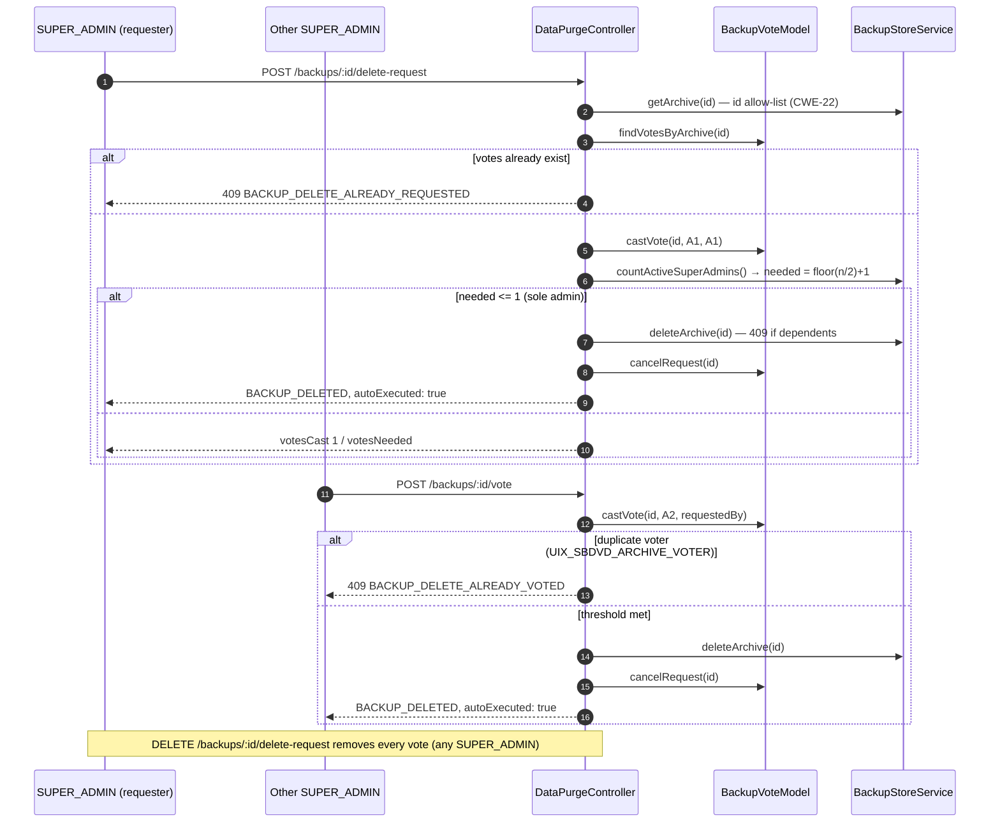

# Data Management — Technical Documentation

> **Scope:** Data Purge, Backup (purge-gating, manual, scheduled), Restore and the majority-vote archive delete for the CATHERINE template — the SUPER_ADMIN page at `/system/data-purge` ("Data Management" in the nav).
> **Primary sources:** `Backend/src/routes/data-purge.route.js`, `Backend/src/controllers/DataPurgeController.js`, `Backend/src/services/{DataPurgeService,DataRestoreService,BackupArchiveService,BackupStoreService,BackupScheduleService,BackupTokenService,BackupEmailService}.js`, `Backend/src/models/{data-purge,backup-token,backup-vote}.model.js`, `Backend/src/constants/purgeTables.js`, `Backend/.env.example`; frontend `Frontend/src/features/systemadmin/datapurge/**` and `Frontend/src/App.jsx`.
>
> **Verified 2026-10-29 against source.** Every path cited below was opened for this revision. No test was run for this revision; §8 states what each answer rests on.
>
> **Key facts.** Four registered tables, all on the `appDbBulk` pool: `T_ADMINS_DEV` and `T_AUDIT_LOGS_DEV` (group `T_`), `T_SERVER_ALERT_LOG_DEV` and `T_SERVER_ALERT_ACK_DEV` (group `SERVER_`). `NEVER_PURGE` and `IMMUTABLE_TIMESTAMP_COLUMNS` ship empty. Two support tables are deliberately outside the registry so they survive a purge: `T_SERVER_BACKUP_TOKEN_CONSUMED_DEV` (spent token nonces) and `T_SERVER_BACKUP_DELETE_VOTE_DEV` (delete votes). The purge-backup email is notification-only — no attachment, no encryption, no passphrase.

---

## 1. Overview

Data Management lets a SUPER_ADMIN do four things with platform data:

1. **Purge** — permanently delete every row of one or more registered tables, only after downloading a signed backup of exactly that scope.
2. **Back up** — archives are written to disk by a manual "Back Up Now", by every purge-gating backup, and by a scheduler once a project registers a schedule event source.
3. **Restore** — upload a signed `.zip` archive and insert its rows back, in FK order, inside one transaction.
4. **Delete an archive** — only when a strict majority of active SUPER_ADMINs vote for it, and only when no other archive depends on it.

The short version: the operator picks groups → the server resolves the scope from the registry (never from the request) → the backup is streamed and a signed, single-use **backup token** is issued → `/execute` re-verifies the admin, password, token, confirm phrase and live row counts → one atomic DELETE transaction runs on `appDbBulk` → an audit row, an ops alert and a cache flush follow outside the transaction.

The template ships its own platform tables as the example registry. A project adds its own tables to `PURGE_TABLES` (see §4.6).

---

## 2. Flow & Architecture

### 2.1 Component map

### 2.2 Backup → purge → restore

### 2.3 Majority-vote archive delete

---

## 3. Frontend Implementation

### 3.1 Routing and access

| Item | Location | Detail |
| --- | --- | --- |
| Route | `Frontend/src/App.jsx` → `AppRoutes` | `system/data-purge` → lazy `DataPurgeView`, inside `<ProtectedRoute role={[ROLES.SADMIN]} />` |
| Role constant | `Frontend/src/App.jsx` → `ROLES` | `SADMIN: "SUPER_ADMIN"`, `ADMIN: "ADMIN"`, `USER: "USER"` |
| Nav entry | `Frontend/src/components/layout/config/nav.config.jsx` | "Data Management", `href: "/system/data-purge"` |
| Guard | `Frontend/src/components/routing/ProtectedRoute.jsx` | Convenience only — every endpoint re-checks `SUPER_ADMIN` server-side |

### 3.2 Three-layer files

| Layer | File | Responsibility |
| --- | --- | --- |
| API | `Frontend/src/features/systemadmin/datapurge/datapurge.api.js` | `dataPurgeApi` — pure `httpClient` calls; 120 s timeout on `/backup`, `/execute`, `/restore`, `/restore/preview`, `/backups/run`, downloads |
| Hook | `Frontend/src/features/systemadmin/datapurge/datapurge.hook.js` | `useDataPurge()` — tab state, scope catalogue, 5-step stepper, restore flow, Backup tab, vote handlers |
| View | `Frontend/src/features/systemadmin/datapurge/DataPurge.view.jsx` | Whole-hook pattern; `Tabs` (`purge`, `backup`, `restore`) + `PurgeStepperModal`; wrapped in `ErrorBoundary` |

### 3.3 Components (`Frontend/src/features/systemadmin/datapurge/components/`)

| Component | Purpose |
| --- | --- |
| `PurgeScopeSelector.jsx` | Group cards from `GET /scopes`, per-table compact row counts, auto-included hints |
| `PurgeStepperModal.jsx` | `STEPS`: Scope Review → Backup → Authorise → Final Confirm → Processing. `ANIMATE_SHAKE` on phrase mismatch; red lockout panel and `acknowledgeLockout` checkbox when `T_ADMINS_DEV` is in scope; shows `RECOVERY_COMMAND` (`cd Backend && npm run db:seed:template`) |
| `BackupPanel.jsx` | Archive list (auto vs pre-purge columns), "Back Up Now", download, verify, delete-request / vote / cancel |
| `BackupChainBadge.jsx` | FULL / INCREMENTAL / chain-broken badge |
| `RestorePanel.jsx` | Dropzone → `/restore/preview` report → password + phrase → `/restore` |
| `FidelityNoticePanel.jsx` | Fidelity notes and `tablesGettingNewPks` |
| `PurgeReportPanel.jsx` | Per-table result for purge (`deletedCount`) or restore (`insertedCount`, `hashesResigned`) |
| `TamperedRestoreAlert.jsx` | Danger alert when `tamperedRowsRestoredUnsigned > 0` |
| `shared/purgeGroupMeta.js` | `GROUP_META` labels: `T_` "Core & Admin", `SERVER_` "Server Alerts" (presentational only) |

### 3.4 Hook behaviour worth knowing

- **Scope catalogue** is fetched fresh, never cached client-side.
- **Purge confirm phrase:** shown from `/preview`, but the phrase that gates Step 4 is read from the `X-Confirm-Phrase` header of `/backup` (URI-decoded) — built server-side from the token's frozen row counts.
- **Restore confirm phrase:** `/restore/preview` returns no phrase, so `buildRestoreConfirmPhrase` derives `RESTORE <groups> <rows> ROWS` from `tables` + `rowCounts`, with groups resolved by `groupKeyFromTable` against the catalogue. The server recomputes it independently; the FE value is guidance only.
- **Blob errors:** `/backup` uses `responseType: "blob"`, so `extractBlobErrorMessage` decodes JSON errors from the Blob body.
- **Upload pre-check:** `MAX_RESTORE_FILE_SIZE` = 100 MB mirrors the default of `BACKUP_UPLOAD_MAX_MB`; multer is the real limit.
- **Lockout:** `ADMIN_ACCOUNT_TABLE = "T_ADMINS_DEV"` drives the lockout panel.

---

## 4. Backend Implementation

### 4.1 Layers

| Layer | File | Notes |
| --- | --- | --- |
| Mount | `Backend/src/routes/index.js` | `router.use("/data-purge", dataPurgeRoutes)` |
| Route | `Backend/src/routes/data-purge.route.js` | `router.use(AuthMiddleware.authenticate, requireSuperAdmin)`; `executeRateLimiter`; `restoreUpload` multer |
| Controller | `Backend/src/controllers/DataPurgeController.js` | Thin, `catchAsync`; `_callerEmpId(req)` = `req.user.id ?? req.user.userId` |
| Purge logic | `Backend/src/services/DataPurgeService.js` | `resolveScope`, `getScopeCatalogue`, `getPreview`, `authorise`, `backup`, `executePurge` |
| Restore logic | `Backend/src/services/DataRestoreService.js` | `preview`, `restore`, `_verifyAndParseArchive`, `_preflight`, `_verifyThenSign` |
| Archive build | `Backend/src/services/BackupArchiveService.js` | `buildBackup` (purge-gating), `buildScheduledBackup`, `buildEntityBackup`; `SCHEMA_VERSION = "v6"`; `BACKUP_TRIGGERS = SCHEDULED, MANUAL, PURGE` |
| Disk store | `Backend/src/services/BackupStoreService.js` | `runBackup`, `listArchives`, `getArchive`, `materialise`, `verifyArchive`, `deleteArchive`, `countActiveSuperAdmins` |
| Scheduler | `Backend/src/services/BackupScheduleService.js` | `registerEventSource`, `triggerScheduledBackup`, `getLockoutStatus`, `describeLockout` |
| Token | `Backend/src/services/BackupTokenService.js` | `issue`, `verify` (pure), `consume` (single-use) |
| Email | `Backend/src/services/BackupEmailService.js` | `sendPurgeNotification` — never throws |
| Data access | `Backend/src/models/data-purge.model.js` | `countRows`, `streamTable`, `streamAllTables`, `deleteTable`, `purgeTables`, `insertRestoreBatch`, `existsByKey` |
| Token ledger | `Backend/src/models/backup-token.model.js` | `consumeJti` on `T_SERVER_BACKUP_TOKEN_CONSUMED_DEV` |
| Votes | `Backend/src/models/backup-vote.model.js` | `castVote`, `findVotesByArchive`, `findAllPendingVotes`, `cancelRequest`, `countVotesForArchive` |
| Registry | `Backend/src/constants/purgeTables.js` | See §4.2 |
| Errors / logs | `Backend/src/constants/errors/index.js` (`PURGE_ERRORS`), `Backend/src/constants/messages/{dataPurge,dataBackup,backupEmail}.messages.js` | Every log line is a named template |

### 4.2 The registry (`Backend/src/constants/purgeTables.js`)

| Table | Group | PK | Identity | `appendOnlyLog` | `identifierColumns` |
| --- | --- | --- | --- | --- | --- |
| `T_ADMINS_DEV` | `T_` | `ID` | yes | — | `ID` |
| `T_AUDIT_LOGS_DEV` | `T_` | `ID` | yes | yes | `ID`, `USER_ID` |
| `T_SERVER_ALERT_LOG_DEV` | `SERVER_` | `ID` | yes | yes | `ID` |
| `T_SERVER_ALERT_ACK_DEV` | `SERVER_` | `ALERT_KEY` (VARCHAR2) | no | — | `ACKED_BY` |

All four: `pool: PURGE_POOL` (`"appDbBulk"`), no `fkEdges`, no `virtualColumns`, `deleteOrderTier: 1`, `restoreOrderTier: 1`, `rowHashDomain: null`. `GROUP_CLOSURE_HINTS` maps both groups to `[]`. `NEVER_PURGE = []`, `IMMUTABLE_TIMESTAMP_COLUMNS = {}`.

Exports: `PURGE_POOL`, `NEVER_PURGE`, `IMMUTABLE_TIMESTAMP_COLUMNS`, `PURGE_GROUP_KEYS`, `GROUP_CLOSURE_HINTS`, `PURGE_TABLES`, `getEntry`, `getTablesByGroup`, `getAllTableNames`, `getDeleteOrder`, `getRestoreOrder`.

`assertRegistryIntegrity` runs at `require()` time and throws on: a duplicate table, a pool other than `PURGE_POOL`, a table also on `NEVER_PURGE`, an unknown group, or an `fkEdges.refTable` that is not registered. `getEntry` re-asserts the pool on every call.

### 4.3 `executePurge` steps (`DataPurgeService.executePurge`)

| Step | Check | Failure |
| --- | --- | --- |
| 0 | `BackupScheduleService.getLockoutStatus()` — scheduled backup imminent or running | 409 `PURGE_SCHEDULE_WINDOW` (token not burned) |
| 1 | `findAdminById` — caller still in `T_ADMINS_DEV` | 401 `ADMIN_NOT_FOUND` |
| 2 | `_assertAdminPassword` (`CryptoVault.verifyAdminPassword`) — same path as `/authorise` | 400 / 401 |
| 3 | `resolveScope(selection)` fresh; `BackupTokenService.consume(token)`; token `empId` = caller; scope ⊆ `rowCounts` keys | 401 `BACKUP_TOKEN_*` (`REQUIRED`, `INVALID`, `EXPIRED`, `REPLAYED`, `WRONG_ADMIN`, `SCOPE_MISMATCH`) |
| 4 | Phrase = `buildConfirmPhrase(groups, tokenTotalRows)` → `DELETE <groups> <n> ROWS` | 400 required / 422 `CONFIRM_PHRASE_MISMATCH` |
| 5 | `T_ADMINS_DEV` in scope ⇒ `acknowledgeLockout === true` | 400 `LOCKOUT_ACK_REQUIRED` |
| 6 | Re-count vs token; `RECOUNT_TOLERANCE = 0`; append-only tables bounded to `pk <= highWater` | 409 `ROW_COUNT_CHANGED` |
| 7–8 | `DataPurgeModel.purgeTables` — one `Transaction` on `appDbBulk`, `getDeleteOrder` | Any error rolls everything back |
| 9 | Outside the transaction: `_writePostCommitAudit`, `_sendPostCommitAlert` (`AlertNotifierService.notifyCriticalNow`, level `EMERGENCY`), `registry.flushAll()` | Best-effort; logged, never undoes the purge |

The token is consumed at Step 3 **before** Steps 4–6, so any later rejection still spends it. That is deliberate: replay protection wins over retry convenience.

### 4.4 Backup paths

| Trigger | Entry point | Chain | Email |
| --- | --- | --- | --- |
| `PURGE` (gating) | `POST /backup` → `DataPurgeService.backup` → `BackupArchiveService.buildBackup` | Streamed to the browser; a separate server copy via `BackupStoreService.runBackup({ trigger: "PURGE", tables: getAllTableNames() })` is always FULL, never in the chain | `sendPurgeNotification` (fire-and-forget) |
| `MANUAL` | `POST /backups/run` → `BackupStoreService.runBackup` | FULL or INCREMENTAL (`_decideChain`) | None |
| `SCHEDULED` | `BackupScheduleService.triggerScheduledBackup` | FULL or INCREMENTAL | None |

Archive contents: `manifest.json`, `signature.json` (HMAC-SHA256, domain `APP_BACKUP_ARCHIVE`, over the SHA-256 of the manifest and every data file), `data/<TABLE>.jsonl`, and `readable/backup-summary.xlsx` (capped by `BACKUP_XLSX_ROW_CAP`, never a restore source).

`_decideChain` forces FULL when the trigger is `PURGE`, when there is no previous archive, when the next generation reaches `DB_BACKUP_FULL_EVERY`, or when any referenced chain member is missing or fails verification. `materialise` rebuilds a self-contained FULL zip for download. The scheduler stays idle until a project calls `registerEventSource`; the template registers none.

There is no database table for backup state. The index is rebuilt from each archive's own `manifest.json` (`_loadIndex`, 15 s TTL, invalidated after every write/delete).

### 4.5 Restore (`DataRestoreService.restore`)

1. **Step 0** — `findAdminById` + `CryptoVault.verifyAdminPassword`.
2. **Steps 1–3** — `_verifyAndParseArchive` (signature over recomputed hashes) then `_preflight`: `schemaVersion` must equal `SCHEMA_VERSION`; `mode: "INCREMENTAL"` rejected (422 `RESTORE_INCREMENTAL_UPLOAD`); every manifest table checked against `NEVER_PURGE` and the registry (403); undeclared data files rejected (403); `kind` must be `FULL_SCOPE` (all targets empty, else 409) or `ENTITY` (key must be absent).
3. **Confirm phrase** — `RESTORE <groups> <archive rows> ROWS`.
4. **Steps 4–6** — one `Transaction` on `createDb(PURGE_POOL)`; tables by `getRestoreOrder`, batches of `RESTORE_BATCH_SIZE`; identity PKs regenerated and FK columns remapped from `fkEdges`; tables with a `rowHashDomain` get verify-then-sign (`_verifyThenSign`). None of the shipped tables has a `rowHashDomain`, so this path is idle until a project registers one.
5. **Post-commit** — audit row (best-effort) and `registry.flushAll()`.

### 4.6 Adding a project table to the purge registry

1. **Create the table** in the project's SQL (the template's own DDL lives in `Backend/sql/01_schema.sql` and `Backend/sql/04_platform_tables.sql`).
2. **Pick or add a group.** Add a key to `PURGE_GROUP_KEYS` if needed, plus an entry in `GROUP_CLOSURE_HINTS` (use `[]` for a leaf group).
3. **Add a `PURGE_TABLES` entry:**
   - `table`, `group`, `pool: PURGE_POOL` — the self-check rejects anything else;
   - `pk` and `isIdentity` — identity tables get new PKs on restore;
   - `virtualColumns` — `GENERATED ALWAYS AS … VIRTUAL` columns (ORA-54013 if inserted);
   - `fkEdges` — `{ column, refTable, refColumn }` for every FK to **another registered** table. `refTable` must be registered or the module fails to load;
   - `deleteOrderTier` (children lower than parents) and `restoreOrderTier` (parents lower than children). Two tables joined by an FK must not share a tier;
   - `rowHashDomain` — the `CryptoVault` domain if the table carries a `ROW_HASH`, else `null`;
   - `identifierColumns` — every NUMBER identifier/FK column, serialised as exact digit strings;
   - `appendOnlyLog: true` only for identity-PK log tables the app appends to continuously;
   - `canonicalTimestampColumns` — signed TIMESTAMP columns, usually omitted.
4. **Externally-owned tables** that must never be touched go on `NEVER_PURGE`, never in `PURGE_TABLES`.
5. **Trigger-stamped immutable timestamps** go in `IMMUTABLE_TIMESTAMP_COLUMNS[table]` so preview and manifest disclose the loss.
6. **Frontend label:** add the group to `GROUP_META` in `Frontend/src/features/systemadmin/datapurge/components/shared/purgeGroupMeta.js`. Unlabelled groups fall back to the raw key.
7. **Restart and check.** A registry mistake throws at `require()` time. `GET /scopes` then lists the table with its live count.

Never register `T_SERVER_BACKUP_TOKEN_CONSUMED_DEV` or `T_SERVER_BACKUP_DELETE_VOTE_DEV`. Purging them would erase replay protection and pending votes (see the headers of `backup-token.model.js` and `backup-vote.model.js`).

### 4.7 Pools and DEMO_MODE

| Work | Pool |
| --- | --- |
| `countRows`, `existsByKey` (interactive pre-flight) | `appDb` (`data-purge.model.js` `_db`) |
| `purgeTables` transaction | `appDbBulk` (`_bulkDb`) |
| Backup streams (`streamTable`, `streamAllTables`) | `appDbBulk` (`db.withConnection("appDbBulk", …)`) |
| Restore transaction | `appDbBulk` (`createDb(PURGE_POOL)` in `DataRestoreService`) |
| Token ledger, votes | `appDb` |

With `DEMO_MODE=true` (`Backend/src/config/demoMode.js`), `BackupTokenModel` and `BackupVoteModel` use the in-memory store (`Backend/src/models/demo/demoStore.js`: `backupTokensConsumed`, `backupVotes`, `nextBackupVoteId`), keeping the same exactly-once semantics. `data-purge.model.js` has **no** demo branch. Behaviour of `/scopes`, `/preview`, `/backup`, `/execute` and `/restore` with no Oracle pool open was not verified for this revision.

### 4.8 Environment variables (`Backend/.env.example`)

| Variable | Default | Used by |
| --- | --- | --- |
| `BACKUP_TOKEN_TTL_MINUTES` | 30 | `BackupTokenService.issue` |
| `BACKUP_UPLOAD_MAX_MB` | 100 | `restoreUpload` multer limit |
| `BACKUP_XLSX_ROW_CAP` | 5000 | summary workbook |
| `RESTORE_BATCH_SIZE` | 500 | `DataRestoreService._restoreBatchSize` |
| `PURGE_RATE_LIMIT_MAX` | 5 | `executeRateLimiter` (15-minute window) |
| `BACKUP_EMAIL_ENABLED` | true | `BackupEmailService.isEnabled` (only `"false"` disables) |
| `DB_BACKUP_ENABLED` | true | `BackupScheduleService.isEnabled` |
| `DB_BACKUP_DIR` | `db-backup` | `BackupStoreService._resolveBackupDir` |
| `DB_BACKUP_IDLE_TIMEOUT_MS` | 600000 | stall watchdog + lease stale window |
| `DB_BACKUP_EVENT_DELAY_MS` | 900000 | delay after a schedule event |
| `DB_BACKUP_LOCKOUT_WINDOW_MS` | 60000 | `getLockoutStatus` |
| `DB_BACKUP_CATCHUP_ON_BOOT` / `DB_BACKUP_CATCHUP_WINDOW_HOURS` | true / 72 | boot catch-up |
| `DB_BACKUP_FULL_EVERY` | 6 | forced-FULL generation cap |
| `DB_BACKUP_RETENTION_DAYS` | 180 | chain-safe pruning |
| `DATA_SIGNING_SECRET` | (required) | token + archive HMAC |

---

## 5. How Frontend and Backend Connect (the Contract)

Base path `/api/v1/data-purge`. Every route: `authenticate` → `requireSuperAdmin` (403 for any other role).

| Method | Path | FE call | Extra middleware | Request | Response |
| --- | --- | --- | --- | --- | --- |
| GET | `/scopes` | `getScopes` | — | — | `{ groups[{ group, tables[{table,rowCount}], totalRows, autoIncludes }], generatedAt }` |
| POST | `/preview` | `preview` | — | `{ groups?, tables? }` | `{ requestedGroups, requestedTables, autoIncludedGroups, scopeHash, totalRows, tables[], fidelityNotes, confirmPhrase }` |
| POST | `/backup` | `backup` (blob) | — | `{ groups?, tables? }` | `application/zip` + `X-Backup-Token`, `X-Backup-Token-Expires-At`, `X-Confirm-Phrase` (URI-encoded) |
| POST | `/authorise` | `authorise` | rate limit, required + password fields | `{ adminPassword }` | `{ verified: true }` |
| POST | `/execute` | `execute` | rate limit, required fields (`scope`, `backupToken`, `adminPassword`, `confirmPhrase`), password fields | `+ acknowledgeLockout?` | `{ scopeHash, tables, totalDeleted, perTable[], durationMs }` |
| POST | `/restore/preview` | `restorePreview` | multer `file`, `restoreContext` | multipart `.zip` | `{ tables, kind, entity, rowCounts, tablesGettingNewPks, fidelityNotes, archiveMeta }` |
| POST | `/restore` | `restore` | rate limit, multer, `restoreContext`, required + password fields | multipart `file`, `adminPassword`, `confirmPhrase` | `{ kind, tables, totalInserted, totalResigned, tamperedRowsRestoredUnsigned, perTable[], durationMs, archiveMeta, fidelityNotes }` |
| GET | `/backups` | `listBackups` | — | — | `{ archives[] (incl. deleteVote), totalSizeBytes, count }` |
| POST | `/backups/run` | `runManualBackup` | rate limit | `{}` | `{ archiveId, filename, sizeBytes, mode, chain, totalRows, tableCount, includedCount, unchangedCount, forcedFullReason }` |
| GET | `/backups/:id/download` | `downloadBackup` (blob) | — | — | materialised FULL `application/zip` |
| POST | `/backups/:id/verify` | `verifyBackup` | — | — | verify result; 422 `BACKUP_VERIFY_FAILED` |
| POST | `/backups/:id/delete-request` | `requestDeleteBackup` | rate limit | — | `{ archiveId, votesNeeded, votesCast, voters[] }` or `{ …, autoExecuted: true }` |
| POST | `/backups/:id/vote` | `voteDeleteBackup` | rate limit | — | as above |
| DELETE | `/backups/:id/delete-request` | `cancelDeleteRequest` | rate limit | — | `{ archiveId, … }` |

**Cross-origin headers.** The three `X-*` headers are readable by the browser only because `Backend/src/middleware/security/CorsMiddleware.js` lists them in `exposedHeaders`.

**Envelope.** JSON responses use `sendSuccess(RESPONSE_MESSAGES.*, data)`; errors are `AppError` with `PURGE_ERRORS.*` text and `details[]` / `hint`, read on the FE through `extractApiError`.

**No route for** `DELETE /backups/:id`. `dataPurgeApi.deleteBackup` calls it anyway — see §6.6.

---

## 6. Technicalities

### 6.1 Scope resolution

`resolveScope` normalises `groups` / `tables` (deduplicated, trimmed strings; anything else becomes `[]`) and rejects an empty selection or unknown names. It then widens the scope with `GROUP_CLOSURE_HINTS` for whole-group picks, applies the transitive closure over every registry `fkEdges`, and computes a `scopeHash`. `_assertSafeScope` re-checks the result against `NEVER_PURGE` and the registry. `getPreview`, `executePurge` and `BackupArchiveService.buildBackup` all call this one function, so they cannot drift apart.

### 6.2 Backup token format

`"<hmac-hex>.<base64url(payload)>"`, payload `{ scopeHash, rowCounts, empId, issuedAt, expiresAt, jti, highWater? }`, signed with `CryptoVault.signData` (`DATA_SIGNING_SECRET`). `verify` is pure. `consume` verifies, then calls `BackupTokenModel.consumeJti`. That method inserts the `jti` into `T_SERVER_BACKUP_TOKEN_CONSUMED_DEV` (PK `JTI`); an ORA-00001 means the token has been used. Because the uniqueness check is enforced by Oracle, it holds across clustered workers and restarts. The `rowCounts` keys double as the set of tables the token covers.

### 6.3 Append-only high-water

`T_AUDIT_LOGS_DEV` and `T_SERVER_ALERT_LOG_DEV` gain rows on ordinary traffic, including the backup request itself. `_streamAndHashTables` records the highest PK streamed (an exact-digit string), and the token carries it. `_scopedHighWater` keeps only in-scope `appendOnlyLog` entries that match `/^\d{1,38}$/`. `_boundedFilter` then limits both the re-count and the DELETE to `pk <= highWater`. A high-water value given for any other table is ignored.

### 6.4 Concurrency

- `BackupStoreService._withRunBackupLock` (an in-process FIFO) plus a `FileLease` (`.backup-run.lease` in the backup directory) serialise every `runBackup`.
- The Step 0 lockout window is for operator ergonomics only. A long purge can still overlap a scheduled backup; the lock handles that case.
- Writes are atomic: `_atomicWrite` writes `*.zip.part` and then renames it, and `_sweepStaleParts` cleans up leftovers. `.part` files never match the index filter.
- A run that makes no progress for `DB_BACKUP_IDLE_TIMEOUT_MS` is cancelled with 503 `BACKUP_STALLED`.

### 6.5 Vote threshold

`votesNeeded = Math.floor(activeSuperAdmins / 2) + 1`, where `activeSuperAdmins = AdminModel.countActiveByRole("SUPER_ADMIN", null)`. The requester's own vote counts. With a single SUPER_ADMIN, the delete runs immediately. Once the threshold is met, `deleteArchive` still refuses with 409 `BACKUP_DELETE_HAS_DEPENDENTS` while another archive's `UNCHANGED` table points at this one. In that case the votes stay in place.

### 6.6 Known inconsistencies (code, not changed here)

| Where | Observation |
| --- | --- |
| `Backend/src/routes/data-purge.route.js` (`/scopes` comment) | Says "all 41 tables". The registry has 4. |
| `Backend/src/routes/data-purge.route.js` (`/execute` block) | The `/execute` comment sits above the `/authorise` comment and route. |
| `Backend/src/routes/data-purge.route.js` + `DataPurgeController.restore` / `restorePreview` JSDoc | Mention `.zip.enc` and a `passphrase` field. Nothing reads a passphrase, and multer accepts only `.zip`. |
| `DataPurgeController` header | Lists `DELETE /backups/:id — deleteBackup`. No such route or method exists. |
| `datapurge.api.js` `deleteBackup` + `datapurge.hook.js` `handleDeleteArchive` | Call that non-existent route, which would return 404. `BackupPanel.jsx` uses `handleRequestDelete` instead. |
| `DataPurgeService.backup` JSDoc, `DataPurgeController.backup` JSDoc, `BackupStoreService` header | Describe an "encrypted copy" email / `sendPurgeBackup` / email attachment. The code calls `sendPurgeNotification` with no attachment (`Backend/src/config/bootGuard.js` confirms). |
| `Backend/src/models/data-purge.model.js` header | Cites a `dataPurgeModel.pool.test.js`. No such file exists in the repo. |
| `DataPurgeController.requestDeleteBackup` | Check-then-insert. Two different admins requesting at the same moment could both pass the "no existing votes" check. |

---

## 7. Security

| Control | Mechanism | CWE |
| --- | --- | --- |
| Role gate | `router.use(authenticate, requireSuperAdmin)` on every route; FE guard is convenience only | CWE-285, CWE-639 |
| Table names never from the request | `resolveScope` + `getEntry` allow-list; `_requireEntry` in every model method; identifiers only from registry / `USER_TAB_COLUMNS`; values bound | CWE-89 |
| Server-side backup-before-delete | Signed single-use token checked in `/execute`, not just the stepper | CWE-602 |
| Replay | `jti` PK in `T_SERVER_BACKUP_TOKEN_CONSUMED_DEV`; token bound to `empId` and scope subset | CWE-294 |
| Token / archive integrity | HMAC-SHA256 via `CryptoVault` (`DATA_SIGNING_SECRET`); archive signature verified before any content is trusted | CWE-345, CWE-347 |
| Forged ROW_HASH laundering | `_verifyThenSign` restores invalid rows with `ROW_HASH = NULL` and counts them | CWE-345 |
| Untrusted archive | Manifest tables re-checked against registry + `NEVER_PURGE`; undeclared data files rejected; INCREMENTAL uploads rejected | CWE-20, CWE-502 |
| Re-authentication | Fresh admin password on `/execute` and `/restore` (`verifyAdminPassword`) | CWE-306 |
| Brute force / flood | Dedicated limiter (`PURGE_RATE_LIMIT_MAX`, 15 min) on `/authorise`, `/execute`, `/restore`, `/backups/run`, vote routes | CWE-307, CWE-770 |
| Upload size / type | multer memory storage, `.zip` filter, `BACKUP_UPLOAD_MAX_MB`, `MULTIPART_FIELD_LIMITS`; runs after auth | CWE-400, CWE-434 |
| Path traversal | `_validateArchiveId` allow-list `^[A-Za-z0-9_:-]+$`, rejects `..`, separators, NUL, absolute; delete re-asserts containment | CWE-22 |
| Email injection | `_escapeHtml` on every template value | CWE-79 |
| Fail-closed registry | Module-load self-check + per-call pool assertion | CWE-1188 |
| Audit trail | Post-commit audit row survives purging `T_AUDIT_LOGS_DEV`; `logger.alert` on commit and lockout ack | CWE-778 |
| Sensitive archives | `.env.example` warns archives hold password hashes — keep `DB_BACKUP_DIR` outside served paths | CWE-538 |
| Self-lockout | `acknowledgeLockout` required when `T_ADMINS_DEV` is in scope; recovery = `npm run db:seed:template` (`Backend/scripts/seed-template.js`) | — |

**Residual risks.** `/backup` (a heavy table stream), `/backups/:id/download` and `/backups/:id/verify` are not behind the strict limiter. The limiter keys by IP (`keyBy` default `"ip"` in `RateLimiterMiddleware`), not by user. The vote-request TOCTOU from §6.6 remains open.

---

## 8. Verification Q&A

No test was run for this revision. The repository has **no test file dedicated to data purge, backup, restore, the purge registry, backup tokens or delete votes**; searches of `Backend/test/**` and `Frontend/src/**` for `DataPurge`, `BackupStore`, `BackupToken`, `purgeTables`, `BackupVote`, `DataRestore` and `X-Backup-Token` found no match except `Backend/test/server/integration/admin-management/admin-management.test.js`, which exercises a `backupToken` on the Access Control delete route only. Every other answer below rests on source.

| # | Question | Answer | Evidence |
| --- | --- | --- | --- |
| 1 | Can a non-SUPER_ADMIN reach any data-purge endpoint? | No — 403 from the router-level guard. | `Backend/src/routes/data-purge.route.js`: `requireSuperAdmin`, `router.use`. Not run for this revision. |
| 2 | How many tables can be purged, and on which pool? | Four, all `appDbBulk`. | `Backend/src/constants/purgeTables.js`: `PURGE_TABLES`, `PURGE_POOL`, `assertRegistryIntegrity` |
| 3 | Are `NEVER_PURGE` and `IMMUTABLE_TIMESTAMP_COLUMNS` populated? | No, both are empty. | `Backend/src/constants/purgeTables.js`: `NEVER_PURGE`, `IMMUTABLE_TIMESTAMP_COLUMNS` |
| 4 | Can the client pick an arbitrary table name? | No — unknown names are rejected and only registry names reach SQL. | `DataPurgeService.resolveScope`, `_assertSafeScope`; `data-purge.model.js`: `_requireEntry` |
| 5 | Can `/execute` run without a backup? | No — 401 `BACKUP_TOKEN_REQUIRED`. | `DataPurgeService.executePurge` Step 3 |
| 6 | Can one token be used twice? | No — the second `consumeJti` hits ORA-00001 → `replayed`. | `BackupTokenService.consume`; `backup-token.model.js`: `consumeJti` |
| 7 | Does a rejected `/execute` burn the token? | Yes, if the rejection comes at Step 3 or later. A Step 0–2 rejection does not. | `DataPurgeService.executePurge` Step 0 and Step 3 comments |
| 8 | Can a token cover a wider scope than was backed up? | No — 401 `BACKUP_TOKEN_SCOPE_MISMATCH`. | `DataPurgeService.executePurge`: `uncoveredTables` |
| 9 | What if rows changed after the backup? | 409 `ROW_COUNT_CHANGED`. Append-only log tables are counted only up to `highWater`. | `executePurge` Step 6; `_scopedHighWater`; `data-purge.model.js`: `_boundedFilter` |
| 10 | Is the purge atomic? | Yes — one `Transaction` on `appDbBulk`; any failure rolls back every table. | `DataPurgeModel.purgeTables` |
| 11 | Is the audit row lost when `T_AUDIT_LOGS_DEV` is purged? | No — it is written after the commit, outside the transaction. | `DataPurgeService._writePostCommitAudit`; Step 9 comment |
| 12 | Does the purge email attach the archive? | No — notification only; scheduled and manual backups never email. | `BackupEmailService.sendPurgeNotification` header; `Backend/src/config/bootGuard.js` comment |
| 13 | Can a restore load into tables that still hold data? | Not for `FULL_SCOPE` — 409 `RESTORE_TARGET_NOT_EMPTY`. | `DataRestoreService._preflight` |
| 14 | Can an edited archive be restored? | No — signature verification fails first. | `DataRestoreService._verifyAndParseArchive` |
| 15 | Can an incremental archive be uploaded? | No — 422 `RESTORE_INCREMENTAL_UPLOAD`. | `DataRestoreService._preflight` |
| 16 | Can a single admin delete an archive alone when several SUPER_ADMINs exist? | No — `floor(n/2)+1` votes are needed. | `DataPurgeController.requestDeleteBackup`, `voteDeleteBackup` |
| 17 | Can the same admin vote twice? | No — the unique constraint returns `already-voted` → 409. | `backup-vote.model.js`: `castVote`; `Backend/sql/01_schema.sql` section 8 |
| 18 | Can a delete orphan an incremental chain? | No — 409 `BACKUP_DELETE_HAS_DEPENDENTS`. | `BackupStoreService.deleteArchive` |
| 19 | Can `:id` traverse the filesystem? | No — 400 `BACKUP_ARCHIVE_ID_INVALID`. | `BackupStoreService._validateArchiveId` |
| 20 | Do the token and vote tables survive a purge? | Yes — neither is registered. | `backup-token.model.js` / `backup-vote.model.js` headers; `purgeTables.js` |
| 21 | Is a backup token required for the Access Control hard delete too? | Yes — that route returns 400 without `backupToken`. | `Backend/test/server/integration/admin-management/admin-management.test.js` ("returns 400 with details when backupToken is missing"). Not run for this revision. |
| 22 | Does the FE read the authoritative purge phrase from `/backup`? | Yes — from the `X-Confirm-Phrase` header. | `datapurge.hook.js` file header; `CorsMiddleware.js` `exposedHeaders` |

_End of document. Updated 2026-10-29._
