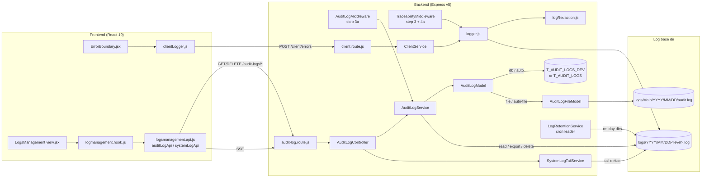
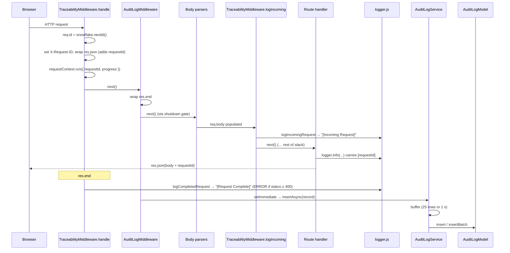

# Logging & Observability — Technical Documentation

> **Scope:** The file logger (RFC 5424 levels, daily folders, size roll-over), log-line redaction, request tracing (Snowflake request id + AsyncLocalStorage), the per-request audit trail (Oracle or JSON-lines file fallback), client-side error ingestion, the System Logs browser and live tail, log retention, and the cluster critical-log relay.
>
> **Primary source files:**
> Backend: `Backend/src/utils/logger.js`, `Backend/src/utils/logRedaction.js`, `Backend/src/utils/requestContext.js`, `Backend/src/middleware/traceability/TraceabilityMiddleware.js`, `Backend/src/middleware/traceability/AuditLogMiddleware.js`, `Backend/src/services/AuditLogService.js`, `Backend/src/services/SystemLogTailService.js`, `Backend/src/services/LogRetentionService.js`, `Backend/src/models/audit.log.model.js`, `Backend/src/models/audit.log.file.model.js`, `Backend/src/routes/audit-log.route.js`, `Backend/src/controllers/AuditLogController.js`, `Backend/src/routes/client.route.js`, `Backend/src/controllers/ClientController.js`, `Backend/src/services/ClientService.js`, `Backend/src/utils/cluster/critRelay.js`, `Backend/src/app.js`, `Backend/server.js`.
> Frontend: `Frontend/src/features/systemadmin/logsmanagement/` (`logsmanagement.api.js`, `logmanagement.hook.js`, `LogsManagement.view.jsx`, `components/*`), `Frontend/src/utils/clientLogger.js`, `Frontend/src/components/feedback/ErrorBoundary.jsx`, `Frontend/src/middleware/HttpClient.js`, `Frontend/src/App.jsx`.
>
> **Verified 2026-10-29 against source.** Tests were not run for this revision.

---

## 1. Overview

CATHERINE ships its own logging stack. There is no Winston, Pino or daily-rotate dependency: `Backend/src/utils/logger.js` is a self-contained class that writes plain-text lines to per-day, per-level files.

In plain terms:

- **Every log line** goes to `logs/YYYY/MM/DD/<level>.log` (eight RFC 5424 levels, one file each). A file that reaches 50 MB rolls to `<level>_1.log`, `<level>_2.log`, and so on.
- **Every HTTP request** gets a Snowflake request id (`0078812966528-0448-0000`). It is set as the `X-Request-ID` header, injected into every JSON response body as `requestId`, and stamped on every log line written while that request is running.
- **Every request** (minus health checks, CORS preflights and the audit-log routes themselves) also becomes one **audit row** — method, canonical route, redacted query params, status, duration, client IP. Rows go to Oracle (`T_AUDIT_LOGS_DEV`, or `T_AUDIT_LOGS` when `NODE_ENV=production`) or, when no audit table is usable, to JSON-lines files under `logs/Main/`.
- **Identifiers and email addresses** are pseudonymised or masked before any line is written.
- **Frontend render crashes** caught by `ErrorBoundary` are posted to `POST /api/v1/client/errors`, so they land in the same log estate. The user sees the server-assigned request id.
- **Operators** use the Super Admin page **System → Logging & Observability** (`/system/logging-and-observability`). It shows audit statistics, the audit table, a per-request trace, a System Logs browser with live tail, and the export/delete retention stepper.
- **Old log folders** are deleted by an unattended sweep (`LogRetentionService`, default 90 days).

---

## 2. Flow & Architecture

### 2.1 Component map



### 2.2 Request lifecycle



### 2.3 Log write path inside `logger.js`

1. `logger.<level>(...)` → `#normalizeLogArguments` → `log(level, message, meta)`.
2. `log()` drops the record if the level is less severe than `LOG_LEVEL`, or if the message is empty.
3. `#injectCallSite(meta)` adds `function`/`file`/`line` from the stack (when `LOG_CALLSITE` is not `false`).
4. The request id is captured from `requestContext.getStore()` **now**, because the queue drains later, possibly under another request's context.
5. `scrubValue(message)` and `scrubMeta(meta)` redact once, so every sink (file, console, level taps) sees the same text. `meta._noRedact === true` skips this only outside production.
6. `#notifySubscribers` fires level taps (`onLevel`), unless `meta._noNotify` is set.
7. The record is pushed onto `writeQueue`. If the queue is at `LOG_MAX_QUEUE_LENGTH`, the **oldest** entries are dropped and counted.
8. `#processWriteQueue` drains one entry at a time: `#writeToFile` → `fs.appendFile`. After a drain with drops, one overflow line is written (see §6.6).

---

## 3. Frontend Implementation

### 3.1 Route and access

`Frontend/src/App.jsx` defines `ROLES = { SADMIN: "SUPER_ADMIN", ADMIN: "ADMIN", USER: "USER" }`. The page is registered inside the `ProtectedRoute role={[ROLES.SADMIN]}` group:

| Path | Component | Guard |
| --- | --- | --- |
| `/system/logging-and-observability` | `LogsManagementView` (lazy) | `SUPER_ADMIN` only |

The frontend guard is a convenience. The backend predicates in §5 are the real control. Note that several backend routes also allow `ADMIN` (see §5.1), but no `ADMIN`-reachable screen currently calls them.

### 3.2 Three-layer feature

| Layer | File | Responsibility |
| --- | --- | --- |
| API | `logsmanagement.api.js` | `auditLogApi` (list, stats, requestLogs, traceExcel, exportExcel, exportLogs, deleteRange, createStream) and `systemLogApi` (list, createStream). Binary exports use `responseType: "arraybuffer"` and a 120 s timeout. SSE uses a native `EventSource` with `withCredentials: true`. |
| Hook | `logmanagement.hook.js` | `useLogsManagement({ activeTab })` — stats date range (default last 30 days), table filters (`fromDate`, `toDate`, `method`, `statusCategory`, `endpoint`, `search`), pagination, trace modal state, System Logs filters and live tail, export/delete stepper. Requests are gated by the active tab. |
| View | `LogsManagement.view.jsx` | Six top-level tabs, wrapped in `ErrorBoundary`. |

### 3.3 Tabs

| Tab id | Label | Content |
| --- | --- | --- |
| `overview` | Overview | `OverviewPageTab` — golden signals, health, live traffic (uses the metrics hook). |
| `metrics` | Metrics | `MetricsPageTab` — RED, System, Dependencies, Frontend Vitals, Alerts. An alert row can pivot to the Audit Logs tab with the route pinned (`navigateToLogs` → `applyEndpointFilter`). |
| `audit-logs` | Audit Logs | `AuditLogsPageTab` with two sub-tabs: **User Traffic** (`AuditStatsRow` + `AuditLogTable`, DB-backed) and **System** (`SystemLogsTab`, file-backed). |
| `health` | Health | `HealthTab` (liveness / readiness). |
| `retention` | Log Retention | `DeleteLoggingTab` — 3-step stepper: select range + export (Excel and ZIP), confirm deletion, done. |
| `archive-reader` | Archive Reader | `ArchiveReaderTab` + `archiveReader.hook.js` — opens exported Excel / ZIP files offline and rebuilds a trace (`buildTrace`, `phaseRank`). |

The metrics and health tabs are covered in their own documents; this document covers the logging and audit parts.

### 3.4 Request trace modal

`RequestLogsModal.jsx` lives at the view root so it overlays any tab. Clicking an audit row calls `auditLogApi.requestLogs(REQUEST_ID, date)`. The modal parses each raw line client-side (`detectPhase`, `extractTimestamp`, `extractLocation`, `extractMessage`) and shows the PARAMS, BODY and auth sections. A Super Admin can download the trace as a two-sheet workbook (`auditLogApi.traceExcel`).

### 3.5 System Logs sub-tab

`SystemLogsTab.jsx` has two modes:

- **Browse** — `systemLogApi.list({ date, maxPriority | level, page, pageSize, search })`. Page size is clamped to 200 (`SYSTEM_LOGS_MAX_PAGE_SIZE`, mirrors the server cap).
- **Live** — only when the selected date is today. Opens `systemLogApi.createStream({ maxPriority | level })` and appends `lines` events. The hook keeps at most `MAX_LIVE_SYSTEM_ROWS = 500` rows.

The level filter options come from `SYSTEM_LOG_LEVEL_OPTIONS` in the hook: `"5"` (Notice & above, default), `"3"`, `"7"`, or an exact level prefixed `lvl:` (for example `lvl:debug`). `_parseSystemLevelFilter` turns the choice into either `maxPriority` or `level`.

### 3.6 Client error reporting

- `ErrorBoundary.componentDidCatch` calls `clientLogger.error(error, info)`.
- `clientLogger.error` posts `{ message, stack, componentStack, url, userAgent, timestamp }` to `client/errors` through the shared `HttpClient` (cookie auth + CSRF header). It returns `res.data.requestId` or `null`, and never throws.
- In `import.meta.env.DEV` it also echoes to `console.error`. Production builds do not.
- The fallback UI shows the request id: either `error.requestId` (set by `HttpClient` for a failed API call) or the id returned by the report.

### 3.7 Traceability header

`Frontend/src/middleware/HttpClient.js` adds `X-Client-Username: <displayName>@<userId>` (or `anonymous@unknown`) to every request. The backend logger uses it for the `[user (C) ip]` prefix of HTTP lifecycle lines (§4.2).

---

## 4. Backend Implementation

### 4.1 Middleware placement (`Backend/src/app.js`)

| Step | Middleware | Why there |
| --- | --- | --- |
| 3 | `defaultTraceability.handle` | Mints `req.id`, sets `X-Request-ID`, opens the ALS context, writes `[Request Complete]`. Above the body parsers so a malformed-JSON 400 still has an id, a context and an audit row. |
| 3a | `defaultAuditLog.handle` | Wraps `res.end`; persists the audit row after the response. |
| 3b | `defaultShutdownGate.handle` | After 3/3a, so a 503 during shutdown still has a request id and an audit row. |
| 4 | Body parsers + `defaultBodyHandler` | `req.body` is always an object from here on. |
| 4a | `defaultTraceability.logIncoming` | Writes `[Incoming Request]` **after** parsing so the body is visible. |

`TraceabilityMiddleware.restoreContext` re-enters the ALS context after multer, which loses it.

### 4.2 Line format

```text
[<host> (S) <ipv4>] [YYYY-MM-DD HH:MM:SS.mmm] [LEVEL] [PID:1234] [fn @ src/path/file.js:42] [FUNC] [0078812966528-0448-0000] - message | META: {"key":"value"}
```

- For HTTP lifecycle lines the first bracket is `[<X-Client-Username or user id> (C) <req.ip>]`, a phase tag (`[Incoming Request]` / `[Request Complete]`) follows the location, and the message is `[METHOD @ url] [PARAMS @ …] [BODY @ …]`.
- `[FUNC]` marks a non-HTTP line. The request id bracket appears only when a context exists.
- `META` lists every meta key that does not start with `_` and is not `method`, `url`, `function`, `file` or `line`.
- Timestamps use `Asia/Manila` with `hourCycle: "h23"` and millisecond precision.
- Console output (when enabled) is the same line, ANSI-coloured.

### 4.3 Levels and files

| Level | Priority | Method | File |
| --- | --- | --- | --- |
| EMERGENCY | 0 | `emergency()` (`emerg()` deprecated) | `emergency.log` |
| ALERT | 1 | `alert()` | `alert.log` |
| CRITICAL | 2 | `critical()` (`crit()` deprecated) | `critical.log` |
| ERROR | 3 | `error()` | `error.log` |
| WARNING | 4 | `warning()` (`warn()` deprecated) | `warning.log` |
| NOTICE | 5 | `notice()` | `notice.log` |
| INFO | 6 | `info()` | `info.log` |
| DEBUG | 7 | `debug()` | `debug.log` |

Helpers: `cache()` and `database()` log at DEBUG, `performance()` at WARNING when the duration is over 5000 ms (INFO otherwise), `security()` at WARNING. `logCompletedRequest` logs at ERROR when `statusCode >= 400`.

### 4.4 Directory layout

`Logger.CONFIG.LOG_BASE_DIR` is `<dir of exe>/logs` in a PKG build (`process.pkg`) and `<cwd>/logs` otherwise. `AuditLogService`, `LogRetentionService` and `AuditLogFileModel` repeat the same resolution, so reads and writes always target the same tree.

```text
logs/
├── 2026/10/29/
│   ├── info.log
│   ├── info_1.log        ← roll-over after 50 MB
│   ├── error.log
│   └── …                 ← one file per level that was written that day
└── Main/2026/10/29/
    └── audit.log         ← audit file fallback (JSON lines)
```

Neither `Backend/logs/` nor `logs/Main/` is committed; both are created at runtime.

### 4.5 Redaction (`Backend/src/utils/logRedaction.js`)

Runs once per record inside `logger.log()`.

| What | How |
| --- | --- |
| Labelled identifiers (`GID`, `GIDs:` lists, `USERID`, `user 123`, a legacy employee-id label, plus JSON/`key=value` forms) followed by 2+ digits | Replaced by a keyed pseudonym: `emp_` or `usr_` + 10 hex chars (HMAC-SHA-256). One-way. |
| Meta keys named `gid`, `gids`, `userId`, `user_id`, … holding a bare number | Same pseudonym (`IDENTIFIER_KEYS`). |
| Bare email addresses | Masked by `maskEmail` → `j******@example.com`. Arrays are masked element by element. |
| `Error` / class instances | Copied with prototype; `message`, `stack` and own properties scrubbed. |

The key is derived once with HKDF from `DATA_SIGNING_SECRET` (info `app-log-pseudonym-v1`). Rotating that secret re-keys every pseudonym. The walk is bounded (`MAX_DEPTH = 6`, `MAX_NODES = 200`); past the budget a subtree is replaced by its scrubbed JSON text, never written raw.

Keys starting with `_` (for example `_clientMachine`) and the five structural keys are copied **unscrubbed** by design — `scrubMeta` documents `_clientMachine` as a deliberate residual.

**Search still works.** `searchCandidates(needle)` returns the raw needle plus the three tokens a digits-only needle would have produced, and `AuditLogService.getSystemLogs` matches any of them.

### 4.6 Request-line redaction (`TraceabilityMiddleware.js`)

`createRequestMessage` redacts query params and body keys whose normalised name contains any `SENSITIVE_PATTERNS` entry (credentials and PII: `password`, `token`, `secret`, `auth`, `otp`, `pin`, `email`, `phone`, `address`, `dob`, …). Nested objects go through `deepRedact` (depth cap 8; a circular body prints `[Complex Object]`). Bodies are deliberately not truncated.

### 4.7 Audit trail

**Producer — `AuditLogMiddleware`.** Skips when `AUDIT_LOG_ENABLED=false`, `/health` (unless `AUDIT_LOG_EXCLUDE_HEALTH=false`), any path in `AUDIT_LOG_EXCLUDE_PATHS`, and every `OPTIONS` request. `_buildRecord` produces:

| Column | Source |
| --- | --- |
| `REQUEST_ID` | `req.id` |
| `USER_ID` | First of `req.user.id` / `GID` / `userId`, kept only if all digits, else `null` (avoids NJS-011 type mixing in a batch) |
| `USERNAME` | `req.user.username` or `firstName` |
| `METHOD` | `req.method` |
| `ENDPOINT` | `resolveRouteLabel(req)` with the verb stripped — a parameterised path, never raw ids |
| `PARAMS` | `_sanitizeParams(req.query)` — sensitive values become `"[REDACTED]"`, JSON truncated to 2000 UTF-8 bytes |
| `STATUS_CODE`, `STATUS_CATEGORY` | `res.statusCode`, `"2xx"`…`"5xx"` |
| `RESPONSE_TIME_MS` | `Date.now() - start` |
| `CLIENT_IP` | `req.ip` |
| `SERVER_IP` | First non-internal IPv4, resolved once |
| `CREATED_AT` | `new Date()` |

PARAMS redaction is two-tier: a substring list (`token`, `password`, `secret`, `apikey`, `jwt`, `signature`, …) and a whole-token list (`auth`, `session`, `pin`, `otp`, `mfa`, `salt`), so `author` or `pinned` are not blinded.

**Buffer — `AuditLogService.insertAsync`.** Rows are flushed as one batch at `FLUSH_MAX = 25` rows or after `FLUSH_INTERVAL_MS = 1000`. A failed batch goes back to the front of the queue and is retried on the next tick; the queue is capped at `PENDING_MAX = 1000` (oldest dropped, one warning). The timer is armed outside any request context and `unref()`'d. Shutdown calls `flushPending({ final: true })` (from `Backend/src/utils/shutdown/TeardownSequence.js`): one attempt, capped at 2000 ms, no requeue.

**Storage — `AuditLogModel`.**

| `AUDIT_LOG_STORAGE` | Behaviour |
| --- | --- |
| `db` | Oracle only via `createDb("appDb")`. Errors propagate. |
| `file` | `AuditLogFileModel` only. |
| `auto` (default) | Oracle first. On the first write failure, switch permanently (for this process) to the file model and re-route the failed batch. Restart to retry Oracle. |

Table name: `AUDIT_LOG_TABLE` if set, else `T_AUDIT_LOGS` in production, `T_AUDIT_LOGS_DEV` elsewhere. In `DEMO_MODE` every method uses the in-memory demo store and no Oracle connection is opened.

The file model writes JSON lines to `logs/Main/YYYY/MM/DD/audit.log` (50 MB roll-over, serialised write chain). Its read methods scan only the filter's date range (today when no range is given) and skip files over 50 MB; `deleteMany` removes whole day folders.

### 4.8 Reading logs back (`AuditLogService`)

| Method | What it does |
| --- | --- |
| `getList` | Paginated rows, page size capped at 100. Exact `endpoint` filter (verb tolerated, `_normalizeEndpointFilter`). `search` is regex-escaped, capped at 100 chars, and OR-ed across `USERNAME`, `CLIENT_IP`, `REQUEST_ID`, `ENDPOINT` (plus exact `USER_ID` when numeric). |
| `getStats` | Aggregates for a range (default last 30 days). `successRate` excludes 4xx from the denominator; `clientErrorRate` and `serverErrorRate` are shares of total traffic. |
| `getRequestLogs` | Validates the request id and date, reads every level file of that day, keeps lines containing `[<requestId>]`, sorts by timestamp with a phase tiebreak. Files over 10 MB are skipped. |
| `getSystemLogs` | Reads the last `SYSTEM_LOG_MAX_READ_BYTES` of each level file for one day, parses each line (`_parseSystemLine`), filters by `level` or `maxPriority` (default 5), searches, sorts newest first, paginates (page size capped at 200). Returns `truncatedFiles`. |
| `exportToExcel` | Workbook "Audit Records" + "Summary". |
| `exportTraceExcel` | Workbook "Request Summary" + "Log Trace" for one request. |
| `exportToZip` | ZIP of every `.log` file in the day folders of the range; symlinks and out-of-folder paths are rejected. |
| `deleteRange` | Deletes audit rows, then each day folder with retry-once + `fs.stat` verification. Returns `{ deletedRows, deletedDays, failedDays }`. |

### 4.9 Live streams

- **Audit stream** (`AuditLogController.stream`) — one shared 5 s poller per process, one `getLatestCreatedAt()` query per tick regardless of viewers. Events: `connected`, `heartbeat`, `update`, `error` (after 5 consecutive failures). Each tick carries a metrics snapshot.
- **System tail** (`SystemLogTailService`) — one shared poller (`SYSTEM_LOG_STREAM_POLL_MS`, default 5000). Reads only the bytes appended since the last tick. The first scan of a day starts at the end of each file (no backlog); a file that appears mid-session is read from 0; a shrunk file resets to 0; midnight discards all offsets. Up to 200 rows per connection per tick, the rest reported as `dropped`.

Both allow one connection per account (409 on a second) and register with `SseConnectionRegistry` so shutdown can end them cleanly.

### 4.10 Client error ingestion

`ClientService.logError(payload, user)` writes one ERROR line, `clientMessages.CLIENT_ERROR(userId)` → `Client-side render error reported by user <id>`, with the payload as meta. The id in that template is pseudonymised by the `user <digits>` rule. `logHelpMiss` (help search zero results) strips control characters, caps the query at 120 chars and logs at WARNING.

### 4.11 Retention (`LogRetentionService`)

Started by `server.js` on the cron leader only, outside the DB pool chain (a DB outage does not stop it). A 15-minute interval checks whether today was swept; if not, it walks `YYYY/MM/DD` folders (digit-only names) and removes those whose midnight is older than `LOG_RETENTION_DAYS` (default 90, `0` = disabled, invalid values fall back to 90 with one warning). Today and yesterday can never be removed. Max 5 failed days per sweep, then it stops until tomorrow.

### 4.12 Cluster behaviour

With `ENABLE_CLUSTERING=true` every worker appends to the same day files; the `[PID:n]` bracket tells them apart. Pseudonyms match across workers because they share `DATA_SIGNING_SECRET`.

The `AlertNotifierService` critical tap (`logger.onLevel(2, …)`) runs on the cron leader only. Non-leader workers call `critRelay.subscribeCriticalRelay(logger, process)` (`server.js`), which serialises their CRITICAL/ALERT/EMERGENCY records (message capped at 4000 chars, meta at 4000 serialised chars) and sends them through the primary to the leader.

The primary stamps `APP_CLUSTER_RUN_ID` on every fork (`ClusterSupervisor`, key name in `Backend/src/constants/serverRunMarker.js`). It is used by the server run marker to recognise a leader handover; it does not appear in log lines.

### 4.13 Shutdown

`logger.flush(timeoutMs = 3000)` waits for the write queue to drain, bounded so a stuck disk cannot hold the process open. `server.js` calls it at the end of graceful shutdown (and with 500 ms on the forced paths).

---

## 5. How Frontend and Backend Connect (the Contract)

### 5.1 Routes

All paths are under `/api/v1`. Every route requires `AuthMiddleware.authenticate`.

| Method | Path | Access | Cache (`auditLog` store, TTL 120 s) | Frontend caller |
| --- | --- | --- | --- | --- |
| GET | `/audit-logs/stats` | ADMIN, SUPER_ADMIN | Yes — key includes `fromDate`, `toDate` | `auditLogApi.stats` |
| GET | `/audit-logs/export/excel` | SUPER_ADMIN | No | `auditLogApi.exportExcel` |
| GET | `/audit-logs/export/logs` | SUPER_ADMIN | No | `auditLogApi.exportLogs` |
| GET | `/audit-logs/stream` (SSE) | ADMIN, SUPER_ADMIN | No | `auditLogApi.createStream` |
| GET | `/audit-logs/system-logs` | ADMIN, SUPER_ADMIN | No | `systemLogApi.list` |
| GET | `/audit-logs/system-logs/stream` (SSE) | ADMIN, SUPER_ADMIN | No | `systemLogApi.createStream` |
| GET | `/audit-logs` | ADMIN, SUPER_ADMIN | Yes — every filter in the key | `auditLogApi.list` |
| GET | `/audit-logs/:requestId/export/trace` | SUPER_ADMIN | No | `auditLogApi.traceExcel` |
| GET | `/audit-logs/:requestId/logs` | ADMIN, SUPER_ADMIN | Yes — key includes `requestId` | `auditLogApi.requestLogs` |
| DELETE | `/audit-logs` | SUPER_ADMIN | Invalidates the whole `auditLog` namespace | `auditLogApi.deleteRange` |
| POST | `/client/errors` | Any authenticated user | No | `clientLogger.error` |
| POST | `/client/help-miss` | Any authenticated user, 20/min limiter | No | Help Center / Help Assistant |

Static segments are declared before `/:requestId/...` so `stats`, `export`, `stream` and `system-logs` are never read as request ids. The `/audit-logs` prefix is excluded from audit persistence by default, so viewing the page does not flood the audit table.

### 5.2 Query parameters

| Route | Parameters |
| --- | --- |
| `GET /audit-logs` | `page` (1), `pageSize` (20, max 100), `fromDate`, `toDate`, `method`, `statusCategory`, `endpoint`, `search` |
| `GET /audit-logs/stats` | `fromDate`, `toDate` |
| `GET /audit-logs/:requestId/logs`, `/export/trace` | `date` (`YYYY-MM-DD`, required) |
| `GET /audit-logs/system-logs` | `date` (today, Asia/Manila), `maxPriority` (0–7, default 5), `level` (overrides `maxPriority`; `warn` = `warning`), `page` (1), `pageSize` (50, max 200), `search` |
| `GET /audit-logs/system-logs/stream` | `maxPriority` (invalid → 5), `level` (invalid → 400 JSON before upgrade) |
| Exports, `DELETE` | `fromDate`, `toDate` (both required) |

### 5.3 Response shapes

JSON routes use the standard envelope `sendSuccess(message, data)`; `TraceabilityMiddleware` adds `requestId`.

```json
{
  "status": "success",
  "code": 200,
  "message": "System log entries fetched successfully.",
  "data": {
    "rows": [{ "ts": "2026-10-29 09:14:02.118", "level": "WARNING", "machine": "HOST (S) 10.0.0.5", "pid": 4120, "location": "fn @ src/services/X.js:88", "phase": null, "method": "FUNC", "requestId": null, "message": "…", "meta": null }],
    "total": 1, "page": 1, "pageSize": 50, "totalPages": 1, "truncatedFiles": []
  },
  "requestId": "0078812966528-0448-0000"
}
```

`getRequestLogs` returns `{ requestId, lines: string[] }`. `deleteRange` returns `{ deletedRows, deletedDays, failedDays }`. Binary exports return the file with `Content-Disposition: attachment` and a filename built from digit/dash-only parts.

### 5.4 SSE events

| Stream | Event | Payload |
| --- | --- | --- |
| `/audit-logs/stream` | `connected` | `{ timestamp, pollIntervalMs }` |
| | `heartbeat` | `{ timestamp, pollCount, metrics }` |
| | `update` | `{ timestamp, metrics }` |
| | `error` | `{ message, code: "POLL_FAILED" }` |
| `/audit-logs/system-logs/stream` | `connected` | `{ timestamp, maxPriority, level? }` |
| | `heartbeat` | `{ timestamp, pollCount }` |
| | `lines` | `{ timestamp, lines: Row[], dropped }` |

Both frontend streams also listen for a `shutdown` event and report server status.

---

## 6. Technicalities

### 6.1 Why a write queue

`log()` is fire-and-forget and must never block the request path. A sequential queue prevents interleaved partial lines from concurrent `appendFile` calls in one process. Across cluster workers, lines are appended to the same file by separate processes; each `appendFile` is one write call.

### 6.2 Why ALS capture happens at enqueue

The queue drains later, possibly while another request's context is active. `log()` captures `requestId` at call time and passes it through the queue, so a line can never carry the wrong id.

### 6.3 Roll-over

`#getAvailableFilename` checks the size of `<level>.log`, then `<level>_1.log` … `<level>_999.log`, and uses the first under 50 MB. After 999 it falls back to `<level>_<epoch>.log`. Files are never renamed or moved, which is what lets retention and the live tail reason about them safely.

### 6.4 Time zone

Folder dates and line timestamps are computed in `Asia/Manila` regardless of the process time zone (logger, file model, `_todayManilaDateStr`, `SystemLogTailService._todayDir`). Some range methods in `AuditLogService` (`exportToZip`, `deleteRange`) build day folders from `Date#getFullYear/getMonth/getDate`, which use the process time zone — see §8.3 item 6.

### 6.5 Tail windows vs size skips

`getSystemLogs` reads the **tail** of each file (default 5 MiB) and drops the first partial line, so a large `info.log` is still browsable. `getRequestLogs` instead **skips** files over 10 MB, so a trace on a very busy day can come back incomplete.

### 6.6 Queue overflow report

When entries were dropped, `#processWriteQueue` writes one line (`WRITE_QUEUE_OVERFLOW`) after the drain. It is written directly with level string `"CRIT"`, not `"CRITICAL"`, so it lands in `crit.log`. That filename does not match `SYSTEM_LOG_FILENAME_RE`, so the System Logs browser, the live tail and the request trace do not show it (flagged in §8.3).

### 6.7 Level taps

`logger.onLevel(maxPriority, fn)` returns an unsubscribe function. Subscribers run synchronously inside try/catch. `meta._noNotify: true` suppresses the tap but not the write — used inside the notification path to avoid a loop.

### 6.8 Dead / unused helpers

`Logger#createHttpLoggerMiddleware` and `Logger#getLogStats` exist but have no call site in `Backend/src` (request lines come from `TraceabilityMiddleware`). `getLogStats` is exercised by the unit test only.

---

## 7. Security

| Concern | CWE | Control | Where |
| --- | --- | --- | --- |
| Sensitive data in logs | CWE-532, CWE-200 | Keyed pseudonyms for labelled ids, email masking, per-record at enqueue; `_noRedact` ignored in production | `logRedaction.js` `scrubValue`/`scrubMeta`; `logger.js` `log()` |
| Credentials in request lines | CWE-532 | `SENSITIVE_PATTERNS` + `deepRedact` on params and body | `TraceabilityMiddleware.js` |
| Credentials in audit PARAMS | CWE-532, CWE-200 | Two-tier key matching, value → `[REDACTED]`, 2000-byte cap | `AuditLogMiddleware._sanitizeParams` |
| Raw ids in audit ENDPOINT | CWE-200 | Canonical route label instead of the concrete path | `AuditLogMiddleware._buildRecord` |
| Offline reversal of pseudonyms | CWE-916-style brute force | HMAC keyed by HKDF(`DATA_SIGNING_SECRET`), not a bare hash | `logRedaction.js` `getKey` |
| Log injection | CWE-117 | Help-miss query: control chars stripped, 120-char cap. Meta values are JSON-encoded (newlines escaped). Request-line body/param strings are **not** escaped (see §8.3). | `ClientService.logHelpMiss`; `logger.js` `#safeStringify` |
| Spoofed client IP in forensic lines | CWE-290 | `req.ip` only; `X-Forwarded-For` / `X-Real-IP` ignored | `logger.js` `#getClientIp`; `AuditLogMiddleware` `CLIENT_IP` |
| Spoofed username in HTTP lines | CWE-290 | **Not controlled** — `X-Client-Username` is client-set and copied unscrubbed into `_clientMachine` | `logger.js` `#createClientMachineIdentifier` |
| ReDoS in audit search | CWE-1333 | Regex metacharacters escaped, 100-char cap | `AuditLogService.getList` |
| Path traversal in log reads/exports | CWE-22, CWE-59 | Date regex + resolved-prefix check; `lstat` rejects symlinks in ZIP export | `getSystemLogs`, `exportToZip` |
| Header injection in download names | CWE-113 | Filename parts stripped to `[0-9-]` / `[A-Za-z0-9_-]` | `AuditLogController.exportExcel`, `exportLogs`, `exportTraceExcel` |
| Cached data served to the wrong caller | CWE-639 | Cache read placed after `authenticate` + `requireAccess` | `audit-log.route.js` |
| Unbounded memory on disk stall | CWE-400, CWE-770 | `LOG_MAX_QUEUE_LENGTH` cap; audit `PENDING_MAX`; relay size caps; tail `MAX_ROWS_PER_TICK` | `logger.js`, `AuditLogService`, `critRelay.js`, `SystemLogTailService` |
| Telemetry flood | CWE-400 | 20/min limiter on help-miss; **none** on `/client/errors` beyond auth and `BODY_LIMIT` | `client.route.js` |
| Error detail shown to users | CWE-209 | Frontend shows only a generic fallback + request id; stack goes server-side | `ErrorBoundary.jsx`, `clientLogger.js` |
| Logs kept forever | CWE-459 | Verified retention sweep of `logs/YYYY/MM/DD`; does **not** cover `logs/Main/` | `LogRetentionService` |
| Destructive actions | — | Export and range delete are SUPER_ADMIN only; delete invalidates the cache namespace | `audit-log.route.js` |

---

## 8. Verification Q&A

Evidence points to `file:symbol`. Tests listed exist in the repo; they were **not run for this revision**.

### 8.1 Behaviour

**Q: Which logging library is used?**
None. `Backend/src/utils/logger.js:Logger` is in-house; `fs.promises.appendFile` writes the files.

**Q: Where does a WARNING line go on 29 Oct 2026?**
`logs/2026/10/29/warning.log` (or `warning_N.log` after roll-over). Evidence: `logger.js:#getLogDirectory`, `#writeToFile`, `#getAvailableFilename`.

**Q: Is an INFO line written when `LOG_LEVEL=WARNING`?**
No. `log()` returns when `LEVELS[level] > currentLevel`. `WARN` is accepted as an alias. Evidence: `logger.js:constructor`, `log`. Test: `Backend/test/server/unit/utils/logger.test.js`.

**Q: Does every line of a request carry the same id?**
Yes, when logged inside the ALS context opened by `TraceabilityMiddleware.handle`. The id is captured at enqueue. Evidence: `TraceabilityMiddleware.js:handle`, `logger.js:log`.

**Q: Does a malformed-JSON 400 still get an id, a trace and an audit row?**
Yes. `handle` and the audit middleware run above the parsers, and `res.end` emits the missing Incoming line idempotently. Evidence: `app.js` steps 3/3a/4a, `TraceabilityMiddleware.js:handle` (`emitIncoming`).

**Q: Which audit table is used in production?**
`T_AUDIT_LOGS`; elsewhere `T_AUDIT_LOGS_DEV`; `AUDIT_LOG_TABLE` overrides both. Evidence: `audit.log.model.js:resolveTableName`. Test: `Backend/test/server/unit/models/auditLogStorage.test.js` ("table name resolution").

**Q: What happens in `auto` mode when the audit table is missing?**
The first failed write switches the process to the file tier permanently and re-routes the failed batch. Evidence: `audit.log.model.js:writeWithFallback`. Test: `auditLogStorage.test.js` ("AUDIT_LOG_STORAGE=auto (default)").

**Q: Does the file fallback rotate and keep lines whole?**
Yes — 50 MB roll-over and a serialised write chain. Evidence: `audit.log.file.model.js:CONFIG`, `writeChain`. Test: `Backend/test/server/unit/models/auditLogFileModel.test.js`.

**Q: Are audit rows written one per request?**
No; they are batched (25 rows / 1 s) with retry and a 1000-row cap. Evidence: `AuditLogService.js:insertAsync`, `_flushOnce`.

**Q: In DEMO_MODE, is Oracle touched for audit?**
No; every model method uses the demo store. Evidence: `audit.log.model.js` (`isDemoMode()` branches). Test: `auditLogStorage.test.js` ("DEMO_MODE=true").

**Q: Can an ADMIN read raw system logs?**
Yes, through the API (`isAdminOrSuperAdmin`), although the frontend page is SUPER_ADMIN only. Evidence: `audit-log.route.js` (`/system-logs`), `App.jsx` (`ROLES.SADMIN` group).

**Q: Who can export or delete?**
SUPER_ADMIN only. Evidence: `audit-log.route.js` (`isSuperAdmin` on `/export/*`, `/:requestId/export/trace`, `DELETE /`). Test: `Backend/test/server/integration/audit-log/audit-log.test.js` (export and range-delete suites).

**Q: Are static segments safe from the `:requestId` route?**
Yes, by declaration order. Test: `audit-log.test.js` ("route ordering — static segments not matched as :requestId").

**Q: Does audit search escape regex input?**
Yes. Evidence: `AuditLogService.js:getList`. Test: `audit-log.test.js` ("REGRESSION — GET /api/v1/audit-logs with ?search= param").

**Q: Does `POST /client/errors` require authentication?**
Yes; any role is accepted. Evidence: `client.route.js`. Test: `Backend/test/server/integration/client/client-errors.test.js`.

**Q: Does a failing error report crash the boundary again?**
No; `clientLogger.error` swallows its own failure. Evidence: `clientLogger.js:error`. Tests: `Frontend/test/reliability/error-boundary.test.jsx`, `Frontend/test/chaos/network-failure-contained.test.jsx`, `Frontend/test/performance/client-logger-no-fanout.test.jsx`.

**Q: Does the fallback UI leak the stack?**
No. Test: `Frontend/test/security/error-disclosure-invariants.test.jsx`.

**Q: Is the system live tail one timer per viewer?**
No; one shared poller, deltas only. Evidence: `SystemLogTailService.js:_start`, `_tick`, `_readDelta`.

**Q: Which worker runs retention?**
The cron leader only. Evidence: `server.js` (`if (IS_CRON_LEADER) … LogRetentionService.start()`).

### 8.2 Coverage gaps

No test file in `Backend/test` references `logRedaction`, `TraceabilityMiddleware` redaction, `SystemLogTailService`, `LogRetentionService`, `/audit-logs/system-logs`, or `/client/help-miss` (searched 2026-10-29). Statements about those parts rest on source reading only.

### 8.3 Code issues noticed (not fixed here)

1. **Overflow line uses level `"CRIT"`** → written to `crit.log`, invisible to the System Logs browser, live tail and trace. `logger.js:#processWriteQueue`. Owner: backend.
2. **Request-line strings are not newline-escaped** — a body or query string value containing `\n` can forge a new log line (CWE-117). `TraceabilityMiddleware.js:createRequestMessage`. Owner: security / backend.
3. **`X-Client-Username` is trusted** for the `[user (C) ip]` prefix and left unscrubbed (CWE-290). `logger.js:#createClientMachineIdentifier`. Owner: security.
4. **`/client/errors` has no rate limiter** and no field length caps (bounded only by `BODY_LIMIT`, 10 MB). `client.route.js`, `ClientService.logError`. Owner: security / backend.
5. **`logs/Main/` is never retention-swept** — `LogRetentionService` only walks digit-named folders; audit JSON lines accumulate. It is also not included in `exportToZip`. Owner: backend.
6. **Time zone mismatch** — `exportToZip` and `deleteRange` compute day folders in the process time zone, while the logger writes Asia/Manila folders. Owner: backend.
7. **`getRequestLogs` skips files over 10 MB**, unlike the tail-window read of `getSystemLogs`. Owner: backend.
8. **Inline log string** in `AuditLogService.exportToZip` (path traversal warning) breaks the `constants/messages` rule. Owner: backend.
9. **`LOG_MAX_SAFESTR_LENGTH` only truncates serialised objects**, not plain strings, while `.env.example` says "truncate logged strings". `logger.js:#safeStringify`. Owner: docs / backend.
10. **Doc drift in constants** — `Backend/src/constants/runtimeModel.js` (`obs.logger`) says "microsecond timestamps"; the code writes milliseconds. The `audit-log.route.js` header comment shows stats/list cache keys without the date/filter dimensions the code actually uses. Owner: docs.
11. **Unused helpers** `createHttpLoggerMiddleware` and `getLogStats` (§6.8). Owner: backend.

---

## Environment Variables Reference

Only variables read by the code paths in this document. Defaults are the code defaults; `.env.example` values may differ.

| Variable | Read in | Code default | Effect |
| --- | --- | --- | --- |
| `LOG_LEVEL` | `logger.js` `CONFIG.CURRENT_LEVEL` | `INFO` | Least severe level written. Case-insensitive; `WARN` = `WARNING`; unknown → INFO. |
| `ENABLE_CONSOLE_LOGS` | `logger.js` `CONFIG.CONSOLE_OUTPUT` | — | `false` always disables console. Otherwise console is on when `true`, when `NODE_ENV` ≠ `production`, or when `DOCKER_CONTAINER=true`. |
| `DOCKER_CONTAINER` | `logger.js` | `false` | `true` forces console output (unless `ENABLE_CONSOLE_LOGS=false`). |
| `NODE_ENV` | `logger.js`, `audit.log.model.js` | — | `production` selects `T_AUDIT_LOGS`, turns console off by default, and disables `_noRedact`. |
| `LOG_EXCLUDE_HEALTH` | `logger.js`, `TraceabilityMiddleware.js` | `false` | `true` = no request lines for URLs containing `/health`. |
| `LOG_EXCLUDE_URLS` | `logger.js`, `TraceabilityMiddleware.js` | empty | Comma-separated substrings; matching URLs get no request lines. |
| `LOG_MAX_SAFESTR_LENGTH` | `logger.js` `CONFIG.MAX_SAFESTR_LENGTH` | `Infinity` | Max length of a serialised object in a line (plain strings are not truncated). |
| `LOG_CALLSITE` | `logger.js` `#injectCallSite`, `#captureCallSite` | `true` | `false` skips stack capture; location shows `anonymous @`. |
| `LOG_MAX_QUEUE_LENGTH` | `logger.js` constructor | `10000` | Write-queue cap; oldest entries dropped beyond it. |
| `LOG_RETENTION_DAYS` | `LogRetentionService.js` | `90` | Day folders older than N days are removed. `0` disables. Invalid or < 1 → 90 with a warning. Read live each sweep. |
| `SYSTEM_LOG_MAX_READ_BYTES` | `AuditLogService.getSystemLogs` | `5242880` | Tail bytes read per level file per browse request. |
| `SYSTEM_LOG_STREAM_POLL_MS` | `SystemLogTailService._pollIntervalMs` | `5000` | Live-tail poll interval (read when the poller starts). |
| `AUDIT_LOG_ENABLED` | `AuditLogMiddleware` constructor | `true` | `false` = no audit rows; file logs continue. |
| `AUDIT_LOG_EXCLUDE_HEALTH` | `AuditLogMiddleware` constructor | `true` | Skips `/health` audit rows unless `false`. |
| `AUDIT_LOG_EXCLUDE_PATHS` | `AuditLogMiddleware` constructor | `/api/v1/audit-logs` | Comma-separated path prefixes not audited. |
| `AUDIT_LOG_STORAGE` | `audit.log.model.js` `storageMode` | `auto` | `db` \| `file` \| `auto` (§4.7). Resolved once per process. |
| `AUDIT_LOG_TABLE` | `audit.log.model.js` `resolveTableName` | empty | Overrides the audit table name. |
| `DATA_SIGNING_SECRET` | `logRedaction.js` `getKey` | `unkeyed-dev` (redaction fallback only; production boot requires it) | HKDF input for log pseudonyms. Rotation breaks correlation with older lines. |
| `DEMO_MODE` | `Backend/src/config/demoMode.js` `isDemoMode` | `false` | `true` = audit model uses the in-memory demo store. |
| `APP_NAME` | `AuditLogService.exportToExcel`, `exportTraceExcel` | `CATHERINE` | Workbook `creator` field. |
| `BODY_LIMIT` | `BodyParserMiddleware.js` | `10mb` | Upper bound on a client error report body. |
| `ENABLE_CLUSTERING` | `server.js` / cluster supervisor | `false` | Multiple workers share the same log files; non-leaders relay critical logs. |
| `APP_CLUSTER_RUN_ID` | `server.js`, `ClusterSupervisor` (via `SERVER_RUN_MARKER.CLUSTER_RUN_ID_ENV`) | random UUID per primary run | Set by the primary on each fork, not in `.env.example`. Not an operator setting. |

---

_End of document. Updated 2026-10-29._
