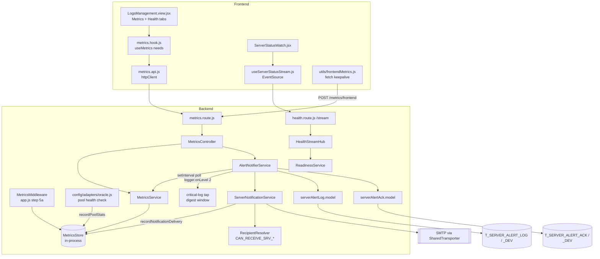
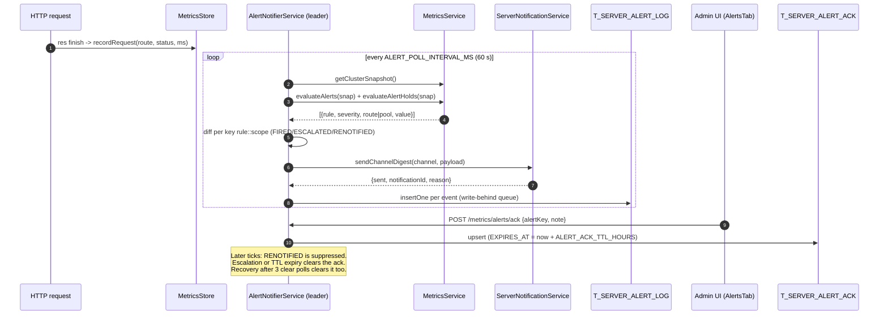
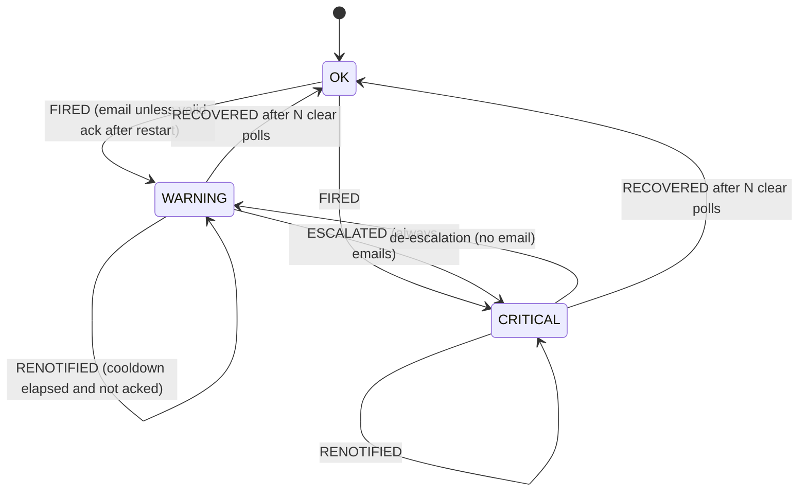

# Metrics & Alerting — Technical Documentation

> **Scope:** in-process RED and system metrics, the eleven alert rules, alert email notifications, alert history and acknowledgement, the health probes and the readiness push stream (SSE), and the admin screens that show them.
> **Source:** `Backend/src/` (services, routes, controllers, models, metrics middleware) and `Frontend/src/features/systemadmin/` plus `Frontend/src/components/shared/serverStatus/`.
> **Verified 2026-10-29 against source.** Every symbol, default and path below was read from the code in this revision. The tests cited in §8 exist. They were **not run for this revision**.

---

## 1. Overview

Metrics & Alerting is an **in-process observability engine with no external dependencies**. It does five things:

1. **Collects** RED metrics (Rate, Errors, Duration) for every HTTP request through `MetricsMiddleware` → `MetricsStore`. It also collects system metrics (heap, GC, event-loop lag, CPU), Oracle pool statistics for `appDb` and `appDbBulk`, and SMTP delivery outcomes.
2. **Evaluates** eleven threshold rules (`MetricsService.evaluateAlerts`) against a snapshot. In cluster mode the snapshot is merged across all workers.
3. **Notifies.** `AlertNotifierService` polls every `ALERT_POLL_INTERVAL_MS` (default 60 s), runs a per-alert state machine, and sends one HTML digest per channel through `ServerNotificationService`. Mail goes out only on state transitions.
4. **Records** every transition and email outcome in `T_SERVER_ALERT_LOG(_DEV)`. Live acknowledgements are kept in `T_SERVER_ALERT_ACK(_DEV)`.
5. **Pushes readiness** to every browser over `GET /api/v1/health/stream` (SSE), so the app-wide server-status banner can react before the user makes a request.

The notifier is **off by default** (`ENABLE_SERVER_NOTIFICATIONS=false`). It runs **only on the cron-leader worker** (`Backend/server.js`, the `IS_CRON_LEADER` gate). Metrics collection, the `/metrics` reads and the health routes run on every worker.

---

## 2. Flow & Architecture

### 2.1 Component flow

### 2.2 Sequence — metric sample to acknowledgement

The email is sent **before** the log row is written. The row records the result in `EMAIL_STATUS` (`SENT` / `FAILED` / `DISABLED` / `SKIPPED`) and `NOTIFICATION_ID` (`AlertNotifierService._dispatchMetricDigest`, `_emailStatusFor`).

### 2.3 Alert state machine (per `rule::scope`)

`N` = `ALERT_RECOVERY_CONFIRM_POLLS` (default 3). A key listed in `evaluateAlertHolds` neither advances nor resets the countdown. A key is held when its rule cannot be evaluated: too few samples, or a cluster gather that missed a worker (`"*"`).

---

## 3. Frontend Implementation

### 3.1 Files

| File | Responsibility |
| --- | --- |
| `Frontend/src/features/systemadmin/logsmanagement/LogsManagement.view.jsx` | The Logging & Observability page. Its `METRICS_TAB_NEEDS` map decides which datasets `useMetrics` fetches for each top-level tab. |
| `Frontend/src/features/systemadmin/logsmanagement/components/MetricsPageTab.jsx` | The **Metrics** tab. Pill sub-tabs: RED Metrics · System · Dependencies · Frontend Vitals · Alerts (`defaultTab="red"`). The Alerts label shows the live count. |
| `Frontend/src/features/systemadmin/logsmanagement/components/OverviewPageTab.jsx` | The Overview tab. Uses summary, alerts, snapshot and health. |
| `Frontend/src/features/systemadmin/logsmanagement/components/DependenciesTab.jsx` | Oracle pool USE view (utilisation, queue, health) per pool. |
| `Frontend/src/features/systemadmin/logsmanagement/components/FrontendVitalsTab.jsx` | Aggregated Web Vitals. |
| `Frontend/src/features/systemadmin/metrics/metrics.api.js` | `metricsApi`: `snapshot`, `summary`, `alerts`, `healthLive`, `healthReady` (treats 503 as data), `notificationStatus`, `testSendNotification`, `alertHistory`, `acknowledgeAlert`, `unacknowledgeAlert`. |
| `Frontend/src/features/systemadmin/metrics/metrics.hook.js` | `useMetrics({ needs })` and `METRICS_NEEDS` (`SNAPSHOT`, `SUMMARY`, `ALERTS`, `HEALTH`, `NOTIFICATIONS`). Each dataset uses `useRequest` with `staleTime: 30_000`. Also holds the ack modal state and the SUPER_ADMIN test-send gate (`isSuperAdmin`). |
| `Frontend/src/features/systemadmin/metrics/components/RedMetricsTab.jsx` | Per-route RED table. |
| `Frontend/src/features/systemadmin/metrics/components/SystemTab.jsx` | Heap, GC, event loop, memory trend. |
| `Frontend/src/features/systemadmin/metrics/components/AlertsTab.jsx` | Active alerts with ack/unack controls. Has an Active / History toggle. |
| `Frontend/src/features/systemadmin/metrics/components/AlertHistoryTab.jsx` | Paginated history with severity/rule/date filters. |
| `Frontend/src/features/systemadmin/metrics/components/AckAlertModal.jsx` | Acknowledge confirmation with an optional note. |
| `Frontend/src/features/systemadmin/metrics/components/NotificationStatusPanel.jsx` | Enabled flag, masked recipients, recent sends, and the test-send control (SUPER_ADMIN only). |
| `Frontend/src/features/systemadmin/metrics/components/HealthTab.jsx` | Liveness and readiness results. Mounted as the top-level **Health** tab. |
| `Frontend/src/features/systemadmin/metrics/metricsStyles.js` | Range-based token colour helpers. |
| `Frontend/src/features/systemadmin/metrics/Metrics.view.jsx` | The older standalone dashboard (Overview/RED/System/Alerts/Health). It calls `useMetrics()` with no `needs`, so it fetches everything. Still routed (§3.3). |
| `Frontend/src/components/shared/serverStatus/useServerStatusStream.js` | Opens `EventSource` on `/health/stream`. Handles `status`, `heartbeat` and `shutdown` frames. `HEARTBEAT_STALE_MS = 40000`. Retries after a refusal once `STREAM_RETRY_AFTER_REFUSAL_MS = 60000` has passed. |
| `Frontend/src/components/shared/serverStatus/ServerStatusWatch.jsx` | Mounts the stream. Falls back to readiness polling when the stream reports `{ fallback: true }`. |
| `Frontend/src/utils/frontendMetrics.js` | Pre-auth telemetry buffer. Flushes every 30 s or at 20 vitals. Errors flush immediately. The buffer holds at most 100 items and a failed flush is retried once after 5 s. Uses `fetch` with `keepalive: true`. |
| `Frontend/src/utils/webVitals.js` | Web Vitals collection that feeds `frontendMetrics`. |

### 3.2 Tab → dataset gating

| Logging & Observability tab | `METRICS_TAB_NEEDS` |
| --- | --- |
| `overview` | `SUMMARY`, `ALERTS`, `SNAPSHOT`, `HEALTH` |
| `metrics` | `SNAPSHOT`, `ALERTS`, `NOTIFICATIONS` |
| `health` | `HEALTH` |
| `audit-logs`, `retention`, `archive-reader` | `[]` (every metrics fetch off) |

Alert history is fetched only while `alertsView === "history"` and alerts are wanted (`metrics.hook.js`).

### 3.3 Routing and roles (`Frontend/src/App.jsx`)

`ROLES = { SADMIN: "SUPER_ADMIN", ADMIN: "ADMIN", USER: "USER" }`. Both `system/logging-and-observability` (`LogsManagementView`) and `system/metrics` (`MetricsView`) sit under `<ProtectedRoute role={[ROLES.SADMIN]} />`. The UI is therefore stricter than the API, which accepts `userLevel >= 2` for most reads (§5). The status banner stream is mounted app-wide and needs no role.

---

## 4. Backend Implementation

### 4.1 Files

| File | Responsibility |
| --- | --- |
| `Backend/src/middleware/metrics/MetricsMiddleware.js` | `defaultMetrics.handle`. Registered at `app.js` step **5a**, after response-time tracking. Records route, status and duration on `finish`. |
| `Backend/src/middleware/metrics/MetricsStore.js` | Singleton store. Per-route ring of 1000 durations (`RING_BUFFER_SIZE`). 5-minute windows (`ERROR_WINDOW_MS = LATENCY_WINDOW_MS = 300_000`, 10 s buckets). System poll every `SYSTEM_POLL_INTERVAL_MS = 10_000`. `APDEX_THRESHOLD_MS = 500`. Also `recordPoolStats` and `recordNotificationDelivery`. |
| `Backend/src/middleware/metrics/metricsMerge.js` | `mergeMetricsSnapshots`, the cluster-wide merge used by `MetricsService.getClusterSnapshot`. |
| `Backend/src/services/MetricsService.js` | `getSnapshot`, `getClusterSnapshot`, `getSummary`, `evaluateAlerts`, `evaluateAlertHolds`, `ingestFrontendMetrics`. Owns every threshold constant. |
| `Backend/src/services/AlertNotifierService.js` | Poller, state machine, critical-log tap, storm ceiling, ack lifecycle, alert-log write-behind, retention purge, status/history/test-send. |
| `Backend/src/services/email/ServerNotificationService.js` | Sender. Builds the subject, fills HTML templates with escaped values, resolves recipients, and sends through `SharedTransporter`. Never throws. |
| `Backend/src/services/email/RecipientResolver.js` | Cached per-channel opt-in list (`RECIPIENT_REFRESH_MIN`, default 5) with last-known-good fallback. |
| `Backend/src/models/serverAlertLog.model.js` | Append-only history. `insertOne`, `findPage` (max 200 per page), `findRecent`, `purgeOlderThan`. `DETAILS` is bound as a CLOB. In DEMO_MODE it uses an in-memory ring of 500 rows. |
| `Backend/src/models/serverAlertAck.model.js` | Live ack set. `upsert`, `remove`, `findAll`. In DEMO_MODE it uses an in-memory Map. |
| `Backend/src/models/admin.model.js` | Maps each channel to its `CAN_RECEIVE_SRV_*` flag. `findServerNotifyRecipients`. |
| `Backend/src/routes/metrics.route.js` · `Backend/src/controllers/MetricsController.js` | The `/api/v1/metrics` surface (§5). |
| `Backend/src/routes/health.route.js` | `/`, `/live`, `/ready`, `/stream`. |
| `Backend/src/services/ReadinessService.js` | The single readiness rule (all pools answer, all breakers closed). Probes are bounded by `HEALTH_PROBE_TIMEOUT_MS`. Concurrent calls share one probe. |
| `Backend/src/services/HealthStreamHub.js` | SSE hub: one evaluation loop shared by all connections, heartbeat, per-IP and total caps. |
| `Backend/src/config/adapters/oracle.js` | The pool health check calls `metricsStore.recordPoolStats` on both its success and failure paths. |
| `Backend/src/utils/cluster/workerRpcWiring.js` | Leader-side RPC handlers: `ALERTS_ACK`, `ALERTS_UNACK`, `ALERTS_STATUS`, `ALERTS_ACKS`. |
| `Backend/src/utils/email-templates/server-notification/*.html` | Four channel templates (§4.4). |

### 4.2 Alert rules (`MetricsService.evaluateAlerts`)

| # | Rule | Condition (warning / critical) | Scope | Channel (`RULE_CHANNEL_MAP`) |
| --- | --- | --- | --- | --- |
| 1 | `HIGH_ERROR_RATE` | 5xx rate in the 5-min window > 1% / > 5%, only once `serviced >= 50` | global | red-metrics |
| 2 | `HIGH_LATENCY` | window p99 > 5 000 ms (default) or > 170 000 ms (routes matching `/save` or `/export`), only once `count >= 20`. Warning only. | route | red-metrics |
| 3 | `HIGH_HEAP` | heap > 75% / > 90% of the V8 limit | global | system |
| 4 | `EVENT_LOOP_LAG` | lag > 100 ms (warning only) | global | system |
| 5 | `HIGH_GC_OVERHEAD` | GC > 5% / > 10% of wall-clock time | global | system |
| 6 | `MEMORY_LEAK_SUSPECTED` | `memoryTrend.suspected` (warning) | global | system |
| 7 | `ORACLE_POOL_SATURATION` | inUse/open > 0.80 / > 0.95 | pool | dependencies |
| 8 | `EMAIL_DELIVERY_FAILING` | consecutive SMTP failures ≥ 1 / ≥ 3 | global | dependencies |
| 9 | `ORACLE_POOL_DOWN` | `healthy === false` (critical) | pool | **critical** |
| 10 | `ORACLE_POOL_DEGRADED` | `consecutiveFailures > 0 && healthy === true` (warning) | pool | dependencies |
| 11 | `ORACLE_POOL_QUEUE_BACKLOG` | queueLength ≥ 3 / ≥ 10 | pool | dependencies |

A rule with no entry in the map falls back to `FALLBACK_CHANNEL = "server-system-notification"`. Every `ALERT_TRIGGERED` log carries `_noNotify: true`, so the critical tap never sends a second email for an alert already delivered on its own channel.

### 4.3 Pool statistics (`appDb`, `appDbBulk`)

`POOL_NAMES` comes from `Backend/src/config/database.js`. Each health-check tick in `oracle.js` pushes `{connectionsInUse, connectionsOpen, poolMax, queueLength, healthy, consecutiveFailures}`. A failed check sends zeroed counters plus the failure signal, so rules 9 and 10 can fire while a pool is down. `MetricsStore.recordPoolStats` derives `utilization = inUse/open` and `capacity = open/poolMax`. The snapshot exposes these as `dependencies.oracle[pool].poolUtilization` and related fields. For readiness, `READINESS_GATING_POOLS = ["appDb"]`. Saturation (NJS-076) of `appDbBulk` still counts as up (`ReadinessService`).

### 4.4 Email channels, subject and recipients

| Channel / template | Admin flag | Fed by |
| --- | --- | --- |
| `server-critical-notification` | `CAN_RECEIVE_SRV_CRIT` | critical-log tap, `ORACLE_POOL_DOWN`, `notifyCriticalNow` |
| `server-dependencies-notification` | `CAN_RECEIVE_SRV_DEPS` | rules 7, 8, 10, 11 |
| `server-red-metrics-notification` | `CAN_RECEIVE_SRV_RED` | rules 1, 2 |
| `server-system-notification` | `CAN_RECEIVE_SRV_SYS` | rules 3–6, lifecycle mails |

- **Subject:** `` `[${process.env.APP_NAME || "CATHERINE"}][${severity}] ${channel}: ${headline}` `` (`ServerNotificationService.sendChannelDigest`). Severity is `WARNING`, `CRITICAL`, `RESOLVED` or `NOTICE`.
- **Recipients:** the union of the `SERVER_NOTIFY_TO` list (always included) and active admins whose channel flag is `'Y'`. Duplicates are removed. `AdminManagementService.updatePermissions` calls `RecipientResolver.invalidate()` when a flag changes. If the DB is down at cold start, only the env list is used.
- **Templates:** `Backend/src/utils/email-templates/server-notification/server-{critical,dependencies,red-metrics,system}-notification.html`. Placeholders use a flat `{{key}}` format. Values are HTML-escaped and `{{alertRows}}` is pre-built from escaped rows.

### 4.5 Critical-log tap

`logger.onLevel(2, …)` buffers emerg, alert and crit records for `CRITICAL_DIGEST_WINDOW_MS` (default 30 s). Up to 200 records are itemised (`CRITICAL_BUFFER_MAX`); the rest are only counted. Then one digest is sent. Once the `CRITICAL_MAX_EMAILS_PER_HOUR` ceiling (default 10) is reached, a window is not mailed. Instead one `SUPPRESSED` row is written with `VALUE_NUM` = count, and the next digest that does send reports the suppressed total. Criticals from non-leader workers are relayed to the leader (`ingestRelayedCritical`).

---

## 5. How Frontend and Backend Connect (the Contract)

All paths are under `/api/v1`. Responses use the standard `sendSuccess` / `sendError` envelope.

| Method | Path | Auth | Extra guards | Caller (FE) | Response `data` |
| --- | --- | --- | --- | --- | --- |
| GET | `/metrics` | `userLevel >= 2` | — | `metricsApi.snapshot` | full (cluster) snapshot |
| GET | `/metrics/summary` | `userLevel >= 1` | — | `metricsApi.summary` | `{uptime, totals, system, topSlowRoutes, alertCount}` |
| GET | `/metrics/alerts` | `userLevel >= 2` | — | `metricsApi.alerts` | `{alerts[], count}`, each alert with `alertKey`, `acknowledged`, `ackedBy`, `ackedByName`, `ackedAt`, `ackExpiresAt` |
| POST | `/metrics/frontend` | none | 30 req/min (`frontendIngestLimiter`), CSRF-exempt, array of 1–50 items | `frontendMetrics.flush` | `null` |
| GET | `/metrics/notifications/status` | `userLevel >= 2` | — | `metricsApi.notificationStatus` | `{enabled, recipients (masked), pollIntervalMs, cooldownMin, …, activeAlerts, recentSends}` |
| POST | `/metrics/notifications/test` | `role === "SUPER_ADMIN"` | 3 req/min, `channel` required | `metricsApi.testSendNotification` | `{sent, notificationId, recipientCount}`. 400 for an unknown channel, 502 when the send fails |
| GET | `/metrics/alerts/history` | `userLevel >= 2` | `severity` ∈ WARNING/CRITICAL/RESOLVED, ISO `from`/`to`, `from ≤ to` | `metricsApi.alertHistory` | `{rows, total, page, limit}` (limit ≤ 200) |
| POST | `/metrics/alerts/ack` | `userLevel >= 2` | `alertKey` required (in the body) | `metricsApi.acknowledgeAlert` | `{alertKey, acknowledged:true, ackedBy, ackedAt, ackExpiresAt, severityAtAck, note}`. 404 for an unknown key, 400 if the alert is not active, 502 if the write fails |
| DELETE | `/metrics/alerts/ack` | `userLevel >= 2` | `alertKey` required (in the body) | `metricsApi.unacknowledgeAlert` | `{alertKey, acknowledged:false}`. 404 `ACK_NOT_FOUND` |
| GET | `/health` | none | answers `database:"draining"` while shutting down | legacy monitors | `{uptime, timestamp, database}` (always 200) |
| GET | `/health/live` | none | never touches the DB | `metricsApi.healthLive` | `{alive, pid, uptime, timestamp}` |
| GET | `/health/ready` | none | 503 + `Retry-After` while draining | `metricsApi.healthReady` | `{ready, checks…}`. 200 when ready, 503 otherwise |
| GET | `/health/stream` | none (SSE) | 503 while draining, 429 above the per-IP or total cap | `useServerStatusStream` | events: `status {ready, cause}`, `heartbeat {t}`, `shutdown`; first frame `retry: 3000` |

`alertKey` goes in the request body because it contains `::` and `/` (for example `HIGH_LATENCY::POST /api/v1/auth/login`). `/health/*` is exempt from the rate limiter (`HEALTH_PATH_RE` in `Backend/src/middleware/security/RateLimiterMiddleware.js`). SSE refusals go through `sendSsePreflightError` (`Backend/src/utils/sse/ssePreflight.js`) before the connection is upgraded, so they keep the standard error shape including `requestId`.

**Cluster:** `acknowledge`, `unacknowledge`, `getStatus` and the ack map behind `decorateAlertsWithAckState` are forwarded to the cron leader (`_forwardsToLeader` → `_forwardToLeader`). A request that lands on any worker therefore sees the leader's state.

---

## 6. Technicalities

### 6.1 Environment variables (defaults read in code)

| Variable | Default | Read in |
| --- | --- | --- |
| `ENABLE_SERVER_NOTIFICATIONS` | `false` (anything but `"true"`) | `ServerNotificationService.isEnabled` |
| `SERVER_NOTIFY_TO` | empty | `resolveRecipients` |
| `RECIPIENT_REFRESH_MIN` | 5 | `RecipientResolver` |
| `ALERT_POLL_INTERVAL_MS` | 60 000 | `_pollIntervalMs` |
| `ALERT_EMAIL_COOLDOWN_MIN` | 30 | `_cooldownMs` |
| `ALERT_NOTIFY_RECOVERY` | `true` | `_notifyRecovery` |
| `ALERT_RECOVERY_CONFIRM_POLLS` | 3 | `_recoveryConfirmPolls` |
| `CRITICAL_DIGEST_WINDOW_MS` | 30 000 | `_digestWindowMs` |
| `CRITICAL_MAX_EMAILS_PER_HOUR` | 10 | `_maxEmailsPerHour` |
| `ALERT_ACK_TTL_HOURS` | 24 | `_ackTtlHours` |
| `ALERT_LOG_RETENTION_DAYS` | 180 | `_runRetentionPurge` |
| `SERVER_ALERT_LOG_TABLE` / `SERVER_ALERT_ACK_TABLE` | blank → `T_SERVER_ALERT_LOG` / `T_SERVER_ALERT_ACK` in production, `*_DEV` elsewhere | `resolveTableName` in each model |
| `APP_NAME` | `CATHERINE` | email subject and plain-text body |
| `HEALTH_PROBE_TIMEOUT_MS` | 2 500 | `ReadinessService` |
| `HEALTH_STREAM_HEARTBEAT_MS` | 15 000 | `HealthStreamHub` |
| `HEALTH_STREAM_EVAL_MS` | 30 000 | `HealthStreamHub` |
| `HEALTH_STREAM_MAX_PER_IP` | 50 | `HealthStreamHub.canAccept` |
| `HEALTH_STREAM_MAX_TOTAL` | 2 000 (per worker) | `HealthStreamHub.canAccept` |

All of these are documented in `Backend/.env.example`. The notifier values use `Number(x) || default`, so `0` falls back to the default. The `HEALTH_*` values go through `_envInt` (positive integer, otherwise the default). `HEALTH_STREAM_RETRY_MS = 3000` is a constant, not an env var.

### 6.2 Windows, floors and holds

- Error rate and latency are read from the **5-minute window**, never from the lifetime totals. A single slow call or a burst at boot would otherwise keep the alert firing forever.
- Minimum sample counts: `ERROR_RATE_MIN_SAMPLES = 50` serviced requests and `LATENCY_MIN_SAMPLES = 20` per route. The error rate counts 5xx only; 4xx are excluded.
- `evaluateAlertHolds` returns:
  - `HIGH_ERROR_RATE::global` when the window is below its floor;
  - `HIGH_LATENCY::<route>` while a thin window (`0 < count < 20`) still holds a slow p99;
  - `"*"` when the cluster gather is degraded or missed a worker.

### 6.3 Acknowledgement rules

- An ack can only be created while the alert is active. The key must be in `_alertStates` with a status other than `OK`; otherwise the call returns 404 or 400.
- The note is cut to 500 characters. `SEVERITY_AT_ACK` is the current status.
- `_checkAndUpdateAck` runs on **every tick**. It clears the ack when the TTL has expired (logged as `ALERT_ACK_EXPIRED`) or when severity has risen (`ALERT_ACK_ESCALATION_CLEARED`, a `notice` log that is deliberately not `_noNotify`).
- Recovery always clears the ack.
- `_hydrateAcks` reloads acks from the table at `start()` and skips (and deletes) rows that have already expired. Because `_alertStates` is in memory, the first tick after a restart sees `OK → active` for an incident that was already acknowledged. If a valid ack exists, that FIRED transition is suppressed (`ALERT_ACK_SUPPRESSED_AFTER_RESTART`) and `lastNotifiedAt` is set to now.

### 6.4 Persistence (`Backend/sql/01_schema.sql`)

- **`T_SERVER_ALERT_LOG_DEV`** — columns `ID`, `ALERT_KEY`, `RULE`, `SEVERITY`, `TRANSITION`, `VALUE_NUM`, `DESCRIPTION`, `CHANNEL`, `NOTIFICATION_ID`, `EMAIL_STATUS`, `EMAIL_ERROR`, `DETAILS` (CLOB, `IS JSON`), `CREATED_AT`.
  - CHECK constraints: `SEVERITY` ∈ WARNING/CRITICAL/RESOLVED; `TRANSITION` ∈ FIRED/ESCALATED/RENOTIFIED/RECOVERED/SUPPRESSED; `EMAIL_STATUS` ∈ SENT/FAILED/SKIPPED/DISABLED.
  - Indexes: `IX_SAL_CREATED_AT`, `IX_SAL_RULE_CREATED`.
- **`T_SERVER_ALERT_ACK_DEV`** — primary key `ALERT_KEY`, plus `ACKED_BY`, `ACKED_AT`, `EXPIRES_AT`, `SEVERITY_AT_ACK` (WARNING/CRITICAL), `NOTE` (500).
- **Write path:**
  - Rows go into a write-behind queue (`ALERT_LOG_QUEUE_MAX = 500`, oldest dropped first) with a single flush running at a time. The flush stops at the first failure to keep rows in order, and is retried at the start of every poll tick.
  - `DETAILS` is sanitised first: keys matching `/password|token|secret|authorization|cookie/i` are redacted, `stack` is cut to 2 000 characters, and the whole payload is capped at 64 KB (replaced by a `{truncated, preview}` envelope above that).
  - Retention: a check runs every 15 minutes and purges at most once per day.

### 6.5 Health stream internals

- **Startup:** the first client starts `db.setPoolHealthWatched(true)` (faster pool-check cadence), subscribes to `onPoolHealthCheck` and `onPoolHealthChange`, and starts the heartbeat and evaluation timers.
- **Evaluation:** only coalesced runs, with at most one running and one queued. A pool check triggers a new evaluation only if its result contradicts the last verdict. `status` is broadcast only when the verdict changes.
- **Teardown:** the last disconnect stops everything and resets `_last`.
- **While draining:** evaluations are skipped. Clients learn of the shutdown from `SseConnectionRegistry`'s `shutdown` event instead.
- **Cluster:** each worker reports its own pool view.
- **Browser side:** after 40 s without a frame (2.5× the heartbeat interval plus slack) the browser marks a network failure and reconnects.

### 6.6 Lifecycle (`Backend/server.js`)

- **Start:** `AlertNotifierService.start()` runs on the cron leader **before** `db.initializePools()`, so a pool-initialisation failure is already caught by the critical tap.
- **Shutdown, in order:**
  - `beginShutdown()` stops the poll and retention timers but leaves the tap live.
  - `flushForShutdown()` saves rows for buffered criticals.
  - `drainAndStop({ persist: false })` sends the final email.
  - `notifyCriticalNow` and `notifyLifecycleNow` are each bounded by `NOTIFY_NOW_TIMEOUT_MS = 5000`.
- The WinSW `stoptimeout` in `Backend/deploy/winsw/catherine-backend-service.xml` (1860 s) is sized to include the time for that forced-exit alert email.

---

## 7. Security

| Concern | CWE | Control (file:symbol) |
| --- | --- | --- |
| HTML/email injection | CWE-79 | Every template value goes through `escapeHtml`, and rows are escaped one by one (`ServerNotificationService._buildRow`). |
| Secrets in alert history | CWE-532 | `AlertNotifierService._sanitizeDetails` uses `SENSITIVE_KEY_PATTERN` to redact; stacks and payloads are size-capped. |
| Error detail leakage | CWE-209 / CWE-200 | The SSE payload is only `{ready, cause}` with `cause ∈ {null,"database"}` (`HealthStreamHub._publish`). `ReadinessService` returns static error strings. The legacy `/health` omits host, pid and environment. |
| Recipient disclosure | CWE-200 | The status endpoint masks addresses (`ServerNotificationService.maskEmail` in `_getStatusLocal`). |
| SQL injection | CWE-89 | Named binds throughout. The history WHERE clause uses literal column names (`serverAlertLog.model.js:buildWhere`). The table name comes from env or a constant, never from the request. |
| Resource exhaustion via SSE | CWE-400 / CWE-770 | `HEALTH_STREAM_MAX_PER_IP` and `HEALTH_STREAM_MAX_TOTAL` (429), coalesced probes, `HEALTH_PROBE_TIMEOUT_MS`. |
| Unauthenticated ingestion abuse | CWE-770 | 30 req/min limiter, at most 50 events per batch, string truncation (`MetricsService.ingestFrontendMetrics`). |
| Mail-bombing through test send | CWE-799 | SUPER_ADMIN only plus 3 req/min (`notificationTestLimiter`). |
| Alert loop / notification storm | CWE-674 / CWE-400 | `_noNotify` loop guard, critical digest window, hourly ceiling, `_pollInFlight` guard against overlapping ticks. |
| Missing authorization | CWE-862 | `AuthMiddleware.requireAccess` on every non-health, non-ingest route. The UI route is SUPER_ADMIN-only on top of that. |
| CSRF | CWE-352 | Every mutation except the pre-auth `/metrics/frontend` sits behind the CSRF middleware (`CSRF_EXEMPT_PATHS` in `Backend/src/app.js`). The FE uses `httpClient` only. |

---

## 8. Verification Q&A

Evidence is cited as source `file:symbol`. Test files are named only where they exist; they were **not run for this revision**.

**Q1. Do alerts email only on transitions, not on every poll?**
Yes. `AlertNotifierService._runPollTick` sets `shouldSend` only for FIRED, ESCALATED, and RENOTIFIED once the cooldown has passed. De-escalation never sends. *Tests:* no unit test for `_runPollTick` exists in `Backend/test/`. This is backend-only, from source.

**Q2. Does recovery require consecutive clean polls?**
Yes. `clearPollCount >= _recoveryConfirmPolls()` (default 3) in `_runPollTick`, and held keys skip the count (`MetricsService.evaluateAlertHolds`). *Tests:* none found. Source only.

**Q3. Which pools are monitored and how do their stats arrive?**
`appDb` and `appDbBulk` (`Backend/src/config/database.js:POOL_NAMES`), fed by the health check in `Backend/src/config/adapters/oracle.js` → `MetricsStore.recordPoolStats`. *Tests:* `Backend/test/server/unit/middleware/metricsStore.test.js` ("Oracle pool stats (recordPoolStats / USE method)").

**Q4. Is the RED error rate 5xx-only?**
Yes. The rationale is in `MetricsStore.computeRates` and the `evaluateAlerts` doc comment. *Tests:* `Backend/test/server/unit/middleware/metricsStore.test.js` ("RED three-bucket model", "computeRates()").

**Q5. What is the email subject format?**
`[APP_NAME][SEVERITY] channel: headline` (`ServerNotificationService.sendChannelDigest`). *Tests:* none found. Source only.

**Q6. Who receives the emails?**
The `SERVER_NOTIFY_TO` list combined with active admins whose `CAN_RECEIVE_SRV_*` flag is `'Y'` (`ServerNotificationService.resolveRecipients`, `Backend/src/models/admin.model.js` channel→flag map). *Tests:* none found.

**Q7. Can an acknowledgement hide a worsening incident?**
No. `_checkAndUpdateAck` clears the ack when severity rises above `severityAtAck` or the TTL expires, and ESCALATED always sends. *Tests:* the HTTP contract for ack/unack is in `Backend/test/server/integration/metrics/metrics-notifications.test.js` ("POST /api/v1/metrics/alerts/ack", "DELETE /api/v1/metrics/alerts/ack"), with the service stubbed. The escalation-override logic itself has no test.

**Q8. Does `GET /metrics/alerts` return ack state?**
Yes, via `decorateAlertsWithAckState`. *Tests:* `metrics-notifications.test.js` ("GET /api/v1/metrics/alerts — ack-state decoration").

**Q9. Is the history filter validated?**
Yes. `MetricsController.getAlertHistory` checks `VALID_HISTORY_SEVERITIES` and uses `parseHistoryDate`, which also enforces `from ≤ to`. *Tests:* `metrics-notifications.test.js` ("GET /api/v1/metrics/alerts/history").

**Q10. Is test-send restricted?**
SUPER_ADMIN plus 3 req/min (`metrics.route.js:notificationTestLimiter`). *Tests:* `metrics-notifications.test.js` ("POST /api/v1/metrics/notifications/test"), and `metrics.route.js` exports the limiter so tests can reset it.

**Q11. Is pre-auth ingestion bounded?**
Yes: 30 req/min, 1–50 items per batch, CSRF-exempt (`MetricsService.ingestFrontendMetrics`). *Tests:* `Backend/test/server/integration/metrics.test.js` and `Backend/test/server/integration/metrics/metrics.test.js` ("POST /api/v1/metrics/frontend").

**Q12. Do `/health/live` and `/health/ready` behave as documented?**
`/live` always returns 200 and never touches the DB. `/ready` returns 200 or 503 depending on `ReadinessService.evaluate`. *Tests:* `Backend/test/server/integration/health/health-probes.test.js`. The legacy `/health` is covered in `Backend/test/server/integration/health.test.js`.

**Q13. Is the SSE stream capped and does it heartbeat?**
Per source, yes: `HealthStreamHub.canAccept` (429 above 50 per IP or 2000 in total) and a heartbeat every `HEALTH_STREAM_HEARTBEAT_MS` (15 s). *Tests:* none for `/health/stream` or `HealthStreamHub` in `Backend/test/`. Source only.

**Q14. Are alert tables environment-specific and overridable?**
Yes. `resolveTableName()` in `serverAlertLog.model.js` and `serverAlertAck.model.js` uses `SERVER_ALERT_*_TABLE` when set, otherwise `T_SERVER_ALERT_*` in production and `*_DEV` elsewhere. *Tests:* none found.

**Q15. Is the frontend side tested?**
No test in `Frontend/test/` references `useMetrics`, `metricsApi`, `useServerStatusStream` or `frontendMetrics`. UI behaviour is backed by source only.

---

_End of document. Updated 2026-10-29._
