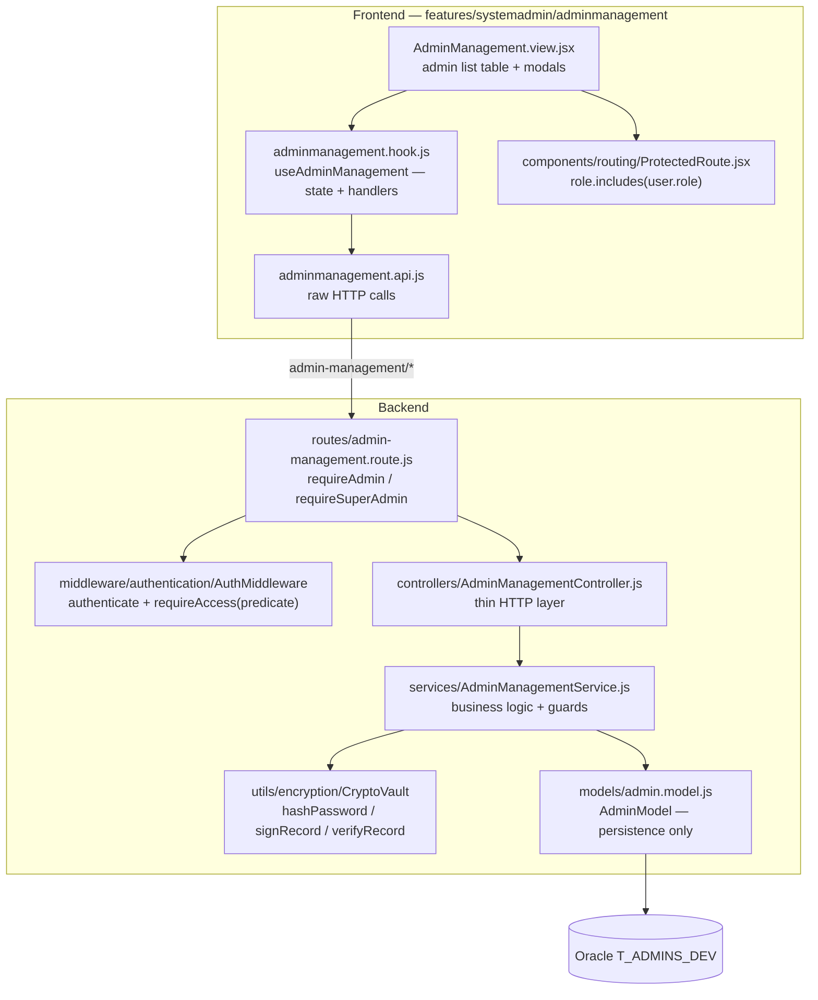
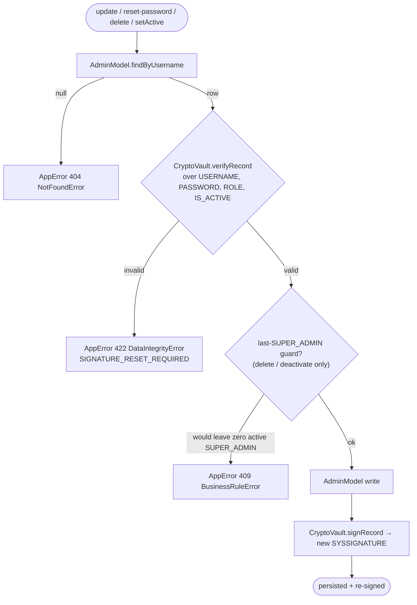
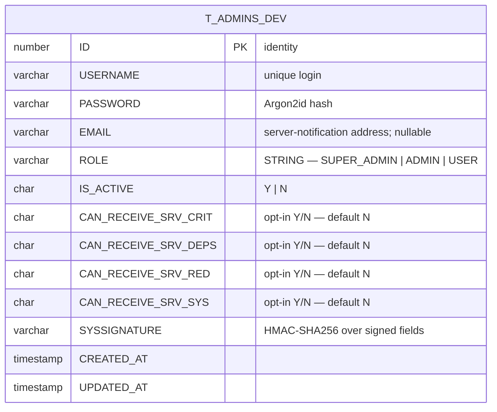

# Admin Management & RBAC — Technical Documentation

> **Scope:** how the CATHERINE template provisions privileged accounts and enforces role-based access control (RBAC) — the `T_ADMINS_DEV` table, its tamper-evident `SYSSIGNATURE`, the string role vocabulary (`SUPER_ADMIN` / `ADMIN` / `USER`), the admin-management CRUD path across both surfaces, and the `requireAccess(predicate)` mechanism that every protected route states inline.
> **Source:** `Backend/` (Node.js + Express v5 API) and `Frontend/` (React 19 + Vite SPA). Core is `Backend/src/controllers/AdminManagementController.js`, `Backend/src/services/AdminManagementService.js`, `Backend/src/models/admin.model.js`, `Backend/src/routes/admin-management.route.js`, `Backend/sql/03_alter_admins_notification_columns.sql`; the presentation layer is `Frontend/src/features/systemadmin/adminmanagement/` and `Frontend/src/components/routing/ProtectedRoute.jsx`.
> **Generated:** 2026-09-04; route table, create flow, guards and drift list re-checked against the code 2026-10-28. **Authority:** the code. Where `CLAUDE.md`, a JSDoc block, a source comment or a reference-view claim disagrees with the code, the code wins and the disagreement is recorded in [§7.5](#75-known-documentation-drift).
> **Rendering:** the ```mermaid fences below render in GitHub, GitLab, Obsidian and VS Code preview. A plain Markdown→PDF path (Chrome "print to PDF") will print them as code — pre-render with `npx @mermaid-js/mermaid-cli` if you need a PDF.

---

## 1. Overview

Privileged accounts live in a single Oracle table, `T_ADMINS_DEV`. Each row carries a `USERNAME`, an Argon2id `PASSWORD` hash, a **string** `ROLE`, an `IS_ACTIVE` flag (`'Y'`/`'N'`), an optional `EMAIL`, four `CAN_RECEIVE_SRV_*` notification opt-in flags, and an HMAC-SHA256 `SYSSIGNATURE` computed over a fixed field set. There is no numeric permission level stored on the row and no role table — the role **is** the string, and the canonical set the service accepts is exactly `["SUPER_ADMIN", "ADMIN", "USER"]` (`AdminManagementService.js` `VALID_ROLES`). Any other value is rejected with a `400` before it reaches the database (`AdminManagementService._validateRole`).

Every write to the table is guarded twice. First, the caller's `SYSSIGNATURE` is verified before the mutation runs — `AdminManagementService._fetchAndVerify` recomputes the HMAC over `{ USERNAME, PASSWORD, ROLE, IS_ACTIVE }` (`AdminModel.buildSignedFields`) and refuses the operation with a `422 DataIntegrityError` if the stored signature does not match. A row edited directly in the database therefore cannot be updated, deleted, or deactivated until its signature is repaired. Second, after every successful mutation the service re-signs the row with `CryptoVault.signRecord` so the signature stays valid across the change. The signature is namespaced to the table name (`SIGN_CONTEXT = "T_ADMINS_DEV"`) so it cannot be replayed against another table.

Authorization is not a fixed table either. `AuthMiddleware.requireAccess(predicate)` is a factory: each route states its own rule inline as a function of the decoded JWT's string `role`. The admin-management router mounts two predicates — `requireAdmin` (`role === "ADMIN" || role === "SUPER_ADMIN"`) applied to the whole router, and `requireSuperAdmin` (`role === "SUPER_ADMIN"`) layered on role change, reset-signature, revoke, delete, unblock-ip and permission flags (`admin-management.route.js:46-69`). Inside the service, `_assertCanManage` adds the per-target rule: an `ADMIN` may only create `USER` accounts and reset the password of a `USER` row that is not its own. On the frontend the equivalent gate is `ProtectedRoute role={[...]}`, whose check is a plain string membership test — `role.includes(user.role)` where `user.role` is `"SUPER_ADMIN" | "ADMIN" | "USER"` (`ProtectedRoute.jsx:54-55`).

Two safety invariants sit on top of the CRUD. The **last-super-admin guard** (`_withSuperAdminGuard` → `AdminModel.withLastSuperAdminGuard`) refuses with a `409` any delete, revoke, deactivation or demotion that would leave zero active `SUPER_ADMIN` rows. And **operators never choose passwords**: create and reset-password generate a temporary password server-side, store it wrapped with a 72-hour expiry (`TEMP_PASSWORD_TTL_MS`, `utils/encryption/adminTempPassword.js`), and email it to the account holder. The legacy `retainPassword` / `newPassword` / `changePassword` fields are refused with a `400`.

The frontend feature follows the template's three-layer split: `adminmanagement.api.js` (raw HTTP), `adminmanagement.hook.js` (state + handlers, `useAdminManagement`), and `AdminManagement.view.jsx` (presentation). The view renders an admin list table with per-row role, status, and integrity badges, and a set of confirmation modals for create / edit / reset-password / reset-signature / revoke / delete / permissions.

There is deliberately **no `/auth/register`** — accounts are provisioned only through this router (`Backend/CLAUDE.md` §Route Conventions).

---

## 2. Flow & Architecture

### 2.1 The layer map



The controller is a thin HTTP layer with no business logic and no direct DB access (`AdminManagementController.js` header) — it unpacks the request, calls the matching `AdminManagementService` method, and wraps the result in `sendSuccess`. All the rules — role validation, signature verify/re-sign, the guards — live in the service. The model only persists; the caller computes hashes and signatures and passes them in (`admin.model.js` header).

### 2.2 Creating an admin

```mermaid
sequenceDiagram
    autonumber
    actor SA as "SUPER_ADMIN / ADMIN"
    participant V as "AdminManagement.view.jsx"
    participant H as "useAdminManagement (hook)"
    participant A as "adminmanagement.api.js"
    participant MW as "AuthMiddleware.authenticate + requireAdmin"
    participant CT as "AdminManagementController.create"
    participant S as "AdminManagementService.addAdmin"
    participant K as "CryptoVault"
    participant M as "AdminModel"
    participant DB as "T_ADMINS_DEV"
    participant E as "AdminAccessEmailService"

    SA->>V: fill Add-Admin form (empId, role, optional flags / overrideEmail)
    V->>H: submitAddAdmin()
    H->>A: POST admin-management { empId, role, flags?, overrideEmail? }
    A->>MW: authenticated + role check
    MW->>CT: create(req)
    CT->>S: addAdmin({ username, role, caller, overrideEmail, flags })
    S->>S: _validateRole(role); refuse retainPassword/newPassword (400)
    S->>S: _assertCanManage(caller, "create") — ADMIN may create USER only (403)
    S->>M: existsByUsername(username)
    alt already an admin
        M-->>S: true
        S-->>CT: AppError 409 ConflictError
    else new
        S->>E: resolveRecipient(username, overrideEmail) — refuses before any write
        S->>K: hashAdminPassword(generated temp password)
        K-->>S: hash, wrapped with 72 h expiry
        S->>K: signRecord(SIGN_CONTEXT, {USERNAME,PASSWORD,ROLE,IS_ACTIVE})
        K-->>S: SYSSIGNATURE
        S->>M: insertAdmin({ username, password, role, sysSignature, isActive, email })
        M->>DB: insertOne (CAN_RECEIVE_SRV_* default 'N')
        S->>E: sendTemporaryPassword — never throws
        S-->>CT: { empId, empRole, emailDelivered, recipientHint, tempPasswordExpiresAt, ... }
    end
    CT-->>H: 201 { data: { empId, empRole, ... } }
    H->>H: invalidateCache + refetch + close modal
```

Three facts are load-bearing. The password is always generated server-side and emailed; the operator never sees or sets it, and a failed send is reported as `emailDelivered: false` rather than rolled back (the operator then uses Reset Password). Before the insert, every refresh token for that username is revoked, so a re-added username cannot inherit an earlier holder's session. And the four `CAN_RECEIVE_SRV_*` opt-in flags default to `'N'` — a newly created admin is subscribed to a notification channel only when the request sets that flag explicitly.

### 2.3 The signature gate on every mutating operation



`resetSignature` is the deliberate exception to the gate: it is the repair path. It fetches the row **without** verifying (`AdminManagementService.resetSignature`), recomputes the HMAC over the current field values, and writes the fresh `SYSSIGNATURE` — turning a `422`-rejected "tampered" row back into a usable one. Every other write goes through `_fetchAndVerify` first.

---

## 3. The admin table — `T_ADMINS_DEV`



The columns and their projection are in `admin.model.js` (`PROJECTION`, `insertAdmin`).

### 3.1 The signed field set — the tamper boundary

`SYSSIGNATURE` is an HMAC over **exactly** four columns: `{ USERNAME, PASSWORD, ROLE, IS_ACTIVE }` (`admin.model.js` `buildSignedFields`). This set is the tamper boundary. `EMAIL` and the four `CAN_RECEIVE_SRV_*` flags are deliberately **outside** it, so an operator can toggle a notification opt-in or set an address without re-signing the row — and, critically, an existing signature stays valid after those columns are added or changed (`AdminModel.setNotifyFlags` writes without recomputing). Widening the signed set is a breaking change that requires re-signing every row.

### 3.2 The additive migration — `03_alter_admins_notification_columns.sql`

A `T_ADMINS_DEV` created before `EMAIL` and the four opt-in flags were added to `01_schema.sql` will fail admin lookup with `ORA-00904: "CAN_RECEIVE_SRV_SYS": invalid identifier` — Oracle reports only the *first* invalid identifier, so that one error can hide all five missing columns (`03_alter_admins_notification_columns.sql` header). The migration is the fix: it is **additive only** — it never drops the table (re-running `01_schema.sql` would, destroying existing accounts and audit history) — and it is **idempotent**, checking `USER_TAB_COLUMNS` / `USER_CONSTRAINTS` before every `ADD`, so it is safe to run repeatedly and safe against an already-current table. Each opt-in column is added `CHAR(1) DEFAULT 'N' NOT NULL` (deny by default) with a matching `IN ('Y','N')` check constraint. Because none of the added columns are in the signed field set (§3.1), existing `SYSSIGNATURE`s remain valid and no row reads as tampered after the migration.

A fresh install does not need this file — `01_schema.sql` already declares every column.

---

## 4. The role vocabulary — roles are strings

The role is a **string**, never a number, everywhere it appears:

| Layer | Where | Values |
| ----- | ----- | ------ |
| Storage | `T_ADMINS_DEV.ROLE` | `SUPER_ADMIN`, `ADMIN`, `USER` |
| Service validation | `AdminManagementService.VALID_ROLES` | `["SUPER_ADMIN", "ADMIN", "USER"]` |
| JWT claim | `user.role` in the decoded token | the string above |
| Route predicate | `AuthMiddleware.requireAccess((user) => user.role === "SUPER_ADMIN")` | string compare |
| Frontend gate | `ProtectedRoute role={[ROLES.SADMIN]}` → `role.includes(user.role)` | string membership |
| Frontend constant | `App.jsx` `ROLES` | `{ SADMIN: "SUPER_ADMIN", ADMIN: "ADMIN", USER: "USER", ... }` |

The frontend `ROLES` object maps a short alias (`SADMIN`) to the wire string (`"SUPER_ADMIN"`); the *values* are the strings that must match `T_ADMINS_DEV.ROLE` and the JWT `user.role` (`App.jsx:62-68`). There is no numeric level involved in an admin-management authorization decision. (`authentication.md` documents a separate `userLevel` derived elsewhere for routes that choose to gate on a numeric threshold; admin-management does not.)

### 4.1 The `requireAccess` predicate mechanism

`AuthMiddleware.requireAccess(predicate, options)` returns a middleware that runs the predicate against the decoded JWT and either calls `next()` or raises an authorization error carrying `options.message`. The admin-management router uses it twice (`admin-management.route.js`):

```js
const requireAdmin = AuthMiddleware.requireAccess(
    (user) => user.role === "ADMIN" || user.role === "SUPER_ADMIN",
    { message: "Only ADMIN or SUPER_ADMIN accounts may access admin management." },
);

const requireSuperAdmin = AuthMiddleware.requireAccess(
    (user) => user.role === "SUPER_ADMIN",
    { message: "Only a Super Admin can do this." },
);
```

`requireAdmin` is applied to the entire router via `router.use(AuthMiddleware.authenticate, requireAdmin)`. Role change, reset-signature, delete, revoke-backup, revoke, unblock-ip and permission flags add `requireSuperAdmin` on their own path (delete, revoke and permissions also re-declare `authenticate`). Create and reset-password stay on `requireAdmin`; `_assertCanManage` decides per target.

---

## 5. The HTTP contract

All routes require a valid JWT (`AuthMiddleware.authenticate`) and, at minimum, `requireAdmin`. The `:empId` path parameter is the admin's `USERNAME` in this template.

| Method | Path | Guard | Body / Params | Result |
| ------ | ---- | ----- | ------------- | ------ |
| `GET` | `admin-management/search?q=` | `requireAdmin` | `q` (required) | `{ data: account[] }` — not cached |
| `GET` | `admin-management` | `requireAdmin` | — | `{ data: enrichedAdmin[] }` |
| `POST` | `admin-management` | `requireAdmin` + `_assertCanManage` | `{ empId, role, flags?, overrideEmail? }` | `{ data: { empId, empRole, emailDelivered, recipientSource, recipientHint, tempPasswordExpiresAt } }` (201) |
| `PUT` | `admin-management/:empId` | `requireSuperAdmin` | `{ role }` | `{ data: { empId, empRole } }` |
| `PATCH` | `admin-management/:empId/reset-password` | `requireAdmin` + `_assertCanManage` + credential-email limiter (5/min) | `{ overrideEmail? }` | temporary-password delivery result |
| `PATCH` | `admin-management/:empId/reset-signature` | `requireSuperAdmin` | — | `{ data: { empId } }` |
| `POST` | `admin-management/:empId/revoke-backup` | `requireSuperAdmin` | — | `.zip` stream + `X-Backup-Token` / `X-Backup-Token-Expires-At` headers |
| `POST` | `admin-management/:empId/revoke` | `requireSuperAdmin` | `{ backupToken }` | `{ data: { empId, isActive: "N" } }` |
| `DELETE` | `admin-management/:empId` | `requireSuperAdmin` | `{ backupToken }` | `{ data: { empId } }` |
| `POST` | `admin-management/security/unblock-ip` | `requireSuperAdmin` | `{ ip }` | `{ data: { ip, cleared } }` |
| `PATCH` | `admin-management/:empId/permissions` | `requireSuperAdmin` | `{ flags: { canReceiveSrvCrit?, canReceiveSrvDeps?, canReceiveSrvRed?, canReceiveSrvSys?, isActive? } }` | `{ data: { empId, flags } }` |

Each `GET /` row (`AdminManagementService.listAdmins`) is enriched with a per-row `signatureValid` boolean (the recomputed HMAC verdict), the masked address a reset would use, any outstanding temporary-password expiry, `isActive`, the four `canReceiveSrv*` flags, and timestamps.

`PATCH /:empId/permissions` accepts only the keys in `ALLOWED_FLAG_KEYS` (the four notification channels plus `isActive`), each `'Y'`/`'N'` (`_validateFlags`). Changing `isActive` re-signs the row; deactivating ends the account's sessions and runs the last-super-admin guard. The notification flags are outside the signed field set and are written without re-signing.

Revoke and delete both require a backup token from `revoke-backup`, bound to the target admin and the caller. Neither may target the caller's own account (`403`), and the guard runs before the token is consumed, so a refused operation does not burn it.

### 5.1 Caching

The router reads the admin list from the `adminList` cache store (TTL 600s) and invalidates it with a namespace wipe on every mutation, including reset-password, because each row shows its outstanding temporary-password expiry (`admin-management.route.js`). The `reset-signature` invalidation matters specifically because the cached `GET /` response embeds the computed `signatureValid` verdict per row — without it a repaired signature keeps showing as tampered until the TTL expires. `/search`, `revoke-backup` and `unblock-ip` neither read nor invalidate the cache.

---

## 6. Frontend feature — `features/systemadmin/adminmanagement`

The feature is the standard three layers:

- **`adminmanagement.api.js`** — raw Axios calls only, no state. Each function returns the raw response (`search`, `list`, `create`, `update`, `resetPassword`, `resetSignature`, `revokeBackup`, `revoke`, `remove`, `updatePermissions`).
- **`adminmanagement.hook.js`** — `useAdminManagement`, which owns the admin list (`useRequest`), the modal open/close state (add, edit, reset-password, reset-signature, delete, permissions), the per-form state, and the submit handlers. Each handler calls the API, surfaces success/error via toast or an inline `ApiErrorAlert`, invalidates the cache key, and refetches. The hook also loads the current user (`AuthMiddleware.isAuth()`) for the `SUPER_ADMIN` gate on the UI.
- **`AdminManagement.view.jsx`** — presentation only; imports the hook (never the API file). It renders the admin list table (username, role badge, status badge, integrity badge, actions) and the confirmation modals, wrapped in `ErrorBoundary`.

The frontend route mounts at `system/admin-management` and is gated `role={[ROLES.SADMIN]}` — i.e. `SUPER_ADMIN` only on the client (`App.jsx:243-244`). See [§7.5](#75-known-documentation-drift) for how that compares to the backend guard.

---

## 7. Security

### 7.1 Tamper-evident rows

Every write verifies `SYSSIGNATURE` first and re-signs after (§2.3). A row altered directly in the database is rejected at `422` on the next mutating operation until an operator explicitly repairs it via `reset-signature`. The list endpoint surfaces the same verdict per row so tampering is visible in the admin list without an attempted write.

### 7.2 Auth before everything

The router applies `AuthMiddleware.authenticate` and the role predicate via `router.use()` before any cache read or controller runs — cached admin-list data is never served without a valid session (`admin-management.route.js` positional rationale). The frontend `ProtectedRoute` is a convenience gate only; the backend predicate is the real boundary.

### 7.3 Temporary passwords, not shared defaults (CWE-1393)

There is no shared reset default. `ADMIN_DEFAULT_PASSWORD` is marked retired in `.env.example`; `AuthService` still checks it only so a legacy row holding that value is restricted until the password is changed. Create and reset-password issue a random temporary password with a 72-hour expiry and email it; the account must change it at first login (`403` pending password change, see `authentication.md`). A reset revokes every refresh token for the account before the password is replaced (fail closed, CWE-613).

### 7.4 Last-super-admin guard

Delete, revoke, deactivation through `/permissions` and demotion through `PUT` run inside `_withSuperAdminGuard`. For an active `SUPER_ADMIN` target this calls `AdminModel.withLastSuperAdminGuard`, which refuses with `409` (`LAST_ACTIVE_SUPER_ADMIN`) if the operation would leave zero active `SUPER_ADMIN` rows. The system can never be locked out of its own highest role.

### 7.5 Known documentation drift

Documentation-only observations where source comments, sibling files, or `CLAUDE.md` disagree with the authoritative code. **No code was changed.** These are flagged for the owning engineers to route:

1. **Frontend admin-management route is stricter than the backend router.** The client gates `system/admin-management` as `role={[ROLES.SADMIN]}` — `SUPER_ADMIN` only (`App.jsx:243-244`) — while the backend router allows `ADMIN` **or** `SUPER_ADMIN` on list, search, create and reset-password (`requireAdmin`, `admin-management.route.js:47-69`). An `ADMIN` is authorized by the API for `USER`-account work but cannot reach the page. This doc documents both guards as written. *Owner: React / backend.*

*Resolved since the 2026-09-04 pass (re-checked 2026-10-28):* the frontend `VALID_ROLES` now matches the backend (`adminmanagement.hook.js:27`); `GET /search` exists; `/permissions` accepts the four notification flags and `isActive`; the `App.jsx` header now describes `ROLES` as string keys; the route and API files no longer carry downstream-domain wording.
